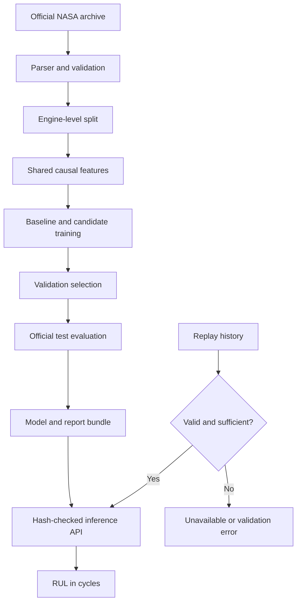
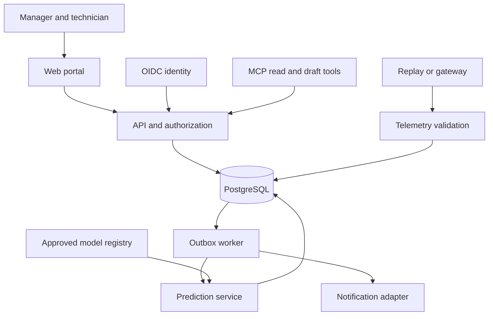
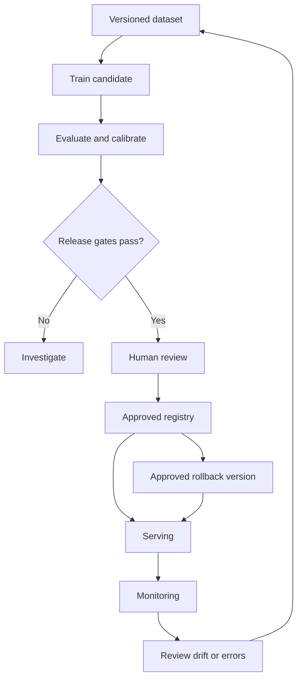

# Architecture and flows

## Implemented ML/backend path

## Target application — pending beyond experimental inference

## Target MLOps release — pending

No automatic physical machine control, maintenance approval or model promotion. No calibrated failure probability or component diagnosis in the present RUL model. Bad/missing input never becomes a green/zero-risk prediction.
