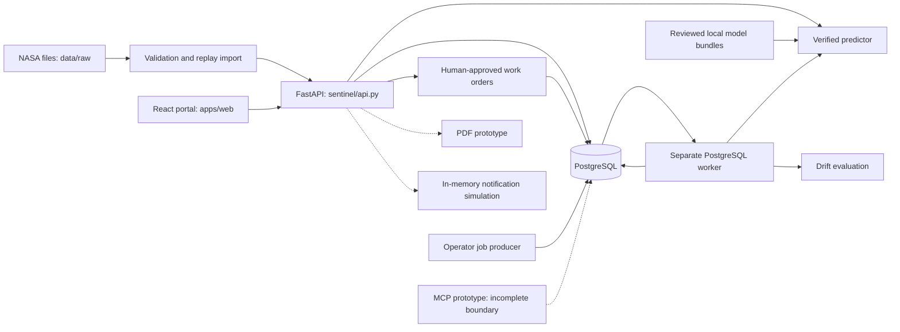

# Start here: Meridian Sentinel AI handoff

This pack explains the project and supplies the implementation evidence needed to go beyond an overview. It reflects a local working-tree snapshot dated 30 October 2026, including in-progress changes. It is not a production-readiness assertion.

## What to give another AI

For one-file upload, use `MERIDIAN_SENTINEL_AI_CONTEXT.md` in the repository root. It combines the main explanation, current gap register, AI instructions and generated technical reference. For exact implementation detail, upload `docs/MERIDIAN_SENTINEL_AI_HANDOFF.zip`, which also contains a sanitized source/documentation snapshot and manifest.

No finite context window can ingest an arbitrarily large project at once. If the AI cannot accept the complete file/archive, provide these in order:

1. `00_READ_FIRST.md` and `03_CURRENT_GAPS_AND_CONTRADICTIONS.md`.
2. `01_PROJECT_MASTER.md` and `04_AI_WORKING_INSTRUCTIONS.md`.
3. `02_TECHNICAL_REFERENCE.md` and `runtime.openapi.json` for interface/schema questions.
4. The relevant files from `source_snapshot/` for the requested change.
5. `05_VALIDATION_AND_PROVENANCE.md` and the applicable historical reports for evidence.

The manifest gives source paths and SHA-256 hashes, exported-file hashes, Git state, omissions and whether input files changed during export. Historical source documents remain historical even when included in this newly generated archive. Their assertions do not override the current gap register.

## Suggested prompt to paste with the pack

> Understand Meridian Sentinel using the attached handoff. Start with the current-gap register, then the master guide. Distinguish verified code, dated test evidence, incomplete prototypes, simulated behavior and planned features. Before changing a module, inspect its bundled source, contracts, migrations and relevant tests. Preserve tenant isolation, truthful unknown states, causal ML inputs, immutable evidence and human-only approval gates. Do not claim deployment, real notifications, certified maintenance procedures or successful tests without evidence. Respect uncommitted work. First explain the parts relevant to my request and identify any assumptions that the snapshot cannot resolve. My task is: [insert task].

## Scope and deliberate exclusions

The pack covers selected first-party source, tests, configuration templates/manifests, migrations, API contracts, operational docs, blueprint/planned/history docs, text evaluation reports and safe saved model metadata. An inventory records selected-but-not-embedded file paths and reasons. Module/function/route/test catalogs and complete migration sources supplement the narrative. `ARTIFACT_INVENTORY.json` records local data/model artifact names and sizes without including raw data or weights.

Actual secrets, environment files, TLS keys, cookies, private logs, local databases, installed dependencies, model binaries, raw datasets, prediction-row exports, compiled frontend bundles and older ZIP/media exports are deliberately not copied. These are not needed to explain the architecture and must not be uploaded indiscriminately. Their categories and reconstruction/prerequisite roles are documented. Sanitized source is reference material; redaction may make some snippets non-executable.

This is comprehensive within the declared scope, not a promise that undocumented external infrastructure or every future change is known. The archive is not a runnable installation. Run-time credentials, data, model artifacts, identity-provider configuration and deployment state remain separate controlled inputs.

## Most important snapshot warnings

- `sentinel/train.py` is empty; current test collection fails in three dependent modules.
- MCP code exists but lacks a verified tenant identity boundary and has service/field mismatches.
- Notification dispatch is an in-memory simulation that does not make outbound HTTP calls.
- PDF export code exists, but current wiring/fields are inconsistent and no digital signature is implemented.
- New job HTTP submission uses the wrong authenticated-principal key and omits the normal CSRF check.
- New planning modules are seeded in-memory demos with readiness/service-contract gaps, not durable warehouse or staff scheduling integrations.
- The classifier card is now mounted; old notes claiming it is not mounted are stale.
- Earlier 27/35-test reports describe earlier targeted runs, not a green current full suite.
- The durable CLI worker/fleet implementation is distinct from the newer incomplete HTTP wrapper.
- Application deployment, running daemon, physical connectivity and certified operational use are not established by this documentation task.


---

# Current gaps, contradictions and evidence boundaries

This register supersedes broad historical status claims for the inspected working-tree snapshot. Findings are static inspection unless a specific executed check is stated. It does not authorize an AI to fix unrelated work automatically.

| ID | Observation | Evidence location | Practical consequence / next verification |
|---|---|---|---|
| G01 | `sentinel/train.py` is zero bytes and locally modified | File size; current pytest collection | `metrics` and `weights` imports fail. Resolve ownership/history of the change before restoring. Do not overwrite another person's work. |
| G02 | Current test collection is not green | `pytest --collect-only -q`: 286 collected, 3 collection errors, exit 2 | No claim of a current full passing suite. Affected modules: all-subsets training, classification and RUL experiments. |
| G03 | MCP has no verified principal/membership binding | `sentinel/mcp_server.py`, direct organization ID to database transactions | Tenant IDs supplied as arguments are not authorization. Add a reviewed identity/scope boundary before exposing data. |
| G04 | MCP calls service APIs that do not match current modules | Registry is a `Registry` class; ingestion exports `history`/`quality`; work orders export draft functions | Advertised tools cannot be assumed executable. Tests currently cover handshake/list/unknown tool, not actual data access/drafting. |
| G05 | MCP evidence field names differ from prediction output | Uses predicted_rul/priority/cutoff_cycle/model_bundle_sha256 versus persistent-service fields | Field translation needs correction and integration tests. Hardcoded assistant actor is not a provisioned authorized principal. |
| G06 | Notification code simulates successful delivery | `notifications/dispatcher.py`: no network sender; writes HTTP 200 into local record | Do not describe alerts as sent, delivered, durable or receiver-acknowledged. |
| G07 | Notification state is process-local | Module dictionaries for subscribers, secrets, cooldown and history | Lost on restart; inconsistent across processes; no durable queue linkage. Cooldown can suppress events even before a subscriber delivery succeeds. |
| G08 | New notification mutations omit CSRF verification | `notifications/api.py` context helper authenticates/authorizes only | Align with established write boundaries and test rejection cases. URL field is a plain string despite an unused HttpUrl import. |
| G09 | Job HTTP submit uses `actor['id']` | `jobs/api.py` versus `auth/context.py` returning `user_id` | Submission path is inconsistent; do not infer CLI validation covers it. Random source IDs also prevent caller-controlled retry deduplication. |
| G10 | Job HTTP writes omit explicit CSRF check and validated lower limit | `jobs/api.py` | Add reviewed input limits, write boundary and idempotency semantics. The API predictor may be multi-subset while CLI fleet uses the configured primary. |
| G11 | PDF API invokes nonexistent registry helper | `audit/api.py` uses module-level get_machine; registry implementation is class-based | Route registration is not a successful downloadable dossier. |
| G12 | PDF schema defaults can falsify evidence | `audit/dossier.py` uses legacy prediction keys and defaults RUL to 0.0 | Map real fields, preserve unknowns and test unavailable states before use. Catch-all fallbacks can hide errors. |
| G13 | PDF is not cryptographically signed | Matplotlib drawing, printed hashes and blank signature lines | “Cryptographic”/“tamper-evident” docstrings are unsupported. No PDF digital-signature/certificate verification implemented. |
| G14 | PDF sensor/history representation needs validation | First 300 observations, static sensor labels, AMM/FAA-style wording | Confirm cutoff alignment, units and procedure provenance; do not equate a template with certified instructions. |
| G15 | New import dependency not clearly declared | API imports audit module; audit imports matplotlib; direct requirements omit it | Verify a clean dependency install and startup. Local installed packages are not reproducibility evidence. |
| G16 | Current API discovers known candidate models | `inference.py: load_multi_predictor`; API construction | Old “only FD001 serves” / “candidates never loaded” statements can be stale. Record actual configured/loaded identities. |
| G17 | Worker and API may have different subset coverage | Queue dispatcher uses primary Predictor; API uses MultiPredictor | Document/test intended behavior before aligning them; do not auto-promote candidates to make outputs match. |
| G18 | Classifier card is now mounted | `MachineDetailPage.tsx` imports/renders LifetimeStageCard | Earlier handoff notes about missing page integration are superseded. Horizon probabilities/physical diagnosis remain absent. |
| G19 | Feature descriptions conflict | `features.py`: last/mean/std/slope = 96; some prose says min/max | Current code/schema govern. Offline engineered97 is a distinct feature family. |
| G20 | Root summaries lag several changes | README still says seven migrations, planned workers, missing EDA | Current head is 0009; queue/fleet exist; offline EDA/selection exists but shared training import is currently broken. |
| G21 | “Active” UI rows can be static candidate descriptors | `ModelMonitoringPage.tsx` | Read backend model-info and activation evidence before claiming an artifact is active. |
| G22 | Authentication prose and proxy code differ | Old auth doc says forwarded headers disabled; current serve/public entrypoints enable them | Reconcile proxy topology and trust; neither old prose nor local HTTPS assumptions suffice. |
| G23 | Current schema is not a live schema inspection | `db.REVISION`, migration files | No application migration query was run during documentation. Code head does not prove deployment head. |
| G24 | Job worker deployment is not demonstrated | Compose has no worker service; earlier reports explicitly did not install one | Start/manage it only through an authorized rollout. Add health/monitoring/supervision intentionally. |
| G25 | RLS/distributed auth controls remain incomplete | Auth service scoping, process-local limiter, migration review | Existing role boundaries do not establish OIDC/SAML, RLS or Redis limiting. |
| G26 | Live integrations and durable planning remain open | No live MQTT/OPC-UA/CMMS adapters; new planning modules use seeded in-memory catalogs/rosters | Require real external contracts, persistence, provenance and human gates. |
| G27 | Maintenance memory is proposed | Conversation and master guide section 29 | No outcome/verification/case-retrieval schema or measured plant efficacy exists yet. |
| G28 | Planning uses hardcoded demo stock, prices and staff | `planning/inventory.py`, `planning/shifts.py` | Not warehouse/HR connectivity, real pricing or certified qualification evidence. State is lost on restart. |
| G29 | Readiness calls a nonexistent service helper | `planning/service.py`: work_orders_service.get_work_order | Repair integration and test against real tenant-scoped work orders. |
| G30 | Readiness can contradict its blockers | Off-duty assigned technician adds blocker without setting is_ready false; qualification matching unions candidates across tasks | Do not treat READY_FOR_EXECUTION as clearance. Require complete task/parts/assignee coverage tests and preserve approval gates. |
| G31 | Planning PATCH routes omit normal CSRF enforcement | `planning/api.py` | Apply established mutation boundary; model actual roster memberships, clock-based shifts and inventory reservations. |

## Benchmark contradictions that are not necessarily bugs

MAE 16.79, 12.45 and 16.14 for FD001 belong to different historical comparisons/populations. Do not pick the smallest number as the product accuracy. Combined classifier row accuracy 90.2457% and engine-balanced accuracy 92.72% use different aggregation. All-cycle, last-cycle and fixed-window evaluation differ. A rejected cap-125 candidate remains rejected unless new reviewed evidence changes that decision.

The same applies to test counts: historical suites with 159 passed/125 skipped, earlier targeted 27/35 passes and today's 286 collected/3 collection errors are different facts. Collection is not execution; skips are not passes. This pack retains those distinctions.

## Prioritized response to these findings

First establish a coherent, importable working tree and ownership of the empty trainer change. Then validate the core API in a clean dependency environment. Repair prototype auth/service contracts before connecting external users or notification networks. Validate PDF evidence and labeling before compliance presentation. Only then extend deployment, scheduler, ingestion or real integrations. This is a suggested dependency order, not an instruction to modify the whole project without a concrete user request.


---

# Meridian Sentinel: complete project understanding guide

Snapshot date: 30 October 2026, user timezone Asia/Calcutta.
Scope: the local working tree of Meridian_Sentinel_Full_Architecture, including uncommitted additions.
Audience: a new AI assistant, developer, reviewer, reliability engineer or project stakeholder.

This is an engineering handoff, not a claim of production certification. The bundled source, route catalog, migration inventory, tests and original documents provide the detail behind this narrative. Read `03_CURRENT_GAPS_AND_CONTRADICTIONS.md` before acting on historical documentation. A file being present does not establish that its advertised capability works.

## 1. What the project is

Meridian Sentinel is an experimental predictive-maintenance application centered on simulated turbofan-engine degradation from NASA C-MAPSS. It joins validated sensor histories, remaining-useful-life regression, maintenance priority, traceable predictions, organization-scoped operational records, human-approved work orders, model monitoring and a React portal.

The practical user journey is: identify an asset, inspect its sensor history, obtain a model estimate, understand the estimate's provenance and limitations, create an inspection draft, obtain authorized human approval, assign a technician, record execution and retain the evidence. The prediction is decision support. It is not a diagnosis, certified maintenance instruction, autonomous actuator command or guarantee of failure time.

The broader product ambition is industrial asset reliability. The currently implemented data/model contract is much narrower: C-MAPSS simulated turbofan observations. Registering a physical machine does not make that machine compatible with the trained engine models. No measured real-plant downtime savings or physical fault-localization accuracy has been established by the work documented here.

### People and decisions

| Persona | Main questions | Relevant surfaces |
|---|---|---|
| Plant manager | Which assets need review? Who should inspect? Can a draft be approved? | Fleet priorities, evidence, work orders, assignments |
| Technician | Which approved task belongs to me? What evidence and history are available? | Machine detail, assigned work orders, transitions and notes |
| Organization administrator | Who belongs to this organization and with what permissions? | Membership management, registry, tenant access |
| ML operator | Which artifact is loaded? What was its evaluation? Has input distribution changed? | CLI, model registry, deployments, monitoring |
| Viewer | What is happening in assets I am allowed to inspect? | Read-only tenant-scoped views |
| Future assistant | What evidence can I retrieve and what draft can I propose? | Proposed secure MCP read/draft boundary; current prototype has gaps |

### Product requirements and acceptance mapping

FR-01/AC-01: verified asset and sensor registry. FR-02/AC-02: validated, deduplicated telemetry. FR-03/AC-03: risk-ranked fleet with unknowns separate. FR-04/AC-04: sensor history, evidence and provenance. FR-05/AC-05: RUL and horizon classification supported by held-out evaluation. FR-06/AC-06: draft/review/assign/execute workflow. FR-07/AC-07: roles, tenant isolation and audit history. FR-08/AC-08: repeatable, explicitly labeled replay. FR-09/AC-09: controlled model release and rollback. FR-10/AC-10: incident evidence and timelines. FR-11/AC-11: technician/parts-aware planning. FR-12/AC-12: read-first, draft-only assistant tools.

The PRD marks FR-01 through FR-08 P0, FR-09 through FR-11 P1, and FR-12 P2. A later gap table called some items P1 that are P0 in the PRD. Preserve this discrepancy rather than silently rewriting requirements. FR-10 does not by itself certify a signed compliance PDF; that is an extension to evidence/timeline functionality.

## 2. How to determine truth

Use this precedence when sources disagree:

1. Current executable source and schema, with meaningful tests for the exact behavior.
2. Fresh inspection and executed validation for this snapshot.
3. Dated test reports and artifact manifests, scoped to their recorded environment and revision.
4. Operational manuals and current feature contracts.
5. Root README and implementation summaries, which can lag development.
6. `docs/planned`, `docs/blueprint`, `docs/history`, reference SQL and production-target OpenAPI: intent or history, not automatically implemented behavior.

Neither a commit title, a module docstring, a screenshot nor a test name proves end-to-end functionality. A test passing against a dummy database establishes only what that test exercises. A SHA-256 printed in a PDF is not a digital signature. A local dictionary called a registry is not durable persistence. A file named `train.py` is not a working trainer when its contents are empty.

The repository has recently changed outside this conversation. This pack records the inspected working tree, including those changes, without overwriting them. Earlier conversational assessments saying “no MCP,” “no PDF,” “no job HTTP API,” or “classifier card not mounted” are no longer accurate descriptions of file presence. Conversely, those newer files do not justify declaring the features complete.

## 3. Architectural shape

The intended architecture is a modular monolith plus a separate worker. Business logic resides in Python modules under `sentinel/`; it is not spread across implemented independent services. FastAPI composes routers. PostgreSQL stores organizational and operational state. React/TypeScript provides the portal. Model artifacts are local files verified by hashes. The durable job queue uses PostgreSQL, not Celery or Redis.



The database is the persistence boundary. HTTP handlers normally open a transaction, resolve a session principal, verify tenant permissions, validate input, invoke a service and commit. Write paths in established modules also enforce CSRF and serialize relevant tenant/state changes. New prototype routers do not uniformly follow these rules; see the gap register.

Worker handlers use the worker-supplied SQLAlchemy session. Their domain writes and completion acknowledgement commit together. External side effects cannot inherit this database-only atomicity. A future webhook sender must use durable delivery records and receiver-side idempotency, not assume a local transaction makes HTTP delivery exactly once.

## 4. Repository navigation

| Location | Meaning |
|---|---|
| `sentinel/` | Runtime Python package: configuration, inference, API, auth, database, registry, ingestion, predictions, work orders, MLOps, jobs and newer prototypes |
| `apps/web/` | Canonical React/TypeScript/Vite application; pages, components, API client, auth context, tests |
| `database/migrations/` | Executable Alembic revision chain; current head is `0009_fleet_jobs` |
| `database/reference/schema.sql` | Broader future database design; must not be executed as the current schema |
| `packages/contracts/` | Experimental OpenAPI and separate production-target contract; distinguish exported schema from functioning behavior |
| `tests/` | Backend behavioral, security, PostgreSQL, ML, deployment and prototype tests |
| `scripts/` | Native PostgreSQL helper, launchers, replay/demo population, experiments, deployment and verification helpers |
| `backend/`, `frontend/`, `infra/` | Container definitions, entrypoints, reverse proxy and deployment scaffolding |
| `config/` | Configuration guidance and placeholders; real TLS material stays private |
| `docs/` | Current domain manuals plus blueprint/planned/history subtrees |
| `reports/` | Dated validation/evaluation evidence; historical claims must retain date and scope |
| `runs/` | Ignored model artifacts, manifests and experiment outputs; not bundled as model binaries |
| `data/raw/` | Ignored NASA datasets, not application PostgreSQL telemetry |
| `.runtime/` | Local cluster/state/caches/logs/private environment files; not portable source |
| `services/` | Architectural placeholder rather than proof of implemented microservices |
| `archives/`, `ml_package/`, `resources/` | Older exports, supporting media and packages; not canonical runtime |

The generated technical reference lists every included file, its symbols, tests, source hash, routes, CLI arguments and migration content. The sanitized source snapshot preserves repository-relative paths so another AI can inspect exact implementations.

## 5. Technology and dependency boundaries

Python source uses FastAPI, Uvicorn, Pydantic, SQLAlchemy, psycopg and Alembic. ML code uses NumPy, pandas, scikit-learn and XGBoost. Local authentication uses Argon2id and email-validator. Tests use pytest, HTTPX/TestClient and actual PostgreSQL for integration behavior. The frontend uses React 18, TypeScript, Vite, Vitest, Testing Library and Lucide icons.

Exact declared versions belong to `requirements.txt`, platform lock files and `apps/web/package.json`/lockfile; the pack includes them. Local historical validation used Python 3.12 and PostgreSQL 18. Docker Compose currently specifies PostgreSQL 17 Alpine. Do not confuse a locally installed package/version with a dependency declared for reproducible installation.

The PDF module imports matplotlib at application import time. Matplotlib is not listed in the inspected direct requirements file. It may be installed locally, but clean-environment startup needs dependency verification. The new master document does not silently modify requirements to conceal this mismatch.

## 6. Configuration and secrets

`sentinel/config.py` owns configuration validation. Explicit overrides beat process environment, which beats the chosen `.env`, then defaults. Blank overrides do not silently fall back. Model configuration binds a directory and expected manifest digest. `SENTINEL_RELEASE_POINTER` can instead bind both through a reviewed local release pointer; pointer resolution is relative to the selected environment file.

Core variable families:

| Family | Variables / meaning |
|---|---|
| Experimental inference | `SENTINEL_API_KEY`, `SENTINEL_MODEL_DIR`, `SENTINEL_BUNDLE_SHA256` |
| Classifier | `SENTINEL_CLASSIFIER_DIR` |
| Server | `SENTINEL_HOST`, `SENTINEL_PORT`, `SENTINEL_CONTAINER_MODE` |
| PostgreSQL | `DATABASE_URL`; psycopg PostgreSQL URL, not arbitrary SQLite substitution |
| Auth | `SENTINEL_AUTH_ENABLED`, `SENTINEL_AUTH_LOCALHOST`, `SENTINEL_AUTH_ORIGINS` |
| Session/limits | `SENTINEL_SESSION_SECONDS`, `SENTINEL_LOGIN_LIMIT`, `SENTINEL_LOGIN_WINDOW`, `SENTINEL_LOGIN_GLOBAL_LIMIT` |
| Releases | `SENTINEL_RELEASE_POINTER` |
| Tests | `SENTINEL_TEST_ADMIN_URL`, explicit disposable-database authority |
| Containers | `POSTGRES_PASSWORD`, `SENTINEL_RUNTIME_PASSWORD`, gateway bind/port, TLS configuration |
| Public demo | `MIGRATION_DATABASE_URL`, provider origin/port variables; owner URL consumed for migration then replaced with runtime URL |
| Frontend development | `VITE_BACKEND_URL` or `BACKEND_URL` for development proxy configuration |

An exhaustive identifier inventory appears in the technical reference. No actual environment values, passwords, cookies, CSRF tokens, webhook secrets, TLS private keys or database contents are part of the pack. File hashes and model digests are integrity identifiers, not credentials. Placeholder configuration is not a deployable secret store.

## 7. Dataset semantics

Canonical C-MAPSS observations have 26 numeric columns in exact order: `engine_id`, `cycle`, three operating settings and 21 sensor channels. Settings are `setting_1` to `setting_3`; sensors are `sensor_01` to `sensor_21`. Engine identities are not globally unique across subsets or train/test partitions.

FD001 and FD003 describe one operating condition; FD002 and FD004 include multiple operating conditions. Dataset-level degradation modes are not per-observation confirmed diagnoses. The model must not infer “Fan fault” merely because an asset belongs to a subset with multiple simulated failure modes.

Training trajectories run to the simulation's failure endpoint. Official test trajectories stop earlier, and the separate RUL file supplies remaining cycles at the final observation. For offline labels, total lifetime can be reconstructed as final observed cycle plus official final RUL. Future lifetime/labels are permitted in supervised target construction, never as input features for the same prediction.

RUL is expressed in operating cycles. Do not convert it to hours, calendar days or due dates without a separately justified operational model. Replay timestamps are ingestion/system timestamps or explicitly synthetic display times, not actual sensor acquisition timestamps. The canonical persisted replay observation accepts `observed_at=None`.

## 8. Data validation and import

`sentinel/data.py` validates exact column order, nonempty frames, finite numeric values, positive integral engine/cycle IDs, unique engine/cycle pairs and consecutive histories within each engine. File parsing uses whitespace-separated data. Rows may be sorted into canonical order; invalid readings are rejected, not silently dropped or replaced by zero.

The offline parser's complete-trajectory rules differ from incremental persisted ingestion. A stored replay can temporarily have missing cycles because batches may arrive separately; quality endpoints expose gaps and the prediction layer rejects incomplete windows. Do not mistake that for a permissive offline training parser.

Persisted ingestion uses strict Pydantic schemas: extra fields forbidden, exactly three settings and 21 sensor readings, finite numbers, positive integer cycle IDs and at most 500 observations per batch. One batch cannot contain a repeated cycle. Its source includes dataset, subset, partition, engine ID, source-file SHA-256 and schema version 1. Idempotency keys are bounded to 128 characters with the permitted alphanumeric/dot/underscore/colon/hyphen pattern.

`sentinel/ingestion/service.py` checks the registered machine's immutable source binding and source version. It scopes stream, observation and batch operations to the tenant/machine. Canonical payload hashing supports replay of identical requests and rejects conflicting reuse. The transaction commits the coherent batch state or rolls back. Source provenance is retained. Importing data does not implicitly perform inference, approve work or send real alerts.

History endpoints use bounded windows/pagination. Quality queries have a maximum requested range of 10,000 cycles. Unknown channel metadata stays unknown. The channel catalog exposes logical input positions; it does not invent physical sensor names, units, components or a hardware mapping.

## 9. Asset and sensor registry

The registry models tenants, machines, sensors and time-bounded sensor installations. A machine has a tenant-scoped asset code, identity, type, descriptive/location fields, lifecycle status, criticality, source binding and version. Lifecycle values are `active`, `inactive`, `archived`; they are not health predictions. Legacy operating status is a separate database concept.

Replay source binding identifies dataset/subset/partition/engine and, where required, source-file hash. Changing a trajectory/version must not mutate historical identity. Physical device registration is separate from having a working physical ingestion adapter. Sensors can be active or retired. Installations map a sensor/channel to a machine over an effective interval; overlapping conflicting mappings are guarded by database constraints and service validation.

`sentinel/registry/service.py` exposes a `Registry` service class. New modules incorrectly calling nonexistent module-level helpers must be treated as broken integrations rather than assumed aliases. Registry operations use tenant-scoped queries, permissions and audit records. Cross-tenant IDs are normally hidden behind 404 responses.

## 10. Serving feature contract and regression

The historical serving feature schema is `cmapss-trailing-v1`. For 24 input channels (three settings plus 21 sensors), it calculates last value, trailing mean, population standard deviation and linear slope. That is 24 × 4 = 96 features, ordered by statistic and channel. The standard baseline window is 30 cycles. The code does not compute min/max in this 96-feature representation even though some older prose describes them.

Features use only current and previous observations. `make_windows` excludes histories shorter than the requested window. Training contributions are bounded per engine; validation uses fixed truncations; final-test mode uses the last eligible window per engine. Engine partitions use deterministic seed 42 with roughly 70% train, 15% validation and 15% calibration-reserved. Splitting correlated rows randomly is not an equivalent evaluation.

`Predictor` verifies the expected `bundle.json` digest, exact feature schema/order, subset/window constraints and model/report hashes before loading. XGBoost uses native JSON; Ridge/constant artifacts use explicit numeric JSON. Untrusted pickle/joblib loading is not an accepted serving mechanism. Prediction rejects incompatible input and nonfinite output; nonnegative RUL is returned in cycles. Failure probability and intervals remain unavailable in this serving contract.

`MultiPredictor` routes by subset. The current API loader includes the configured primary bundle and attempts known, hash-pinned candidate directories for other subsets when available. This is a material difference from older statements that candidates never affect serving. The fleet worker deliberately loads only the configured primary `Predictor`, not candidate discovery. Thus API and worker subset coverage can differ. Always inspect loaded model identity rather than trusting a static “ACTIVE” table.

### Current training regression

At the documented snapshot, `sentinel/train.py` is zero bytes and modified relative to Git. Historical trainer descriptions describe earlier functionality, not runnable current contents. `all_subsets_training.py` imports `metrics` from it and `rul_experiments.py` imports `weights`; these imports currently fail. Do not run training or claim its tests pass until this is resolved with the owner of the change. This documentation task did not restore or overwrite the file.

## 11. Offline all-subset experiments

`sentinel/all_subsets_training.py` contains a separate experiment pipeline with validation, training-only EDA, feature alternatives, selection, classification and regression. Its code is present, but execution is currently blocked by the empty shared training module.

Raw25 features consist of cycle plus 24 input channels. Engineered97 adds trailing mean and population standard deviation over up to ten cycles plus five-cycle differences for all 24 channels. Early-history derived-statistic initialization is explicitly defined; it is not raw missing-sensor imputation. Feature extraction is grouped by engine. Combined identities retain subset prefixes.

Training-only feature selection removes constants, filters strongly correlated later columns above 0.995, ranks survivors using a 64-tree ExtraTrees classifier and retains at most 40 features. Raw and selected engineered representations are compared on validation data. Importance is not causal fault attribution.

Five Random Forest classification scopes exist in the recorded experiment: four subsets and COMBINED. Each compares two representations; the documented forest uses 300 trees, depth 15, max_samples 0.4, seed 42, two threads and engine-balanced fitting. Four separate XGBoost regression scopes compare feature alternatives with uncapped RUL targets. The bounded experiment budget is 10 forest fits, five selectors and eight XGBoost fits.

Classification labels are early lifetime at <=60% elapsed total lifetime, middle at >60% to <=80%, and late at >80%. They are not Healthy/Warning/Critical physical diagnosis labels, not P(failure within 30 cycles), and not calibrated probabilities. Raw25 won four recorded classifier scopes; engineered-selected won FD003. Official test data is used after frozen selection, and historical repeated benchmark inspection is acknowledged.

Forest exports use numeric NPZ arrays and JSON metadata with expected digests and `allow_pickle=False`. Reload parity is tested. Experiment artifacts are not automatically compatible with the 96-feature serving bundle. Model files and row-level prediction exports stay in ignored run directories.

## 12. Model results: retain evaluation context

The following are historical reported measurements, not reruns during this documentation task:

| Experiment | Recorded result | Essential caveat |
|---|---|---|
| Historical FD001 baseline | README reports official-test MAE 16.79 cycles | Use bundle report and its eligibility/protocol; not every later comparison uses the same engines |
| Four-subset candidates, 27 Oct | MAE 16.14 / 21.87 / 22.07 / 29.98 for FD001–FD004; 100 / 253 / 100 / 237 eligible engines | 17 short histories excluded; not directly comparable to all-cycle/startup experiments |
| Cap-125 comparison, 28 Oct | Candidate 13.58 versus baseline 12.45 MAE on 88 common engines | Candidate rejected; differing headline baseline is explained by matched evaluation population |
| Combined lifetime classifier, 30 Oct | 90.2457% row accuracy, macro F1 0.8132; 104,897 test observations | Correlated rows, lifetime stages, uncalibrated scores; not failure prediction accuracy |
| Combined classifier engine-balanced result | 92.72%, descriptive bootstrap interval 92.11%–93.33% | Different aggregation from row accuracy; not per-engine confidence |
| All-subset XGBoost regression, 30 Oct | MAE 18.21 / 20.04 / 23.60 / 28.76; RMSE 24.86 / 27.55 / 33.93 / 38.37 | Final-cycle evaluation across 100 / 259 / 100 / 248 engines; supports partial startup windows |

The supplied external notebook's 90.5069% uses a different recipe and is not proof that one implementation is better. Do not pool or compare metrics without matching target definitions, engine populations, feature windows, weighting, split and test reuse. Offline conformal/uncertainty studies do not mean a live calibrated interval is served. The pack retains the experiment reports for exact context.

## 13. Lifetime-stage API and UI

`sentinel/classification.py` implements a read-only organization/machine endpoint ending in `/lifetime-classification`. It uses a fixed trusted manifest and numeric forest representation, checks input dimensionality and finite values, and evaluates a stored observation at or before an optional cutoff. Session membership and replay-read permission are checked.

Responses identify the machine, stream, source cycle, requested cutoff, model version/hash, class ID, lifetime-stage label, replay mode and interpretation. Classification is not persisted as a maintenance mutation. The returned label policy explicitly distinguishes lifetime stage from physical health and failure probability. Missing observations and missing/incompatible model artifacts produce unavailable/error behavior rather than invented predictions.

The current `MachineDetailPage.tsx` imports and mounts `LifetimeStageCard`. Earlier notes that it was unmounted are superseded. The card has a service client and a component test. That does not validate horizon classification, calibrated risk or component localization; those remain absent.

## 14. Persistent predictions and priorities

`compute_and_persist` retrieves the tenant-scoped machine, verifies source/model compatibility, resolves replay stream and requested cutoff, extracts the trailing window, checks exact consecutive cycles, runs inference, applies priority policy and persists provenance. Missing history stays unavailable. It does not fill sensor gaps or allow future observations into the prediction window.

Stored prediction fields include machine/tenant/stream, actor/request IDs, requested/observed cutoff, input range/count/digest, model version/digest/bundle digest, inference and feature-schema versions, status/reason, RUL, priority policy/band and latency. The API adds display semantics such as cycles, experiment-only release status and unavailable probability/interval/diagnosis.

Prediction uniqueness is scoped by tenant, machine, stream, requested cutoff, input digest, model digest and inference version. Identical input reuses the prior result. A backfill changes the digest and can produce a new result at the same cutoff. This is why work-order stale-evidence checks cannot rely solely on a larger cycle number.

Priority policy `v1-experimental`: available RUL <=15 cycles is urgent, <=35 high, <=75 medium, otherwise low. Any unavailable result maps to unknown. These are experimental simulation thresholds, not manufacturer-approved limits. “Unknown” is not low risk. A completed job can contain unavailable predictions; queue success means processing succeeded, not that every machine is healthy.

The prediction service records completed/failed prediction audit events. Prediction failure in this context may mean insufficient or incompatible data, not a failed machine. UI copy and downstream reporting must preserve this distinction.

## 15. Authentication, sessions and permissions

Local email/password authentication is implemented. Password hashes use Argon2id; email normalization is explicit and does not invent provider-specific alias rules. Users are global identities; memberships bind users to tenants with roles. Organization administration does not imply platform/model-release authority.

Sessions are opaque random tokens in HttpOnly, host-only, SameSite=Lax cookies; only token digests are stored. Secure mode uses `__Host-meridian_session`; explicit localhost mode uses `meridian_session` and permits loopback HTTP. Sessions have absolute expiry. Logout, password change and user disable revoke sessions. Last-usable-admin protection prevents stranding an organization.

Login requires JSON, allowed Origin and `X-CSRF-Protection: 1`. Mutating established application routes require `X-CSRF-Token`, checked against a session-bound digest, plus origin checks. Browser tokens stay in memory, not URLs/localStorage. Credentialed CORS uses configured origins rather than `*`. New job/notification prototype write routes omit the established CSRF call and must be reviewed before use.

Permissions are defined in `sentinel/auth/permissions.py`. All four roles can read core tenant views. Viewers cannot create predictions or maintenance drafts. Technicians can request predictions and drafts, and execute/note eligible assigned work orders. Plant managers and admins can approve, assign, update and cancel. Only organization admins manage memberships. The exact permission sets are included in the source snapshot.

Login throttling is in-process and resets on restart; it is not distributed Redis rate limiting. OIDC/SAML SSO, database RLS and broader enterprise security controls remain work. Existing tenant checks and least-privilege deployment roles are valuable but not equivalent to full production hardening.

## 16. HTTP boundaries and errors

`http_support.py` caps request bodies at 1 MiB, generates request IDs, sets no-store and sanitizes response errors. Request-validation failures become bounded schema errors rather than echoing raw input. Logs emphasize request ID and status rather than payloads or secrets. The safe-code allowlist means arbitrary route exception text is normally mapped to a generic error. MCP runs outside this middleware and therefore does not inherit its safeguards.

Health endpoints distinguish process liveness, model readiness, database revision readiness and combined deployment readiness. A successful `/health` response does not prove tenant auth, worker operation, physical ingestion or a production release. Startup and health checks are not permission to retrain models.

The generated route catalog records methods, full paths, handler locations, source signatures and docstrings. `runtime.openapi.json` in this pack is generated from a non-serving, no-database, no-model app construction. It inventories routes and schemas; it is not an end-to-end test. Avoid confusing it with the aspirational production-target contract.

## 17. Work orders and human approval

Work orders may be manual or prediction-linked. Both begin as drafts. A prediction-linked draft captures immutable evidence: prediction ID, model/bundle hashes, stream/cutoff, RUL, policy/band and disclaimers. New observations do not rewrite that snapshot. Manual drafts do not manufacture prediction evidence.

States: draft, approved, in_progress, blocked, completed, cancelled. Actions: approve, start, block, resume, complete, cancel. Approval is manager/admin-only and checks evidence currency. Start requires an eligible active assignee. Technicians execute only their assigned work with current permissions. Block/cancel require reasons; completion requires a summary. Completed and cancelled are terminal in the current workflow. Status cannot be changed via an unrestricted generic PATCH.

Assignment requires an active user, active same-tenant membership and technician eligibility. Revocation takes effect at execution time; a stale assignee UUID is not continuing authority. Managers/admins can act for an assignee only within the enforced eligibility rules. Changes carry an expected integer version; stale versions return conflicts. Successful changes increment it.

Prediction-origin active orders are deduplicated per tenant/machine by a partial unique index. Scoped idempotency records replay identical creates and reject changed payloads under the same key. Transitions, assignments and notes retain actor/time/request context. Notes are bounded plain text, not arbitrary HTML. Completing a work order does not reset raw telemetry, prove repair effectiveness, establish health or grant an assistant approval rights.

AMM-looking descriptions/checklists in demos or PDF/MCP prototypes are not validated manufacturer procedures. Do not present them as a certified aircraft maintenance manual. Structured spare-parts availability, warehouse inventory, technician shifts and verified post-repair outcome learning are not yet complete capabilities.

## 18. PostgreSQL schema and migrations

The executable chain is linear: 0001_registry → 0002_auth → 0003_registry → 0004_replay → 0005_predictions → 0006_work_orders → 0007_mlops → 0008_outbox → 0009_fleet_jobs. Runtime readiness expects the last revision. Do not edit an applied revision to implement a new feature; add a forward migration and write rollback/restore notes.

| Revision | Main responsibility |
|---|---|
| 0001_registry | Initial tenants, users, memberships, machines, sensors, installations, extensions/constraints |
| 0002_auth | Local identity/session/audit fields and auth invariants |
| 0003_registry | Lifecycle/source bindings, richer registry metadata, installation constraints |
| 0004_replay | Immutable replay streams/observations/batches and source traceability |
| 0005_predictions | Persisted prediction identity/provenance and deduplication |
| 0006_work_orders | Work-order state, evidence, transitions, assignments, notes and idempotency |
| 0007_mlops | Model registry, deployments, monitoring runs and inference/pipeline latency |
| 0008_outbox | Tenant-scoped queue, attempts, leases, retry scheduling and dead-letter view |
| 0009_fleet_jobs | Fleet event type and persisted result object; guarded downgrade |

The technical reference embeds the complete executable migration sources, including constraints/indexes/triggers and downgrade code. This avoids pretending a prose table is an exhaustive schema definition. Reference/blueprint SQL contains additional future entities and is separately labeled.

`Database` uses a bounded pool, pre-ping, UTC session timezone and statement/lock/connect timeouts. Integration tests create and drop generated disposable databases using explicit test administration credentials. They do not silently use SQLite or reset a development database.

Audit history is append-oriented in application behavior and supported by relevant constraints/triggers, but organization-wide claims of cryptographic immutability or production append-only role enforcement require separate evidence. PostgreSQL composite tenant keys and service scoping should remain aligned.

## 19. Durable background processing

`sentinel/jobs/queue.py` provides internal enqueue, lease-based claim, dispatch and transactional execution. The producer uses its caller's transaction so domain writes and the outbox event commit atomically. Event identity is `(tenant_id, event_type, source_event_id)`. Conflicting reuse of the same event ID with different payload is rejected. Currently supported types are `drift.evaluate` and `fleet.score`.

Claims use `FOR UPDATE SKIP LOCKED`, a unique lease token and a five-minute lease. Attempts increment on claim, including crashes. A handler holds its queue-row lock while committing effects and acknowledgement, so another claimant skips an actively locked row even if time passes beyond lease expiry. Token verification prevents an obsolete claimant from executing after reassignment.

A savepoint rolls back failed handler writes before storing retry state. Default attempts are five. Failure delays begin at 2, 4, 8 and 16 seconds; the SQL backoff expression is capped. Exhaustion moves the event to dead_letter. `outbox_dead_letter` is a view over retained queue rows, not a separate delivery service. Error codes are sanitized; raw exception strings are not stored by the worker. Interrupted work is recoverable when its lease expires. The system promises at-least-once delivery with idempotent database effects, not exactly-once transport.

The worker is a separate CLI process, `python -m sentinel.jobs work`, with `--once` for one polling iteration. It is not automatically installed as a system service. No recurring scheduler or Compose worker service is established by the queue code itself. Database outages require supervision/restart; there is no evidence here of an always-running deployed daemon.

### Drift job

`enqueue-drift` accepts an explicit tenant and source event ID. Payload is empty and schema-validated. The handler calls existing verified FD001 drift evaluation and retains monitoring records. Insufficient data is a completed monitoring outcome; incompatible reference/failed evaluation enters retry handling. There is no automatic retraining or model promotion.

### Fleet job

`enqueue-fleet` requires a tenant, acting user ID and source event ID. The producer verifies active account/membership and `predictions.create`, snapshots all active machines in that tenant, and rejects more than 100 rather than truncating. Empty fleets complete with zero results. The snapshot binds requester, primary model hash, policy version, stream, cutoff and trailing-window digest per machine.

Repeated submission by the same requester returns the original snapshot despite later telemetry. Worker execution rechecks permissions, lifecycle/tenant membership, input identity and model/policy identity. Later cycles beyond the frozen cutoff do not affect results; backfilled input in the frozen window invalidates it. A changed primary model cannot silently execute an old job as a different prediction experiment.

All predictions, corresponding audit events and queue success commit in one bounded transaction. An unexpected error for one machine rolls back the batch. Existing prediction uniqueness prevents duplicate records. Results store counts and machine/prediction identifiers with available/unavailable reasons. Tenant writes may contend with the batch lock; this is not an established high-volume throughput SLA.

### Job API caveat

A new `sentinel/jobs/api.py` registers list/detail/fleet-submit routes. The inspected submission uses `actor['id']`, whereas the authenticated principal exposes `user_id`; this is a concrete integration defect. Its mutation also lacks the established CSRF check, creates a random source ID rather than accepting a retry key, and passes the API predictor into a producer designed around the primary predictor. HTTP code presence must not be reported as verified equivalent to the tested CLI path.

## 20. Model registry, monitoring and release

MLOps modules provide verified bundle inspection, model registration, release/rollback bookkeeping, a local release pointer, inference/pipeline latency, reference-based feature drift and offline evaluation against official labels. Models and deployments are separate from organization users' ordinary permissions.

Registration ties model metadata to verified artifact digests. Deployment operations require explicit operator identity/reason and reject prohibited review states. They record desired state and publish a recoverable pointer after commit. Running processes do not hot-swap automatically; restart and activation matching establish what actually loaded. Desired, active, failed and superseded states must not be collapsed into “deployed.”

Monitoring compares unique input windows to a training-partition reference with source/bundle/report identity. Drift is a statistical input shift, not proof of failure or inaccurate predictions. Ground-truth performance evaluation is an offline NASA benchmark, not a stream of confirmed industrial maintenance outcomes. Displayed latency distinguishes model execution from the surrounding pipeline.

MLflow/W&B remote tracking, Airflow/Prefect orchestration, continuous retraining, shadow/canary traffic, delayed real-world labels and automated production release gates remain extensions. Human approval for operational maintenance and production model release remains a policy boundary. Current local CLI release capability is not proof of enterprise production governance.

## 21. MCP prototype: what exists and what does not

`sentinel/mcp_server.py` contains a stdio JSON-RPC loop, initialize response, tools/list and tools/call dispatch. It advertises list_machines, get_sensor_trends, get_prediction_evidence and draft_work_order. Approval, shutdown and deployment tools are not advertised. The declared protocol version is 2024-11-05; interoperability beyond the local implementation has not been validated here.

The implementation directly accepts organization IDs and opens database transactions without binding a verified principal/membership. It invokes service helper names that do not exist in the current registry/ingestion/work-order modules, assumes prediction field names that differ from persistent prediction responses, and uses a hardcoded assistant actor UUID. Errors are returned/logged through a separate path. The three inspected tests exercise initialize, tool listing and an unknown tool; they do not prove usable scoped tool execution.

Therefore classify this as an incomplete prototype, not a safe usable assistant integration. The desired design remains a reviewed read/draft scope, verified organization identity, bounded input/output, citation of evidence, secret exclusion and hard prohibition on approval/execution/model release. Do not configure it as a trusted production data interface based on this handoff.

## 22. Notifications prototype

Notification code registers tenant webhook configurations in process memory, builds an envelope, signs bytes with HMAC-SHA256, suppresses repeated machine/priority events for 15 minutes and retains at most 50 recent delivery records per tenant. API routes expose registration, removal, test dispatch and history.

The inspected dispatcher does not perform an outbound HTTP request. It writes a delivery record with `status='dispatched'` and `http_code=200` locally. Registrations, secrets, deduplication and history disappear on restart and are not shared across workers. The cooldown is recorded before subscriber/delivery success is established. These are simulation semantics, regardless of a “durable” docstring or commit title.

Actual notification work requires persisted subscriptions/secret handling, durable outbox-to-delivery linkage, event generation on verified priority transitions, network timeouts, retries, per-destination deduplication, receiver acknowledgements and validated connector formats. Email/SMS and actual Slack/Teams delivery are not implemented merely because a generic URL is accepted. Before enabling network delivery, endpoint validation/egress policy and CSRF/authorization must be addressed.

## 23. PDF/audit prototype

`sentinel/audit/api.py` registers a machine audit-dossier GET route. `dossier.py` uses matplotlib PdfPages to draw two pages containing identity/provenance fields, prediction text, sensor plots, maintenance history/checklist-like material and signature lines. The frontend has a client and download UI wiring.

Several implementation mismatches remain: nonexistent registry/data-quality helper calls, assumed prediction keys such as predicted_rul/priority/model_bundle_sha256 instead of actual service fields, broad exception fallback that can hide missing evidence, and defaults that may show 0.0 RUL rather than unknown. The plotted observation query takes the first 300 cycles, which must not be described as necessarily aligned to the prediction cutoff. Sensor labels and FAA/AMM-style statements require independent validation.

The module does not implement a cryptographic digital signature or PDF tamper-evidence mechanism. Printed hashes and blank signature lines do not establish either. No fresh PDF rendering, content correctness, tenant-boundary integration or compliance validation was run in this documentation task. Treat it as a prototype needing repair and review, not a signed compliance packet.

## 24. Frontend behavior

### Newly present planning prototype

`sentinel/planning/` now contains inventory, shift-roster, readiness-service and API
modules. This appeared during the documentation work and is included in the final
source snapshot. It supersedes statements that there are no planning files, but it
does not establish durable parts-aware scheduling.

Inventory is seeded from a hardcoded catalog of five example part types, warehouse
bins, prices, stock counts and minimum quantities, then stored in a per-process
tenant dictionary. Rosters similarly clone three example technicians with fixed
identifiers, qualification strings, descriptive shift-hour text and manually toggled
on-duty booleans. These are demo inputs, not verified stock, vendor pricing, certified
personnel or an actual clock/calendar-based shift calculation. Updates do not persist
across process restart and are not backed by reservations, stock movements or database
membership/qualification records.

The readiness service calls `work_orders_service.get_work_order`, which is not the
current service interface. It falls back to static task codes if a work order has no
tasks. Its qualification aggregation takes a union of candidates across tasks rather
than proving complete task coverage. An assigned technician being off-duty adds a
blocker string but does not set the overall readiness flag false in that branch.
Thus a READY_FOR_EXECUTION label cannot be trusted as an operational clearance.
Planning PATCH routes also lack the established CSRF call. Repair the service
contract, durable data model, actual identity linkage and readiness invariants before
using it for real planning. The existing maintenance approval gate remains required.

### Portal structure

`apps/web/src/App.tsx` uses hash-based navigation and local page state rather than a separate routing library. Routes/views cover overview, machines, machine detail, work-order list/detail, registry, members and model monitoring. Login/session loading gate the application. Shell is keyed by active tenant; details are keyed by object IDs. Auth context controls session state, memberships, tenant selection and CSRF lifecycle.

The API client uses credentialed requests and shared error handling. Types encode prediction/work-order/registry contracts. Client-side role hiding improves usability but does not replace server permission checks. Tenant switches must discard stale data and in-flight responses from the previous tenant; dedicated regression tests address this boundary.

Overview ranks available maintenance priorities while making unknown conditions explicit. Machine detail displays asset identity, replay provenance, sensor trends, quality, prediction evidence, classification, maintenance links and newer PDF controls. Prediction UI must distinguish unavailable model/probability/diagnosis from numeric zero. Trend gaps should not be connected into a false continuous line.

Work-order components cover creation, actions, notes and history. Model monitoring combines registry/deployment information, observability, drift and evaluation. Some static candidate rows are labeled ACTIVE; these are not authoritative proof of the backend's loaded subset models. Compare with returned model info and deployed artifact identity.

Vite development server defaults to loopback port 5173 and proxies `/api` and `/health` to the backend (default loopback 8000). Runtime deployments use Nginx/static serving. UI tests use Vitest/jsdom and Testing Library; browser validation reports are historical evidence, not a current browser session certification.

## 25. Operational entrypoints

Use the repository root and its configured virtual environment. These commands describe available interfaces, not commands all executed for this documentation task:

```powershell
.venv/Scripts/python.exe -m sentinel.check
.venv/Scripts/python.exe -m sentinel.serve
.venv/Scripts/python.exe -m sentinel.db --help
.venv/Scripts/python.exe -m sentinel.auth --help
.venv/Scripts/python.exe -m sentinel.registry --help
.venv/Scripts/python.exe -m sentinel.ingestion --help
.venv/Scripts/python.exe -m sentinel.mlops.cli --help
.venv/Scripts/python.exe -m sentinel.jobs --help
.venv/Scripts/python.exe -m sentinel.jobs enqueue-drift --tenant <uuid> --source-event-id <stable-id>
.venv/Scripts/python.exe -m sentinel.jobs enqueue-fleet --tenant <uuid> --actor <user-uuid> --source-event-id <stable-id>
.venv/Scripts/python.exe -m sentinel.jobs work --once
.venv/Scripts/python.exe -m sentinel.jobs status --tenant <uuid> --job <uuid>
```

`sentinel.check` verifies local model/data prerequisites and prepares replay; do not make training an implicit readiness step. `sentinel.train` is currently empty and must not be advertised as a working command. All-subset and RUL experiment commands currently depend on the missing helper functions. Population/streaming scripts generate/replay demonstrations; inspect their write targets and labeling before use.

Frontend commands from `apps/web` are `npm ci`, `npm run dev`, `npm run typecheck`, `npm test` and `npm run build`. Do not assume globally installed Node/Python versions match the documented environment. The safe source bundle contains no installed environments or data/model files, so it is context, not a self-contained runnable distribution.

## 26. Deployment topology and rollback

Compose defines postgres, migrate, backend, frontend and an Nginx gateway. The migration service uses owner credentials and prepares a separate runtime role. Backend/database ports are private within the network; the gateway handles externally bound TLS with separately provisioned certificates. Dev override has explicit loopback behavior. Build, health checks and process startup are not evidence a production deployment actually occurred.

The public demo entrypoint consumes an owner migration URL, configures the runtime URL, removes owner-related environment values, constructs the app, mounts frontend assets and runs behind a trusted TLS proxy. Forwarded headers are trusted in current entrypoints under their stated topology. Older authentication prose saying proxy headers are always disabled is stale. Review ingress exposure and trust topology before deployment.

Native PostgreSQL helper scripts manage an isolated `.runtime` cluster and do not authorize deleting the machine's existing PostgreSQL service/data. The test database role needs privileges to create disposable databases; that is separate from application runtime access.

For migrations: back up, stop affected producers/workers, apply the forward migration using the proper owner role, grant needed runtime access, deploy matching app/worker code, check schema/model/auth paths and verify recovery. Downgrading 0009 refuses while fleet rows exist. Archive/review any explicit removal first. Earlier outbox downgrade destroys queue/history and does not reverse completed domain effects. Restore matching database/application snapshots; restoring only queue state over newer domain state can replay work.

No actual application database upgrade or daemon installation is asserted by the earlier queue/fleet reports. This documentation task did not deploy, migrate, train, send notifications or approve maintenance.

## 27. Testing and evidence interpretation

Backend suites cover parser/schema validity, feature causality, artifact integrity, configuration, authentication, tenant boundaries, registry integrity, immutable ingestion, prediction provenance, concurrency/deduplication, work-order authorization, MLOps, queue recovery and fleet scoring. Prototype tests cover only their limited tested surfaces. PostgreSQL fixtures require an explicit test admin URL and otherwise skip, so a green result with many skips is not database validation.

Historical counts include the 27-test initial queue validation and the later 35-test fleet/queue/prediction/deployment run. The latter repaired a stale single-model test assumption by explicitly injecting a single Predictor rather than changing production inference. Other dated reports record different suites and environments; counts must not be added together as one full-run total.

During this handoff task, a current `pytest --collect-only -q` attempt exited 2: 286 tests were collected and three modules failed collection because the empty `sentinel.train` lacked `metrics`/`weights`. This was collection, not execution; it does not establish 286 passing tests. A fresh complete green suite cannot currently be claimed. See `05_VALIDATION_AND_PROVENANCE.md` for exact task checks.

CI currently contains a GitHub Actions Python install/pytest workflow. No fresh remote CI run is claimed. The repository's docs can describe desired checks that have not been run. Browser, deployment, PDF rendering, external connector behavior and production restore each require their own evidence.

## 28. Known work remaining

Immediate correctness work: reconcile/restore the empty trainer with its owner, repair prototype service calls/field contracts, fix job submission principal key and CSRF, make notification simulation explicit, correct PDF unknown/provenance semantics, and synchronize documentation/OpenAPI with reviewed code.

Infrastructure/product work: deploy the durable worker safely, add asynchronous telemetry ingestion, add periodic scheduling, expose reviewed job UI, support fleets beyond the bounded batch, implement durable real notification delivery, integrate MQTT/OPC-UA and CMMS, replace the in-memory parts/shift prototype with verified durable planning, add enterprise auth/RLS/distributed limits, produce verified export packets and build secure MCP tools.

ML work: define horizon targets consistently (planned docs mention 15/30/45 while a later request mentions 30/50), obtain/evaluate appropriate labels, calibrate probabilities, test near-failure behavior, assess operating-regime normalization, validate delayed real outcomes, and retain explicit human release gates. Lifetime-stage classification is not a shortcut to this work.

Product differentiation: verified maintenance memory, described next, is proposed rather than implemented. It depends on genuine reviewed maintenance outcomes, not fabricated findings attached to NASA replay.

## 29. Proposed differentiator: verified maintenance memory

The feature answers: “What actually fixed a similar problem here, and what evidence supports that?” It links each warning to what a technician found, what action was taken, what happened afterward and which similarities/differences matter for a later decision. This can preserve plant-specific expertise as staff and assets change. It is a product hypothesis, not a claim that competitors have no such feature or that a single addition guarantees irreplaceability.

### Minimum useful workflow

1. Freeze an alert/prediction evidence snapshot and operating context.
2. Record structured inspection finding: confirmed finding, no fault found, unresolved or inconclusive.
3. Record human-reviewed action, parts actually consumed, measured downtime and actual recorded costs, leaving missing values unknown.
4. Perform an explicit follow-up observation using comparable operating conditions and defined observation windows.
5. Classify follow-up as improved, unchanged, worsened or inconclusive, retaining reviewer and rationale.
6. Retrieve previous verified cases for the same asset; only later add similarity retrieval across appropriate comparable assets.

### Proposed data design, not existing tables

An inspection outcome would link tenant, asset, work order, reviewer, finding taxonomy, evidence references and review status. A maintenance action record would capture the actual work and its provenance. A verification record would link pre/post windows, operating-context matching, measured change, recurrence horizon, limitations and sign-off. A case link would record why a prior case was retrieved, which features were compared, and whether a human accepted its relevance. Revisions should append evidence rather than rewrite earlier claims.

Photos/documents need private storage, tenant-scoped access, retention policy and consent where people are identifiable. Raw voice notes or technician narratives need controlled handling; they are not automatically training data. Identity, tenancy and export policies should apply to any embedding/vector index as well as PostgreSQL.

### Decision safeguards

Similarity is not diagnosis. A repair preceding improved readings does not establish causality. Sensor replacement, changed load, environmental conditions, regression to the mean, preventive intervention and censored failures can explain apparent improvement. Unknown outcomes must not be counted as successful fixes. Do not compute “avoided downtime” or financial savings without a defensible baseline/counterfactual and a clear distinction from actual recorded costs.

Use sufficient reviewed cases before ranking actions. Show the case count, verification status, relevant differences and unavailable evidence. Do not automatically recommend a manufacturer's procedure from generated text. Human approval remains mandatory; no autonomous model promotion or maintenance execution is introduced.

### Suggested phased implementation

Phase A: outcome capture and review for existing work orders. Phase B: post-maintenance verification tied to comparable sensor windows. Phase C: asset-local case timeline and search. Phase D: reviewed similarity retrieval with explanations and tenant isolation. Phase E: evaluate operational usefulness and only then consider offline learning pipelines using curated, consented outcomes.

Measure capture completeness, verification completion, proportion of inconclusive outcomes, reviewer agreement, recurrence over an explicitly defined horizon, time to find relevant evidence, and actual measured downtime/cost. Any claimed improvement needs a prospective evaluation. Do not claim NASA replay can validate the real-world repair-effectiveness loop.

## 30. Rules for the next AI

Read the gap register and source index first. Identify the user's actual request; do not implement every roadmap item merely because it is documented. Treat existing uncommitted changes as user/other-agent work. Inspect before editing, preserve contracts and make one reviewable vertical slice at a time.

Do not turn this document's descriptions into authority to deploy, message external services, approve work orders, load arbitrary pickles, train models or expose secrets. When modifying schema, add a migration and rollback/restore notes. When modifying API, keep runtime schemas, exported OpenAPI and frontend types consistent. Tests should prove meaningful behavior, particularly tenant access, revocation, deduplication, state transitions and leakage prevention.

Always report what changed, what actually ran, what failed/skipped, what remains unverified and whether rollout occurred. If source changes after this snapshot, regenerate or inspect the changed files; the pack is versioned context, not a live connection to the repository.


---

# Working instructions for another AI

## Before changing anything

Read this pack's start page, gap register and the relevant master-guide sections. Inspect the actual repository if available; a bundled snapshot can become stale. Read the applicable `AGENTS.md` files. Check Git status and identify uncommitted/user changes. Never replace current source with the bundled snapshot indiscriminately.

Choose one concrete vertical slice. Locate its handler, schema, service, database migration, frontend client/types/page and tests. Search exact symbol references instead of trusting a similarly named service. Compare current runtime OpenAPI to the frontend and stored export. Determine which behaviors are implemented, prototype-only or merely planned.

## Invariants to preserve

- Tenant is resolved from trusted identity/membership; user-supplied UUID alone is not authorization.
- Recheck account, membership, role and assignee eligibility when the action occurs.
- Use the established CSRF/origin/session boundary for state-changing browser requests.
- Keep raw telemetry immutable and retain source dataset/partition/engine/file/stream identity.
- Do not fill missing sensor values with zero or silently bridge data gaps.
- Never use future observations, official test labels or full lifetime as current inference features.
- Separate RUL cycles, lifetime stage, priority policy, failure probability and physical diagnosis.
- Preserve unknown/unavailable state; zero, healthy and missing are not interchangeable.
- Hash-verify trusted artifacts and load safe formats; no arbitrary pickle execution.
- Use stable source-event and idempotency keys; reject conflicting replay instead of disabling retries.
- Preserve immutable prediction/work-order evidence and append attributable history.
- Do not automatically approve maintenance, dispatch technicians, control equipment or promote models.
- Do not claim compliance, signed evidence, real notification delivery, live IoT or downtime savings without implementation and measured evidence.
- Do not print/commit/upload private environment files, tokens, model binaries, raw telemetry or private credentials.

## Implementation checklist

For a DB change, add a forward Alembic revision, update readiness expectation, inspect runtime grants, write downgrade/restore instructions and exercise disposable-database migration behavior. Do not run schema reference SQL as a substitute. For an API change, use explicit schemas/bounds, preserve safe errors, update exported OpenAPI and matching UI types, and test unauthorized/cross-tenant/malformed requests. For a worker change, test duplicate delivery, crashes, expired leases, stale claimant rejection, transaction rollback and bounded retry/dead-letter behavior. External side effects require their own durable idempotency design.

For a model change, freeze provenance/splits/features, select without test leakage, report held-out metrics and populations, verify artifact parity, retain baseline comparison and require a reviewed release. Do not retrain simply to make a smoke check pass. For an export, validate actual rendered content and unknown states; a file generating successfully is not proof of correctness. For an assistant tool, test actual authorized execution and negative cases, not only tool advertisement.

## Verification commands and limits

Use the repository virtual environment. Backend integration tests need explicit `SENTINEL_TEST_ADMIN_URL` with permission to create disposable databases. Do not derive authority from an unrelated production connection. The project has no SQLite fallback for its PostgreSQL guarantees. Frontend tests and build run from `apps/web`. Avoid overstating coverage: report exact commands, passed/failed/skipped counts and environment. At this snapshot collection is blocked by an empty training module; do not conceal that with a selective green summary.

## How to answer the user

Lead with the outcome. State changed files/behavior, why, actual validation, remaining limits and whether migration/deployment occurred. Use source references for claims. If blocked by missing credentials, artifacts or a conflicting change, explain exactly what can still be completed and what requires external input. Do not invent connectivity, model metrics, findings or approval. Treat the user's new message as steering the current task unless they clearly replace it.

## Context-window strategy

Keep the start page/gap register as working memory. Load relevant source snapshot files on demand. Use the symbol/route/test index to target retrieval. If context is compressed, retain objective, accepted decisions, invariants, current modified files, test evidence and unresolved blockers. Do not discard the distinction between historical evidence and current working-tree reality.


---

# Validation and provenance for this documentation task

Date: 30 October 2026 (user timezone Asia/Calcutta).

## Performed

- Read repository instructions, source, current/planned/historical documentation and relevant prior validation reports.
- Inspected newly present MCP, audit, notification and jobs API modules rather than repeating the older conversation's status table.
- Confirmed the current training file was empty and recorded the resulting import/collection failures.
- Executed `.venv/Scripts/python.exe -m pytest --collect-only -q` through a subprocess that captured output to a private local log.
- Result: exit code 2; **286 tests collected, 3 errors**, in 14.80 seconds. Errors concern missing `metrics`/`weights` imports from `sentinel.train` in `test_all_subsets_training.py`, `test_classification.py` and `test_rul_experiments.py`.
- Generated code/route/schema/test inventories from the selected source, plus a runtime OpenAPI export without starting a server or connecting to a database.
- Generated a sanitized source/documentation snapshot and SHA-256 manifest; export validation results are in `EXPORT_VALIDATION.json`.
- Inspected planning modules that appeared during documentation and incorporated their in-memory/demo behavior and readiness defects into the final guide. The manifest is the definitive included-file inventory.

## Not performed

No application code repair, training, model promotion, application-database migration, worker deployment, real notification send, physical data connection, maintenance approval, PDF rendering or new full backend/frontend test run was performed. Runtime OpenAPI construction is introspection, not route integration verification. No external server state or live database contents were queried for the handoff.

An unrestricted repository `git diff --check` also reported pre-existing/concurrent
blank-line-at-EOF issues in newer jobs/notifications/planning files and tests. This
documentation task did not rewrite those files to clear that unrelated check. Its own
tracked README and ignore-file edits were checked separately.

## Historical evidence retained, not re-certified

`reports/BACKGROUND_JOBS_VALIDATION_20261030.md` records an earlier 27-test targeted run. `reports/FLEET_JOBS_VALIDATION_20261030.md` records an earlier 35-test targeted run. Earlier phase reports contain different suites and dates. Since the working tree has changed, these remain useful history but cannot certify every current module. The model metrics in the master guide are attributed to stored reports, not rerun calculations.

## Export privacy and reproducibility

The builder excludes live environment files, credentials, raw data/model binaries, private runtime directories, installed dependencies and generated media/archives. It sanitizes recognized sensitive environment values and credential-bearing URL patterns in exported text. The export validation checks its output against those recognized values without printing them. This is a bounded automated check, not a claim to detect every conceivable private fact in arbitrary free text. Review any additional material before externally sharing it.

`MANIFEST.json` distinguishes original source hashes from sanitized exported hashes. This matters because sanitized copies are evidence/context rather than guaranteed executable replacements. The builder checks selected inputs again at the end; any changed file is reported, not silently described as a coherent frozen snapshot. Generated guide files have their own integrity manifest inside the bundle.

Local absolute workspace/home prefixes are replaced in exported source text where recognized. Actual secrets are not needed for an AI to understand the architecture. A new environment must provision its own credentials, obtain authorized datasets and install trusted artifact bundles separately.


---

# Generated technical reference

Generated from the selected working-tree sources. Static routes/symbols establish declarations, not successful execution.
Source paths below resolve beneath `source_snapshot/`. Complete source files accompany this index.

## 1. Runtime OpenAPI endpoint inventory

| Method | Path | Operation ID | Summary |
|---|---|---|---|
| GET | `/api/v1/auth/csrf` | `refresh_csrf_api_v1_auth_csrf_get` | Refresh Csrf |
| POST | `/api/v1/auth/login` | `login_api_v1_auth_login_post` | Login |
| POST | `/api/v1/auth/logout` | `logout_api_v1_auth_logout_post` | Logout |
| GET | `/api/v1/auth/me` | `me_api_v1_auth_me_get` | Me |
| POST | `/api/v1/auth/password` | `change_password_api_v1_auth_password_post` | Change Password |
| GET | `/api/v1/experimental/model` | `model_report_api_v1_experimental_model_get` | Model Report |
| POST | `/api/v1/experimental/predict` | `predict_api_v1_experimental_predict_post` | Predict |
| POST | `/api/v1/machines/{machine_id}/predictions` | `create_prediction_api_v1_machines__machine_id__predictions_post` | Create Prediction |
| GET | `/api/v1/machines/{machine_id}/predictions` | `list_predictions_api_v1_machines__machine_id__predictions_get` | List Predictions |
| GET | `/api/v1/machines/{machine_id}/predictions/latest` | `get_latest_prediction_api_v1_machines__machine_id__predictions_latest_get` | Get Latest Prediction |
| GET | `/api/v1/maintenance-priorities` | `get_maintenance_priorities_api_v1_maintenance_priorities_get` | Get Maintenance Priorities |
| GET | `/api/v1/organizations/{organization_id}/jobs` | `list_jobs_api_v1_organizations__organization_id__jobs_get` | List Jobs |
| POST | `/api/v1/organizations/{organization_id}/jobs/fleet-score` | `submit_fleet_scoring_job_api_v1_organizations__organization_id__jobs_fleet_score_post` | Submit Fleet Scoring Job |
| GET | `/api/v1/organizations/{organization_id}/jobs/{job_id}` | `get_job_detail_api_v1_organizations__organization_id__jobs__job_id__get` | Get Job Detail |
| GET | `/api/v1/organizations/{organization_id}/machines/{machine_id}/audit-dossier` | `get_audit_dossier_api_v1_organizations__organization_id__machines__machine_id__audit_dossier_get` | Get Audit Dossier |
| GET | `/api/v1/organizations/{organization_id}/ml/model-info` | `get_model_info_api_v1_organizations__organization_id__ml_model_info_get` | Get Model Info |
| GET | `/api/v1/organizations/{organization_id}/ml/monitoring` | `list_monitoring_runs_api_v1_organizations__organization_id__ml_monitoring_get` | List Monitoring Runs |
| POST | `/api/v1/organizations/{organization_id}/ml/monitoring/drift` | `trigger_drift_run_api_v1_organizations__organization_id__ml_monitoring_drift_post` | Trigger Drift Run |
| POST | `/api/v1/organizations/{organization_id}/ml/monitoring/evaluation` | `trigger_evaluation_run_api_v1_organizations__organization_id__ml_monitoring_evaluation_post` | Trigger Evaluation Run |
| GET | `/api/v1/organizations/{organization_id}/ml/monitoring/{run_id}` | `get_monitoring_run_detail_api_v1_organizations__organization_id__ml_monitoring__run_id__get` | Get Monitoring Run Detail |
| GET | `/api/v1/organizations/{organization_id}/ml/observability` | `get_observability_api_v1_organizations__organization_id__ml_observability_get` | Get Observability |
| GET | `/api/v1/organizations/{organization_id}/notifications/history` | `get_history_api_v1_organizations__organization_id__notifications_history_get` | Get History |
| POST | `/api/v1/organizations/{organization_id}/notifications/test` | `trigger_test_notification_api_v1_organizations__organization_id__notifications_test_post` | Trigger Test Notification |
| GET | `/api/v1/organizations/{organization_id}/notifications/webhooks` | `get_webhooks_api_v1_organizations__organization_id__notifications_webhooks_get` | Get Webhooks |
| POST | `/api/v1/organizations/{organization_id}/notifications/webhooks` | `create_webhook_api_v1_organizations__organization_id__notifications_webhooks_post` | Create Webhook |
| DELETE | `/api/v1/organizations/{organization_id}/notifications/webhooks/{webhook_id}` | `remove_webhook_api_v1_organizations__organization_id__notifications_webhooks__webhook_id__delete` | Remove Webhook |
| GET | `/api/v1/organizations/{organization_id}/planning/inventory` | `get_inventory_api_v1_organizations__organization_id__planning_inventory_get` | Get Inventory |
| PATCH | `/api/v1/organizations/{organization_id}/planning/inventory/{part_number}` | `update_stock_api_v1_organizations__organization_id__planning_inventory__part_number__patch` | Update Stock |
| GET | `/api/v1/organizations/{organization_id}/planning/shifts` | `get_shifts_api_v1_organizations__organization_id__planning_shifts_get` | Get Shifts |
| PATCH | `/api/v1/organizations/{organization_id}/planning/shifts/{technician_id}` | `update_technician_duty_api_v1_organizations__organization_id__planning_shifts__technician_id__patch` | Update Technician Duty |
| GET | `/api/v1/organizations/{organization_id}/planning/work-orders/{work_order_id}/readiness` | `get_work_order_readiness_api_v1_organizations__organization_id__planning_work_orders__work_order_id__readiness_get` | Get Work Order Readiness |
| GET | `/api/v1/organizations/{tenant_id}` | `organization_api_v1_organizations__tenant_id__get` | Organization |
| GET | `/api/v1/organizations/{tenant_id}/ingestion-batches/{batch_id}` | `batch_api_v1_organizations__tenant_id__ingestion_batches__batch_id__get` | Batch |
| POST | `/api/v1/organizations/{tenant_id}/installations/{installation_id}/remove` | `remove_api_v1_organizations__tenant_id__installations__installation_id__remove_post` | Remove |
| POST | `/api/v1/organizations/{tenant_id}/machines` | `create_machine_api_v1_organizations__tenant_id__machines_post` | Create Machine |
| GET | `/api/v1/organizations/{tenant_id}/machines` | `machines_api_v1_organizations__tenant_id__machines_get` | Machines |
| GET | `/api/v1/organizations/{tenant_id}/machines/{machine_id}` | `machine_api_v1_organizations__tenant_id__machines__machine_id__get` | Machine |
| PATCH | `/api/v1/organizations/{tenant_id}/machines/{machine_id}` | `update_machine_api_v1_organizations__tenant_id__machines__machine_id__patch` | Update Machine |
| POST | `/api/v1/organizations/{tenant_id}/machines/{machine_id}/archive` | `archive_api_v1_organizations__tenant_id__machines__machine_id__archive_post` | Archive |
| GET | `/api/v1/organizations/{tenant_id}/machines/{machine_id}/data-quality` | `quality_api_v1_organizations__tenant_id__machines__machine_id__data_quality_get` | Quality |
| POST | `/api/v1/organizations/{tenant_id}/machines/{machine_id}/installations` | `install_api_v1_organizations__tenant_id__machines__machine_id__installations_post` | Install |
| GET | `/api/v1/organizations/{tenant_id}/machines/{machine_id}/installations` | `installations_api_v1_organizations__tenant_id__machines__machine_id__installations_get` | Installations |
| GET | `/api/v1/organizations/{tenant_id}/machines/{machine_id}/lifetime-classification` | `classify_api_v1_organizations__tenant_id__machines__machine_id__lifetime_classification_get` | Classify |
| GET | `/api/v1/organizations/{tenant_id}/machines/{machine_id}/observations` | `history_api_v1_organizations__tenant_id__machines__machine_id__observations_get` | History |
| POST | `/api/v1/organizations/{tenant_id}/machines/{machine_id}/predictions` | `create_prediction_org_api_v1_organizations__tenant_id__machines__machine_id__predictions_post` | Create Prediction Org |
| GET | `/api/v1/organizations/{tenant_id}/machines/{machine_id}/predictions` | `list_predictions_org_api_v1_organizations__tenant_id__machines__machine_id__predictions_get` | List Predictions Org |
| GET | `/api/v1/organizations/{tenant_id}/machines/{machine_id}/predictions/latest` | `get_latest_prediction_org_api_v1_organizations__tenant_id__machines__machine_id__predictions_latest_get` | Get Latest Prediction Org |
| POST | `/api/v1/organizations/{tenant_id}/machines/{machine_id}/replay-batches` | `ingest_api_v1_organizations__tenant_id__machines__machine_id__replay_batches_post` | Ingest |
| GET | `/api/v1/organizations/{tenant_id}/maintenance-priorities` | `get_maintenance_priorities_org_api_v1_organizations__tenant_id__maintenance_priorities_get` | Get Maintenance Priorities Org |
| GET | `/api/v1/organizations/{tenant_id}/members` | `members_api_v1_organizations__tenant_id__members_get` | Members |
| POST | `/api/v1/organizations/{tenant_id}/members` | `add_member_api_v1_organizations__tenant_id__members_post` | Add Member |
| PATCH | `/api/v1/organizations/{tenant_id}/members/{member_id}` | `change_member_api_v1_organizations__tenant_id__members__member_id__patch` | Change Member |
| DELETE | `/api/v1/organizations/{tenant_id}/members/{member_id}` | `remove_member_api_v1_organizations__tenant_id__members__member_id__delete` | Remove Member |
| GET | `/api/v1/organizations/{tenant_id}/predictions/{prediction_id}` | `get_prediction_detail_org_api_v1_organizations__tenant_id__predictions__prediction_id__get` | Get Prediction Detail Org |
| POST | `/api/v1/organizations/{tenant_id}/predictions/{prediction_id}/work-order-draft` | `create_draft_from_prediction_org_api_v1_organizations__tenant_id__predictions__prediction_id__work_order_draft_post` | Create Draft From Prediction Org |
| GET | `/api/v1/organizations/{tenant_id}/registry/channels` | `channels_api_v1_organizations__tenant_id__registry_channels_get` | Channels |
| POST | `/api/v1/organizations/{tenant_id}/sensors` | `create_sensor_api_v1_organizations__tenant_id__sensors_post` | Create Sensor |
| GET | `/api/v1/organizations/{tenant_id}/sensors` | `sensors_api_v1_organizations__tenant_id__sensors_get` | Sensors |
| GET | `/api/v1/organizations/{tenant_id}/sensors/{sensor_id}` | `sensor_api_v1_organizations__tenant_id__sensors__sensor_id__get` | Sensor |
| PATCH | `/api/v1/organizations/{tenant_id}/sensors/{sensor_id}` | `update_sensor_api_v1_organizations__tenant_id__sensors__sensor_id__patch` | Update Sensor |
| GET | `/api/v1/organizations/{tenant_id}/work-order-assignees` | `work_order_assignees_api_v1_organizations__tenant_id__work_order_assignees_get` | Work Order Assignees |
| POST | `/api/v1/organizations/{tenant_id}/work-orders` | `create_manual_work_order_org_api_v1_organizations__tenant_id__work_orders_post` | Create Manual Work Order Org |
| GET | `/api/v1/organizations/{tenant_id}/work-orders` | `list_work_orders_org_api_v1_organizations__tenant_id__work_orders_get` | List Work Orders Org |
| GET | `/api/v1/organizations/{tenant_id}/work-orders/{work_order_id}` | `get_work_order_org_api_v1_organizations__tenant_id__work_orders__work_order_id__get` | Get Work Order Org |
| PATCH | `/api/v1/organizations/{tenant_id}/work-orders/{work_order_id}` | `update_work_order_org_api_v1_organizations__tenant_id__work_orders__work_order_id__patch` | Update Work Order Org |
| POST | `/api/v1/organizations/{tenant_id}/work-orders/{work_order_id}/assignment` | `assign_technician_org_api_v1_organizations__tenant_id__work_orders__work_order_id__assignment_post` | Assign Technician Org |
| GET | `/api/v1/organizations/{tenant_id}/work-orders/{work_order_id}/history` | `get_work_order_history_org_api_v1_organizations__tenant_id__work_orders__work_order_id__history_get` | Get Work Order History Org |
| POST | `/api/v1/organizations/{tenant_id}/work-orders/{work_order_id}/notes` | `add_note_org_api_v1_organizations__tenant_id__work_orders__work_order_id__notes_post` | Add Note Org |
| POST | `/api/v1/organizations/{tenant_id}/work-orders/{work_order_id}/transitions` | `transition_work_order_org_api_v1_organizations__tenant_id__work_orders__work_order_id__transitions_post` | Transition Work Order Org |
| GET | `/api/v1/predictions/{prediction_id}` | `get_prediction_detail_api_v1_predictions__prediction_id__get` | Get Prediction Detail |
| POST | `/api/v1/predictions/{prediction_id}/work-order-draft` | `create_draft_from_prediction_api_v1_predictions__prediction_id__work_order_draft_post` | Create Draft From Prediction |
| POST | `/api/v1/work-orders` | `create_manual_work_order_api_v1_work_orders_post` | Create Manual Work Order |
| GET | `/api/v1/work-orders` | `list_work_orders_api_v1_work_orders_get` | List Work Orders |
| GET | `/api/v1/work-orders/{work_order_id}` | `get_work_order_api_v1_work_orders__work_order_id__get` | Get Work Order |
| PATCH | `/api/v1/work-orders/{work_order_id}` | `update_work_order_api_v1_work_orders__work_order_id__patch` | Update Work Order |
| POST | `/api/v1/work-orders/{work_order_id}/assignment` | `assign_technician_api_v1_work_orders__work_order_id__assignment_post` | Assign Technician |
| GET | `/api/v1/work-orders/{work_order_id}/history` | `get_work_order_history_api_v1_work_orders__work_order_id__history_get` | Get Work Order History |
| POST | `/api/v1/work-orders/{work_order_id}/notes` | `add_note_api_v1_work_orders__work_order_id__notes_post` | Add Note |
| POST | `/api/v1/work-orders/{work_order_id}/transitions` | `transition_work_order_api_v1_work_orders__work_order_id__transitions_post` | Transition Work Order |
| GET | `/health` | `health_health_get` | Health |
| GET | `/health/database` | `database_ready_health_database_get` | Database Ready |
| GET | `/health/deployment` | `deployment_ready_health_deployment_get` | Deployment Ready |
| GET | `/health/live` | `live_health_live_get` | Live |
| GET | `/health/ready` | `ready_health_ready_get` | Ready |

## 2. Static route declarations and handler contracts

### sentinel/api.py

- `GET /health` — line 104; `health()`
- `GET /health/database` — line 108; `database_ready()`
- `GET /health/live` — line 116; `live()`
- `GET /health/ready` — line 120; `ready()`
- `GET /health/deployment` — line 126; `deployment_ready()`
- `GET /api/v1/experimental/model` — line 135; `model_report(request: Request)`
- `POST /api/v1/experimental/predict` — line 141; `predict(payload: PredictionRequest, request: Request)`

### sentinel/audit/api.py

- `GET /api/v1/organizations/{organization_id}/machines/{machine_id}/audit-dossier` — line 26; `get_audit_dossier(organization_id: UUID, machine_id: UUID, request: Request)`

### sentinel/auth/api.py

- `POST /api/v1/auth/login` — line 62; `login(payload: Login, request: Request, response: Response)`
- `GET /api/v1/auth/me` — line 107; `me(request: Request)`
- `GET /api/v1/auth/csrf` — line 114; `refresh_csrf(request: Request)`
- `POST /api/v1/auth/logout` — line 126; `logout(request: Request, response: Response)`
- `POST /api/v1/auth/password` — line 136; `change_password(payload: PasswordChange, request: Request, response: Response)`
- `GET /api/v1/organizations/{tenant_id}` — line 150; `organization(tenant_id: UUID, request: Request)`
- `GET /api/v1/organizations/{tenant_id}/members` — line 158; `members(tenant_id: UUID, request: Request, offset: int=0)`
- `GET /api/v1/organizations/{tenant_id}/work-order-assignees` — line 170; `work_order_assignees(tenant_id: UUID, request: Request, offset: int=0)`
- `POST /api/v1/organizations/{tenant_id}/members` — line 193; `add_member(tenant_id: UUID, payload: MemberAdd, request: Request)`
- `PATCH /api/v1/organizations/{tenant_id}/members/{member_id}` — line 217; `change_member(tenant_id: UUID, member_id: UUID, payload: MemberChange, request: Request)`
- `DELETE /api/v1/organizations/{tenant_id}/members/{member_id}` — line 223; `remove_member(tenant_id: UUID, member_id: UUID, request: Request)`

### sentinel/classification.py

- `GET /api/v1/organizations/{tenant_id}/machines/{machine_id}/lifetime-classification` — line 57; `classify(tenant_id: UUID, machine_id: UUID, request: Request, cutoff_cycle: Annotated[int | None, Query(ge=1, le=MAX_CYCLE)]=None)`

### sentinel/ingestion/api.py

- `POST /api/v1/organizations/{tenant_id}/machines/{machine_id}/replay-batches` — line 28; `ingest(tenant_id: UUID, machine_id: UUID, payload: Batch, request: Request, idempotency_key: Annotated[str, Header(pattern='^[A-Za-z0-9._:-]{1,128}$')])`
- `GET /api/v1/organizations/{tenant_id}/machines/{machine_id}/observations` — line 35; `history(tenant_id: UUID, machine_id: UUID, request: Request, start_cycle: Annotated[int, Query(ge=1, le=MAX_CYCLE)]=1, end_cycle: Annotated[int, Query(ge=1, le=MAX_CYCLE)]=MAX_CYCLE, after_cycle: Annotated[int, Query(ge=0, le=MAX_CYCLE)]=0, limit: Annotated[int, Query(ge=1, le=500)]=100)`
- `GET /api/v1/organizations/{tenant_id}/machines/{machine_id}/data-quality` — line 44; `quality(tenant_id: UUID, machine_id: UUID, request: Request, start_cycle: Annotated[int, Query(ge=1, le=MAX_CYCLE)]=1, end_cycle: Annotated[int | None, Query(ge=1, le=MAX_CYCLE)]=None)`
- `GET /api/v1/organizations/{tenant_id}/ingestion-batches/{batch_id}` — line 51; `batch(tenant_id: UUID, batch_id: UUID, request: Request)`

### sentinel/jobs/api.py

- `POST /api/v1/organizations/{organization_id}/jobs/fleet-score` — line 22; `submit_fleet_scoring_job(organization_id: UUID, request: Request)`
- `GET /api/v1/organizations/{organization_id}/jobs` — line 42; `list_jobs(organization_id: UUID, request: Request, limit: int=50)`
- `GET /api/v1/organizations/{organization_id}/jobs/{job_id}` — line 71; `get_job_detail(organization_id: UUID, job_id: UUID, request: Request)`

### sentinel/mlops/api.py

- `GET /api/v1/organizations/{organization_id}/ml/model-info` — line 33; `get_model_info(organization_id: UUID, request: Request)`
- `GET /api/v1/organizations/{organization_id}/ml/observability` — line 108; `get_observability(organization_id: UUID, request: Request)`
- `GET /api/v1/organizations/{organization_id}/ml/monitoring` — line 118; `list_monitoring_runs(organization_id: UUID, request: Request, run_type: str | None=Query(None, pattern='^(drift|evaluation)$'), limit: int=Query(20, ge=1, le=50), offset: int=Query(0, ge=0))`
- `GET /api/v1/organizations/{organization_id}/ml/monitoring/{run_id}` — line 163; `get_monitoring_run_detail(organization_id: UUID, run_id: UUID, request: Request)`
- `POST /api/v1/organizations/{organization_id}/ml/monitoring/drift` — line 192; `trigger_drift_run(organization_id: UUID, request: Request, min_samples: int=Query(5, ge=1, le=1000))`
- `POST /api/v1/organizations/{organization_id}/ml/monitoring/evaluation` — line 205; `trigger_evaluation_run(organization_id: UUID, request: Request, subset: str=Query('FD001', pattern='^(FD001|FD002|FD003|FD004)$'))`

### sentinel/notifications/api.py

- `GET /api/v1/organizations/{organization_id}/notifications/webhooks` — line 34; `get_webhooks(organization_id: UUID, request: Request)`
- `POST /api/v1/organizations/{organization_id}/notifications/webhooks` — line 40; `create_webhook(organization_id: UUID, body: WebhookCreate, request: Request)`
- `DELETE /api/v1/organizations/{organization_id}/notifications/webhooks/{webhook_id}` — line 53; `remove_webhook(organization_id: UUID, webhook_id: str, request: Request)`
- `POST /api/v1/organizations/{organization_id}/notifications/test` — line 62; `trigger_test_notification(organization_id: UUID, body: TestNotification, request: Request)`
- `GET /api/v1/organizations/{organization_id}/notifications/history` — line 74; `get_history(organization_id: UUID, request: Request)`

### sentinel/planning/api.py

- `GET /api/v1/organizations/{organization_id}/planning/inventory` — line 30; `get_inventory(organization_id: UUID, request: Request)`
- `PATCH /api/v1/organizations/{organization_id}/planning/inventory/{part_number}` — line 36; `update_stock(organization_id: UUID, part_number: str, body: StockUpdate, request: Request)`
- `GET /api/v1/organizations/{organization_id}/planning/shifts` — line 45; `get_shifts(organization_id: UUID, request: Request)`
- `PATCH /api/v1/organizations/{organization_id}/planning/shifts/{technician_id}` — line 51; `update_technician_duty(organization_id: UUID, technician_id: str, body: DutyUpdate, request: Request)`
- `GET /api/v1/organizations/{organization_id}/planning/work-orders/{work_order_id}/readiness` — line 60; `get_work_order_readiness(organization_id: UUID, work_order_id: UUID, request: Request)`

### sentinel/predictions/api.py

- `POST /api/v1/organizations/{tenant_id}/machines/{machine_id}/predictions` — line 57; `create_prediction_org(tenant_id: UUID, machine_id: UUID, request: Request, payload: PredictionCreate | None=None)`
- `POST /api/v1/machines/{machine_id}/predictions` — line 67; `create_prediction(machine_id: UUID, request: Request, payload: PredictionCreate | None=None)`
- `GET /api/v1/organizations/{tenant_id}/machines/{machine_id}/predictions` — line 78; `list_predictions_org(tenant_id: UUID, machine_id: UUID, request: Request, limit: Annotated[int, Query(ge=1, le=100)]=25, offset: Annotated[int, Query(ge=0, le=100000)]=0, status: Literal['available', 'unavailable'] | None=None)`
- `GET /api/v1/machines/{machine_id}/predictions` — line 89; `list_predictions(machine_id: UUID, request: Request, limit: Annotated[int, Query(ge=1, le=100)]=25, offset: Annotated[int, Query(ge=0, le=100000)]=0, status: Literal['available', 'unavailable'] | None=None)`
- `GET /api/v1/organizations/{tenant_id}/machines/{machine_id}/predictions/latest` — line 101; `get_latest_prediction_org(tenant_id: UUID, machine_id: UUID, request: Request)`
- `GET /api/v1/machines/{machine_id}/predictions/latest` — line 107; `get_latest_prediction(machine_id: UUID, request: Request)`
- `GET /api/v1/organizations/{tenant_id}/predictions/{prediction_id}` — line 114; `get_prediction_detail_org(tenant_id: UUID, prediction_id: UUID, request: Request)`
- `GET /api/v1/predictions/{prediction_id}` — line 120; `get_prediction_detail(prediction_id: UUID, request: Request)`
- `GET /api/v1/organizations/{tenant_id}/maintenance-priorities` — line 127; `get_maintenance_priorities_org(tenant_id: UUID, request: Request, limit: Annotated[int, Query(ge=1, le=100)]=50, offset: Annotated[int, Query(ge=0, le=100000)]=0, priority_band: PriorityBand | None=None)`
- `GET /api/v1/maintenance-priorities` — line 138; `get_maintenance_priorities(request: Request, tenant_id: UUID | None=None, limit: Annotated[int, Query(ge=1, le=100)]=50, offset: Annotated[int, Query(ge=0, le=100000)]=0, priority_band: PriorityBand | None=None)`

### sentinel/registry/api.py

- `GET /api/v1/organizations/{tenant_id}/registry/channels` — line 40; `channels(tenant_id: UUID, request: Request)`
- `POST /api/v1/organizations/{tenant_id}/machines` — line 45; `create_machine(tenant_id: UUID, payload: MachineCreate, request: Request)`
- `GET /api/v1/organizations/{tenant_id}/machines` — line 50; `machines(tenant_id: UUID, request: Request, limit: Annotated[int, Query(ge=1, le=100)]=25, offset: Annotated[int, Query(ge=0, le=100000)]=0, asset_code: Annotated[str | None, Query(max_length=64)]=None, lifecycle_status: Literal['active', 'inactive', 'archived'] | None=None, data_source: Literal['nasa_replay', 'physical_device'] | None=None, machine_type: Annotated[str | None, Query(max_length=120)]=None, site: Annotated[str | None, Query(max_length=120)]=None)`
- `GET /api/v1/organizations/{tenant_id}/machines/{machine_id}` — line 62; `machine(tenant_id: UUID, machine_id: UUID, request: Request)`
- `PATCH /api/v1/organizations/{tenant_id}/machines/{machine_id}` — line 67; `update_machine(tenant_id: UUID, machine_id: UUID, payload: MachinePatch, request: Request)`
- `POST /api/v1/organizations/{tenant_id}/machines/{machine_id}/archive` — line 72; `archive(tenant_id: UUID, machine_id: UUID, request: Request)`
- `POST /api/v1/organizations/{tenant_id}/sensors` — line 77; `create_sensor(tenant_id: UUID, payload: SensorCreate, request: Request)`
- `GET /api/v1/organizations/{tenant_id}/sensors` — line 82; `sensors(tenant_id: UUID, request: Request, limit: Annotated[int, Query(ge=1, le=100)]=25, offset: Annotated[int, Query(ge=0, le=100000)]=0, sensor_code: Annotated[str | None, Query(max_length=64)]=None, status: Literal['active', 'retired'] | None=None, data_source: Literal['nasa_replay', 'physical_device'] | None=None, kind: Annotated[str | None, Query(max_length=120)]=None, channel_id: Annotated[str | None, Query(max_length=32)]=None)`
- `GET /api/v1/organizations/{tenant_id}/sensors/{sensor_id}` — line 94; `sensor(tenant_id: UUID, sensor_id: UUID, request: Request)`
- `PATCH /api/v1/organizations/{tenant_id}/sensors/{sensor_id}` — line 99; `update_sensor(tenant_id: UUID, sensor_id: UUID, payload: SensorPatch, request: Request)`
- `POST /api/v1/organizations/{tenant_id}/machines/{machine_id}/installations` — line 104; `install(tenant_id: UUID, machine_id: UUID, payload: InstallationCreate, request: Request)`
- `GET /api/v1/organizations/{tenant_id}/machines/{machine_id}/installations` — line 109; `installations(tenant_id: UUID, machine_id: UUID, request: Request, limit: Annotated[int, Query(ge=1, le=100)]=25, offset: Annotated[int, Query(ge=0, le=100000)]=0, open_only: bool=False)`
- `POST /api/v1/organizations/{tenant_id}/installations/{installation_id}/remove` — line 121; `remove(tenant_id: UUID, installation_id: UUID, payload: InstallationRemove, request: Request)`

### sentinel/work_orders/api.py

- `POST /api/v1/organizations/{tenant_id}/predictions/{prediction_id}/work-order-draft` — line 81; `create_draft_from_prediction_org(tenant_id: UUID, prediction_id: UUID, request: Request, payload: WorkOrderCreateFromPrediction | None=None)`
- `POST /api/v1/predictions/{prediction_id}/work-order-draft` — line 105; `create_draft_from_prediction(prediction_id: UUID, request: Request, payload: WorkOrderCreateFromPrediction | None=None)`
- `POST /api/v1/organizations/{tenant_id}/work-orders` — line 129; `create_manual_work_order_org(tenant_id: UUID, payload: WorkOrderCreateManual, request: Request)`
- `POST /api/v1/work-orders` — line 152; `create_manual_work_order(payload: WorkOrderCreateManual, request: Request, tenant_id: UUID | None=None)`
- `GET /api/v1/organizations/{tenant_id}/work-orders` — line 191; `list_work_orders_org(tenant_id: UUID, request: Request, machine_id: UUID | None=None, status: WorkOrderStatus | None=None, priority: WorkOrderPriority | None=None, technician_id: UUID | None=None, created_from: AwareDatetime | None=None, created_to: AwareDatetime | None=None, due_from: date | None=None, due_to: date | None=None, limit: Annotated[int, Query(ge=1, le=100)]=25, offset: Annotated[int, Query(ge=0, le=100000)]=0)`
- `GET /api/v1/work-orders` — line 220; `list_work_orders(request: Request, tenant_id: UUID | None=None, machine_id: UUID | None=None, status: WorkOrderStatus | None=None, priority: WorkOrderPriority | None=None, technician_id: UUID | None=None, created_from: AwareDatetime | None=None, created_to: AwareDatetime | None=None, due_from: date | None=None, due_to: date | None=None, limit: Annotated[int, Query(ge=1, le=100)]=25, offset: Annotated[int, Query(ge=0, le=100000)]=0)`
- `GET /api/v1/organizations/{tenant_id}/work-orders/{work_order_id}` — line 262; `get_work_order_org(tenant_id: UUID, work_order_id: UUID, request: Request)`
- `GET /api/v1/work-orders/{work_order_id}` — line 269; `get_work_order(work_order_id: UUID, request: Request)`
- `PATCH /api/v1/organizations/{tenant_id}/work-orders/{work_order_id}` — line 277; `update_work_order_org(tenant_id: UUID, work_order_id: UUID, payload: WorkOrderUpdate, request: Request)`
- `PATCH /api/v1/work-orders/{work_order_id}` — line 300; `update_work_order(work_order_id: UUID, payload: WorkOrderUpdate, request: Request)`
- `POST /api/v1/organizations/{tenant_id}/work-orders/{work_order_id}/assignment` — line 323; `assign_technician_org(tenant_id: UUID, work_order_id: UUID, payload: WorkOrderAssign, request: Request)`
- `POST /api/v1/work-orders/{work_order_id}/assignment` — line 343; `assign_technician(work_order_id: UUID, payload: WorkOrderAssign, request: Request)`
- `POST /api/v1/organizations/{tenant_id}/work-orders/{work_order_id}/transitions` — line 363; `transition_work_order_org(tenant_id: UUID, work_order_id: UUID, payload: WorkOrderTransition, request: Request)`
- `POST /api/v1/work-orders/{work_order_id}/transitions` — line 385; `transition_work_order(work_order_id: UUID, payload: WorkOrderTransition, request: Request)`
- `POST /api/v1/organizations/{tenant_id}/work-orders/{work_order_id}/notes` — line 407; `add_note_org(tenant_id: UUID, work_order_id: UUID, payload: WorkOrderNoteCreate, request: Request)`
- `POST /api/v1/work-orders/{work_order_id}/notes` — line 427; `add_note(work_order_id: UUID, payload: WorkOrderNoteCreate, request: Request)`
- `GET /api/v1/organizations/{tenant_id}/work-orders/{work_order_id}/history` — line 447; `get_work_order_history_org(tenant_id: UUID, work_order_id: UUID, request: Request)`
- `GET /api/v1/work-orders/{work_order_id}/history` — line 453; `get_work_order_history(work_order_id: UUID, request: Request)`

## 3. Declared request/response schemas

These are the app-generated schemas; not all legacy handlers declare response models. Exact service output remains in source.

### Batch

```json
{
  "properties": {
    "source": {
      "$ref": "#/components/schemas/Source"
    },
    "observations": {
      "items": {
        "$ref": "#/components/schemas/sentinel__ingestion__schemas__Observation"
      },
      "type": "array",
      "maxItems": 500,
      "minItems": 1,
      "title": "Observations"
    }
  },
  "additionalProperties": false,
  "type": "object",
  "required": [
    "source",
    "observations"
  ],
  "title": "Batch"
}
```

### Binding

```json
{
  "properties": {
    "dataset": {
      "type": "string",
      "const": "C-MAPSS",
      "title": "Dataset",
      "default": "C-MAPSS"
    },
    "subset": {
      "type": "string",
      "enum": [
        "FD001",
        "FD002",
        "FD003",
        "FD004"
      ],
      "title": "Subset"
    },
    "engine_id": {
      "type": "integer",
      "maximum": 2147483647.0,
      "minimum": 1.0,
      "title": "Engine Id"
    },
    "split": {
      "type": "string",
      "enum": [
        "train",
        "test"
      ],
      "title": "Split",
      "default": "test"
    },
    "file_sha256": {
      "anyOf": [
        {
          "type": "string",
          "pattern": "^[0-9a-f]{64}$"
        },
        {
          "type": "null"
        }
      ],
      "title": "File Sha256"
    }
  },
  "additionalProperties": false,
  "type": "object",
  "required": [
    "subset",
    "engine_id"
  ],
  "title": "Binding"
}
```

### DutyUpdate

```json
{
  "properties": {
    "is_on_duty": {
      "type": "boolean",
      "title": "Is On Duty",
      "description": "Whether technician is on duty"
    }
  },
  "type": "object",
  "required": [
    "is_on_duty"
  ],
  "title": "DutyUpdate"
}
```

### HTTPValidationError

```json
{
  "properties": {
    "detail": {
      "items": {
        "$ref": "#/components/schemas/ValidationError"
      },
      "type": "array",
      "title": "Detail"
    }
  },
  "type": "object",
  "title": "HTTPValidationError"
}
```

### InstallationCreate

```json
{
  "properties": {
    "sensor_id": {
      "type": "string",
      "format": "uuid",
      "title": "Sensor Id"
    },
    "channel": {
      "type": "string",
      "pattern": "^[A-Za-z0-9][A-Za-z0-9_.:-]{0,63}$",
      "title": "Channel"
    },
    "installed_at": {
      "type": "string",
      "format": "date-time",
      "title": "Installed At"
    },
    "removed_at": {
      "anyOf": [
        {
          "type": "string",
          "format": "date-time"
        },
        {
          "type": "null"
        }
      ],
      "title": "Removed At"
    },
    "note": {
      "anyOf": [
        {
          "type": "string",
          "maxLength": 1000
        },
        {
          "type": "null"
        }
      ],
      "title": "Note"
    }
  },
  "additionalProperties": false,
  "type": "object",
  "required": [
    "sensor_id",
    "channel",
    "installed_at"
  ],
  "title": "InstallationCreate"
}
```

### InstallationRemove

```json
{
  "properties": {
    "removed_at": {
      "type": "string",
      "format": "date-time",
      "title": "Removed At"
    }
  },
  "additionalProperties": false,
  "type": "object",
  "required": [
    "removed_at"
  ],
  "title": "InstallationRemove"
}
```

### Login

```json
{
  "properties": {
    "email": {
      "type": "string",
      "maxLength": 254,
      "minLength": 1,
      "title": "Email"
    },
    "password": {
      "type": "string",
      "maxLength": 128,
      "minLength": 1,
      "format": "password",
      "title": "Password",
      "writeOnly": true
    }
  },
  "additionalProperties": false,
  "type": "object",
  "required": [
    "email",
    "password"
  ],
  "title": "Login"
}
```

### MachineCreate

```json
{
  "properties": {
    "asset_code": {
      "type": "string",
      "pattern": "^[A-Za-z0-9][A-Za-z0-9_.:-]{0,63}$",
      "title": "Asset Code"
    },
    "name": {
      "type": "string",
      "maxLength": 120,
      "minLength": 1,
      "title": "Name"
    },
    "machine_type": {
      "type": "string",
      "maxLength": 120,
      "minLength": 1,
      "title": "Machine Type"
    },
    "manufacturer": {
      "anyOf": [
        {
          "type": "string",
          "maxLength": 120,
          "minLength": 1
        },
        {
          "type": "null"
        }
      ],
      "title": "Manufacturer"
    },
    "model": {
      "anyOf": [
        {
          "type": "string",
          "maxLength": 120,
          "minLength": 1
        },
        {
          "type": "null"
        }
      ],
      "title": "Model"
    },
    "serial_number": {
      "anyOf": [
        {
          "type": "string",
          "maxLength": 120,
          "minLength": 1
        },
        {
          "type": "null"
        }
      ],
      "title": "Serial Number"
    },
    "site": {
      "anyOf": [
        {
          "type": "string",
          "maxLength": 120,
          "minLength": 1
        },
        {
          "type": "null"
        }
      ],
      "title": "Site"
    },
    "area": {
      "anyOf": [
        {
          "type": "string",
          "maxLength": 120,
          "minLength": 1
        },
        {
          "type": "null"
        }
      ],
      "title": "Area"
    },
    "location": {
      "anyOf": [
        {
          "type": "string",
          "maxLength": 120,
          "minLength": 1
        },
        {
          "type": "null"
        }
      ],
      "title": "Location"
    },
    "lifecycle_status": {
      "type": "string",
      "enum": [
        "active",
        "inactive"
      ],
      "title": "Lifecycle Status",
      "default": "active"
    },
    "data_source": {
      "type": "string",
      "enum": [
        "nasa_replay",
        "physical_device"
      ],
      "title": "Data Source"
    },
    "source_binding": {
      "anyOf": [
        {
          "$ref": "#/components/schemas/Binding"
        },
        {
          "type": "null"
        }
      ]
    }
  },
  "additionalProperties": false,
  "type": "object",
  "required": [
    "asset_code",
    "name",
    "machine_type",
    "data_source"
  ],
  "title": "MachineCreate"
}
```

### MachinePatch

```json
{
  "properties": {
    "name": {
      "anyOf": [
        {
          "type": "string",
          "maxLength": 120,
          "minLength": 1
        },
        {
          "type": "null"
        }
      ],
      "title": "Name"
    },
    "machine_type": {
      "anyOf": [
        {
          "type": "string",
          "maxLength": 120,
          "minLength": 1
        },
        {
          "type": "null"
        }
      ],
      "title": "Machine Type"
    },
    "manufacturer": {
      "anyOf": [
        {
          "type": "string",
          "maxLength": 120,
          "minLength": 1
        },
        {
          "type": "null"
        }
      ],
      "title": "Manufacturer"
    },
    "model": {
      "anyOf": [
        {
          "type": "string",
          "maxLength": 120,
          "minLength": 1
        },
        {
          "type": "null"
        }
      ],
      "title": "Model"
    },
    "serial_number": {
      "anyOf": [
        {
          "type": "string",
          "maxLength": 120,
          "minLength": 1
        },
        {
          "type": "null"
        }
      ],
      "title": "Serial Number"
    },
    "site": {
      "anyOf": [
        {
          "type": "string",
          "maxLength": 120,
          "minLength": 1
        },
        {
          "type": "null"
        }
      ],
      "title": "Site"
    },
    "area": {
      "anyOf": [
        {
          "type": "string",
          "maxLength": 120,
          "minLength": 1
        },
        {
          "type": "null"
        }
      ],
      "title": "Area"
    },
    "location": {
      "anyOf": [
        {
          "type": "string",
          "maxLength": 120,
          "minLength": 1
        },
        {
          "type": "null"
        }
      ],
      "title": "Location"
    },
    "lifecycle_status": {
      "anyOf": [
        {
          "type": "string",
          "enum": [
            "active",
            "inactive"
          ]
        },
        {
          "type": "null"
        }
      ],
      "title": "Lifecycle Status"
    }
  },
  "additionalProperties": false,
  "type": "object",
  "title": "MachinePatch"
}
```

### MemberAdd

```json
{
  "properties": {
    "roles": {
      "items": {
        "type": "string",
        "enum": [
          "admin",
          "plant_manager",
          "technician",
          "viewer"
        ]
      },
      "type": "array",
      "maxItems": 4,
      "minItems": 1,
      "title": "Roles"
    },
    "active": {
      "type": "boolean",
      "title": "Active",
      "default": true
    },
    "user_id": {
      "type": "string",
      "format": "uuid",
      "title": "User Id"
    }
  },
  "additionalProperties": false,
  "type": "object",
  "required": [
    "roles",
    "user_id"
  ],
  "title": "MemberAdd"
}
```

### MemberChange

```json
{
  "properties": {
    "roles": {
      "items": {
        "type": "string",
        "enum": [
          "admin",
          "plant_manager",
          "technician",
          "viewer"
        ]
      },
      "type": "array",
      "maxItems": 4,
      "minItems": 1,
      "title": "Roles"
    },
    "active": {
      "type": "boolean",
      "title": "Active",
      "default": true
    }
  },
  "additionalProperties": false,
  "type": "object",
  "required": [
    "roles"
  ],
  "title": "MemberChange"
}
```

### PasswordChange

```json
{
  "properties": {
    "current_password": {
      "type": "string",
      "maxLength": 128,
      "minLength": 1,
      "format": "password",
      "title": "Current Password",
      "writeOnly": true
    },
    "new_password": {
      "type": "string",
      "maxLength": 128,
      "minLength": 12,
      "format": "password",
      "title": "New Password",
      "writeOnly": true
    }
  },
  "additionalProperties": false,
  "type": "object",
  "required": [
    "current_password",
    "new_password"
  ],
  "title": "PasswordChange"
}
```

### PredictionCreate

```json
{
  "properties": {
    "cutoff_cycle": {
      "anyOf": [
        {
          "type": "integer",
          "maximum": 2147483647.0,
          "minimum": 1.0
        },
        {
          "type": "null"
        }
      ],
      "title": "Cutoff Cycle"
    }
  },
  "additionalProperties": false,
  "type": "object",
  "title": "PredictionCreate"
}
```

### PredictionRequest

```json
{
  "properties": {
    "subset": {
      "type": "string",
      "enum": [
        "FD001",
        "FD002",
        "FD003",
        "FD004"
      ],
      "title": "Subset"
    },
    "engine_id": {
      "type": "integer",
      "maximum": 2147483647.0,
      "minimum": 1.0,
      "title": "Engine Id"
    },
    "data_mode": {
      "type": "string",
      "const": "replay",
      "title": "Data Mode"
    },
    "observations": {
      "items": {
        "$ref": "#/components/schemas/sentinel__api__Observation"
      },
      "type": "array",
      "maxItems": 1000,
      "minItems": 1,
      "title": "Observations"
    }
  },
  "additionalProperties": false,
  "type": "object",
  "required": [
    "subset",
    "engine_id",
    "data_mode",
    "observations"
  ],
  "title": "PredictionRequest"
}
```

### SensorCreate

```json
{
  "properties": {
    "sensor_code": {
      "type": "string",
      "pattern": "^[A-Za-z0-9][A-Za-z0-9_.:-]{0,63}$",
      "title": "Sensor Code"
    },
    "name": {
      "type": "string",
      "maxLength": 120,
      "minLength": 1,
      "title": "Name"
    },
    "kind": {
      "type": "string",
      "maxLength": 120,
      "minLength": 1,
      "title": "Kind"
    },
    "unit": {
      "anyOf": [
        {
          "type": "string",
          "maxLength": 120,
          "minLength": 1
        },
        {
          "type": "null"
        }
      ],
      "title": "Unit"
    },
    "unit_reference": {
      "anyOf": [
        {
          "type": "string",
          "maxLength": 500,
          "minLength": 1
        },
        {
          "type": "null"
        }
      ],
      "title": "Unit Reference"
    },
    "data_source": {
      "type": "string",
      "enum": [
        "nasa_replay",
        "physical_device"
      ],
      "title": "Data Source"
    },
    "channel_id": {
      "anyOf": [
        {
          "type": "string",
          "maxLength": 32
        },
        {
          "type": "null"
        }
      ],
      "title": "Channel Id"
    },
    "hardware_device_id": {
      "anyOf": [
        {
          "type": "string",
          "maxLength": 120,
          "minLength": 1
        },
        {
          "type": "null"
        }
      ],
      "title": "Hardware Device Id"
    },
    "status": {
      "type": "string",
      "enum": [
        "active",
        "retired"
      ],
      "title": "Status",
      "default": "active"
    }
  },
  "additionalProperties": false,
  "type": "object",
  "required": [
    "sensor_code",
    "name",
    "kind",
    "data_source"
  ],
  "title": "SensorCreate"
}
```

### SensorPatch

```json
{
  "properties": {
    "name": {
      "anyOf": [
        {
          "type": "string",
          "maxLength": 120,
          "minLength": 1
        },
        {
          "type": "null"
        }
      ],
      "title": "Name"
    },
    "kind": {
      "anyOf": [
        {
          "type": "string",
          "maxLength": 120,
          "minLength": 1
        },
        {
          "type": "null"
        }
      ],
      "title": "Kind"
    },
    "unit": {
      "anyOf": [
        {
          "type": "string",
          "maxLength": 120,
          "minLength": 1
        },
        {
          "type": "null"
        }
      ],
      "title": "Unit"
    },
    "unit_reference": {
      "anyOf": [
        {
          "type": "string",
          "maxLength": 500,
          "minLength": 1
        },
        {
          "type": "null"
        }
      ],
      "title": "Unit Reference"
    },
    "hardware_device_id": {
      "anyOf": [
        {
          "type": "string",
          "maxLength": 120,
          "minLength": 1
        },
        {
          "type": "null"
        }
      ],
      "title": "Hardware Device Id"
    },
    "status": {
      "anyOf": [
        {
          "type": "string",
          "enum": [
            "active",
            "retired"
          ]
        },
        {
          "type": "null"
        }
      ],
      "title": "Status"
    }
  },
  "additionalProperties": false,
  "type": "object",
  "title": "SensorPatch"
}
```

### Source

```json
{
  "properties": {
    "dataset": {
      "type": "string",
      "const": "C-MAPSS",
      "title": "Dataset",
      "default": "C-MAPSS"
    },
    "subset": {
      "type": "string",
      "enum": [
        "FD001",
        "FD002",
        "FD003",
        "FD004"
      ],
      "title": "Subset"
    },
    "partition": {
      "type": "string",
      "enum": [
        "train",
        "test"
      ],
      "title": "Partition"
    },
    "engine_id": {
      "type": "integer",
      "maximum": 2147483647.0,
      "minimum": 1.0,
      "title": "Engine Id"
    },
    "file_sha256": {
      "type": "string",
      "pattern": "^[0-9a-f]{64}$",
      "title": "File Sha256"
    },
    "schema_version": {
      "type": "integer",
      "const": 1,
      "title": "Schema Version",
      "default": 1
    }
  },
  "additionalProperties": false,
  "type": "object",
  "required": [
    "subset",
    "partition",
    "engine_id",
    "file_sha256"
  ],
  "title": "Source"
}
```

### StockUpdate

```json
{
  "properties": {
    "stock_qty": {
      "type": "integer",
      "minimum": 0.0,
      "title": "Stock Qty",
      "description": "New stock quantity in warehouse"
    }
  },
  "type": "object",
  "required": [
    "stock_qty"
  ],
  "title": "StockUpdate"
}
```

### TestNotification

```json
{
  "properties": {
    "event_type": {
      "type": "string",
      "title": "Event Type",
      "default": "alert.urgent"
    },
    "message": {
      "type": "string",
      "title": "Message",
      "default": "Simulated test alert: Engine NASA-FD001-TEST-76 reached URGENT threshold (RUL: 2.5 cycles)"
    }
  },
  "type": "object",
  "title": "TestNotification"
}
```

### ValidationError

```json
{
  "properties": {
    "loc": {
      "items": {
        "anyOf": [
          {
            "type": "string"
          },
          {
            "type": "integer"
          }
        ]
      },
      "type": "array",
      "title": "Location"
    },
    "msg": {
      "type": "string",
      "title": "Message"
    },
    "type": {
      "type": "string",
      "title": "Error Type"
    },
    "input": {
      "title": "Input"
    },
    "ctx": {
      "type": "object",
      "title": "Context"
    }
  },
  "type": "object",
  "required": [
    "loc",
    "msg",
    "type"
  ],
  "title": "ValidationError"
}
```

### WebhookCreate

```json
{
  "properties": {
    "url": {
      "type": "string",
      "title": "Url",
      "description": "Target HTTPS/HTTP webhook URL"
    },
    "secret": {
      "type": "string",
      "minLength": 8,
      "title": "Secret",
      "description": "Shared secret for HMAC-SHA256 signature verification"
    },
    "events": {
      "items": {
        "type": "string"
      },
      "type": "array",
      "title": "Events",
      "default": [
        "alert.urgent",
        "alert.high",
        "work_order.created"
      ]
    },
    "label": {
      "type": "string",
      "title": "Label",
      "default": "Main Alert Webhook"
    }
  },
  "type": "object",
  "required": [
    "url",
    "secret"
  ],
  "title": "WebhookCreate"
}
```

### WorkOrderAssign

```json
{
  "properties": {
    "version": {
      "type": "integer",
      "minimum": 1.0,
      "title": "Version",
      "description": "Expected concurrency version"
    },
    "technician_id": {
      "type": "string",
      "format": "uuid",
      "title": "Technician Id"
    },
    "reason": {
      "anyOf": [
        {
          "type": "string",
          "maxLength": 1000
        },
        {
          "type": "null"
        }
      ],
      "title": "Reason"
    }
  },
  "additionalProperties": false,
  "type": "object",
  "required": [
    "version",
    "technician_id"
  ],
  "title": "WorkOrderAssign"
}
```

### WorkOrderCreateFromPrediction

```json
{
  "properties": {
    "title": {
      "anyOf": [
        {
          "type": "string",
          "maxLength": 200
        },
        {
          "type": "null"
        }
      ],
      "title": "Title"
    },
    "description": {
      "anyOf": [
        {
          "type": "string",
          "maxLength": 4000
        },
        {
          "type": "null"
        }
      ],
      "title": "Description"
    },
    "priority": {
      "anyOf": [
        {
          "type": "string",
          "enum": [
            "urgent",
            "high",
            "medium",
            "low",
            "unknown"
          ]
        },
        {
          "type": "null"
        }
      ],
      "title": "Priority"
    },
    "due_date": {
      "anyOf": [
        {
          "type": "string",
          "format": "date"
        },
        {
          "type": "null"
        }
      ],
      "title": "Due Date"
    },
    "planned_date": {
      "anyOf": [
        {
          "type": "string",
          "format": "date"
        },
        {
          "type": "null"
        }
      ],
      "title": "Planned Date"
    },
    "idempotency_key": {
      "anyOf": [
        {
          "type": "string",
          "maxLength": 128
        },
        {
          "type": "null"
        }
      ],
      "title": "Idempotency Key"
    }
  },
  "additionalProperties": false,
  "type": "object",
  "title": "WorkOrderCreateFromPrediction"
}
```

### WorkOrderCreateManual

```json
{
  "properties": {
    "machine_id": {
      "type": "string",
      "format": "uuid",
      "title": "Machine Id"
    },
    "title": {
      "type": "string",
      "maxLength": 200,
      "minLength": 3,
      "title": "Title"
    },
    "description": {
      "type": "string",
      "maxLength": 4000,
      "minLength": 1,
      "title": "Description"
    },
    "priority": {
      "type": "string",
      "enum": [
        "urgent",
        "high",
        "medium",
        "low",
        "unknown"
      ],
      "title": "Priority",
      "default": "medium"
    },
    "due_date": {
      "anyOf": [
        {
          "type": "string",
          "format": "date"
        },
        {
          "type": "null"
        }
      ],
      "title": "Due Date"
    },
    "planned_date": {
      "anyOf": [
        {
          "type": "string",
          "format": "date"
        },
        {
          "type": "null"
        }
      ],
      "title": "Planned Date"
    },
    "idempotency_key": {
      "anyOf": [
        {
          "type": "string",
          "maxLength": 128
        },
        {
          "type": "null"
        }
      ],
      "title": "Idempotency Key"
    }
  },
  "additionalProperties": false,
  "type": "object",
  "required": [
    "machine_id",
    "title",
    "description"
  ],
  "title": "WorkOrderCreateManual"
}
```

### WorkOrderNoteCreate

```json
{
  "properties": {
    "version": {
      "type": "integer",
      "minimum": 1.0,
      "title": "Version",
      "description": "Expected concurrency version"
    },
    "note_text": {
      "type": "string",
      "maxLength": 2000,
      "minLength": 1,
      "title": "Note Text"
    }
  },
  "additionalProperties": false,
  "type": "object",
  "required": [
    "version",
    "note_text"
  ],
  "title": "WorkOrderNoteCreate"
}
```

### WorkOrderTransition

```json
{
  "properties": {
    "version": {
      "type": "integer",
      "minimum": 1.0,
      "title": "Version",
      "description": "Expected concurrency version"
    },
    "action": {
      "type": "string",
      "enum": [
        "approve",
        "start",
        "block",
        "resume",
        "complete",
        "cancel"
      ],
      "title": "Action"
    },
    "reason": {
      "anyOf": [
        {
          "type": "string",
          "maxLength": 1000
        },
        {
          "type": "null"
        }
      ],
      "title": "Reason"
    },
    "completion_summary": {
      "anyOf": [
        {
          "type": "string",
          "maxLength": 4000
        },
        {
          "type": "null"
        }
      ],
      "title": "Completion Summary"
    }
  },
  "additionalProperties": false,
  "type": "object",
  "required": [
    "version",
    "action"
  ],
  "title": "WorkOrderTransition"
}
```

### WorkOrderUpdate

```json
{
  "properties": {
    "version": {
      "type": "integer",
      "minimum": 1.0,
      "title": "Version",
      "description": "Expected concurrency version"
    },
    "title": {
      "anyOf": [
        {
          "type": "string",
          "maxLength": 200,
          "minLength": 3
        },
        {
          "type": "null"
        }
      ],
      "title": "Title"
    },
    "description": {
      "anyOf": [
        {
          "type": "string",
          "maxLength": 4000,
          "minLength": 1
        },
        {
          "type": "null"
        }
      ],
      "title": "Description"
    },
    "priority": {
      "anyOf": [
        {
          "type": "string",
          "enum": [
            "urgent",
            "high",
            "medium",
            "low",
            "unknown"
          ]
        },
        {
          "type": "null"
        }
      ],
      "title": "Priority"
    },
    "due_date": {
      "anyOf": [
        {
          "type": "string",
          "format": "date"
        },
        {
          "type": "null"
        }
      ],
      "title": "Due Date"
    },
    "planned_date": {
      "anyOf": [
        {
          "type": "string",
          "format": "date"
        },
        {
          "type": "null"
        }
      ],
      "title": "Planned Date"
    }
  },
  "additionalProperties": false,
  "type": "object",
  "required": [
    "version"
  ],
  "title": "WorkOrderUpdate"
}
```

### sentinel__api__Observation

```json
{
  "properties": {
    "cycle": {
      "type": "integer",
      "maximum": 2147483647.0,
      "minimum": 1.0,
      "title": "Cycle"
    },
    "settings": {
      "items": {
        "type": "number"
      },
      "type": "array",
      "maxItems": 3,
      "minItems": 3,
      "title": "Settings"
    },
    "sensors": {
      "items": {
        "type": "number"
      },
      "type": "array",
      "maxItems": 21,
      "minItems": 21,
      "title": "Sensors"
    }
  },
  "additionalProperties": false,
  "type": "object",
  "required": [
    "cycle",
    "settings",
    "sensors"
  ],
  "title": "Observation"
}
```

### sentinel__ingestion__schemas__Observation

```json
{
  "properties": {
    "cycle": {
      "type": "integer",
      "maximum": 2147483647.0,
      "minimum": 1.0,
      "title": "Cycle"
    },
    "settings": {
      "items": {
        "type": "number"
      },
      "type": "array",
      "maxItems": 3,
      "minItems": 3,
      "title": "Settings"
    },
    "sensors": {
      "items": {
        "type": "number"
      },
      "type": "array",
      "maxItems": 21,
      "minItems": 21,
      "title": "Sensors"
    },
    "observed_at": {
      "type": "null",
      "title": "Observed At"
    }
  },
  "additionalProperties": false,
  "type": "object",
  "required": [
    "cycle",
    "settings",
    "sensors"
  ],
  "title": "Observation"
}
```

## 4. Complete executable migration definitions

Only database/migrations/versions is executable migration history. Reference and blueprint schemas are separate planned designs.

### database/migrations/versions/0001_registry.py

````python
"""Initial reviewed registry foundation; immutable SQL beside this revision."""
from pathlib import Path
from alembic import op
revision = '0001_registry'
down_revision = None
branch_labels = None
depends_on = None

def upgrade():
    for statement in Path(__file__).with_suffix('.sql').read_text().split(';'):
        if statement.strip():
            op.execute(statement)

def downgrade():
    # Destructive: loses ALL foundation data. No CASCADE; dependencies block drops.
    for table in ('installations','sensors','machines','memberships','users','tenants'):
        op.drop_table(table)
    # Shared btree_gist extension deliberately retained.

````

### database/migrations/versions/0001_registry.sql

````sql
CREATE EXTENSION IF NOT EXISTS btree_gist;
CREATE TABLE tenants (id uuid PRIMARY KEY DEFAULT gen_random_uuid(), name text NOT NULL, created_at timestamptz NOT NULL DEFAULT now());

CREATE TABLE users (id uuid PRIMARY KEY DEFAULT gen_random_uuid(), oidc_issuer text NOT NULL, oidc_subject text NOT NULL, display_name text NOT NULL, UNIQUE (oidc_issuer,oidc_subject));

CREATE TABLE memberships (
 id uuid PRIMARY KEY DEFAULT gen_random_uuid(),
 tenant_id uuid NOT NULL REFERENCES tenants(id),
 user_id uuid NOT NULL REFERENCES users(id), roles text[] NOT NULL, active boolean NOT NULL DEFAULT true,
 UNIQUE (tenant_id,id),
 UNIQUE (tenant_id,user_id)
);

CREATE TABLE machines (
 id uuid PRIMARY KEY DEFAULT gen_random_uuid(),
 tenant_id uuid NOT NULL REFERENCES tenants(id),
 asset_code text NOT NULL, name text NOT NULL, machine_type text NOT NULL, serial_number text, location text NOT NULL, criticality integer NOT NULL DEFAULT 3 CHECK (criticality BETWEEN 1 AND 5), operating_status text NOT NULL DEFAULT 'stopped' CHECK (operating_status IN ('running','stopped','maintenance','offline','retired')), version integer NOT NULL DEFAULT 1, created_at timestamptz NOT NULL DEFAULT now(),
 UNIQUE (tenant_id,id),
 UNIQUE (tenant_id,asset_code)
);

CREATE TABLE sensors (
 id uuid PRIMARY KEY DEFAULT gen_random_uuid(),
 tenant_id uuid NOT NULL REFERENCES tenants(id),
 sensor_code text NOT NULL, kind text NOT NULL, canonical_unit text NOT NULL, retired boolean NOT NULL DEFAULT false,
 UNIQUE (tenant_id,id),
 UNIQUE (tenant_id,sensor_code)
);

CREATE TABLE installations (
 id uuid PRIMARY KEY DEFAULT gen_random_uuid(),
 tenant_id uuid NOT NULL REFERENCES tenants(id),
 sensor_id uuid NOT NULL, machine_id uuid NOT NULL, gateway_channel text NOT NULL, valid_from timestamptz NOT NULL, valid_to timestamptz, verified_at timestamptz, verified_by uuid, CHECK (valid_to IS NULL OR valid_to > valid_from),
 UNIQUE (tenant_id,id),
 FOREIGN KEY (tenant_id,sensor_id) REFERENCES sensors(tenant_id,id),
 FOREIGN KEY (tenant_id,machine_id) REFERENCES machines(tenant_id,id),
 FOREIGN KEY (tenant_id,verified_by) REFERENCES memberships(tenant_id,user_id)
);


ALTER TABLE users ADD COLUMN created_at timestamptz NOT NULL DEFAULT now();
ALTER TABLE memberships ADD COLUMN created_at timestamptz NOT NULL DEFAULT now();
ALTER TABLE sensors ADD COLUMN created_at timestamptz NOT NULL DEFAULT now();
ALTER TABLE installations ADD COLUMN created_at timestamptz NOT NULL DEFAULT now();
ALTER TABLE memberships ADD CONSTRAINT memberships_roles CHECK (
 cardinality(roles) > 0 AND array_position(roles, NULL) IS NULL AND
 roles <@ ARRAY['viewer','technician','manager','ml_engineer','admin']::text[]);
ALTER TABLE machines ADD CONSTRAINT machines_version CHECK (version > 0);
ALTER TABLE installations ADD CONSTRAINT installations_verification CHECK ((verified_at IS NULL) = (verified_by IS NULL));
ALTER TABLE installations ADD CONSTRAINT installations_finite_time CHECK (
 isfinite(valid_from) AND (valid_to IS NULL OR isfinite(valid_to)));
ALTER TABLE installations ADD CONSTRAINT installations_sensor_no_overlap
 EXCLUDE USING gist (tenant_id WITH =, sensor_id WITH =, tstzrange(valid_from, valid_to, '[)') WITH &&);
CREATE INDEX installations_machine ON installations(tenant_id,machine_id,valid_from);
CREATE INDEX installations_verifier ON installations(tenant_id,verified_by);
CREATE INDEX memberships_user ON memberships(user_id);
ALTER TABLE tenants ADD CONSTRAINT tenants_name_nonempty CHECK (length(btrim(name)) > 0);
ALTER TABLE users ADD CONSTRAINT users_oidc_issuer_nonempty CHECK (length(btrim(oidc_issuer)) > 0);
ALTER TABLE users ADD CONSTRAINT users_oidc_subject_nonempty CHECK (length(btrim(oidc_subject)) > 0);
ALTER TABLE users ADD CONSTRAINT users_display_name_nonempty CHECK (length(btrim(display_name)) > 0);
ALTER TABLE machines ADD CONSTRAINT machines_asset_code_nonempty CHECK (length(btrim(asset_code)) > 0);
ALTER TABLE machines ADD CONSTRAINT machines_name_nonempty CHECK (length(btrim(name)) > 0);
ALTER TABLE machines ADD CONSTRAINT machines_machine_type_nonempty CHECK (length(btrim(machine_type)) > 0);
ALTER TABLE machines ADD CONSTRAINT machines_location_nonempty CHECK (length(btrim(location)) > 0);
ALTER TABLE sensors ADD CONSTRAINT sensors_sensor_code_nonempty CHECK (length(btrim(sensor_code)) > 0);
ALTER TABLE sensors ADD CONSTRAINT sensors_kind_nonempty CHECK (length(btrim(kind)) > 0);
ALTER TABLE sensors ADD CONSTRAINT sensors_canonical_unit_nonempty CHECK (length(btrim(canonical_unit)) > 0);
ALTER TABLE installations ADD CONSTRAINT installations_gateway_channel_nonempty CHECK (length(btrim(gateway_channel)) > 0);

````

### database/migrations/versions/0002_auth.py

````python
"""Local password identity, opaque sessions and minimal security audit.
Existing external identities stay intact. No public registration is introduced.
"""
from alembic import op
revision = '0002_auth'
down_revision = '0001_registry'
branch_labels = None
depends_on = None


def upgrade():
    # Fail rather than silently assign a different privilege to legacy ML engineers.
    op.execute("""DO $$ BEGIN
      IF EXISTS (SELECT 1 FROM memberships WHERE 'ml_engineer' = ANY(roles)) THEN
        RAISE EXCEPTION 'Resolve legacy ml_engineer memberships explicitly before Phase 3 upgrade';
      END IF;
    END $$""")
    op.execute('ALTER TABLE memberships DROP CONSTRAINT memberships_roles')
    op.execute("UPDATE memberships SET roles = array_replace(roles, 'manager', 'plant_manager')")
    op.execute("""ALTER TABLE memberships ADD CONSTRAINT memberships_roles CHECK (
      cardinality(roles) > 0 AND array_position(roles, NULL) IS NULL AND
      roles <@ ARRAY['viewer','technician','plant_manager','admin']::text[])""")
    op.execute("ALTER TABLE tenants ADD COLUMN slug text UNIQUE CHECK (slug ~ '^[a-z0-9][a-z0-9-]{1,62}$')")
    op.execute("""ALTER TABLE users
      ADD COLUMN email varchar(254) UNIQUE,
      ADD COLUMN password_hash text,
      ADD COLUMN active boolean NOT NULL DEFAULT true,
      ADD CONSTRAINT users_email_normalized CHECK (email IS NULL OR
        (email = lower(btrim(email)) AND email ~ '^[!-~]+@[!-~]+$')),
      ADD CONSTRAINT users_password_identity CHECK (password_hash IS NULL OR
        (email IS NOT NULL AND password_hash LIKE '$argon2id$%'))""")
    op.execute("""CREATE TABLE auth_sessions (
      id uuid PRIMARY KEY DEFAULT gen_random_uuid(),
      user_id uuid NOT NULL REFERENCES users(id),
      token_hash text NOT NULL UNIQUE CHECK (token_hash ~ '^[0-9a-f]{64}$'),
      csrf_hash text NOT NULL CHECK (csrf_hash ~ '^[0-9a-f]{64}$'),
      created_at timestamptz NOT NULL DEFAULT now(),
      expires_at timestamptz NOT NULL,
      revoked_at timestamptz,
      CHECK (expires_at > created_at)
    )""")
    op.execute('CREATE INDEX auth_sessions_user ON auth_sessions(user_id)')
    op.execute('CREATE INDEX auth_sessions_expiry ON auth_sessions(expires_at)')
    op.execute("""CREATE TABLE auth_audit_events (
      id uuid PRIMARY KEY DEFAULT gen_random_uuid(),
      created_at timestamptz NOT NULL DEFAULT now(),
      action text NOT NULL CHECK (action IN ('login_success','login_failure','login_rate_limited',
        'logout','password_changed','membership_added','membership_changed','membership_disabled',
        'bootstrap','user_created','user_disabled')),
      actor_id uuid REFERENCES users(id),
      tenant_id uuid REFERENCES tenants(id),
      target_user_id uuid REFERENCES users(id),
      request_id uuid NOT NULL
    )""")
    op.execute('CREATE INDEX auth_audit_tenant_time ON auth_audit_events(tenant_id,created_at)')
    op.execute('CREATE INDEX auth_audit_actor_time ON auth_audit_events(actor_id,created_at)')
    op.execute("""CREATE FUNCTION revoke_changed_user_sessions() RETURNS trigger LANGUAGE plpgsql AS $$
    BEGIN
      IF NEW.password_hash IS DISTINCT FROM OLD.password_hash OR (OLD.active AND NOT NEW.active) THEN
        UPDATE auth_sessions SET revoked_at = now() WHERE user_id = NEW.id AND revoked_at IS NULL;
      END IF;
      RETURN NEW;
    END $$""")
    op.execute("""CREATE TRIGGER users_revoke_sessions AFTER UPDATE OF password_hash, active ON users
      FOR EACH ROW EXECUTE FUNCTION revoke_changed_user_sessions()""")


def downgrade():
    # Destructive identity/session/audit rollback. Operator-only, disposable tests only.
    op.execute('DROP TRIGGER users_revoke_sessions ON users')
    op.execute('DROP FUNCTION revoke_changed_user_sessions()')
    op.drop_table('auth_audit_events')
    op.drop_table('auth_sessions')
    op.execute('ALTER TABLE users DROP CONSTRAINT users_password_identity, DROP CONSTRAINT users_email_normalized')
    op.execute('ALTER TABLE users DROP COLUMN email, DROP COLUMN password_hash, DROP COLUMN active')
    op.execute('ALTER TABLE tenants DROP COLUMN slug')
    op.execute('ALTER TABLE memberships DROP CONSTRAINT memberships_roles')
    op.execute("UPDATE memberships SET roles = array_replace(roles, 'plant_manager', 'manager')")
    op.execute("""ALTER TABLE memberships ADD CONSTRAINT memberships_roles CHECK (
      cardinality(roles) > 0 AND array_position(roles, NULL) IS NULL AND
      roles <@ ARRAY['viewer','technician','manager','ml_engineer','admin']::text[])""")

````

### database/migrations/versions/0003_registry.py

````python
"""Registry identity/provenance and installation-slot integrity; preserves legacy rows."""
from alembic import op
revision = '0003_registry'
down_revision = '0002_auth'
branch_labels = None
depends_on = None

AUTH_ACTIONS = "'login_success','login_failure','login_rate_limited','logout','password_changed','membership_added','membership_changed','membership_disabled','bootstrap','user_created','user_disabled'"
REGISTRY_ACTIONS = "'machine_created','machine_updated','machine_archived','sensor_created','sensor_updated','installation_created','installation_removed'"


def upgrade():
    op.execute("""ALTER TABLE machines
      ADD COLUMN manufacturer text, ADD COLUMN model text, ADD COLUMN site text, ADD COLUMN area text,
      ADD COLUMN lifecycle_status text NOT NULL DEFAULT 'inactive' CHECK (lifecycle_status IN ('active','inactive','archived')),
      ADD COLUMN data_source text CHECK (data_source IN ('nasa_replay','physical_device')),
      ADD COLUMN source_dataset text, ADD COLUMN source_subset text, ADD COLUMN source_engine_id integer,
      ADD COLUMN source_split text, ADD COLUMN updated_at timestamptz NOT NULL DEFAULT now(),
      ADD CONSTRAINT machine_source_binding CHECK (
        (data_source IS NOT NULL AND data_source='nasa_replay' AND source_dataset IS NOT NULL AND source_dataset='C-MAPSS'
         AND source_subset IS NOT NULL AND source_subset IN ('FD001','FD002','FD003','FD004')
         AND source_engine_id IS NOT NULL AND source_engine_id>0 AND source_split IS NOT NULL AND source_split='test')
        OR ((data_source IS NULL OR data_source='physical_device') AND source_dataset IS NULL
            AND source_subset IS NULL AND source_engine_id IS NULL AND source_split IS NULL))""")
    op.execute("UPDATE machines SET lifecycle_status='archived' WHERE operating_status='retired'")
    op.execute("CREATE UNIQUE INDEX machine_replay_binding ON machines(tenant_id,source_dataset,source_subset,source_engine_id) WHERE data_source='nasa_replay'")
    op.execute('CREATE INDEX machine_registry_list ON machines(tenant_id,asset_code,id)')
    op.execute("""ALTER TABLE sensors ADD COLUMN name text, ADD COLUMN data_source text,
      ADD COLUMN channel_id text, ADD COLUMN hardware_device_id text, ADD COLUMN unit_reference text,
      ADD COLUMN updated_at timestamptz NOT NULL DEFAULT now(),
      ADD CONSTRAINT sensor_data_source CHECK (data_source IN ('nasa_replay','physical_device')),
      ADD CONSTRAINT sensor_source_channel CHECK (
        (data_source IS NOT NULL AND data_source='nasa_replay' AND channel_id IS NOT NULL
         AND channel_id ~ '^sensor_(0[1-9]|1[0-9]|2[01])$' AND kind='cmapss_channel'
         AND canonical_unit='unknown' AND unit_reference IS NULL AND hardware_device_id IS NULL)
        OR ((data_source IS NULL OR data_source='physical_device') AND channel_id IS NULL))""")
    op.execute('UPDATE sensors SET name=sensor_code')
    op.execute("ALTER TABLE sensors ALTER COLUMN name SET NOT NULL, ALTER COLUMN name SET DEFAULT 'unknown'")
    op.execute("ALTER TABLE sensors ADD CONSTRAINT sensor_name_nonempty CHECK (length(btrim(name))>0)")
    op.execute('CREATE INDEX sensor_registry_list ON sensors(tenant_id,sensor_code,id)')
    op.execute('ALTER TABLE installations ADD COLUMN note text, ADD COLUMN updated_at timestamptz NOT NULL DEFAULT now()')
    # Fails transactionally if legacy slots already overlap; no automatic cleanup/data loss.
    op.execute("""ALTER TABLE installations ADD CONSTRAINT installations_slot_no_overlap
      EXCLUDE USING gist (tenant_id WITH =, machine_id WITH =, gateway_channel WITH =,
                         tstzrange(valid_from,valid_to,'[)') WITH &&)""")
    op.execute("""CREATE FUNCTION registry_touch_updated() RETURNS trigger LANGUAGE plpgsql AS $$
      BEGIN NEW.updated_at=clock_timestamp(); RETURN NEW; END $$""")
    for table in ('machines','sensors','installations'):
        op.execute(f'CREATE TRIGGER {table}_touch BEFORE UPDATE ON {table} FOR EACH ROW EXECUTE FUNCTION registry_touch_updated()')
    op.execute("""CREATE FUNCTION registry_installation_guard() RETURNS trigger LANGUAGE plpgsql AS $$
    DECLARE m machines%ROWTYPE; s sensors%ROWTYPE;
    BEGIN
      IF TG_OP='UPDATE' THEN
        IF ROW(NEW.tenant_id,NEW.machine_id,NEW.sensor_id,NEW.gateway_channel,NEW.valid_from)
           IS DISTINCT FROM ROW(OLD.tenant_id,OLD.machine_id,OLD.sensor_id,OLD.gateway_channel,OLD.valid_from)
           OR (OLD.valid_to IS NOT NULL AND NEW.valid_to IS DISTINCT FROM OLD.valid_to) THEN
          RAISE EXCEPTION 'Installation identity/history is immutable' USING ERRCODE='23514';
        END IF;
        RETURN NEW;
      END IF;
      SELECT * INTO m FROM machines WHERE tenant_id=NEW.tenant_id AND id=NEW.machine_id FOR UPDATE;
      SELECT * INTO s FROM sensors WHERE tenant_id=NEW.tenant_id AND id=NEW.sensor_id FOR UPDATE;
      IF m.lifecycle_status='archived' OR s.retired THEN
        RAISE EXCEPTION 'Asset unavailable for new installation' USING ERRCODE='23514';
      END IF;
      IF m.data_source IS DISTINCT FROM s.data_source OR
         (s.data_source='nasa_replay' AND s.channel_id IS DISTINCT FROM NEW.gateway_channel) THEN
        RAISE EXCEPTION 'Installation source/channel mismatch' USING ERRCODE='23514';
      END IF;
      RETURN NEW;
    END $$""")
    op.execute('CREATE TRIGGER registry_installation_guard BEFORE INSERT OR UPDATE ON installations FOR EACH ROW EXECUTE FUNCTION registry_installation_guard()')
    op.execute('ALTER TABLE auth_audit_events ADD COLUMN target_type text, ADD COLUMN target_id uuid')
    op.execute('ALTER TABLE auth_audit_events DROP CONSTRAINT auth_audit_events_action_check')
    op.execute(f'ALTER TABLE auth_audit_events ADD CONSTRAINT auth_audit_events_action_check CHECK (action IN ({AUTH_ACTIONS},{REGISTRY_ACTIONS}))')
    op.execute("""ALTER TABLE auth_audit_events ADD CONSTRAINT registry_audit_target CHECK
      ((action NOT IN ('machine_created','machine_updated','machine_archived','sensor_created','sensor_updated','installation_created','installation_removed'))
       OR (tenant_id IS NOT NULL AND actor_id IS NOT NULL AND target_id IS NOT NULL AND target_type IS NOT NULL AND target_type IN ('machine','sensor','installation')))""")
    op.execute('CREATE INDEX audit_registry_target ON auth_audit_events(tenant_id,target_type,target_id,created_at)')


def downgrade():
    # Refuse rollback when it would discard registry audit events. Restore plan required.
    op.execute(f"""DO $$ BEGIN IF EXISTS(SELECT 1 FROM auth_audit_events WHERE action IN ({REGISTRY_ACTIONS})) THEN
      RAISE EXCEPTION 'Registry audit records exist; downgrade refused'; END IF; END $$""")
    op.execute('DROP TRIGGER registry_installation_guard ON installations')
    op.execute('DROP FUNCTION registry_installation_guard()')
    for table in ('machines','sensors','installations'):
        op.execute(f'DROP TRIGGER {table}_touch ON {table}')
    op.execute('DROP FUNCTION registry_touch_updated()')
    op.execute('ALTER TABLE installations DROP CONSTRAINT installations_slot_no_overlap, DROP COLUMN note, DROP COLUMN updated_at')
    op.execute('DROP INDEX machine_replay_binding')
    op.execute('DROP INDEX machine_registry_list')
    op.execute('ALTER TABLE machines DROP CONSTRAINT machine_source_binding')
    for col in ('manufacturer','model','site','area','lifecycle_status','data_source','source_dataset','source_subset','source_engine_id','source_split','updated_at'):
        op.execute(f'ALTER TABLE machines DROP COLUMN {col}')
    op.execute('DROP INDEX sensor_registry_list')
    op.execute('ALTER TABLE sensors DROP CONSTRAINT sensor_source_channel')
    for col in ('name','data_source','channel_id','hardware_device_id','unit_reference','updated_at'):
        op.execute(f'ALTER TABLE sensors DROP COLUMN {col}')
    op.execute('ALTER TABLE auth_audit_events DROP CONSTRAINT registry_audit_target, DROP CONSTRAINT auth_audit_events_action_check')
    op.execute(f'ALTER TABLE auth_audit_events ADD CONSTRAINT auth_audit_events_action_check CHECK (action IN ({AUTH_ACTIONS}))')
    op.execute('ALTER TABLE auth_audit_events DROP COLUMN target_type, DROP COLUMN target_id')

````

### database/migrations/versions/0004_replay.py

````python
"""Immutable versioned replay streams, atomic batches/idempotency and observations."""
from alembic import op
revision='0004_replay'
down_revision='0003_registry'
branch_labels=None
depends_on=None


def binding_constraint(versioned):
    partitions="source_split IN ('train','test')" if versioned else "source_split='test'"
    hash_check=" AND source_file_sha256 IS NULL" if versioned else ''
    return f"""ALTER TABLE machines ADD CONSTRAINT machine_source_binding CHECK (
      (data_source IS NOT NULL AND data_source='nasa_replay' AND source_dataset IS NOT NULL AND source_dataset='C-MAPSS'
       AND source_subset IS NOT NULL AND source_subset IN ('FD001','FD002','FD003','FD004')
       AND source_engine_id IS NOT NULL AND source_engine_id>0 AND source_split IS NOT NULL AND {partitions})
      OR ((data_source IS NULL OR data_source='physical_device') AND source_dataset IS NULL AND source_subset IS NULL
          AND source_engine_id IS NULL AND source_split IS NULL {hash_check}))"""


def upgrade():
    op.execute("ALTER TABLE machines ADD COLUMN source_file_sha256 text CHECK (source_file_sha256 ~ '^[0-9a-f]{64}$')")
    op.execute('ALTER TABLE machines DROP CONSTRAINT machine_source_binding')
    op.execute(binding_constraint(True))
    op.execute('DROP INDEX machine_replay_binding')
    op.execute("""CREATE UNIQUE INDEX machine_replay_binding ON machines
      (tenant_id,source_dataset,source_subset,source_split,source_engine_id,source_file_sha256)
      NULLS NOT DISTINCT WHERE data_source='nasa_replay'""")
    op.execute("""ALTER TABLE machines ADD CONSTRAINT machine_stream_identity UNIQUE
      (tenant_id,id,source_dataset,source_subset,source_split,source_engine_id,source_file_sha256)""")
    op.execute("""CREATE FUNCTION protect_machine_source() RETURNS trigger LANGUAGE plpgsql AS $$
    BEGIN
      IF ROW(OLD.tenant_id,OLD.id,OLD.data_source,OLD.source_dataset,OLD.source_subset,OLD.source_split,OLD.source_engine_id)
        IS DISTINCT FROM ROW(NEW.tenant_id,NEW.id,NEW.data_source,NEW.source_dataset,NEW.source_subset,NEW.source_split,NEW.source_engine_id)
        OR (OLD.source_file_sha256 IS NOT NULL AND NEW.source_file_sha256 IS DISTINCT FROM OLD.source_file_sha256) THEN
        RAISE EXCEPTION 'Registered source identity is immutable' USING ERRCODE='23514';
      END IF;
      RETURN NEW;
    END $$""")
    op.execute('CREATE TRIGGER machine_source_immutable BEFORE UPDATE ON machines FOR EACH ROW EXECUTE FUNCTION protect_machine_source()')
    op.execute("""CREATE TABLE replay_streams (
      id uuid PRIMARY KEY DEFAULT gen_random_uuid(), tenant_id uuid NOT NULL, machine_id uuid NOT NULL,
      dataset text NOT NULL CHECK (dataset='C-MAPSS'), subset text NOT NULL CHECK (subset IN ('FD001','FD002','FD003','FD004')),
      partition text NOT NULL CHECK (partition IN ('train','test')), engine_id integer NOT NULL CHECK (engine_id>0),
      file_sha256 text NOT NULL CHECK (file_sha256 ~ '^[0-9a-f]{64}$'), schema_version integer NOT NULL CHECK (schema_version=1),
      created_at timestamptz NOT NULL DEFAULT clock_timestamp(),
      UNIQUE(tenant_id,machine_id), UNIQUE(tenant_id,machine_id,id),
      UNIQUE(tenant_id,dataset,subset,partition,engine_id,file_sha256),
      FOREIGN KEY(tenant_id,machine_id,dataset,subset,partition,engine_id,file_sha256)
        REFERENCES machines(tenant_id,id,source_dataset,source_subset,source_split,source_engine_id,source_file_sha256)
    )""")
    op.execute("""CREATE TABLE replay_batches (
      id uuid PRIMARY KEY DEFAULT gen_random_uuid(), tenant_id uuid NOT NULL, machine_id uuid NOT NULL, stream_id uuid NOT NULL,
      actor_id uuid NOT NULL, request_id uuid NOT NULL,
      operation text NOT NULL DEFAULT 'replay_ingest' CHECK (operation='replay_ingest'),
      idempotency_key varchar(128) NOT NULL CHECK (idempotency_key ~ '^[A-Za-z0-9._:-]{1,128}$'),
      payload_sha256 text NOT NULL CHECK (payload_sha256 ~ '^[0-9a-f]{64}$'),
      requested_count integer NOT NULL CHECK (requested_count BETWEEN 1 AND 500),
      inserted_count integer NOT NULL CHECK (inserted_count>=0), existing_count integer NOT NULL CHECK (existing_count>=0),
      first_cycle integer NOT NULL CHECK(first_cycle>0), last_cycle integer NOT NULL CHECK(last_cycle>=first_cycle),
      ingested_at timestamptz NOT NULL DEFAULT clock_timestamp(),
      CHECK (requested_count=inserted_count+existing_count),
      UNIQUE(tenant_id,machine_id,operation,idempotency_key), UNIQUE(tenant_id,machine_id,stream_id,id),
      FOREIGN KEY(tenant_id,machine_id,stream_id) REFERENCES replay_streams(tenant_id,machine_id,id),
      FOREIGN KEY(tenant_id,actor_id) REFERENCES memberships(tenant_id,user_id)
    )""")
    op.execute('CREATE INDEX replay_batches_machine_time ON replay_batches(tenant_id,machine_id,ingested_at,id)')
    op.execute("""CREATE FUNCTION replay_finite_vector(a double precision[], n integer) RETURNS boolean
      LANGUAGE sql IMMUTABLE AS $$ SELECT coalesce(array_ndims(a)=1 AND array_lower(a,1)=1 AND cardinality(a)=n
        AND NOT EXISTS(SELECT 1 FROM unnest(a) v WHERE v IS NULL OR NOT (v>'-Infinity'::double precision AND v<'Infinity'::double precision)),false) $$""")
    op.execute("""CREATE TABLE replay_observations (
      tenant_id uuid NOT NULL, machine_id uuid NOT NULL, stream_id uuid NOT NULL, cycle integer NOT NULL CHECK(cycle>0),
      batch_id uuid NOT NULL, settings double precision[] NOT NULL CHECK(replay_finite_vector(settings,3)),
      sensors double precision[] NOT NULL CHECK(replay_finite_vector(sensors,21)),
      observed_at timestamptz CHECK (observed_at IS NULL), ingested_at timestamptz NOT NULL DEFAULT clock_timestamp(),
      PRIMARY KEY(tenant_id,stream_id,cycle),
      FOREIGN KEY(tenant_id,machine_id,stream_id) REFERENCES replay_streams(tenant_id,machine_id,id),
      FOREIGN KEY(tenant_id,machine_id,stream_id,batch_id) REFERENCES replay_batches(tenant_id,machine_id,stream_id,id)
    )""")
    op.execute('CREATE INDEX replay_history_machine_cycle ON replay_observations(tenant_id,machine_id,cycle)')
    op.execute('CREATE INDEX replay_observations_batch ON replay_observations(tenant_id,machine_id,stream_id,batch_id)')
    op.execute("""CREATE FUNCTION replay_immutable() RETURNS trigger LANGUAGE plpgsql AS $$
      BEGIN RAISE EXCEPTION 'Replay history/provenance is immutable' USING ERRCODE='23514'; END $$""")
    for table in ('replay_streams','replay_batches','replay_observations'):
        op.execute(f'CREATE TRIGGER {table}_immutable BEFORE UPDATE OR DELETE ON {table} FOR EACH ROW EXECUTE FUNCTION replay_immutable()')


def downgrade():
    op.execute("""DO $$ BEGIN IF EXISTS(SELECT 1 FROM replay_streams)
      OR EXISTS(SELECT 1 FROM machines WHERE source_split='train' OR source_file_sha256 IS NOT NULL) THEN
      RAISE EXCEPTION 'Versioned replay records exist; destructive downgrade refused'; END IF; END $$""")
    for table in ('replay_observations','replay_batches','replay_streams'):
        op.drop_table(table)
    op.execute('DROP FUNCTION replay_immutable()')
    op.execute('DROP FUNCTION replay_finite_vector(double precision[],integer)')
    op.execute('DROP TRIGGER machine_source_immutable ON machines')
    op.execute('DROP FUNCTION protect_machine_source()')
    op.execute('ALTER TABLE machines DROP CONSTRAINT machine_stream_identity, DROP CONSTRAINT machine_source_binding')
    op.execute('DROP INDEX machine_replay_binding')
    op.execute('ALTER TABLE machines DROP COLUMN source_file_sha256')
    op.execute(binding_constraint(False))
    op.execute("CREATE UNIQUE INDEX machine_replay_binding ON machines(tenant_id,source_dataset,source_subset,source_engine_id) WHERE data_source='nasa_replay'")

````

### database/migrations/versions/0005_predictions.py

````python
"""Persistent RUL predictions, input window provenance and maintenance priority tracking."""
from alembic import op

revision = '0005_predictions'
down_revision = '0004_replay'
branch_labels = None
depends_on = None

AUTH_ACTIONS = "'login_success','login_failure','login_rate_limited','logout','password_changed','membership_added','membership_changed','membership_disabled','bootstrap','user_created','user_disabled'"
REGISTRY_ACTIONS = "'machine_created','machine_updated','machine_archived','sensor_created','sensor_updated','installation_created','installation_removed'"
PREDICTION_ACTIONS = "'prediction_requested','prediction_completed','prediction_failed'"


def upgrade():
    # Extend audit events to support prediction lifecycle
    op.execute('ALTER TABLE auth_audit_events DROP CONSTRAINT auth_audit_events_action_check')
    op.execute(f"ALTER TABLE auth_audit_events ADD CONSTRAINT auth_audit_events_action_check CHECK (action IN ({AUTH_ACTIONS},{REGISTRY_ACTIONS},{PREDICTION_ACTIONS}))")
    op.execute('ALTER TABLE auth_audit_events DROP CONSTRAINT registry_audit_target')
    op.execute(f"""ALTER TABLE auth_audit_events ADD CONSTRAINT audit_target_check CHECK
      ((action NOT IN ({REGISTRY_ACTIONS},{PREDICTION_ACTIONS}))
       OR (tenant_id IS NOT NULL AND actor_id IS NOT NULL AND target_id IS NOT NULL AND target_type IS NOT NULL
           AND target_type IN ('machine','sensor','installation','prediction')))""")

    # Create predictions table
    op.execute("""CREATE TABLE predictions (
      id uuid PRIMARY KEY DEFAULT gen_random_uuid(),
      tenant_id uuid NOT NULL,
      machine_id uuid NOT NULL,
      stream_id uuid,
      actor_id uuid NOT NULL,
      request_id uuid NOT NULL,
      status text NOT NULL CHECK (status IN ('available','unavailable')),
      reason text CHECK (reason IS NULL OR reason IN ('no_observations','insufficient_history','gaps_in_history','unsupported_machine','unsupported_subset','unsupported_model','nonfinite_model_output','invalid_stored_input')),
      requested_cutoff_cycle integer NOT NULL CHECK (requested_cutoff_cycle > 0),
      observed_cutoff_cycle integer CHECK (observed_cutoff_cycle IS NULL OR observed_cutoff_cycle > 0),
      input_start_cycle integer CHECK (input_start_cycle IS NULL OR input_start_cycle > 0),
      input_end_cycle integer CHECK (input_end_cycle IS NULL OR input_end_cycle > 0),
      input_observation_count integer NOT NULL CHECK (input_observation_count >= 0),
      input_digest text NOT NULL CHECK (input_digest ~ '^[0-9a-f]{64}$'),
      model_version text NOT NULL,
      model_digest text NOT NULL CHECK (model_digest ~ '^[0-9a-f]{64}$'),
      bundle_digest text NOT NULL CHECK (bundle_digest ~ '^[0-9a-f]{64}$'),
      inference_version integer NOT NULL DEFAULT 1 CHECK (inference_version > 0),
      feature_schema_version integer NOT NULL DEFAULT 1 CHECK (feature_schema_version > 0),
      rul_cycles double precision CHECK (rul_cycles IS NULL OR (status = 'available' AND rul_cycles >= 0)),
      failure_probability double precision CHECK (failure_probability IS NULL),
      interval_lower double precision CHECK (interval_lower IS NULL),
      interval_upper double precision CHECK (interval_upper IS NULL),
      diagnosis_basis text NOT NULL DEFAULT 'unavailable' CHECK (diagnosis_basis = 'unavailable'),
      release_status text NOT NULL DEFAULT 'experiment_only' CHECK (release_status = 'experiment_only'),
      policy_version text NOT NULL DEFAULT 'v1-experimental',
      priority_band text CHECK (priority_band IS NULL OR priority_band IN ('urgent','high','medium','low','unknown')),
      created_at timestamptz NOT NULL DEFAULT clock_timestamp(),
      CHECK (status <> 'available' OR (rul_cycles IS NOT NULL AND reason IS NULL AND priority_band IS NOT NULL AND priority_band <> 'unknown')),
      CHECK (status <> 'unavailable' OR (rul_cycles IS NULL AND reason IS NOT NULL)),
      FOREIGN KEY (tenant_id, machine_id) REFERENCES machines(tenant_id, id),
      FOREIGN KEY (tenant_id, actor_id) REFERENCES memberships(tenant_id, user_id)
    )""")

    # Foreign key to replay_streams when stream_id is present
    op.execute("""ALTER TABLE predictions ADD CONSTRAINT predictions_stream_fkey
      FOREIGN KEY (tenant_id, machine_id, stream_id) REFERENCES replay_streams(tenant_id, machine_id, id)""")

    # Unique index for deduplication and idempotency:
    # source + cutoff + input digest + model digest + inference version
    op.execute("""CREATE UNIQUE INDEX predictions_dedup ON predictions
      (tenant_id, machine_id, stream_id, requested_cutoff_cycle, input_digest, model_digest, inference_version)
      NULLS NOT DISTINCT""")

    # Query indexes
    op.execute('CREATE INDEX predictions_machine_cutoff ON predictions (tenant_id, machine_id, requested_cutoff_cycle DESC, created_at DESC)')
    op.execute('CREATE INDEX predictions_tenant_created ON predictions (tenant_id, created_at DESC)')
    op.execute('CREATE INDEX predictions_priority ON predictions (tenant_id, priority_band, rul_cycles)')

    # Immutability trigger
    op.execute('CREATE TRIGGER predictions_immutable BEFORE UPDATE OR DELETE ON predictions FOR EACH ROW EXECUTE FUNCTION replay_immutable()')


def downgrade():
    op.execute(f"""DO $$ BEGIN
      IF EXISTS(SELECT 1 FROM predictions) OR EXISTS(SELECT 1 FROM auth_audit_events WHERE action IN ({PREDICTION_ACTIONS})) THEN
        RAISE EXCEPTION 'Prediction records exist; destructive downgrade refused';
      END IF;
    END $$""")
    op.execute('DROP TRIGGER predictions_immutable ON predictions')
    op.drop_table('predictions')
    op.execute('ALTER TABLE auth_audit_events DROP CONSTRAINT audit_target_check')
    op.execute(f"""ALTER TABLE auth_audit_events ADD CONSTRAINT registry_audit_target CHECK
      ((action NOT IN ({REGISTRY_ACTIONS}))
       OR (tenant_id IS NOT NULL AND actor_id IS NOT NULL AND target_id IS NOT NULL AND target_type IS NOT NULL AND target_type IN ('machine','sensor','installation')))""")
    op.execute('ALTER TABLE auth_audit_events DROP CONSTRAINT auth_audit_events_action_check')
    op.execute(f"ALTER TABLE auth_audit_events ADD CONSTRAINT auth_audit_events_action_check CHECK (action IN ({AUTH_ACTIONS},{REGISTRY_ACTIONS}))")

````

### database/migrations/versions/0006_work_orders.py

````python
"""Maintenance work orders, approval workflow, assignment and audit tracking."""
from alembic import op

revision = '0006_work_orders'
down_revision = '0005_predictions'
branch_labels = None
depends_on = None

AUTH_ACTIONS = "'login_success','login_failure','login_rate_limited','logout','password_changed','membership_added','membership_changed','membership_disabled','bootstrap','user_created','user_disabled'"
REGISTRY_ACTIONS = "'machine_created','machine_updated','machine_archived','sensor_created','sensor_updated','installation_created','installation_removed'"
PREDICTION_ACTIONS = "'prediction_requested','prediction_completed','prediction_failed'"
WORK_ORDER_ACTIONS = "'work_order_created','work_order_approved','work_order_assigned','work_order_transitioned','work_order_priority_changed','work_order_updated','work_order_note_added','work_order_cancelled','work_order_completed'"


def upgrade():
    # 1. Extend audit events to support work order actions and target type
    op.execute('ALTER TABLE auth_audit_events DROP CONSTRAINT auth_audit_events_action_check')
    op.execute(f"ALTER TABLE auth_audit_events ADD CONSTRAINT auth_audit_events_action_check CHECK (action IN ({AUTH_ACTIONS},{REGISTRY_ACTIONS},{PREDICTION_ACTIONS},{WORK_ORDER_ACTIONS}))")
    op.execute('ALTER TABLE auth_audit_events DROP CONSTRAINT audit_target_check')
    op.execute(f"""ALTER TABLE auth_audit_events ADD CONSTRAINT audit_target_check CHECK
      ((action NOT IN ({REGISTRY_ACTIONS},{PREDICTION_ACTIONS},{WORK_ORDER_ACTIONS}))
       OR (tenant_id IS NOT NULL AND actor_id IS NOT NULL AND target_id IS NOT NULL AND target_type IS NOT NULL
           AND target_type IN ('machine','sensor','installation','prediction','work_order')))""")

    # 2. Sequence counters table for organization-scoped work order numbers (e.g. WO-00001)
    op.execute("""CREATE TABLE work_order_counters (
      tenant_id uuid PRIMARY KEY REFERENCES tenants(id) ON DELETE CASCADE,
      last_number integer NOT NULL DEFAULT 0 CHECK (last_number >= 0)
    )""")

    # 3. Work orders core table
    op.execute("""CREATE TABLE work_orders (
      id uuid PRIMARY KEY DEFAULT gen_random_uuid(),
      tenant_id uuid NOT NULL,
      work_order_number text NOT NULL,
      machine_id uuid NOT NULL,
      title text NOT NULL CHECK (length(trim(title)) >= 3 AND length(title) <= 200),
      description text NOT NULL CHECK (length(trim(description)) >= 1 AND length(description) <= 4000),
      status text NOT NULL CHECK (status IN ('draft','approved','in_progress','blocked','completed','cancelled')),
      priority text NOT NULL CHECK (priority IN ('urgent','high','medium','low','unknown')),
      assigned_technician_id uuid,
      planned_date date,
      due_date date,
      created_by_id uuid NOT NULL,
      version integer NOT NULL DEFAULT 1 CHECK (version >= 1),
      created_at timestamptz NOT NULL DEFAULT clock_timestamp(),
      updated_at timestamptz NOT NULL DEFAULT clock_timestamp(),
      
      -- State completion & cancellation & blocked details
      completion_summary text,
      completed_at timestamptz,
      cancellation_reason text,
      cancelled_at timestamptz,
      block_reason text,
      blocked_at timestamptz,

      -- Evidence snapshot for prediction-linked drafts
      origin text NOT NULL CHECK (origin IN ('prediction','manual')),
      prediction_id uuid,
      model_version text,
      model_digest text CHECK (model_digest IS NULL OR model_digest ~ '^[0-9a-f]{64}$'),
      bundle_digest text CHECK (bundle_digest IS NULL OR bundle_digest ~ '^[0-9a-f]{64}$'),
      stream_id uuid,
      cutoff_cycle integer CHECK (cutoff_cycle IS NULL OR cutoff_cycle > 0),
      rul_cycles double precision CHECK (rul_cycles IS NULL OR rul_cycles >= 0),
      prediction_status text CHECK (prediction_status IS NULL OR prediction_status IN ('available','unavailable')),
      release_status text CHECK (release_status IS NULL OR release_status = 'experiment_only'),
      policy_version text,
      snapshot_priority_band text CHECK (snapshot_priority_band IS NULL OR snapshot_priority_band IN ('urgent','high','medium','low','unknown')),

      -- Foreign keys guaranteeing tenant isolation
      FOREIGN KEY (tenant_id, machine_id) REFERENCES machines(tenant_id, id),
      FOREIGN KEY (tenant_id, created_by_id) REFERENCES memberships(tenant_id, user_id),
      FOREIGN KEY (tenant_id, assigned_technician_id) REFERENCES memberships(tenant_id, user_id),
      FOREIGN KEY (prediction_id) REFERENCES predictions(id),
      UNIQUE (tenant_id, work_order_number),

      -- State-specific constraints
      CHECK (status <> 'completed' OR (completion_summary IS NOT NULL AND length(trim(completion_summary)) >= 3 AND completed_at IS NOT NULL)),
      CHECK (status <> 'cancelled' OR (cancellation_reason IS NOT NULL AND length(trim(cancellation_reason)) >= 3 AND cancelled_at IS NOT NULL)),
      CHECK (status <> 'blocked' OR (block_reason IS NOT NULL AND length(trim(block_reason)) >= 3 AND blocked_at IS NOT NULL)),
      CHECK (status <> 'in_progress' OR assigned_technician_id IS NOT NULL),

      -- Origin-specific constraints
      CHECK (origin <> 'prediction' OR (
        prediction_id IS NOT NULL AND
        model_version IS NOT NULL AND
        model_digest IS NOT NULL AND
        bundle_digest IS NOT NULL AND
        cutoff_cycle IS NOT NULL AND
        rul_cycles IS NOT NULL AND
        prediction_status = 'available' AND
        release_status = 'experiment_only' AND
        policy_version IS NOT NULL AND
        snapshot_priority_band IS NOT NULL
      )),
      CHECK (origin <> 'manual' OR (
        prediction_id IS NULL AND
        model_version IS NULL AND
        model_digest IS NULL AND
        bundle_digest IS NULL AND
        cutoff_cycle IS NULL AND
        rul_cycles IS NULL AND
        prediction_status IS NULL AND
        release_status IS NULL AND
        policy_version IS NULL AND
        snapshot_priority_band IS NULL
      ))
    )""")

    # 4. Partial unique index: Only ONE active prediction-generated work order per machine
    op.execute("""CREATE UNIQUE INDEX work_orders_active_prediction_machine ON work_orders (tenant_id, machine_id)
      WHERE origin = 'prediction' AND status IN ('draft','approved','in_progress','blocked')""")

    # Query indexes
    op.execute('CREATE INDEX work_orders_tenant_status ON work_orders (tenant_id, status, created_at DESC)')
    op.execute('CREATE INDEX work_orders_machine ON work_orders (tenant_id, machine_id, created_at DESC)')
    op.execute('CREATE INDEX work_orders_technician ON work_orders (tenant_id, assigned_technician_id, status)')
    op.execute('CREATE INDEX work_orders_priority ON work_orders (tenant_id, priority, created_at DESC)')

    # 5. Transition history table (immutable)
    op.execute("""CREATE TABLE work_order_transitions (
      id uuid PRIMARY KEY DEFAULT gen_random_uuid(),
      tenant_id uuid NOT NULL,
      work_order_id uuid NOT NULL REFERENCES work_orders(id) ON DELETE CASCADE,
      from_status text NOT NULL CHECK (from_status IN ('draft','approved','in_progress','blocked','completed','cancelled')),
      to_status text NOT NULL CHECK (to_status IN ('draft','approved','in_progress','blocked','completed','cancelled')),
      actor_id uuid NOT NULL,
      reason text,
      created_at timestamptz NOT NULL DEFAULT clock_timestamp(),
      FOREIGN KEY (tenant_id, actor_id) REFERENCES memberships(tenant_id, user_id)
    )""")
    op.execute('CREATE INDEX work_order_transitions_wo ON work_order_transitions (work_order_id, created_at ASC)')

    # 6. Assignment history table (immutable)
    op.execute("""CREATE TABLE work_order_assignments (
      id uuid PRIMARY KEY DEFAULT gen_random_uuid(),
      tenant_id uuid NOT NULL,
      work_order_id uuid NOT NULL REFERENCES work_orders(id) ON DELETE CASCADE,
      previous_assignee_id uuid,
      new_assignee_id uuid NOT NULL,
      assigned_by_id uuid NOT NULL,
      reason text,
      created_at timestamptz NOT NULL DEFAULT clock_timestamp(),
      FOREIGN KEY (tenant_id, new_assignee_id) REFERENCES memberships(tenant_id, user_id),
      FOREIGN KEY (tenant_id, assigned_by_id) REFERENCES memberships(tenant_id, user_id)
    )""")
    op.execute('CREATE INDEX work_order_assignments_wo ON work_order_assignments (work_order_id, created_at ASC)')

    # 7. Append-only work order notes table
    op.execute("""CREATE TABLE work_order_notes (
      id uuid PRIMARY KEY DEFAULT gen_random_uuid(),
      tenant_id uuid NOT NULL,
      work_order_id uuid NOT NULL REFERENCES work_orders(id) ON DELETE CASCADE,
      author_id uuid NOT NULL,
      note_text text NOT NULL CHECK (length(trim(note_text)) >= 1 AND length(note_text) <= 2000),
      created_at timestamptz NOT NULL DEFAULT clock_timestamp(),
      FOREIGN KEY (tenant_id, author_id) REFERENCES memberships(tenant_id, user_id)
    )""")
    op.execute('CREATE INDEX work_order_notes_wo ON work_order_notes (work_order_id, created_at ASC)')

    # 8. Idempotency tracking table
    op.execute("""CREATE TABLE work_order_idempotency (
      tenant_id uuid NOT NULL REFERENCES tenants(id) ON DELETE CASCADE,
      idempotency_key text NOT NULL CHECK (length(trim(idempotency_key)) > 0 AND length(idempotency_key) <= 128),
      request_hash text NOT NULL CHECK (request_hash ~ '^[0-9a-f]{64}$'),
      work_order_id uuid NOT NULL REFERENCES work_orders(id) ON DELETE CASCADE,
      created_at timestamptz NOT NULL DEFAULT clock_timestamp(),
      PRIMARY KEY (tenant_id, idempotency_key)
    )""")

    # 9. Immutability trigger on evidence snapshot and immutable history tables
    op.execute("""CREATE OR REPLACE FUNCTION work_orders_immutable_guard() RETURNS trigger AS $$
    BEGIN
      IF TG_OP = 'DELETE' THEN
        RAISE EXCEPTION 'Work orders cannot be deleted';
      END IF;
      IF OLD.origin IS DISTINCT FROM NEW.origin
         OR OLD.prediction_id IS DISTINCT FROM NEW.prediction_id
         OR OLD.model_version IS DISTINCT FROM NEW.model_version
         OR OLD.model_digest IS DISTINCT FROM NEW.model_digest
         OR OLD.bundle_digest IS DISTINCT FROM NEW.bundle_digest
         OR OLD.stream_id IS DISTINCT FROM NEW.stream_id
         OR OLD.cutoff_cycle IS DISTINCT FROM NEW.cutoff_cycle
         OR OLD.rul_cycles IS DISTINCT FROM NEW.rul_cycles
         OR OLD.prediction_status IS DISTINCT FROM NEW.prediction_status
         OR OLD.release_status IS DISTINCT FROM NEW.release_status
         OR OLD.policy_version IS DISTINCT FROM NEW.policy_version
         OR OLD.snapshot_priority_band IS DISTINCT FROM NEW.snapshot_priority_band
         OR OLD.tenant_id IS DISTINCT FROM NEW.tenant_id
         OR OLD.machine_id IS DISTINCT FROM NEW.machine_id
         OR OLD.work_order_number IS DISTINCT FROM NEW.work_order_number
         OR OLD.created_by_id IS DISTINCT FROM NEW.created_by_id
         OR OLD.created_at IS DISTINCT FROM NEW.created_at THEN
        RAISE EXCEPTION 'Work order evidence snapshot, identity, and creation provenance are immutable';
      END IF;
      RETURN NEW;
    END;
    $$ LANGUAGE plpgsql;""")

    op.execute("""CREATE TRIGGER work_orders_guard BEFORE UPDATE OR DELETE ON work_orders
      FOR EACH ROW EXECUTE FUNCTION work_orders_immutable_guard()""")

    # Protect history and notes from modification or deletion
    op.execute("""CREATE TRIGGER work_order_transitions_immutable BEFORE UPDATE OR DELETE ON work_order_transitions
      FOR EACH ROW EXECUTE FUNCTION replay_immutable()""")
    op.execute("""CREATE TRIGGER work_order_assignments_immutable BEFORE UPDATE OR DELETE ON work_order_assignments
      FOR EACH ROW EXECUTE FUNCTION replay_immutable()""")
    op.execute("""CREATE TRIGGER work_order_notes_immutable BEFORE UPDATE OR DELETE ON work_order_notes
      FOR EACH ROW EXECUTE FUNCTION replay_immutable()""")


def downgrade():
    op.execute(f"""DO $$ BEGIN
      IF EXISTS(SELECT 1 FROM work_orders) OR EXISTS(SELECT 1 FROM auth_audit_events WHERE action IN ({WORK_ORDER_ACTIONS})) THEN
        RAISE EXCEPTION 'Work order records exist; destructive downgrade refused';
      END IF;
    END $$""")
    op.execute('DROP TRIGGER IF EXISTS work_order_notes_immutable ON work_order_notes')
    op.execute('DROP TRIGGER IF EXISTS work_order_assignments_immutable ON work_order_assignments')
    op.execute('DROP TRIGGER IF EXISTS work_order_transitions_immutable ON work_order_transitions')
    op.execute('DROP TRIGGER IF EXISTS work_orders_guard ON work_orders')
    op.execute('DROP FUNCTION IF EXISTS work_orders_immutable_guard()')
    op.drop_table('work_order_idempotency')
    op.drop_table('work_order_notes')
    op.drop_table('work_order_assignments')
    op.drop_table('work_order_transitions')
    op.drop_table('work_orders')
    op.drop_table('work_order_counters')
    op.execute('ALTER TABLE auth_audit_events DROP CONSTRAINT audit_target_check')
    op.execute(f"""ALTER TABLE auth_audit_events ADD CONSTRAINT audit_target_check CHECK
      ((action NOT IN ({REGISTRY_ACTIONS},{PREDICTION_ACTIONS}))
       OR (tenant_id IS NOT NULL AND actor_id IS NOT NULL AND target_id IS NOT NULL AND target_type IS NOT NULL
           AND target_type IN ('machine','sensor','installation','prediction')))""")
    op.execute('ALTER TABLE auth_audit_events DROP CONSTRAINT auth_audit_events_action_check')
    op.execute(f"ALTER TABLE auth_audit_events ADD CONSTRAINT auth_audit_events_action_check CHECK (action IN ({AUTH_ACTIONS},{REGISTRY_ACTIONS},{PREDICTION_ACTIONS}))")

````

### database/migrations/versions/0007_mlops.py

````python
"""MLOps model registry, deployment tracking, monitoring runs, and inference latency."""
from alembic import op

revision = '0007_mlops'
down_revision = '0006_work_orders'
branch_labels = None
depends_on = None

AUTH_ACTIONS = "'login_success','login_failure','login_rate_limited','logout','password_changed','membership_added','membership_changed','membership_disabled','bootstrap','user_created','user_disabled'"
REGISTRY_ACTIONS = "'machine_created','machine_updated','machine_archived','sensor_created','sensor_updated','installation_created','installation_removed'"
PREDICTION_ACTIONS = "'prediction_requested','prediction_completed','prediction_failed'"
WORK_ORDER_ACTIONS = "'work_order_created','work_order_approved','work_order_assigned','work_order_transitioned','work_order_priority_changed','work_order_updated','work_order_note_added','work_order_cancelled','work_order_completed'"
MLOPS_ACTIONS = "'model_registered','model_deployed','model_activated','model_rollback','model_monitoring_run'"


def upgrade():
    # 1. Extend audit events to support MLOps lifecycle actions and optional details payload
    op.execute("ALTER TABLE auth_audit_events ADD COLUMN details jsonb")
    op.execute('ALTER TABLE auth_audit_events DROP CONSTRAINT auth_audit_events_action_check')
    op.execute(f"ALTER TABLE auth_audit_events ADD CONSTRAINT auth_audit_events_action_check CHECK (action IN ({AUTH_ACTIONS},{REGISTRY_ACTIONS},{PREDICTION_ACTIONS},{WORK_ORDER_ACTIONS},{MLOPS_ACTIONS}))")
    op.execute('ALTER TABLE auth_audit_events DROP CONSTRAINT audit_target_check')
    op.execute(f"""ALTER TABLE auth_audit_events ADD CONSTRAINT audit_target_check CHECK
      ((action NOT IN ({REGISTRY_ACTIONS},{PREDICTION_ACTIONS},{WORK_ORDER_ACTIONS},{MLOPS_ACTIONS}))
       OR (target_id IS NOT NULL AND target_type IS NOT NULL
           AND target_type IN ('machine','sensor','installation','prediction','work_order','model','monitoring_run')
           AND (action IN ({MLOPS_ACTIONS}) OR (tenant_id IS NOT NULL AND actor_id IS NOT NULL))))""")

    # 2. Immutable model registry table
    op.execute("""CREATE TABLE models (
      id uuid PRIMARY KEY DEFAULT gen_random_uuid(),
      model_version text NOT NULL UNIQUE CHECK (length(trim(model_version)) >= 3 AND length(model_version) <= 64),
      model_family text NOT NULL CHECK (model_family IN ('xgboost', 'ridge', 'constant', 'custom')),
      bundle_digest text NOT NULL CHECK (bundle_digest ~ '^[0-9a-f]{64}$'),
      model_digest text NOT NULL CHECK (model_digest ~ '^[0-9a-f]{64}$'),
      report_digest text NOT NULL CHECK (report_digest ~ '^[0-9a-f]{64}$'),
      feature_schema text NOT NULL CHECK (length(trim(feature_schema)) >= 3),
      feature_count integer NOT NULL CHECK (feature_count > 0),
      window_size integer NOT NULL CHECK (window_size >= 2),
      target_subset text NOT NULL CHECK (target_subset IN ('FD001', 'FD002', 'FD003', 'FD004')),
      target_machine_type text NOT NULL,
      target_data_source text NOT NULL,
      training_provenance jsonb NOT NULL,
      evaluation_metrics jsonb NOT NULL,
      registration_actor text NOT NULL CHECK (length(trim(registration_actor)) >= 1),
      review_status text NOT NULL DEFAULT 'experiment_only' CHECK (review_status IN ('experiment_only', 'reviewed_candidate', 'rejected', 'archived')),
      created_at timestamptz NOT NULL DEFAULT clock_timestamp()
    )""")

    # 3. Model deployments / release tracking table
    op.execute("""CREATE TABLE model_deployments (
      id uuid PRIMARY KEY DEFAULT gen_random_uuid(),
      model_id uuid NOT NULL REFERENCES models(id) ON DELETE RESTRICT,
      model_version text NOT NULL,
      target_environment text NOT NULL DEFAULT 'local' CHECK (target_environment IN ('local', 'staging', 'production')),
      action text NOT NULL CHECK (action IN ('deploy', 'rollback', 'deactivate')),
      status text NOT NULL CHECK (status IN ('desired', 'active', 'failed', 'superseded')),
      actor text NOT NULL CHECK (length(trim(actor)) >= 1),
      reason text NOT NULL CHECK (length(trim(reason)) >= 3),
      activated_at timestamptz,
      created_at timestamptz NOT NULL DEFAULT clock_timestamp()
    )""")
    op.execute("CREATE INDEX idx_model_deployments_status ON model_deployments(status, created_at DESC)")

    # 4. ML monitoring runs table (input drift and ground-truth evaluation)
    op.execute("""CREATE TABLE ml_monitoring_runs (
      id uuid PRIMARY KEY DEFAULT gen_random_uuid(),
      tenant_id uuid NOT NULL REFERENCES tenants(id) ON DELETE CASCADE,
      model_version text NOT NULL,
      run_type text NOT NULL CHECK (run_type IN ('drift', 'evaluation')),
      status text NOT NULL CHECK (status IN ('available', 'insufficient_data', 'incompatible_reference', 'failed')),
      sample_count integer NOT NULL CHECK (sample_count >= 0),
      engine_count integer NOT NULL DEFAULT 0 CHECK (engine_count >= 0),
      metrics jsonb NOT NULL,
      actor text NOT NULL,
      created_at timestamptz NOT NULL DEFAULT clock_timestamp()
    )""")
    op.execute("CREATE INDEX idx_ml_monitoring_runs_tenant ON ml_monitoring_runs(tenant_id, run_type, created_at DESC)")

    # 5. Add inference latency columns to predictions table
    op.execute("ALTER TABLE predictions ADD COLUMN inference_ms double precision CHECK (inference_ms IS NULL OR inference_ms >= 0)")
    op.execute("ALTER TABLE predictions ADD COLUMN pipeline_ms double precision CHECK (pipeline_ms IS NULL OR pipeline_ms >= 0)")


def downgrade():
    op.execute("ALTER TABLE predictions DROP COLUMN IF EXISTS pipeline_ms")
    op.execute("ALTER TABLE predictions DROP COLUMN IF EXISTS inference_ms")
    op.execute("DROP TABLE IF EXISTS ml_monitoring_runs CASCADE")
    op.execute("DROP TABLE IF EXISTS model_deployments CASCADE")
    op.execute("DROP TABLE IF EXISTS models CASCADE")
    op.execute("ALTER TABLE auth_audit_events DROP COLUMN IF EXISTS details")

````

### database/migrations/versions/0008_outbox.py

````python
"""Durable tenant-scoped background jobs."""
from alembic import op

revision = '0008_outbox'
down_revision = '0007_mlops'
branch_labels = depends_on = None


def upgrade():
    op.execute("""CREATE TABLE outbox_events (
        id uuid PRIMARY KEY DEFAULT gen_random_uuid(),
        tenant_id uuid NOT NULL REFERENCES tenants(id),
        event_type text NOT NULL CHECK (event_type = 'drift.evaluate'),
        source_event_id text NOT NULL CHECK (length(btrim(source_event_id)) BETWEEN 1 AND 128),
        payload jsonb NOT NULL CHECK (jsonb_typeof(payload) = 'object'),
        status text NOT NULL DEFAULT 'pending' CHECK (status IN ('pending','claimed','delivered','dead_letter')),
        attempts integer NOT NULL DEFAULT 0 CHECK (attempts >= 0),
        max_attempts integer NOT NULL DEFAULT 5 CHECK (max_attempts BETWEEN 1 AND 10),
        lease_token uuid, lease_until timestamptz,
        next_attempt_at timestamptz NOT NULL DEFAULT clock_timestamp(),
        error_code text, created_at timestamptz NOT NULL DEFAULT clock_timestamp(),
        completed_at timestamptz,
        UNIQUE (tenant_id, event_type, source_event_id),
        CHECK ((status = 'claimed') = (lease_token IS NOT NULL AND lease_until IS NOT NULL))
    )""")
    op.execute("CREATE INDEX outbox_claim ON outbox_events(next_attempt_at, created_at) WHERE status IN ('pending','claimed')")
    op.execute("CREATE VIEW outbox_dead_letter AS SELECT * FROM outbox_events WHERE status = 'dead_letter'")


def downgrade():
    op.execute('DROP VIEW outbox_dead_letter')
    op.execute('DROP TABLE outbox_events')

````

### database/migrations/versions/0009_fleet_jobs.py

````python
"""Fleet scoring jobs and persisted job results."""
from alembic import op

revision = '0009_fleet_jobs'
down_revision = '0008_outbox'
branch_labels = depends_on = None


def upgrade():
    op.execute('ALTER TABLE outbox_events DROP CONSTRAINT outbox_events_event_type_check')
    op.execute("ALTER TABLE outbox_events ADD CONSTRAINT outbox_events_event_type_check CHECK (event_type IN ('drift.evaluate','fleet.score'))")
    op.execute("ALTER TABLE outbox_events ADD COLUMN result jsonb CHECK (result IS NULL OR jsonb_typeof(result)='object')")


def downgrade():
    # Refuse to silently discard queued work or its audit context.
    op.execute("""DO $$ BEGIN IF EXISTS (SELECT 1 FROM outbox_events WHERE event_type='fleet.score')
        THEN RAISE EXCEPTION 'Archive fleet jobs and remove them explicitly before downgrade'; END IF; END $$""")
    op.execute('ALTER TABLE outbox_events DROP COLUMN result')
    op.execute('ALTER TABLE outbox_events DROP CONSTRAINT outbox_events_event_type_check')
    op.execute("ALTER TABLE outbox_events ADD CONSTRAINT outbox_events_event_type_check CHECK (event_type='drift.evaluate')")

````

## 5. Source modules, symbols and imports

### apps/web/src/App.tsx

132 lines; source SHA-256 `cd6c7449e2f63361e6b1e181bcda0278000b1009ace89c55581c2318227064e9`.

- Line 15: `App`

### apps/web/src/components/charts/SensorTrendChart.tsx

457 lines; source SHA-256 `a360050ab7c704f0a4e049af65d24e68af376f035dc1d7f04602f586c1b6e84e`.

- Line 30: `SensorTrendChart`

### apps/web/src/components/common/Badge.tsx

116 lines; source SHA-256 `b91496a55927e992b50cc98adc5cd452c90c3091bec69a6a9f575fc3b4b4a060`.

- Line 10: `PriorityBadge`
- Line 63: `StatusBadge`

### apps/web/src/components/common/EmptyState.tsx

62 lines; source SHA-256 `12cb631d76bcfd43c1b95d008cdac580ed2c82ddca94794a2b740ff4b91cd8ed`.

- Line 11: `EmptyState`

### apps/web/src/components/common/ErrorState.tsx

60 lines; source SHA-256 `c3d15c59668548ee020453a40c6be20dc59aa60956e7c610646d70112a32b266`.

- Line 12: `ErrorState`

### apps/web/src/components/common/LoadingState.tsx

46 lines; source SHA-256 `317258ab6ecba144c628cac264a1afd51f4f38c4ce34b165c95784e26074d579`.

- Line 9: `LoadingState`

### apps/web/src/components/common/Modal.tsx

75 lines; source SHA-256 `a572a34f11bc55770bcea320ef3c8566f1957e0c369214ea34f2ea87efe34ed1`.

- Line 13: `Modal`

### apps/web/src/components/layout/Breadcrumbs.tsx

47 lines; source SHA-256 `9e95a11c8b559fed5a8a6b21482a8938e843a21afb8a42765af9e407c1182d73`.

- Line 4: `BreadcrumbItem`
- Line 14: `Breadcrumbs`

### apps/web/src/components/layout/Shell.tsx

296 lines; source SHA-256 `9c82f722f88952b2011ae6a58184daea5315ccc0e45ef0b9293c9c21c7b7d3eb`.

- Line 16: `NavigationPage`
- Line 24: `Shell`

### apps/web/src/components/predictions/LifetimeStageCard.tsx

24 lines; source SHA-256 `cf620b0702816f5a99f280876b22a84cfddf514844b93a3940b772399ccdeef7`.

- Line 4: `LifetimeStageCard`

### apps/web/src/components/predictions/PredictionCard.tsx

175 lines; source SHA-256 `2dc7a1f15c6ef2df50c9932571ee65601c91f8b9020bc0936dcd23c1217a83cc`.

- Line 12: `PredictionCard`

### apps/web/src/components/predictions/RunPredictionModal.tsx

156 lines; source SHA-256 `19f8c4fb4d05ad2ef9e5d676d502bea01ef997869d87f8d10c3a4301783fa147`.

- Line 16: `RunPredictionModal`

### apps/web/src/components/work-orders/WorkOrderActionModal.tsx

312 lines; source SHA-256 `32fa78b90742df6c2db91ff91bbc63ea07158dada25365cabf91d4293143b50d`.

- Line 7: `ActionType`
- Line 19: `WorkOrderActionModal`

### apps/web/src/components/work-orders/WorkOrderCreateModal.tsx

242 lines; source SHA-256 `6f3e3d1b6ff7c2db983433d9596b952dcda3585de0c4646f79eb0ffb66758024`.

- Line 20: `WorkOrderCreateModal`

### apps/web/src/components/work-orders/WorkOrderNotes.tsx

163 lines; source SHA-256 `6ee12bc1519c74621fd12211a6c8df87773c7ae69d775a0b89e6e707ff7c830f`.

- Line 16: `WorkOrderNotes`

### apps/web/src/context/AuthContext.tsx

204 lines; source SHA-256 `eea41baf9b3960ced817c8f322a40e8ce7f2c2cebe79995e0a7307a7aeea13a5`.

- Line 28: `AuthProvider`
- Line 198: `useAuth`

### apps/web/src/pages/LoginPage.tsx

186 lines; source SHA-256 `f272eef58e19713cbd8e3a8da45ffcaaf674afd982a370714dca5f839b1af6c6`.

- Line 9: `LoginPage`

### apps/web/src/pages/MachineDetailPage.tsx

665 lines; source SHA-256 `8c4d7842bb978d2ac31cd67a4be81a98d3190ad2d175b34a3754202e441ccad7`.

- Line 38: `MachineDetailPage`

### apps/web/src/pages/MachinesPage.tsx

286 lines; source SHA-256 `5524b412b7629d44bc533d859bc052a16516857aa8e0ad0b78a0ca59de7db56c`.

- Line 15: `MachinesPage`

### apps/web/src/pages/MembersPage.tsx

305 lines; source SHA-256 `f1ec1b0e110b61643ed04145be0168382755869821174a214a44bd36d794c912`.

- Line 10: `MembersPage`

### apps/web/src/pages/ModelMonitoringPage.tsx

1062 lines; source SHA-256 `1250e3fe2ec9b1c5089ca75ecd16e971ac8fd36a68356bf899705030fe9956e2`.

- Line 20: `ModelMonitoringPage`

### apps/web/src/pages/OverviewPage.tsx

499 lines; source SHA-256 `6ba5924029ff933df62719509ef567569b57061e80a33256a651bb41ab52940f`.

- Line 26: `OverviewPage`

### apps/web/src/pages/RegistryPage.tsx

845 lines; source SHA-256 `b65b724b70c17f119a9e5b04885385edd98796014e75a41e4ba082d5304b0245`.

- Line 17: `RegistryPage`

### apps/web/src/pages/WorkOrderDetailPage.tsx

478 lines; source SHA-256 `bd3c07c3192a24466b6c740fc28d0b74fa0f926b1209f1852db19340fea092ba`.

- Line 32: `WorkOrderDetailPage`

### apps/web/src/pages/WorkOrdersPage.tsx

391 lines; source SHA-256 `4a1748a94715d4246ce97afe0484d5e75c78ca5a3090c5c3a6fd1c7e1c44ae86`.

- Line 24: `WorkOrdersPage`

### apps/web/src/services/api.ts

798 lines; source SHA-256 `262bc4b63775bf9e6730b909b05d58d243562893d5f880ebc08b59ed562f2395`.

- Line 37: `ApiError`
- Line 55: `setCsrfToken`
- Line 59: `getCsrfToken`
- Line 63: `classificationApi`
- Line 192: `authApi`
- Line 298: `registryApi`
- Line 444: `ingestionApi`
- Line 482: `predictionsApi`
- Line 548: `workOrdersApi`
- Line 724: `systemApi`
- Line 742: `auditApi`
- Line 747: `mlopsApi`
- Line 791: `planningApi`

### apps/web/src/services/types.ts

506 lines; source SHA-256 `fea9c6ee09eeea7224b82d398e6f75a974fb159d9d9cdf2b58cfc5e3061ba06a`.

- Line 3: `Role`
- Line 5: `User`
- Line 11: `OrganizationMembership`
- Line 18: `Member`
- Line 28: `MachineLifecycle`
- Line 29: `DataSource`
- Line 31: `ReplaySourceBinding`
- Line 39: `Machine`
- Line 62: `Sensor`
- Line 79: `Installation`
- Line 93: `ChannelCatalog`
- Line 106: `Observation`
- Line 115: `ObservationsResponse`
- Line 137: `DataQualityGap`
- Line 142: `DataQualityResponse`
- Line 163: `PriorityBand`
- Line 164: `PredictionStatus`
- Line 166: `Prediction`
- Line 205: `MaintenancePriorityItem`
- Line 226: `PrioritySummary`
- Line 235: `MaintenancePrioritiesResponse`
- Line 253: `WorkOrderStatus`
- Line 254: `WorkOrderPriority`
- Line 255: `WorkOrderAction`
- Line 257: `WorkOrderEvidenceSnapshot`
- Line 273: `WorkOrder`
- Line 308: `WorkOrderTransitionRecord`
- Line 324: `WorkOrderAssignmentRecord`
- Line 343: `WorkOrderNoteRecord`
- Line 356: `WorkOrderHistory`
- Line 365: `ModelBenchmarkMetrics`
- Line 375: `ModelInfo`
- Line 401: `LatencyStats`
- Line 409: `MlObservability`
- Line 423: `MonitoringRunSummary`
- Line 430: `MonitoringRun`
- Line 442: `MonitoringRunsResponse`
- Line 448: `MonitoringRunDetail`
- Line 463: `EligibleAssignee`
- Line 469: `PartItem`
- Line 480: `TechnicianSchedule`
- Line 489: `WorkOrderReadiness`

### database/migrations/env.py

17 lines; source SHA-256 `617641909f3582a7a9ebe1f478c7f7fa8c1a3314d3c67d44a7635637656f368a`.

Imports: `alembic:context`; `sentinel.config:load_database_url`; `sentinel.db:Database`.


### database/migrations/versions/0001_registry.py

18 lines; source SHA-256 `5cf40166dee7b28d4ff42db9aedc324851934cb705c0d4e4e67697f123a06f6d`.

Imports: `alembic:op`; `pathlib:Path`.

- Line 9: `upgrade()`
- Line 14: `downgrade()`

### database/migrations/versions/0002_auth.py

81 lines; source SHA-256 `20eec85bd631973740a7a90ac78e2c3a8e139e21aecc06e8cf65dcc09b38f295`.

Imports: `alembic:op`.

- Line 11: `upgrade()`
- Line 68: `downgrade()`

### database/migrations/versions/0003_registry.py

103 lines; source SHA-256 `f8948f24d128b38e8c0a63f842886b8ec28e28e487b5e1250126886d850d2113`.

Imports: `alembic:op`.

- Line 12: `upgrade()`
- Line 82: `downgrade()`

### database/migrations/versions/0004_replay.py

101 lines; source SHA-256 `64c846d7a4dc38e9c1b5efcd95f84317f40aa6c6cbe4534a41feae0a9f6530cf`.

Imports: `alembic:op`.

- Line 9: `binding_constraint(versioned)`
- Line 20: `upgrade()`
- Line 87: `downgrade()`

### database/migrations/versions/0005_predictions.py

92 lines; source SHA-256 `8f0d1f17d9e858f8392744116a37429632ab6911f26205d621d82c311354e392`.

Imports: `alembic:op`.

- Line 14: `upgrade()`
- Line 79: `downgrade()`

### database/migrations/versions/0006_work_orders.py

236 lines; source SHA-256 `7fb8125c89cca50fae44f0ccb11609efdba76f3ce82645b6ffc56bbffd84de90`.

Imports: `alembic:op`.

- Line 15: `upgrade()`
- Line 213: `downgrade()`

### database/migrations/versions/0007_mlops.py

90 lines; source SHA-256 `d019667cd690f04422797d578440449b754497644b4bc3729b8438bd91bd2ad9`.

Imports: `alembic:op`.

- Line 16: `upgrade()`
- Line 84: `downgrade()`

### database/migrations/versions/0008_outbox.py

32 lines; source SHA-256 `42767a8d931db51d3fae83da1495c55b9e73cfb10504edb4d82eb9357304fc8e`.

Imports: `alembic:op`.

- Line 9: `upgrade()`
- Line 30: `downgrade()`

### database/migrations/versions/0009_fleet_jobs.py

21 lines; source SHA-256 `01075f60b622f5b3e951eee9bc1c8d71c745e3d19612324e7da5221b504a927f`.

Imports: `alembic:op`.

- Line 9: `upgrade()`
- Line 15: `downgrade()`

### docs/blueprint/scripts/validate_docs.py

73 lines; source SHA-256 `2a178cfeb2e600ac1c2a83247c467616fbad59709b5d2e4e03fa96b2fe46e1ef`.

Imports: `json`; `pathlib:Path`; `re`; `sys`.

- Line 6: `fail(msg)`
- Line 15: `refs(o)`
- Line 40: `validate(value, schema, label)`

### scripts/analyze_rul_errors.py

188 lines; source SHA-256 `bf5c299a1724aece26004a1a77d399126dd385c51017ebfdd53faf71ce5f0a05`.

Imports: `argparse`; `json`; `numpy`; `pandas`; `pathlib:Path`; `sentinel.config:TRUSTED_FD001_SHA256`; `sentinel.data:read_data,sha256`; `sentinel.features:make_windows`; `sentinel.inference:Predictor`; `sentinel.mlops.verification:verify_model_bundle`; `sys`.

- Line 24: `band(value)`
- Line 30: `summarize(frame)`
- Line 53: `analyze_run(folder, trusted_digest)`
- Line 118: `main()`

### scripts/build_ai_handoff.py

329 lines; source SHA-256 `8988c121601ac7ae662d2b86165be832fb3b5d4497dd7b7e8a0541c69ef947a9`.

Imports: `__future__:annotations`; `ast`; `datetime:datetime,timezone`; `hashlib`; `json`; `pathlib:Path`; `re`; `secrets`; `sentinel.api:create_app`; `sentinel.config:Settings`; `subprocess`; `sys`; `zipfile`.

- Line 34: `digest(data)`
- Line 38: `git(*args)`
- Line 42: `private_values()`
- Line 61: `clean(value, sensitive)`
- Line 76: `select(path)`
- Line 101: `analyze(path, source)`
- Line 142: `write(name, value)`
- Line 148: `main()`
- Line 67: `scrub_url(match)`

### scripts/compare_cap125.py

125 lines; source SHA-256 `beaa8065fe56c730b6acdbb27e34b25a6814b27fe47b5706e5958dc9047bc08f`.

Imports: `argparse`; `json`; `numpy`; `pandas`; `pathlib:Path`; `sentinel.data:VALUES,read_data,sha256`; `sentinel.rul_experiments:ExperimentPredictor,windows,scores,qualifies`; `sentinel.train:weights`; `sklearn.metrics:r2_score`; `sys`; `xgboost`; `xgboost:XGBRegressor`.

- Line 22: `dump(path, value)`
- Line 26: `metrics(y, p, ids)`
- Line 32: `main()`
- Line 77: `predict(x)`
- Line 85: `compare(name, data, mode='dense', truth=None)`

### scripts/fd003_experiment.py

575 lines; source SHA-256 `cdaba96b2de7c12a5b9c89f8afa2daf60f0671030b39557c0323037001c54b84`.

Imports: `datetime`; `importlib.metadata`; `json`; `numpy`; `pandas`; `pathlib:Path`; `platform`; `sentinel.data:read_data,split_engines,sha256`; `sentinel.features:make_windows,feature_names`; `sklearn.ensemble:HistGradientBoostingRegressor`; `sklearn.preprocessing:StandardScaler`; `sys`; `time`; `xgboost:XGBRegressor`.

- Line 59: `engine_weights(engine_ids)`
  Declared docstring (not independently verified): Inverse-frequency per-engine weights so each engine contributes equally.
- Line 67: `compute_metrics(y_true, y_pred, engine_ids, label='')`
  Declared docstring (not independently verified): Compute full metric suite against UNCAPPED true RUL.
- Line 108: `to_nb_sensor_names(df)`
  Declared docstring (not independently verified): Map zero-padded sensor_01..sensor_21 to sensor_1..sensor_21 for notebook compatibility.
- Line 114: `extract_121_features(df_nb, scaler)`
  Declared docstring (not independently verified): Notebook recipe:
- Line 141: `apply_gate(baseline_metrics, candidate_metrics)`
  Declared docstring (not independently verified): A candidate QUALIFIES only if ALL conditions met:
- Line 168: `main()`

### scripts/populate_all_100_engines.py

63 lines; source SHA-256 `8fee618079acf0c574317dafe12fc36830159e2c129f7f19d8b8ed9104dde9ed`.

Imports: `pathlib:Path`; `sentinel.config:ROOT,read_env`; `sentinel.db:Database`; `sentinel.inference:Predictor`; `sentinel.ingestion.importer:load_selection`; `sentinel.ingestion.schemas:Batch,MAX_BATCH`; `sentinel.ingestion.service:ingest`; `sentinel.predictions.service:compute_and_persist`; `sentinel.registry.replay:register_replay`; `sqlalchemy:text`; `sys`; `uuid:uuid4`.

- Line 17: `main()`

### scripts/populate_all_subsets.py

76 lines; source SHA-256 `7a3f71291af1a1bcdad9b382d1101bdac733cfce135e1316916f8c83e8f8cf7b`.

Imports: `pathlib:Path`; `sentinel.config:ROOT,read_env`; `sentinel.db:Database`; `sentinel.inference:load_multi_predictor`; `sentinel.ingestion.importer:load_selection`; `sentinel.ingestion.schemas:Batch,MAX_BATCH`; `sentinel.ingestion.service:ingest`; `sentinel.predictions.service:compute_and_persist`; `sentinel.registry.replay:register_replay`; `sqlalchemy:text`; `sys`; `uuid:uuid4`.

- Line 18: `main()`

### scripts/populate_fleet_demo.py

95 lines; source SHA-256 `9765c336d9a3a073fc429e626d6175b1dd837d90e034445ee1b0d800ba03cf27`.

Imports: `pathlib:Path`; `sentinel.config:ROOT,read_env`; `sentinel.db:Database`; `sentinel.inference:Predictor`; `sentinel.ingestion.importer:load_selection`; `sentinel.ingestion.schemas:Batch,MAX_BATCH`; `sentinel.ingestion.service:ingest`; `sentinel.predictions.service:compute_and_persist`; `sentinel.registry.replay:register_replay`; `sqlalchemy:text`; `sys`; `uuid:uuid4`.

- Line 21: `main()`

### scripts/postgres-local.py

64 lines; source SHA-256 `94fdc2c636e15c23313fe01ce5af48f4a5e5e70e27dd8dd1536113be9108e51c`.

Imports: `argparse`; `os`; `pathlib:Path`; `psycopg`; `secrets`; `sentinel.config:ROOT,read_env`; `sentinel.local_setup:protect_file`; `sqlalchemy.engine:make_url`; `subprocess`; `sys`.

- Line 26: `run(program, *args)`

### scripts/predict_rul_experiment.py

35 lines; source SHA-256 `ed23eb44af07f0cb17224a7798984c185e9460b1e6d91d59b8edf83a298c3a42`.

Imports: `argparse`; `json`; `pathlib:Path`; `sentinel.data:SUBSETS,read_data`; `sentinel.rul_experiments:ExperimentPredictor`; `sys`.

- Line 12: `main()`

### scripts/prepare_demo_data.py

95 lines; source SHA-256 `aa2a2cd00034a3ef297e21bf322dd5b7c22c7a1e6bc464867363082720fd70c8`.

Imports: `os`; `pathlib:Path`; `sentinel.auth.service:bootstrap,create_user`; `sentinel.config:ROOT,read_env`; `sentinel.db:Database`; `sentinel.ingestion.importer:load_selection`; `sentinel.ingestion.schemas:Batch`; `sentinel.ingestion.service:ingest`; `sentinel.registry.replay:register_replay`; `sqlalchemy:text`; `uuid:uuid4`.

- Line 15: `prepare_demo()`

### scripts/run_rul_improvement.py

190 lines; source SHA-256 `2c301b4adce63c82c181ce80cb4bc65bfdb41be0102f33f42fd018e9c3b04985`.

Imports: `argparse`; `json`; `numpy`; `pandas`; `pathlib:Path`; `sentinel.data:read_data,sha256`; `sentinel.features:feature_names`; `sentinel.mlops.verification:verify_model_bundle`; `sentinel.rul_experiments:SCHEMA,MIN_CUTOFF,PointModel,ExperimentPredictor,fit_transform,windows,fit_model,scores,qualifies,split_reserved,calibrate,interval_audit`; `sentinel.train:weights`; `sys`.

- Line 21: `dump(path, value)`
- Line 25: `save_predictions(path, y, pred, ids, cycles, calibration=None)`
- Line 33: `run_subset(record, directory, protocol)`
- Line 156: `main()`

### scripts/setup_streaming_engine.py

29 lines; source SHA-256 `6b66ac2f9039b022e3427d9f69e6068d566abd4b0a4f5d233a75b1f88d17b7ca`.

Imports: `pathlib:Path`; `sentinel.config:ROOT,read_env`; `sentinel.db:Database`; `sentinel.registry.replay:register_replay`; `sqlalchemy:text`; `sys`.

- Line 12: `main()`

### scripts/stream_telemetry.py

260 lines; source SHA-256 `108ce82ebbe52894de722837b1a17904d912e81dc4f0bf350d1d600771302e37`.

Imports: `argparse`; `hashlib`; `httpx`; `io`; `pathlib:Path`; `sentinel.config:ROOT,read_env`; `sentinel.data:read_data,SETTINGS,SENSORS`; `sentinel.db:Database`; `sentinel.ingestion.schemas:Batch,MAX_BATCH`; `sentinel.ingestion.service:payload_digest`; `sqlalchemy:text`; `sys`; `time`; `urllib.parse:urlsplit`.

- Line 26: `parse_args()`
- Line 40: `StreamClient`
- Line 122: `load_trajectory(data_dir: Path, subset: str, partition: str, engine_id: int)`
- Line 150: `reset_machine_data(tenant_id: str, machine_id: str)`
  Declared docstring (not independently verified): Safely reset observations & predictions for the machine when --reset is requested.
- Line 164: `run_stream_loop(client, machine, source, rows, args)`
- Line 230: `main()`
- Line 41: `__init__(self, origin: str, email: str, password: str)`
- Line 49: `login(self)`
- Line 66: `logout(self)`
- Line 77: `get_machine(self, asset_code: str)`
- Line 90: `get_latest_cycle(self, machine_id: str)`
- Line 99: `ingest_cycle(self, machine_id: str, source: dict, observation: dict)`
- Line 111: `compute_prediction(self, machine_id: str, cutoff_cycle: int)`

### scripts/verify-auth-local.py

127 lines; source SHA-256 `5f33c9608c9161dc7d3d7b4adab3565b27c5439bfa0fba0d2955c4401151a4ff`.

Imports: `alembic.config:Config`; `alembic:command`; `dataclasses:replace`; `httpx`; `json`; `os`; `pathlib:Path`; `sentinel.api:create_app`; `sentinel.auth.security:new_token`; `sentinel.auth.service:bootstrap,create_user`; `sentinel.check:verify_and_prepare`; `sentinel.config:ROOT,load_settings,validate_database_url`; `sentinel.db:Database`; `socket`; `sqlalchemy:create_engine,text`; `sys`; `threading`; `time`; `uuid:uuid4`; `uvicorn`.

- Line 28: `main()`
- Line 70: `expect(label, response, status)`

### scripts/verify-ingestion-local.py

141 lines; source SHA-256 `d1e5bce44c9a1f136a5dc39828e069bf346a8fce32db1dd65be4922f0d695744`.

Imports: `alembic.config:Config`; `alembic:command`; `dataclasses:replace`; `httpx`; `json`; `os`; `pathlib:Path`; `sentinel.api:create_app`; `sentinel.auth.security:new_token`; `sentinel.auth.service:bootstrap,create_user`; `sentinel.check:verify_and_prepare`; `sentinel.config:ROOT,load_settings,validate_database_url`; `sentinel.db:Database`; `sentinel.ingestion.importer:load_selection,authenticated_import`; `socket`; `sqlalchemy:create_engine,text`; `subprocess`; `sys`; `threading`; `time`; `uuid:uuid4`; `uvicorn`.

- Line 30: `main()`
- Line 72: `expect(label, response, status)`

### scripts/verify-predictions-local.py

265 lines; source SHA-256 `90c6062ce9950921cc0b06cca0d60807419225b7f8a85103b2b08a03778cd71a`.

Imports: `alembic.config:Config`; `alembic:command`; `dataclasses:replace`; `httpx`; `json`; `os`; `pathlib:Path`; `sentinel.api:create_app`; `sentinel.auth.security:new_token`; `sentinel.auth.service:bootstrap,create_user`; `sentinel.check:verify_and_prepare`; `sentinel.config:ROOT,load_settings,validate_database_url`; `sentinel.data:COLUMNS`; `sentinel.data:sha256`; `sentinel.db:Database`; `sentinel.inference:Predictor`; `sentinel.ingestion.importer:load_selection,authenticated_import`; `socket`; `sqlalchemy:create_engine,text`; `sys`; `threading`; `time`; `uuid:UUID,uuid4`; `uvicorn`.

- Line 31: `main()`
- Line 96: `expect(label, response, expected_status)`

### scripts/verify-registry-local.py

166 lines; source SHA-256 `46f4a9f7b920289e9c79adf012abc144805610b7221ddcee71cb4ce30b91a220`.

Imports: `alembic.config:Config`; `alembic:command`; `dataclasses:replace`; `httpx`; `json`; `os`; `pathlib:Path`; `sentinel.api:create_app`; `sentinel.auth.security:new_token`; `sentinel.auth.service:bootstrap,create_user`; `sentinel.check:verify_and_prepare`; `sentinel.config:ROOT,load_settings,validate_database_url`; `sentinel.db:Database`; `socket`; `sqlalchemy:create_engine,text`; `subprocess`; `sys`; `threading`; `time`; `uuid:uuid4`; `uvicorn`.

- Line 29: `main()`
- Line 80: `expect(label, response, status)`

### scripts/verify-work-orders-local.py

381 lines; source SHA-256 `c0ba7d1ead4b48ec6a21bc026bf0c2f6b274725b5f2412a1401a5d758b37af79`.

Imports: `alembic.config:Config`; `alembic:command`; `dataclasses:replace`; `httpx`; `json`; `os`; `pathlib:Path`; `sentinel.api:create_app`; `sentinel.auth.security:new_token`; `sentinel.auth.service:bootstrap,create_user`; `sentinel.check:verify_and_prepare`; `sentinel.config:ROOT,load_settings,validate_database_url`; `sentinel.db:Database`; `sentinel.inference:Predictor`; `sentinel.ingestion.importer:load_selection`; `socket`; `sqlalchemy:create_engine,text`; `sys`; `threading`; `time`; `uuid:UUID,uuid4`; `uvicorn`.

- Line 30: `main()`
- Line 123: `client_login(email)`
- Line 304: `checked(label, response, expected=200)`

### scripts/verify_e2e_flow.py

262 lines; source SHA-256 `b88760ea177e514c2cd7916e6b58e3dbcac8c8b8fb7d4a72815f4b5b1ce9855d`.

Imports: `httpx`; `sys`; `uuid`.

- Line 8: `run_e2e_verification()`

### scripts/verify_portal_browser.py

91 lines; source SHA-256 `ef57a7e0d06c5546365e533de09efa7611888ea5bc7931b9967ca4f17ab28967`.

Imports: `dataclasses:replace`; `fastapi.staticfiles:StaticFiles`; `playwright.sync_api:sync_playwright,expect`; `pytest`; `sentinel.api:create_app`; `sentinel.config:ROOT`; `socket`; `sqlalchemy:text`; `tests.test_auth_postgres:setup,login`; `tests.test_postgres:db`; `tests.test_predictions_postgres:pred_client,registered_machine,DEFAULT_SETTINGS`; `threading`; `time`; `uvicorn`.

- Line 21: `test_portal_manager_assignment_tenant_switch_and_monitoring(setup)`

### sentinel/__init__.py

2 lines; source SHA-256 `3433da11af5ace946d4cb0c3fd5e39870d674995cf3322b632f45c4c083db134`.


### sentinel/all_subsets_training.py

294 lines; source SHA-256 `e0f4126ce47fd85a98acb68c544a8c5c9b2385215a00a20fb2f02d3742b043c1`.

Imports: `.data:SUBSETS,VALUES,read_data,split_engines,sha256,validate_frame`; `.train:metrics`; `argparse`; `datetime`; `importlib.metadata`; `json`; `matplotlib`; `matplotlib.pyplot`; `numpy`; `pandas`; `pathlib:Path`; `platform`; `sklearn.ensemble:ExtraTreesClassifier,RandomForestClassifier`; `sklearn.metrics:accuracy_score,classification_report,confusion_matrix,f1_score`; `time`; `xgboost:XGBRegressor`.

- Line 23: `write_json(path, obj)`
- Line 27: `features(frame)`
  Declared docstring (not independently verified): 97 causal features, one row per cycle. No engine ID or labels in X.
- Line 44: `targets(frame, final_rul=None)`
  Declared docstring (not independently verified): Future lifetime is used for labels ONLY, never passed to features().
- Line 62: `weights(ids)`
- Line 68: `classification_metrics(y, pred, ids)`
- Line 82: `select_features(X, y, ids)`
  Declared docstring (not independently verified): Train-only constant/correlation removal and tree-importance top 40.
- Line 105: `save_forest(model, columns, directory)`
  Declared docstring (not independently verified): Numeric NPZ + JSON only. No pickle/joblib deserialization required.
- Line 123: `forest_predict(directory, X, expected_manifest_hash)`
  Declared docstring (not independently verified): Load our numeric export with an independently supplied manifest hash.
- Line 151: `audit_eda(df, subset, directory)`
  Declared docstring (not independently verified): Development EDA only, using training-partition engines.
- Line 177: `run(data_dir, out)`
- Line 286: `main()`
- Line 209: `prepare(frames)`

### sentinel/api.py

155 lines; source SHA-256 `b87ac129d32e2292194bf5288b44f7f7b70b6d16279345a9d8b637d13c2a6f8a`.

Imports: `.audit.api:audit_router`; `.auth.api:auth_router`; `.classification:LifetimeClassifier,classification_router`; `.config:ConfigurationError,load_settings,validate_api_key`; `.config:Settings`; `.data:COLUMNS`; `.db:Database`; `.http_support:install_http_support`; `.inference:Predictor`; `.inference:load_multi_predictor`; `.ingestion.api:ingestion_router`; `.jobs.api:jobs_router`; `.mlops.api:mlops_router`; `.mlops.deployment:record_activation`; `.notifications.api:notifications_router`; `.planning.api:planning_router`; `.predictions.api:predictions_router`; `.registry.api:registry_router`; `.work_orders.api:work_orders_router`; `contextlib:asynccontextmanager`; `fastapi.middleware.cors:CORSMiddleware`; `fastapi:Depends,FastAPI,Header,HTTPException,Request`; `hmac`; `logging`; `pydantic:BaseModel,ConfigDict,Field,FiniteFloat`; `typing:Literal`.

- Line 29: `Observation`
- Line 36: `PredictionRequest`
- Line 44: `create_app(predictor=None, api_key=None, *, settings=None)`
- Line 58: `lifespan(app)`
- Line 99: `authorized(x_api_key: str=Header(default=''))`
- Line 104: `health()`
- Line 108: `database_ready()`
- Line 116: `live()`
- Line 120: `ready()`
- Line 126: `deployment_ready()`
- Line 135: `model_report(request: Request)`
- Line 141: `predict(payload: PredictionRequest, request: Request)`

### sentinel/audit/api.py

99 lines; source SHA-256 `0e2fa68ac6bf4475bf0fb221c523504be70800f721c8b99ff91ae68a0b4098ad`.

Imports: `contextlib:contextmanager`; `fastapi:APIRouter,HTTPException,Request,Response`; `sentinel.audit.dossier:generate_audit_dossier_pdf`; `sentinel.auth.context:AuthContext`; `sentinel.ingestion:service`; `sentinel.predictions:service`; `sentinel.registry:service`; `sentinel.work_orders:service`; `sqlalchemy:text`; `uuid:UUID`.

- Line 14: `audit_router(database, settings)`
- Line 19: `scoped_tenant(request: Request, tenant_id: UUID, permission: str='predictions.read')`
- Line 26: `get_audit_dossier(organization_id: UUID, machine_id: UUID, request: Request)`
  Declared docstring (not independently verified): Generates a downloadable, cryptographic PDF audit dossier for an engine asset.

### sentinel/audit/dossier.py

222 lines; source SHA-256 `4b260dce25cac21ee26a750478d74e6073461c636ac0ae6bff51302bd6bc84a0`.

Imports: `datetime:datetime,timezone`; `io`; `matplotlib`; `matplotlib.backends.backend_pdf:PdfPages`; `matplotlib.pyplot`; `numpy`.

- Line 13: `generate_audit_dossier_pdf(machine_code: str, machine_id: str, tenant_id: str, source_binding: dict, data_quality: dict, latest_prediction: dict | None, observations: list[dict], related_work_orders: list[dict])`
  Declared docstring (not independently verified): Generates a complete, tamper-evident PDF investigation dossier.

### sentinel/auth/__init__.py

1 lines; source SHA-256 `23f60cb509ace803cad7ab4f3ef1eedcdb0af809f34fb7c8e5be092d1c4eb463`.


### sentinel/auth/__main__.py

57 lines; source SHA-256 `1b7ed7b74d1309b3577f0be040c7ef2e7ecf171bebbbbcf9bda43765e6063ec6`.

Imports: `.service:bootstrap,create_user,disable_user,reset_password,audit`; `argparse`; `getpass`; `sentinel.config:load_database_url`; `sentinel.db:Database`; `sys`; `uuid:uuid4`.

- Line 11: `password_prompt()`
- Line 20: `main()`

### sentinel/auth/api.py

228 lines; source SHA-256 `f850c41012f1e6a5cd6cf73417684eaa49febf80b5f1ff73f9c8a39bffa00fab`.

Imports: `.context:AuthContext`; `.limiter:LoginLimiter`; `.permissions:Role`; `.security:HASHER,digest,hash_password,new_token,normalize_email,verify_password`; `.service:audit,ensure_admin_remains,lock_tenant`; `datetime:datetime,timedelta,timezone`; `fastapi:APIRouter,HTTPException,Request,Response`; `pydantic:BaseModel,ConfigDict,Field,SecretStr,field_validator`; `sqlalchemy:text`; `uuid:UUID`.

- Line 14: `Input`
- Line 18: `Login`
- Line 23: `MemberChange`
- Line 35: `MemberAdd`
- Line 39: `PasswordChange`
- Line 44: `auth_router(database, settings)`
- Line 29: `unique_roles(cls, value)`
- Line 53: `organization_list(s, uid)`
- Line 58: `envelope(request, **data)`
- Line 62: `login(payload: Login, request: Request, response: Response)`
- Line 107: `me(request: Request)`
- Line 114: `refresh_csrf(request: Request)`
- Line 126: `logout(request: Request, response: Response)`
- Line 136: `change_password(payload: PasswordChange, request: Request, response: Response)`
- Line 150: `organization(tenant_id: UUID, request: Request)`
- Line 158: `members(tenant_id: UUID, request: Request, offset: int=0)`
- Line 170: `work_order_assignees(tenant_id: UUID, request: Request, offset: int=0)`
- Line 183: `admin_context(s, request, tenant_id)`
- Line 193: `add_member(tenant_id: UUID, payload: MemberAdd, request: Request)`
- Line 203: `update_member(s, request, tenant_id, member_id, roles=None, active=False)`
- Line 217: `change_member(tenant_id: UUID, member_id: UUID, payload: MemberChange, request: Request)`
- Line 223: `remove_member(tenant_id: UUID, member_id: UUID, request: Request)`

### sentinel/auth/context.py

66 lines; source SHA-256 `ba5502ada560bfd507badeb35ae124cb6eae58fc40199c578e9dbd33df0c9f51`.

Imports: `.permissions:permits`; `.security:digest`; `contextlib:contextmanager`; `fastapi:HTTPException`; `hmac`; `re`; `sqlalchemy.exc:SQLAlchemyError,IntegrityError`; `sqlalchemy:text`.

- Line 11: `AuthContext`
- Line 12: `__init__(self, database, settings)`
- Line 17: `transaction(self, request)`
- Line 33: `origin(self, request)`
- Line 39: `principal(self, s, request)`
- Line 51: `csrf(self, request, actor)`
- Line 57: `membership(self, s, actor, tenant_id, permission)`

### sentinel/auth/limiter.py

30 lines; source SHA-256 `146eb0cb00efb550faa8748e6373164aa85d11bef7e6b49a6b3139a0e0a2a863`.

Imports: `.security:digest`; `collections:deque`; `threading:Lock`; `time:monotonic`.

- Line 7: `LoginLimiter`
- Line 8: `__init__(self, limit, window, global_limit)`
- Line 13: `allow(self, address, email)`

### sentinel/auth/permissions.py

13 lines; source SHA-256 `96d0e8c240e4bba7a8392c1681709256798e06c1337b7be317fb1f67b3ae0dfd`.

Imports: `typing:Literal`.

- Line 12: `permits(roles, permission)`

### sentinel/auth/security.py

39 lines; source SHA-256 `1023c36e0a8108281f443582b53383fb050c995af74777cd2223c808e9fe3d17`.

Imports: `argon2.exceptions:VerificationError,InvalidHashError`; `argon2:PasswordHasher,Type`; `email_validator:validate_email,EmailNotValidError`; `hashlib`; `secrets`.

- Line 13: `normalize_email(value)`
- Line 21: `hash_password(value)`
- Line 27: `verify_password(stored, password)`
- Line 34: `digest(token)`
- Line 38: `new_token()`

### sentinel/auth/service.py

69 lines; source SHA-256 `e6f246c6f89979c00fd18a815fb461e405576ac457e2b9534648ba33530df4e3`.

Imports: `.security:normalize_email,hash_password`; `fastapi:HTTPException`; `re`; `sqlalchemy:text`; `uuid:uuid4`.

- Line 8: `audit(session, action, request_id, actor=None, tenant=None, target=None)`
- Line 14: `create_user(session, email, password, name)`
- Line 25: `bootstrap(database, slug, organization, email, password, name)`
- Line 38: `lock_tenant(session, tenant_id)`
- Line 43: `ensure_admin_remains(session, tenant_id, user_id)`
- Line 53: `disable_user(database, email)`
- Line 64: `reset_password(database, email, password)`

### sentinel/check.py

48 lines; source SHA-256 `6644be2ce111ff58ea241c25676c222e65a3f59953e43cd6967c4640a915e0e5`.

Imports: `.config:ROOT,ConfigurationError,load_settings`; `.data:read_data,sha256,SETTINGS,SENSORS`; `.inference:Predictor`; `argparse`; `json`; `pathlib:Path`.

- Line 10: `verify_and_prepare(settings, data_dir, request_path)`
- Line 35: `main()`

### sentinel/classification.py

88 lines; source SHA-256 `af6346a593e1f51c46db5fcf7e1283d5db8585fa58daaf8f99b2b3eb650e075a`.

Imports: `.auth.context:AuthContext`; `.data:VALUES,SUBSETS,sha256`; `.ingestion.schemas:MAX_CYCLE`; `.ingestion:service`; `fastapi:APIRouter,HTTPException,Query,Request`; `json`; `numpy`; `pathlib:Path`; `sqlalchemy:text`; `typing:Annotated`; `uuid:UUID`.

- Line 21: `LifetimeClassifier`
- Line 52: `classification_router(database, settings, classifier)`
- Line 22: `__init__(self, directory)`
- Line 36: `predict(self, cycle, settings, sensors)`
- Line 57: `classify(tenant_id: UUID, machine_id: UUID, request: Request, cutoff_cycle: Annotated[int | None, Query(ge=1, le=MAX_CYCLE)]=None)`

### sentinel/config.py

211 lines; source SHA-256 `1995546c9183d9511bf1f3be9d688e7b48a50c81514e6775bada817c5f75eced`.

Imports: `dataclasses:dataclass,field`; `json`; `os`; `pathlib:Path`; `re`; `sqlalchemy.engine:make_url`; `sqlalchemy:create_engine,text`; `urllib.parse:urlsplit`.

- Line 11: `ConfigurationError`
  Declared docstring (not independently verified): Messages name invalid fields, never their values.
- Line 15: `read_env(path)`
  Declared docstring (not independently verified): Small literal KEY=value format. No expansion, execution or inline comments.
- Line 41: `validate_api_key(value)`
- Line 50: `Settings`
- Line 95: `load_settings(env_file=None, environ=None, overrides=None)`
- Line 153: `validate_database_url(value)`
- Line 166: `load_database_url(env_file=None)`
- Line 173: `env_bool(values, name)`
- Line 180: `env_int(values, name, default)`
- Line 187: `validate_auth_settings(settings)`
- Line 68: `__post_init__(self)`
- Line 89: `require_model(self)`

### sentinel/container_setup.py

62 lines; source SHA-256 `d8c0d948eb2289e1cf3ae29770011267505297fd6bffc1341ab7f2519c208d52`.

Imports: `alembic.config:Config`; `alembic:command`; `os`; `psycopg:sql`; `re`; `sentinel.config:ROOT,validate_database_url`; `sqlalchemy:create_engine`.

- Line 12: `migrate_and_grant(url, password, runtime_role='sentinel_app')`
- Line 52: `main()`

### sentinel/data.py

53 lines; source SHA-256 `02875b822e2feddf1e928d3d93bcb0734843afe2ccdb90b53a285b86b8817543`.

Imports: `hashlib`; `numpy`; `pandas`; `pathlib:Path`.

- Line 13: `sha256(path)`
- Line 17: `validate_frame(df)`
- Line 37: `read_data(path)`
- Line 45: `split_engines(df, seed=42)`

### sentinel/db/__init__.py

29 lines; source SHA-256 `453ce30cb3aa98673b664ee9dbfbe459b7bbdfd0dfb294c65d79cff74e3f0294`.

Imports: `contextlib:contextmanager`; `sentinel.config:validate_database_url`; `sqlalchemy.exc:SQLAlchemyError`; `sqlalchemy.orm:Session`; `sqlalchemy:create_engine,text`.

- Line 10: `Database`
- Line 11: `__init__(self, url)`
- Line 17: `transaction(self)`
- Line 21: `ready(self)`
- Line 28: `close(self)`

### sentinel/db/__main__.py

37 lines; source SHA-256 `f25c5fdc61b4b05343763bedf4ab3f29fa3aa364e598d0dbbc7797e3d65d4f8b`.

Imports: `alembic.config:Config`; `alembic:command`; `argparse`; `sentinel.config:ROOT,load_database_url`; `sentinel.db.seed:seed_demo`; `sentinel.db:Database`.

- Line 10: `main()`

### sentinel/db/repository.py

40 lines; source SHA-256 `8ebe3d44592a846e8fcd604f064186d57822042322a7e110d23e91ac5ccaecb8`.

Imports: `sqlalchemy:MetaData,Table,select`; `uuid:UUID,uuid4`.

- Line 8: `RegistryRepository`
- Line 9: `__init__(self, session, *, tenant_id)`
- Line 16: `_table(self, name)`
- Line 21: `get(self, table, record_id)`
- Line 25: `list(self, table)`
- Line 29: `add(self, table, **values)`
- Line 37: `retire_machine(self, record_id)`

### sentinel/db/seed.py

26 lines; source SHA-256 `cbbcf85f660471ddafed7a2cc776737c9be232920633b0a622f81e252ec8f972`.

Imports: `datetime:datetime,timezone`; `sqlalchemy.dialects.postgresql:insert`; `sqlalchemy:MetaData,Table`; `uuid:NAMESPACE_URL,uuid5`.

- Line 8: `demo_id(label)`
- Line 12: `seed_demo(database)`
- Line 16: `add(table, label, **values)`

### sentinel/download.py

54 lines; source SHA-256 `320f63e31bc6cb3f871a2408ced7be1120dcac2cecc74430e564633f60154494`.

Imports: `.data:SUBSETS`; `argparse`; `datetime`; `hashlib`; `io`; `json`; `pathlib:Path,PurePosixPath`; `urllib.request`; `zipfile`.

- Line 15: `main()`

### sentinel/example.py

27 lines; source SHA-256 `b1b3778b7b592e760c331f3e4d88201bba4bbbf818385d618f6f887990bb60c0`.

Imports: `.data:read_data,SUBSETS,SETTINGS,SENSORS`; `argparse`; `json`; `pathlib:Path`.

- Line 8: `main()`

### sentinel/features.py

44 lines; source SHA-256 `ad1495694512a439650df5e66157d3bbb75b8f208fa44cbe17882c443790ad5c`.

Imports: `.data:VALUES`; `numpy`; `pandas`.

- Line 8: `feature_names()`
- Line 12: `window_features(values)`
- Line 21: `make_windows(df, window=30, mode='train')`
  Declared docstring (not independently verified): No future values in features. Train labels use run-to-failure end.

### sentinel/http_support.py

62 lines; source SHA-256 `d72958fd7f3a7783585304d7e170b0ae87d6ebda5fe5ef7289dcf07761b000f8`.

Imports: `fastapi.exceptions:RequestValidationError`; `fastapi.responses:JSONResponse`; `logging`; `starlette.exceptions:HTTPException`; `uuid:uuid4`.

- Line 18: `error_response(request, status, code, message=None)`
- Line 26: `install_http_support(app)`
- Line 28: `bounds_and_trace(request, call_next)`
- Line 49: `invalid(request, exc)`
- Line 55: `http_error(request, exc)`

### sentinel/inference.py

128 lines; source SHA-256 `3bb0e33683f1ade01baca6e4d9fc97098f9ae336fba0de791b6cc27a52a5ed9a`.

Imports: `.data:COLUMNS,VALUES,SUBSETS,validate_frame,sha256`; `.features:SCHEMA,feature_names,window_features`; `json`; `numpy`; `pandas`; `pathlib:Path`; `xgboost:XGBRegressor`.

- Line 10: `Predictor`
- Line 60: `MultiPredictor`
- Line 102: `load_multi_predictor(primary_dir=None, primary_hash=None, project_root=None)`
  Declared docstring (not independently verified): Loads predictors for all available subsets (FD001..FD004).
- Line 11: `__init__(self, directory, expected_manifest_sha256)`
- Line 33: `predict(self, subset, records)`
- Line 61: `__init__(self, predictors: dict[str, Predictor])`
- Line 70: `supports_subset(self, subset: str)`
- Line 73: `get_meta(self, subset: str)`
- Line 78: `predict(self, subset: str, records: list)`

### sentinel/ingestion/__init__.py

1 lines; source SHA-256 `06ace4f2723bc1dcdc3eb6092c1a13b62af75f23e45bb39c82e881c944d73299`.


### sentinel/ingestion/__main__.py

40 lines; source SHA-256 `4e2b4ea73afdeb2caa583713537d45b30c10a717473e6b34e7b2f2c11e23722a`.

Imports: `.importer:origin_for,load_selection,authenticated_import`; `.schemas:MAX_CYCLE`; `argparse`; `getpass`; `httpx`; `json`; `uuid:UUID`.

- Line 11: `main()`

### sentinel/ingestion/api.py

54 lines; source SHA-256 `6de7a1ff4dd5ae6b3d34aead0d0c0cae1918a9ad6e56ac02a285ce2cb7c5c9de`.

Imports: `.:service`; `.schemas:Batch,MAX_CYCLE`; `contextlib:contextmanager`; `fastapi:APIRouter,Request,Query,Header`; `sentinel.auth.context:AuthContext`; `sentinel.auth.service:lock_tenant`; `typing:Annotated`; `uuid:UUID`.

- Line 12: `ingestion_router(database, settings)`
- Line 17: `scope(request, tenant, write=False)`
- Line 28: `ingest(tenant_id: UUID, machine_id: UUID, payload: Batch, request: Request, idempotency_key: Annotated[str, Header(pattern='^[A-Za-z0-9._:-]{1,128}$')])`
- Line 35: `history(tenant_id: UUID, machine_id: UUID, request: Request, start_cycle: Annotated[int, Query(ge=1, le=MAX_CYCLE)]=1, end_cycle: Annotated[int, Query(ge=1, le=MAX_CYCLE)]=MAX_CYCLE, after_cycle: Annotated[int, Query(ge=0, le=MAX_CYCLE)]=0, limit: Annotated[int, Query(ge=1, le=500)]=100)`
- Line 44: `quality(tenant_id: UUID, machine_id: UUID, request: Request, start_cycle: Annotated[int, Query(ge=1, le=MAX_CYCLE)]=1, end_cycle: Annotated[int | None, Query(ge=1, le=MAX_CYCLE)]=None)`
- Line 51: `batch(tenant_id: UUID, batch_id: UUID, request: Request)`

### sentinel/ingestion/importer.py

87 lines; source SHA-256 `9eba7119da512c8259831e37b0a83fa3c82d9494dde0d356f358afbc8836e1e4`.

Imports: `.schemas:Batch,MAX_BATCH,MAX_CYCLE`; `.service:payload_digest`; `hashlib`; `httpx`; `io`; `pathlib:Path`; `sentinel.data:read_data,SETTINGS,SENSORS,SUBSETS`; `urllib.parse:urlsplit`.

- Line 12: `origin_for(url, allow_local_http=False)`
- Line 22: `load_selection(data_dir, subset, partition, engine_id, start_cycle=1, end_cycle=MAX_CYCLE)`
- Line 42: `checked(response)`
- Line 48: `import_selection(client, tenant_id, machine_id, csrf, source, rows, batch_size=500)`
- Line 79: `authenticated_import(origin, email, password, tenant_id, machine_id, source, rows, batch_size=500)`

### sentinel/ingestion/schemas.py

54 lines; source SHA-256 `152545220c40a180184607e70c7870d5ef96c9de8554fe4ff84a81571700ca75`.

Imports: `pydantic:BaseModel,ConfigDict,Field,field_validator,model_validator`; `sentinel.data:SETTINGS,SENSORS`; `typing:Annotated,Literal`.

- Line 13: `Input`
- Line 16: `Source`
- Line 30: `Observation`
- Line 41: `Batch`
- Line 26: `strict_version(cls, value)`
- Line 38: `normalize_signed_zero(cls, values)`
- Line 46: `unique_cycles(self)`
- Line 51: `canonical(self)`

### sentinel/ingestion/service.py

119 lines; source SHA-256 `9d23213da4b563918a65b37f229491c5f84bc1ed939f8340f1dafbfd9c874a15`.

Imports: `.schemas:Batch,MAX_CYCLE,MAX_QUALITY_RANGE`; `fastapi:HTTPException`; `hashlib`; `json`; `re`; `sentinel.data:SETTINGS,SENSORS`; `sqlalchemy:text`.

- Line 11: `payload_digest(payload)`
- Line 15: `channel_schema()`
- Line 19: `get_machine(s, tenant, machine, lock=False)`
- Line 27: `get_stream(s, tenant, machine)`
- Line 31: `batch_view(row)`
- Line 36: `ingest(s, tenant, machine, actor, request_id, payload: Batch, key)`
- Line 80: `history(s, tenant, machine, start, end, after, limit)`
- Line 92: `quality(s, tenant, machine, start, end)`
- Line 115: `read_batch(s, tenant, batch_id)`

### sentinel/jobs/__init__.py

1 lines; source SHA-256 `87f343288c210aa808cc457ea2a52ac841f3239d333d905c035f038fd6d15b0d`.


### sentinel/jobs/__main__.py

74 lines; source SHA-256 `4a118c671e2520d7f332711017e194e61dca6b4e06eff7efa084f12b7d169a67`.

Imports: `.fleet:enqueue_fleet`; `.queue:enqueue,run_once`; `argparse`; `fastapi:HTTPException`; `json`; `sentinel.config:load_database_url`; `sentinel.config:load_settings`; `sentinel.db:Database`; `sentinel.inference:Predictor`; `sqlalchemy.exc:SQLAlchemyError`; `sqlalchemy:text`; `time`; `uuid:UUID`.

- Line 15: `main()`

### sentinel/jobs/api.py

98 lines; source SHA-256 `a91989afb6c535b88cdc622c0cb9328f8dfdfcd087dcda5e6069b816cdf2c5ff`.

Imports: `contextlib:contextmanager`; `fastapi:APIRouter,HTTPException,Request`; `sentinel.auth.context:AuthContext`; `sentinel.jobs.fleet:enqueue_fleet`; `sqlalchemy:text`; `uuid:UUID,uuid4`.

- Line 10: `jobs_router(database, settings, predictor=None)`
- Line 15: `scoped_tenant(request: Request, tenant_id: UUID, permission: str='predictions.read')`
- Line 22: `submit_fleet_scoring_job(organization_id: UUID, request: Request)`
  Declared docstring (not independently verified): Submits an asynchronous fleet-wide scoring job to the PostgreSQL outbox queue.
- Line 42: `list_jobs(organization_id: UUID, request: Request, limit: int=50)`
  Declared docstring (not independently verified): Lists background outbox jobs and their processing statuses for this tenant.
- Line 71: `get_job_detail(organization_id: UUID, job_id: UUID, request: Request)`
  Declared docstring (not independently verified): Retrieves details and execution results of a specific background job.

### sentinel/jobs/fleet.py

93 lines; source SHA-256 `b18f16b2bf0ea4b0d95b41715c790324175add60d5d698a9ec4dba7e1a2b6267`.

Imports: `.queue:enqueue`; `pydantic:BaseModel,ConfigDict,Field`; `sentinel.auth.permissions:permits`; `sentinel.auth.service:lock_tenant`; `sentinel.predictions.policy:DEFAULT_POLICY`; `sentinel.predictions.service:compute_input_digest,compute_and_persist`; `sqlalchemy:text`; `uuid:UUID`.

- Line 13: `MachineSnapshot`
- Line 21: `FleetPayload`
- Line 29: `authorize(session, tenant, actor)`
- Line 38: `snapshot(session, tenant, machine, predictor, cutoff=None)`
- Line 51: `enqueue_fleet(session, tenant, actor, source_event_id, predictor)`
- Line 72: `fleet_handler(session, job, predictor)`

### sentinel/jobs/queue.py

107 lines; source SHA-256 `7d371255744d0ccb2de94e9984096f3951f7fae91f35f567e04f16cc972f20a2`.

Imports: `.fleet:FleetPayload`; `.fleet:fleet_handler`; `json`; `pydantic:BaseModel,ConfigDict`; `sentinel.config:load_settings`; `sentinel.inference:Predictor`; `sentinel.mlops.drift:evaluate_input_drift`; `sqlalchemy:text`; `uuid:UUID,uuid4`.

- Line 8: `DriftPayload`
- Line 13: `enqueue(session, tenant_id: UUID, source_event_id: str, payload: dict, *, event_type='drift.evaluate')`
  Declared docstring (not independently verified): Use the caller's transaction so domain writes and enqueue commit together.
- Line 39: `claim(database)`
- Line 60: `drift_handler(session, job)`
- Line 68: `dispatch(session, job)`
- Line 81: `run_once(database, handler=dispatch)`

### sentinel/local_setup.py

66 lines; source SHA-256 `f583769fcc02741f945268a39912b084c0329d3336e5c0ba3e7af0b198740796`.

Imports: `.config:ROOT,TRUSTED_FD001_SHA256,ConfigurationError,load_settings,read_env`; `os`; `pathlib:Path`; `secrets`; `subprocess`.

- Line 9: `protect_file(path)`
- Line 30: `initialize(path=ROOT / '.env')`
- Line 57: `main()`

### sentinel/mcp_server.py

328 lines; source SHA-256 `33826da23d92a7056657cb7608f7f740e56cd9302465012fddef92f416e28494`.

Imports: `datetime:datetime,timezone`; `json`; `logging`; `sentinel.config:load_settings,ROOT`; `sentinel.db:Database`; `sentinel.ingestion:service`; `sentinel.predictions:service`; `sentinel.registry:service`; `sentinel.work_orders:service`; `sys`; `uuid:UUID`.

- Line 123: `MCPServer`
- Line 319: `main()`
- Line 124: `__init__(self, db: Database)`
- Line 127: `handle_list_machines(self, arguments: dict)`
- Line 144: `handle_get_sensor_trends(self, arguments: dict)`
- Line 171: `handle_get_prediction_evidence(self, arguments: dict)`
- Line 194: `handle_draft_work_order(self, arguments: dict)`
- Line 227: `dispatch_tool(self, name: str, arguments: dict)`
- Line 239: `handle_request(self, req: dict)`
- Line 302: `run_stdio(self)`
  Declared docstring (not independently verified): Standard IO event loop for MCP communication.

### sentinel/mlops/__init__.py

1 lines; source SHA-256 `47f219146288fae659158985d6c9d789db5bd88b1861b4e2b99f7a4d8fe7b8c7`.


### sentinel/mlops/api.py

222 lines; source SHA-256 `d7ed570a3c3aa8e6a87af7930a184272019cd4ad39723ff2aec013bde1c6461d`.

Imports: `contextlib:contextmanager`; `fastapi:APIRouter,HTTPException,Query,Request`; `pathlib:Path`; `sentinel.auth.context:AuthContext`; `sentinel.auth.service:lock_tenant`; `sentinel.config:ROOT`; `sentinel.mlops.deployment:get_deployment_status`; `sentinel.mlops.drift:evaluate_input_drift`; `sentinel.mlops.evaluation:evaluate_predictions_performance`; `sentinel.mlops.observability:get_tenant_observability`; `sentinel.mlops.registry:get_model`; `sqlalchemy:text`; `uuid:UUID`.

- Line 17: `mlops_router(database, settings, predictor=None)`
- Line 22: `scoped_tenant(request: Request, tenant_id: UUID, permission: str='predictions.read', write: bool=False)`
- Line 33: `get_model_info(organization_id: UUID, request: Request)`
  Declared docstring (not independently verified): Returns safe metadata for the active serving model and its frozen benchmark metrics.
- Line 108: `get_observability(organization_id: UUID, request: Request)`
  Declared docstring (not independently verified): Returns aggregated operational telemetry and inference latencies strictly for this tenant.
- Line 118: `list_monitoring_runs(organization_id: UUID, request: Request, run_type: str | None=Query(None, pattern='^(drift|evaluation)$'), limit: int=Query(20, ge=1, le=50), offset: int=Query(0, ge=0))`
  Declared docstring (not independently verified): Lists input drift and evaluation monitoring runs executed for this tenant.
- Line 163: `get_monitoring_run_detail(organization_id: UUID, run_id: UUID, request: Request)`
  Declared docstring (not independently verified): Retrieves detailed metrics and feature breakdowns for a specific monitoring run.
- Line 192: `trigger_drift_run(organization_id: UUID, request: Request, min_samples: int=Query(5, ge=1, le=1000))`
  Declared docstring (not independently verified): Triggers an input feature drift monitoring run for this tenant.
- Line 205: `trigger_evaluation_run(organization_id: UUID, request: Request, subset: str=Query('FD001', pattern='^(FD001|FD002|FD003|FD004)$'))`
  Declared docstring (not independently verified): Triggers an offline ground-truth performance evaluation run against reference labels.

### sentinel/mlops/cli.py

292 lines; source SHA-256 `3c003a60c2da77db322c45af592f78f7559ea78a4e9e1e0622bf443f75c83dbb`.

Imports: `argparse`; `json`; `os`; `pathlib:Path`; `sentinel.config:load_database_url`; `sentinel.config:read_env,ROOT`; `sentinel.db:Database`; `sentinel.mlops.deployment:deploy_model,rollback_model,list_deployments,get_deployment_status,sync_release_pointer`; `sentinel.mlops.drift:evaluate_input_drift`; `sentinel.mlops.evaluation:evaluate_predictions_performance`; `sentinel.mlops.registry:register_model,list_models,get_model`; `sentinel.mlops.verification:verify_model_bundle`; `sys`; `uuid:UUID`.

- Line 19: `get_db()`
- Line 32: `cmd_list_models(args)`
- Line 46: `cmd_register_model(args)`
- Line 64: `cmd_validate_candidate(args)`
- Line 83: `_configure_release(args, rollback=False)`
- Line 99: `cmd_deploy_model(args)`
- Line 103: `cmd_rollback_model(args)`
- Line 107: `cmd_sync_release_pointer(args)`
- Line 116: `cmd_list_deployments(args)`
- Line 131: `cmd_status(args)`
- Line 151: `cmd_drift_monitoring(args)`
- Line 179: `cmd_evaluate(args)`
- Line 212: `main()`

### sentinel/mlops/deployment.py

379 lines; source SHA-256 `e89ddf06465126e737169cf852c905007848b25ebdab89077413bf9b0d136857`.

Imports: `datetime:datetime,timezone`; `json`; `os`; `pathlib:Path`; `sentinel.mlops.verification:verify_model_bundle`; `sqlalchemy:text,event`; `tempfile:NamedTemporaryFile`; `uuid:uuid4`.

- Line 14: `write_atomic_release_file(payload: dict, target_path: Path | None=None)`
  Declared docstring (not independently verified): Replace a complete pointer; unique temporary files avoid writer collisions.
- Line 29: `_release_lock(session)`
- Line 33: `sync_release_pointer(engine)`
  Declared docstring (not independently verified): Recover the local pointer from committed audit metadata, under the release lock.
- Line 48: `_publish_after_commit(session)`
- Line 64: `read_release_file(target_path: Path | None=None)`
- Line 74: `deploy_model(session, model_version: str, actor: str, reason: str, model_dir: Path | str, target_environment: str='local')`
  Declared docstring (not independently verified): Configures a registered model for deployment. Requires restart for process activation.
- Line 166: `rollback_model(session, target_version: str, actor: str, reason: str, model_dir: Path | str, target_environment: str='local')`
  Declared docstring (not independently verified): Rolls back desired deployment to a previously verified registered model.
- Line 272: `_matches_model(session, deployment, predictor)`
- Line 281: `record_activation(session, running_predictor)`
  Declared docstring (not independently verified): Updates deployment state upon server boot to verify desired == active model.
- Line 345: `get_deployment_status(session, running_predictor=None)`
  Declared docstring (not independently verified): Inspects desired deployment versus active running process state.
- Line 374: `list_deployments(session, limit: int=50, offset: int=0)`
- Line 55: `publish(committed)`
- Line 58: `discard(rolled_back)`

### sentinel/mlops/drift.py

357 lines; source SHA-256 `e00048ad8deb3a5d322e903ce361aa7cd203faa03e73f3b21204d3034fa9edfe`.

Imports: `datetime:datetime,timezone`; `json`; `numpy`; `pathlib:Path`; `sentinel.config:TRUSTED_FD001_SHA256`; `sentinel.data:VALUES,read_data,sha256`; `sentinel.features:feature_names,window_features`; `sentinel.mlops.verification:verify_model_bundle`; `sqlalchemy:text`; `uuid:UUID,uuid4`.

- Line 18: `build_or_load_reference_profile(model_dir: Path | str=MODEL_DIR, raw_data_dir: Path | str=RAW_DATA_DIR, cache_path: Path=DEFAULT_REFERENCE_CACHE, trusted_manifest_sha256: str=TRUSTED_FD001_SHA256)`
  Declared docstring (not independently verified): Builds or loads verified reference profile for training partition engines only.
- Line 114: `evaluate_input_drift(session, tenant_id: UUID, model_version: str='fd001-v1', actor: str='operator:monitoring', min_samples: int=5, drift_threshold_z: float=3.0, model_dir: Path | str=MODEL_DIR, trusted_manifest_sha256: str=TRUSTED_FD001_SHA256, cache_path: Path=DEFAULT_REFERENCE_CACHE)`
  Declared docstring (not independently verified): Evaluates statistical drift of recent unique inputs against training partition profile.

### sentinel/mlops/evaluation.py

293 lines; source SHA-256 `5a1a06afe2286d62285c631f2203ede30243a5e6e4643218bc60212decf960dd`.

Imports: `json`; `math`; `pathlib:Path`; `sentinel.config:ROOT,TRUSTED_FD001_SHA256`; `sentinel.data:sha256,read_data`; `sentinel.mlops.verification:verify_model_bundle`; `sqlalchemy:text`; `uuid:UUID,uuid4`.

- Line 12: `GroundTruthEvaluationError`
  Declared docstring (not independently verified): Raised when ground truth evaluation inputs are missing, mismatched, or ambiguous.
- Line 16: `load_verified_rul_labels(labels_path: Path | str, expected_sha256: str | None=None)`
  Declared docstring (not independently verified): Loads and verifies official NASA C-MAPSS RUL ground truth file.
- Line 46: `evaluate_predictions_performance(session, tenant_id: UUID, labels_path: Path | str, subset: str='FD001', partition: str='test', model_version: str='fd001-v1', actor: str='operator:evaluation', expected_labels_sha256: str | None=None, model_dir: Path | str=ROOT / 'runs/fd001-v1', trusted_manifest_sha256: str=TRUSTED_FD001_SHA256)`
  Declared docstring (not independently verified): Joins stored predictions for a tenant against verified reference ground-truth labels.

### sentinel/mlops/observability.py

86 lines; source SHA-256 `6bcc06dfb4a799b8a014c457f0a7c67326128a5ded823f7fc90a626f77b0b141`.

Imports: `sqlalchemy:text`; `uuid:UUID`.

- Line 6: `get_tenant_observability(session, tenant_id: UUID)`
  Declared docstring (not independently verified): Aggregates operational inference telemetry strictly scoped to a tenant.

### sentinel/mlops/registry.py

148 lines; source SHA-256 `9e8f3282fd45e4a278d4ca14f9a45fe9ab26efb0d1a5b08dba2a0c8720ef63e0`.

Imports: `json`; `pathlib:Path`; `sentinel.mlops.verification:verify_model_bundle`; `sqlalchemy:text`; `uuid:uuid4`.

- Line 9: `register_model(session, model_dir: Path | str, trusted_sha256: str, actor: str, reason: str | None=None)`
  Declared docstring (not independently verified): Verifies a model bundle and registers its metadata in the immutable registry.
- Line 88: `get_model(session, model_version: str)`
- Line 96: `list_models(session, limit: int=50, offset: int=0)`
- Line 104: `update_review_status(session, model_version: str, status: str, actor: str, reason: str)`

### sentinel/mlops/verification.py

162 lines; source SHA-256 `fe14ca6e7508947e2411340c7af27b887a23d4fc232777d47bef499af224fe95`.

Imports: `json`; `pathlib:Path`; `sentinel.data:SUBSETS,sha256`; `sentinel.features:SCHEMA,feature_names`; `xgboost:XGBRegressor`.

- Line 9: `ModelVerificationError`
  Declared docstring (not independently verified): Raised when a model bundle is tampered, incompatible, or invalid.
- Line 13: `verify_model_bundle(model_dir: Path | str, expected_manifest_sha256: str | None=None)`
  Declared docstring (not independently verified): Rigorous verification of an offline model bundle and its artifacts.

### sentinel/notifications/api.py

80 lines; source SHA-256 `ab5d87f7b53b5f6d56070b5ea67ad99b3153b137ea34cc48d74c1b16ab1017bc`.

Imports: `contextlib:contextmanager`; `fastapi:APIRouter,HTTPException,Request`; `pydantic:BaseModel,HttpUrl,Field`; `sentinel.auth.context:AuthContext`; `sentinel.notifications:dispatcher`; `uuid:UUID`.

- Line 10: `WebhookCreate`
- Line 17: `TestNotification`
- Line 22: `notifications_router(database, settings)`
- Line 27: `scoped_tenant(request: Request, tenant_id: UUID, permission: str='predictions.read')`
- Line 34: `get_webhooks(organization_id: UUID, request: Request)`
  Declared docstring (not independently verified): Lists registered notification webhooks for the tenant.
- Line 40: `create_webhook(organization_id: UUID, body: WebhookCreate, request: Request)`
  Declared docstring (not independently verified): Registers a new outbound notification webhook for the tenant.
- Line 53: `remove_webhook(organization_id: UUID, webhook_id: str, request: Request)`
  Declared docstring (not independently verified): Deletes a registered notification webhook.
- Line 62: `trigger_test_notification(organization_id: UUID, body: TestNotification, request: Request)`
  Declared docstring (not independently verified): Dispatches an immediate signed test notification event to all registered webhooks.
- Line 74: `get_history(organization_id: UUID, request: Request)`
  Declared docstring (not independently verified): Retrieves recent notification delivery logs for audit.

### sentinel/notifications/dispatcher.py

155 lines; source SHA-256 `e7ab5dadfdfb2bee6c35010323736d75a7c4732cfac9c08257dc16a4904597ea`.

Imports: `datetime:datetime,timezone,timedelta`; `hashlib`; `hmac`; `json`; `logging`; `typing:Literal`; `uuid:UUID,uuid4`.

- Line 26: `register_webhook(tenant_id: UUID, url: str, secret: str, events: list[str], label: str='Default Webhook')`
  Declared docstring (not independently verified): Registers a webhook endpoint for a tenant organization.
- Line 52: `list_webhooks(tenant_id: UUID)`
  Declared docstring (not independently verified): Lists registered webhooks for a tenant organization (secrets masked).
- Line 59: `delete_webhook(tenant_id: UUID, webhook_id: str)`
  Declared docstring (not independently verified): Deletes a webhook by ID for a tenant.
- Line 69: `sign_payload(payload_bytes: bytes, secret: str)`
  Declared docstring (not independently verified): Computes HMAC-SHA256 hex digest for webhook signature verification.
- Line 74: `dispatch_event(tenant_id: UUID, event_type: str, payload: dict, machine_id: str | None=None, priority: str | None=None, force: bool=False)`
  Declared docstring (not independently verified): Dispatches an event to all registered webhooks for the tenant matching event_type.
- Line 152: `get_dispatch_history(tenant_id: UUID)`
  Declared docstring (not independently verified): Retrieves recent notification delivery history for a tenant.

### sentinel/planning/api.py

70 lines; source SHA-256 `aeb6d8f1529fc718bd17334b59039d8757e2095827b34cd34d5cfd404e1e589a`.

Imports: `contextlib:contextmanager`; `fastapi:APIRouter,HTTPException,Request`; `pydantic:BaseModel,Field`; `sentinel.auth.context:AuthContext`; `sentinel.planning:inventory,shifts,service`; `uuid:UUID`.

- Line 10: `StockUpdate`
- Line 14: `DutyUpdate`
- Line 18: `planning_router(database, settings)`
- Line 23: `scoped_tenant(request: Request, tenant_id: UUID, permission: str='work_orders.read')`
- Line 30: `get_inventory(organization_id: UUID, request: Request)`
  Declared docstring (not independently verified): Lists warehouse spare parts, bin locations, and stock levels.
- Line 36: `update_stock(organization_id: UUID, part_number: str, body: StockUpdate, request: Request)`
  Declared docstring (not independently verified): Updates warehouse stock level for a part.
- Line 45: `get_shifts(organization_id: UUID, request: Request)`
  Declared docstring (not independently verified): Lists technician shift schedules, qualifications, and on-duty status.
- Line 51: `update_technician_duty(organization_id: UUID, technician_id: str, body: DutyUpdate, request: Request)`
  Declared docstring (not independently verified): Updates technician duty status.
- Line 60: `get_work_order_readiness(organization_id: UUID, work_order_id: UUID, request: Request)`
  Declared docstring (not independently verified): Evaluates warehouse parts availability and qualified staff readiness for a work order.

### sentinel/planning/inventory.py

120 lines; source SHA-256 `f7b715e1c8446aa54916ee82af122732e70f9371006ddf8b920361b181c78dda`.

Imports: `typing:TypedDict`; `uuid:UUID`.

- Line 5: `PartItem`
- Line 73: `get_tenant_inventory(tenant_id: UUID)`
  Declared docstring (not independently verified): Returns the warehouse inventory for a tenant, initializing with default catalog if empty.
- Line 81: `update_part_stock(tenant_id: UUID, part_number: str, new_qty: int)`
  Declared docstring (not independently verified): Updates the stock quantity of a part in the warehouse.
- Line 91: `find_parts_for_tasks(tenant_id: UUID, task_codes: list[str])`
  Declared docstring (not independently verified): Maps AMM task codes to required spare parts and checks stock availability.

### sentinel/planning/service.py

66 lines; source SHA-256 `5788d3c2a071f78170c20ee6b75761791bc7c534d8135e16e3667ed0a2f6bb48`.

Imports: `sentinel.planning.inventory:find_parts_for_tasks`; `sentinel.planning.shifts:get_available_technicians_for_task,get_tenant_roster`; `sentinel.work_orders:service`; `uuid:UUID`.

- Line 8: `evaluate_work_order_readiness(session, tenant_id: UUID, work_order_id: UUID)`
  Declared docstring (not independently verified): Evaluates whether an unblocked work order has available warehouse parts and qualified on-duty staff.

### sentinel/planning/shifts.py

79 lines; source SHA-256 `814e2a14374678ef5fb09904e3fb8433d059641c358009a6d4a1269dbb79de03`.

Imports: `datetime:datetime,timezone`; `typing:TypedDict`; `uuid:UUID`.

- Line 6: `TechnicianSchedule`
- Line 45: `get_tenant_roster(tenant_id: UUID)`
  Declared docstring (not independently verified): Returns the shift roster for technicians in a tenant organization.
- Line 53: `update_technician_duty(tenant_id: UUID, technician_id: str, is_on_duty: bool)`
  Declared docstring (not independently verified): Updates whether a technician is currently on duty.
- Line 63: `get_available_technicians_for_task(tenant_id: UUID, task_code: str)`
  Declared docstring (not independently verified): Finds currently on-duty technicians qualified for a given AMM task code.

### sentinel/predictions/__init__.py

5 lines; source SHA-256 `7eefa11a345a79010f547c88139eabf052c754eaf03751491eb320888a7d4913`.

Imports: `.api:predictions_router`; `.policy:PriorityPolicy,DEFAULT_POLICY`.


### sentinel/predictions/api.py

161 lines; source SHA-256 `210cc7a9cc571faf20c6609ce7cadff7c93d87568e3c09e46de536148488bab6`.

Imports: `.:service`; `.policy:DEFAULT_POLICY,PriorityBand`; `.schemas:PredictionCreate,MAX_CYCLE`; `contextlib:contextmanager`; `fastapi:APIRouter,Request,Query,HTTPException`; `sentinel.auth.context:AuthContext`; `sentinel.auth.service:lock_tenant`; `sqlalchemy:text`; `typing:Annotated,Literal`; `uuid:UUID`.

- Line 14: `predictions_router(database, settings, predictor)`
- Line 19: `scoped_tenant(request, tenant: UUID, permission: str, write: bool=False)`
- Line 30: `resolve_machine_tenant(request, machine_id: UUID, permission: str, write: bool=False)`
- Line 45: `resolve_prediction_tenant(request, prediction_id: UUID, permission: str)`
- Line 57: `create_prediction_org(tenant_id: UUID, machine_id: UUID, request: Request, payload: PredictionCreate | None=None)`
- Line 67: `create_prediction(machine_id: UUID, request: Request, payload: PredictionCreate | None=None)`
- Line 78: `list_predictions_org(tenant_id: UUID, machine_id: UUID, request: Request, limit: Annotated[int, Query(ge=1, le=100)]=25, offset: Annotated[int, Query(ge=0, le=100000)]=0, status: Literal['available', 'unavailable'] | None=None)`
- Line 89: `list_predictions(machine_id: UUID, request: Request, limit: Annotated[int, Query(ge=1, le=100)]=25, offset: Annotated[int, Query(ge=0, le=100000)]=0, status: Literal['available', 'unavailable'] | None=None)`
- Line 101: `get_latest_prediction_org(tenant_id: UUID, machine_id: UUID, request: Request)`
- Line 107: `get_latest_prediction(machine_id: UUID, request: Request)`
- Line 114: `get_prediction_detail_org(tenant_id: UUID, prediction_id: UUID, request: Request)`
- Line 120: `get_prediction_detail(prediction_id: UUID, request: Request)`
- Line 127: `get_maintenance_priorities_org(tenant_id: UUID, request: Request, limit: Annotated[int, Query(ge=1, le=100)]=50, offset: Annotated[int, Query(ge=0, le=100000)]=0, priority_band: PriorityBand | None=None)`
- Line 138: `get_maintenance_priorities(request: Request, tenant_id: UUID | None=None, limit: Annotated[int, Query(ge=1, le=100)]=50, offset: Annotated[int, Query(ge=0, le=100000)]=0, priority_band: PriorityBand | None=None)`

### sentinel/predictions/policy.py

48 lines; source SHA-256 `1ea9437ece4ff8f67e336d8a2d89926009947622e5f0e747aebf22de30c3d098`.

Imports: `dataclasses:dataclass`; `typing:Literal`.

- Line 12: `PriorityPolicy`
- Line 20: `__post_init__(self)`
- Line 24: `evaluate(self, status: str, rul_cycles: float | None, reason: str | None=None)`
  Declared docstring (not independently verified): Maps an estimated RUL or unavailable status to a named priority band and explanation.
- Line 37: `as_dict(self)`

### sentinel/predictions/schemas.py

97 lines; source SHA-256 `103b09f09b2453122385536ebe22c9e75f5bc84334c4380bea815c6d1abf61a2`.

Imports: `.policy:PriorityBand`; `datetime:datetime`; `pydantic:BaseModel,ConfigDict,Field`; `uuid:UUID`.

- Line 10: `PredictionCreate`
- Line 15: `PredictionRecord`
- Line 51: `LatestPredictionRecord`
- Line 57: `PredictionListResponse`
- Line 66: `MaintenancePriorityItem`
- Line 88: `MaintenancePrioritiesResponse`

### sentinel/predictions/service.py

550 lines; source SHA-256 `8bbd77284ecd686fa6fd988b2c90df3c91c009cad99697d86ba101ef82a347d7`.

Imports: `.policy:DEFAULT_POLICY,PriorityPolicy,PriorityBand`; `fastapi:HTTPException`; `hashlib`; `json`; `sentinel.data:COLUMNS`; `sqlalchemy.exc:IntegrityError`; `sqlalchemy:text`; `time`; `uuid:UUID,uuid4`.

- Line 15: `compute_input_digest(records: list)`
  Declared docstring (not independently verified): Computes deterministic SHA-256 hex digest of trailing input observations.
- Line 21: `prediction_view(row, idempotency_replayed: bool=False, priority_rule: str | None=None)`
- Line 39: `get_machine(s, tenant: UUID, machine_id: UUID, for_update: bool=False)`
- Line 47: `compute_and_persist(s, tenant: UUID, machine_id: UUID, actor_id: UUID, request_id: UUID, predictor, cutoff_cycle: int | None=None, policy: PriorityPolicy=DEFAULT_POLICY)`
  Declared docstring (not independently verified): Extracts trailing window from stored observations, runs inference, and atomically persists provenance.
- Line 233: `_persist_or_get_existing(s, tenant_id, machine_id, stream_id, actor_id, request_id, status, reason, requested_cutoff, observed_cutoff, input_start, input_end, input_count, input_digest, model_version, model_digest, bundle_digest, inference_version, feature_schema_version, rul_cycles, policy_version, priority_band, priority_rule, inference_ms: float | None=None, pipeline_ms: float | None=None)`
  Declared docstring (not independently verified): Atomic idempotent persistence with concurrent duplicate safety.
- Line 314: `list_machine_predictions(s, tenant: UUID, machine_id: UUID, limit: int=25, offset: int=0, status_filter: str | None=None)`
- Line 342: `get_latest_prediction(s, tenant: UUID, machine_id: UUID)`
- Line 368: `get_prediction_by_id(s, tenant: UUID, prediction_id: UUID)`
- Line 378: `get_maintenance_priorities(s, tenant: UUID, limit: int=50, offset: int=0, priority_band_filter: PriorityBand | None=None, policy: PriorityPolicy=DEFAULT_POLICY)`
  Declared docstring (not independently verified): Ranks all active machines by maintenance priority and ascending RUL with transparent rule explanations.

### sentinel/public_serve.py

30 lines; source SHA-256 `7756dd99e3b7cb3f7939d0cdc5e4c9e9975fd81b96f050175724ef7f766824ab`.

Imports: `.api:create_app`; `.config:load_settings,validate_database_url`; `.container_setup:migrate_and_grant`; `fastapi.staticfiles:StaticFiles`; `os`; `pathlib:Path`; `uvicorn`.

- Line 10: `main()`

### sentinel/registry/__init__.py

1 lines; source SHA-256 `763a7135874176c4d270e413bbf4d2ebd6a2c7270e7b15ed9a01de7e267e665b`.


### sentinel/registry/__main__.py

32 lines; source SHA-256 `e7a6749bf449cfc351ae2b944ce475b2bb09080475ad38c3bbc7de42fb55c030`.

Imports: `.replay:register_replay`; `argparse`; `json`; `pathlib:Path`; `sentinel.config:ROOT,load_database_url`; `sentinel.db:Database`; `uuid:UUID`.

- Line 11: `main()`

### sentinel/registry/api.py

124 lines; source SHA-256 `936c750528995f24f9074586143846004a14011aabfe7c96d5945e458f395153`.

Imports: `.channels:catalog`; `.schemas:MachineCreate,MachinePatch,SensorCreate,SensorPatch,InstallationCreate,InstallationRemove`; `.service:Registry,machine_view,sensor_view,installation_view`; `contextlib:contextmanager`; `fastapi:APIRouter,Request,Query`; `sentinel.auth.context:AuthContext`; `sentinel.auth.service:lock_tenant`; `sqlalchemy:select`; `typing:Annotated,Literal`; `uuid:UUID`.

- Line 14: `registry_router(database, settings)`
- Line 19: `scope(request, tenant, permission, write=False)`
- Line 29: `result(request, **values)`
- Line 31: `page(r, table, limit, offset, conditions, view, order)`
- Line 40: `channels(tenant_id: UUID, request: Request)`
- Line 45: `create_machine(tenant_id: UUID, payload: MachineCreate, request: Request)`
- Line 50: `machines(tenant_id: UUID, request: Request, limit: Annotated[int, Query(ge=1, le=100)]=25, offset: Annotated[int, Query(ge=0, le=100000)]=0, asset_code: Annotated[str | None, Query(max_length=64)]=None, lifecycle_status: Literal['active', 'inactive', 'archived'] | None=None, data_source: Literal['nasa_replay', 'physical_device'] | None=None, machine_type: Annotated[str | None, Query(max_length=120)]=None, site: Annotated[str | None, Query(max_length=120)]=None)`
- Line 62: `machine(tenant_id: UUID, machine_id: UUID, request: Request)`
- Line 67: `update_machine(tenant_id: UUID, machine_id: UUID, payload: MachinePatch, request: Request)`
- Line 72: `archive(tenant_id: UUID, machine_id: UUID, request: Request)`
- Line 77: `create_sensor(tenant_id: UUID, payload: SensorCreate, request: Request)`
- Line 82: `sensors(tenant_id: UUID, request: Request, limit: Annotated[int, Query(ge=1, le=100)]=25, offset: Annotated[int, Query(ge=0, le=100000)]=0, sensor_code: Annotated[str | None, Query(max_length=64)]=None, status: Literal['active', 'retired'] | None=None, data_source: Literal['nasa_replay', 'physical_device'] | None=None, kind: Annotated[str | None, Query(max_length=120)]=None, channel_id: Annotated[str | None, Query(max_length=32)]=None)`
- Line 94: `sensor(tenant_id: UUID, sensor_id: UUID, request: Request)`
- Line 99: `update_sensor(tenant_id: UUID, sensor_id: UUID, payload: SensorPatch, request: Request)`
- Line 104: `install(tenant_id: UUID, machine_id: UUID, payload: InstallationCreate, request: Request)`
- Line 109: `installations(tenant_id: UUID, machine_id: UUID, request: Request, limit: Annotated[int, Query(ge=1, le=100)]=25, offset: Annotated[int, Query(ge=0, le=100000)]=0, open_only: bool=False)`
- Line 121: `remove(tenant_id: UUID, installation_id: UUID, payload: InstallationRemove, request: Request)`

### sentinel/registry/channels.py

13 lines; source SHA-256 `929543cb4d90a3c450e690ff3bf76333f525482059cecc1f824d9f6b89c5ecea`.

Imports: `sentinel.data:SENSORS,SETTINGS`.

- Line 7: `catalog()`
- Line 8: `definitions(names, category)`

### sentinel/registry/replay.py

92 lines; source SHA-256 `99bcaa5e46bdf2382a556bdce40d7c5f40023fece1efbb80e032c9d36ddeabad`.

Imports: `.schemas:MachineCreate,SensorCreate,InstallationCreate`; `.service:Registry`; `datetime:datetime,timezone`; `fastapi:HTTPException`; `sentinel.auth.permissions:permits`; `sentinel.auth.service:lock_tenant`; `sentinel.data:SUBSETS,SENSORS,read_data,sha256`; `sqlalchemy.exc:IntegrityError`; `sqlalchemy:text`; `typing:Literal`; `uuid:uuid4`.

- Line 15: `register_replay(database, tenant, actor, subset, engine_ids, data_dir, split: Literal['train', 'test']='test')`

### sentinel/registry/schemas.py

115 lines; source SHA-256 `68811aaa0922df606f62974ac31dcc9c2a0bcdac3c297ae590980894df8c41ef`.

Imports: `pydantic:BaseModel,ConfigDict,Field,AwareDatetime,model_validator`; `sentinel.data:SENSORS`; `typing:Annotated,Literal`; `uuid:UUID`.

- Line 10: `Input`
- Line 13: `Binding`
- Line 26: `MachineCreate`
- Line 46: `MachinePatch`
- Line 63: `SensorCreate`
- Line 87: `SensorPatch`
- Line 101: `InstallationCreate`
- Line 114: `InstallationRemove`
- Line 21: `new_partition_requires_version(self)`
- Line 41: `binding_matches_source(self)`
- Line 58: `required_fields_not_null(self)`
- Line 75: `channel_matches_source(self)`
- Line 96: `required_fields_not_null(self)`
- Line 109: `valid_range(self)`

### sentinel/registry/service.py

128 lines; source SHA-256 `2666bf25aeb47d2a9108633a1c84c71de75d3796b98f6f6096db8dab3fbcd682`.

Imports: `.schemas:SensorCreate`; `fastapi:HTTPException`; `pydantic:ValidationError`; `sentinel.db.repository:RegistryRepository`; `sqlalchemy:select,text`.

- Line 8: `audit(s, action, tenant, actor, target_type, target, request_id)`
- Line 14: `machine_view(row)`
- Line 26: `sensor_view(row)`
- Line 34: `installation_view(row)`
- Line 38: `Registry`
- Line 39: `__init__(self, s, tenant, actor, request_id)`
- Line 43: `get(self, table, id, lock=False)`
- Line 51: `event(self, action, table, id)`
- Line 54: `update(self, table, id, values)`
- Line 59: `create_machine(self, payload)`
- Line 69: `patch_machine(self, id, payload)`
- Line 79: `archive(self, id)`
- Line 86: `create_sensor(self, payload)`
- Line 93: `patch_sensor(self, id, payload)`
- Line 108: `install(self, machine_id, payload)`
- Line 120: `remove(self, id, payload)`

### sentinel/replay.py

31 lines; source SHA-256 `8fab157be91994c04598fef9e29bc2a131a2e058f45a4915be45385aa1e6e311`.

Imports: `.config:ConfigurationError,load_settings`; `argparse`; `json`; `pathlib:Path`; `urllib.error`; `urllib.request`.

- Line 10: `main()`

### sentinel/rul_experiments.py

240 lines; source SHA-256 `ff9d0f13201b7f24d4c5b99ea20435450d35c8d675afd1880b1bc980f561bad8`.

Imports: `json`; `math`; `numpy`; `pandas`; `pathlib:Path`; `sentinel.data:VALUES,SETTINGS,SENSORS,COLUMNS,validate_frame,sha256`; `sentinel.features:feature_names,window_features`; `sentinel.train:weights`; `sklearn.cluster:KMeans`; `sklearn.linear_model:Ridge`; `sklearn.preprocessing:StandardScaler`; `xgboost:XGBRegressor`.

- Line 18: `fit_transform(frame, normalized=False)`
  Declared docstring (not independently verified): Caller must supply training engines only. Store numeric parameters, never pickle.
- Line 39: `transform_frame(frame, transform)`
- Line 50: `windows(frame, window, transform, mode='dense', min_cutoff=MIN_CUTOFF)`
- Line 71: `PointModel`
- Line 106: `fit_model(features, targets, engines, family)`
- Line 123: `scores(targets, predictions, engines)`
- Line 147: `qualifies(candidate, baseline)`
  Declared docstring (not independently verified): Frozen development gate, not an operational safety certification.
- Line 157: `split_reserved(ids, seed=43)`
- Line 166: `calibrate(targets, predictions, engines, alpha=0.1)`
  Declared docstring (not independently verified): One max residual per engine, not thousands of pseudo-independent windows.
- Line 185: `interval_audit(targets, predictions, engines, calibration)`
- Line 201: `ExperimentPredictor`
  Declared docstring (not independently verified): Explicit offline loader. Production Predictor cannot load experiment manifests.
- Line 72: `__init__(self, family, model)`
- Line 75: `predict(self, features)`
- Line 91: `save(self, path)`
- Line 98: `load(cls, path, family)`
- Line 203: `__init__(self, directory, trusted_manifest_sha256)`
- Line 218: `predict(self, subset, records)`

### sentinel/serve.py

40 lines; source SHA-256 `1fb35359591778998eb568adfe7f5cd7031da0d30f9406e83f1abd39216bdafb`.

Imports: `.api:create_app`; `.config:ConfigurationError,load_settings`; `argparse`; `logging`; `uvicorn`.

- Line 9: `get_app(env_file=None)`
  Declared docstring (not independently verified): Application factory for WSGI/ASGI servers (Gunicorn, Uvicorn factory).
- Line 15: `main()`

### sentinel/train.py

0 lines; source SHA-256 `e3b0c44298fc1c149afbf4c8996fb92427ae41e4649b934ca495991b7852b855`.

**EMPTY FILE at capture.**


### sentinel/work_orders/__init__.py

4 lines; source SHA-256 `0f47f52108b9657515cc0811a859c7f0ec3df5de45e2632cae2e9e6460a6e7c7`.

Imports: `.api:work_orders_router`.


### sentinel/work_orders/api.py

458 lines; source SHA-256 `8e76647cb22fa42ec36c3a16e86944dbf72ac4e62487f5be670548c03b153783`.

Imports: `.:service`; `.schemas:WorkOrderCreateManual,WorkOrderCreateFromPrediction,WorkOrderUpdate,WorkOrderAssign,WorkOrderTransition,WorkOrderNoteCreate,WorkOrderStatus,WorkOrderPriority`; `contextlib:contextmanager`; `datetime:date`; `fastapi:APIRouter,Request,Query,HTTPException,Header`; `pydantic:AwareDatetime`; `sentinel.auth.context:AuthContext`; `sentinel.auth.service:lock_tenant`; `sqlalchemy:text`; `typing:Annotated,Literal`; `uuid:UUID`.

- Line 24: `work_orders_router(database, settings)`
- Line 29: `scoped_tenant(request, tenant: UUID, permission: str, write: bool=False)`
- Line 40: `resolve_work_order_tenant(request, work_order_id: UUID, permission: str, write: bool=False)`
- Line 58: `resolve_prediction_tenant(request, prediction_id: UUID, permission: str, write: bool=False)`
- Line 75: `get_idempotency_key(request: Request, payload_key: str | None=None)`
- Line 81: `create_draft_from_prediction_org(tenant_id: UUID, prediction_id: UUID, request: Request, payload: WorkOrderCreateFromPrediction | None=None)`
- Line 105: `create_draft_from_prediction(prediction_id: UUID, request: Request, payload: WorkOrderCreateFromPrediction | None=None)`
- Line 129: `create_manual_work_order_org(tenant_id: UUID, payload: WorkOrderCreateManual, request: Request)`
- Line 152: `create_manual_work_order(payload: WorkOrderCreateManual, request: Request, tenant_id: UUID | None=None)`
- Line 191: `list_work_orders_org(tenant_id: UUID, request: Request, machine_id: UUID | None=None, status: WorkOrderStatus | None=None, priority: WorkOrderPriority | None=None, technician_id: UUID | None=None, created_from: AwareDatetime | None=None, created_to: AwareDatetime | None=None, due_from: date | None=None, due_to: date | None=None, limit: Annotated[int, Query(ge=1, le=100)]=25, offset: Annotated[int, Query(ge=0, le=100000)]=0)`
- Line 220: `list_work_orders(request: Request, tenant_id: UUID | None=None, machine_id: UUID | None=None, status: WorkOrderStatus | None=None, priority: WorkOrderPriority | None=None, technician_id: UUID | None=None, created_from: AwareDatetime | None=None, created_to: AwareDatetime | None=None, due_from: date | None=None, due_to: date | None=None, limit: Annotated[int, Query(ge=1, le=100)]=25, offset: Annotated[int, Query(ge=0, le=100000)]=0)`
- Line 262: `get_work_order_org(tenant_id: UUID, work_order_id: UUID, request: Request)`
- Line 269: `get_work_order(work_order_id: UUID, request: Request)`
- Line 277: `update_work_order_org(tenant_id: UUID, work_order_id: UUID, payload: WorkOrderUpdate, request: Request)`
- Line 300: `update_work_order(work_order_id: UUID, payload: WorkOrderUpdate, request: Request)`
- Line 323: `assign_technician_org(tenant_id: UUID, work_order_id: UUID, payload: WorkOrderAssign, request: Request)`
- Line 343: `assign_technician(work_order_id: UUID, payload: WorkOrderAssign, request: Request)`
- Line 363: `transition_work_order_org(tenant_id: UUID, work_order_id: UUID, payload: WorkOrderTransition, request: Request)`
- Line 385: `transition_work_order(work_order_id: UUID, payload: WorkOrderTransition, request: Request)`
- Line 407: `add_note_org(tenant_id: UUID, work_order_id: UUID, payload: WorkOrderNoteCreate, request: Request)`
- Line 427: `add_note(work_order_id: UUID, payload: WorkOrderNoteCreate, request: Request)`
- Line 447: `get_work_order_history_org(tenant_id: UUID, work_order_id: UUID, request: Request)`
- Line 453: `get_work_order_history(work_order_id: UUID, request: Request)`

### sentinel/work_orders/schemas.py

173 lines; source SHA-256 `ab404ad7fcd83fd7efda14e37aa5b5714aad29cef9af5edeedc8374a2223b1bc`.

Imports: `datetime:datetime,date`; `pydantic:BaseModel,Field,ConfigDict`; `typing:Literal`; `uuid:UUID`.

- Line 19: `EvidenceSnapshot`
- Line 37: `WorkOrderCreateManual`
- Line 48: `WorkOrderCreateFromPrediction`
- Line 58: `WorkOrderUpdate`
- Line 68: `WorkOrderAssign`
- Line 75: `WorkOrderTransition`
- Line 83: `WorkOrderNoteCreate`
- Line 89: `WorkOrderView`
- Line 123: `WorkOrderTransitionView`
- Line 135: `WorkOrderAssignmentView`
- Line 149: `WorkOrderNoteView`
- Line 159: `WorkOrderHistoryView`
- Line 167: `WorkOrderListResponse`

### sentinel/work_orders/service.py

845 lines; source SHA-256 `9511d36fb700e6d369c2e5f78ca2614ac7a9655ea99bad34f465ede22d620abd`.

Imports: `.schemas:WorkOrderStatus,WorkOrderPriority,WorkOrderTransitionAction,PREDICTION_DISCLAIMER_TEMPLATE`; `datetime:datetime,timezone`; `fastapi:HTTPException`; `hashlib`; `html`; `json`; `re`; `sentinel.auth.permissions:PERMISSIONS,permits`; `sqlalchemy.exc:IntegrityError`; `sqlalchemy:text`; `uuid:UUID,uuid4`.

- Line 24: `sanitize_plain_text(val: str, field_name: str='text')`
  Declared docstring (not independently verified): Ensures input is plain text and rejects or strips executable HTML markup.
- Line 33: `compute_payload_hash(payload: dict)`
  Declared docstring (not independently verified): Computes deterministic SHA-256 hex digest of a canonical payload dictionary.
- Line 39: `next_work_order_number(s, tenant: UUID)`
  Declared docstring (not independently verified): Monotonically increments organization-scoped work order sequence and formats human-readable code.
- Line 50: `record_audit(s, tenant: UUID, actor_id: UUID, action: str, target_id: UUID, request_id: UUID | None=None)`
  Declared docstring (not independently verified): Appends an immutable audit event to auth_audit_events.
- Line 66: `get_work_order_raw(s, tenant: UUID, work_order_id: UUID, for_update: bool=False)`
- Line 86: `build_work_order_view(s, row, already_active: bool=False, idempotency_replayed: bool=False)`
- Line 134: `validate_assignee(s, tenant: UUID, technician_id: UUID)`
  Declared docstring (not independently verified): Validates that assignee is an active user with active membership and documented technician execution permission.
- Line 151: `find_active_prediction_work_order(s, tenant: UUID, machine_id: UUID)`
  Declared docstring (not independently verified): Finds an existing active prediction work order for a machine.
- Line 164: `create_draft_from_prediction(s, tenant: UUID, prediction_id: UUID, actor_id: UUID, title: str | None=None, description: str | None=None, priority: WorkOrderPriority | None=None, due_date=None, planned_date=None, idempotency_key: str | None=None, request_id: UUID | None=None)`
  Declared docstring (not independently verified): Creates a draft work order from an available, current prediction, preserving immutable evidence.
- Line 306: `create_manual_draft(s, tenant: UUID, machine_id: UUID, actor_id: UUID, title: str, description: str, priority: WorkOrderPriority='medium', due_date=None, planned_date=None, idempotency_key: str | None=None, request_id: UUID | None=None)`
  Declared docstring (not independently verified): Creates a manual draft work order without model prediction dependencies.
- Line 398: `assign_technician(s, tenant: UUID, work_order_id: UUID, actor_id: UUID, technician_id: UUID, expected_version: int, reason: str | None=None, request_id: UUID | None=None)`
  Declared docstring (not independently verified): Assigns or reassigns an open work order to an eligible technician with optimistic locking.
- Line 457: `transition_work_order(s, tenant: UUID, work_order_id: UUID, actor_id: UUID, actor_roles: list[str], action: WorkOrderTransitionAction, expected_version: int, reason: str | None=None, completion_summary: str | None=None, request_id: UUID | None=None)`
  Declared docstring (not independently verified): Executes state machine transitions enforcing permission gates, reason requirements, and optimistic locking.
- Line 625: `update_work_order(s, tenant: UUID, work_order_id: UUID, actor_id: UUID, expected_version: int, title: str | None=None, description: str | None=None, priority: WorkOrderPriority | None=None, due_date=None, planned_date=None, request_id: UUID | None=None)`
  Declared docstring (not independently verified): Updates permitted mutable fields (title, description, priority, dates) with optimistic locking.
- Line 696: `add_note(s, tenant: UUID, work_order_id: UUID, author_id: UUID, actor_roles: list[str], note_text: str, expected_version: int, request_id: UUID | None=None)`
  Declared docstring (not independently verified): Appends a note, version increment and audit in the same transaction.
- Line 734: `list_work_orders(s, tenant: UUID, machine_id: UUID | None=None, status: WorkOrderStatus | None=None, priority: WorkOrderPriority | None=None, technician_id: UUID | None=None, limit: int=25, offset: int=0, created_from: datetime | None=None, created_to: datetime | None=None, due_from=None, due_to=None)`
  Declared docstring (not independently verified): Retrieves paginated, filtered work orders with stable sorting.
- Line 806: `get_work_order_history(s, tenant: UUID, work_order_id: UUID)`
  Declared docstring (not independently verified): Retrieves full history of transitions, assignments, and notes for a work order.

### tests/__init__.py

0 lines; source SHA-256 `e3b0c44298fc1c149afbf4c8996fb92427ae41e4649b934ca495991b7852b855`.

**EMPTY FILE at capture.**


### tests/conftest.py

6 lines; source SHA-256 `4f2f92315729a26fd9a4f1113c3c9c20e4b71ae023ab65445dd4cbd2aa7afdbd`.

Imports: `pytest`; `sentinel.mlops:deployment`.

- Line 4: `isolated_release_pointer(tmp_path, monkeypatch)`

### tests/test_all_subsets_training.py

108 lines; source SHA-256 `19240eb8f9da121902614d9fe9ae6ed7a8ae2008ba17d3b02b90f59b4f9c4afb`.

Imports: `json`; `numpy`; `pandas`; `pytest`; `sentinel.all_subsets_training:features,targets,select_features,classification_metrics,save_forest,forest_predict,run`; `sentinel.data:COLUMNS,sha256,split_engines`; `sklearn.ensemble:RandomForestClassifier`.

- Line 12: `frame(engines=2, length=20)`
- Line 21: `test_causality_and_engine_isolation()`
- Line 29: `test_short_history_and_missing_raw_distinct()`
- Line 39: `test_strict_cleaning(kind)`
- Line 53: `test_label_boundaries_and_official_cutoffs()`
- Line 64: `test_feature_selection_removes_constants_and_duplicate_columns()`
- Line 75: `test_metrics_hand_calculation_and_engine_balance()`
- Line 83: `test_numeric_forest_roundtrip_and_tamper(tmp_path)`
- Line 95: `test_split_preserves_engines_and_missing_files_fail(tmp_path)`
- Line 103: `test_output_overwrite_refused_before_loading(tmp_path)`

### tests/test_api.py

82 lines; source SHA-256 `16797005f69a9793d2ad909a582e90a4768ddcbb48e7a2b5ab5fb912dfec939d`.

Imports: `fastapi.testclient:TestClient`; `json`; `pathlib:Path`; `pytest`; `sentinel.api:create_app`; `sentinel.data:sha256`; `sentinel.features:SCHEMA,feature_names`; `sentinel.inference:Predictor`; `shutil`; `tests.test_pipeline:frame`.

- Line 16: `bundle(tmp_path)`
- Line 28: `payload(n=30)`
- Line 34: `client(bundle)`
- Line 38: `test_auth_required(client)`
- Line 42: `test_prediction_and_unknown(client)`
- Line 54: `test_bad_inputs(client, case)`
- Line 66: `test_size_limit(client)`
- Line 70: `test_absent_model()`
- Line 75: `test_tampered_bundle_rejected(bundle)`
- Line 81: `test_wrong_manifest_hash(bundle)`

### tests/test_auth_postgres.py

367 lines; source SHA-256 `e3ca94bab94ad9e67731bd14a59701380b25dacf003d0beaaa7ee8f71487d315`.

Imports: `alembic:command`; `argon2:PasswordHasher,Type`; `concurrent.futures:ThreadPoolExecutor`; `dataclasses:replace`; `datetime:datetime,timedelta,timezone`; `fastapi.testclient:TestClient`; `json`; `logging`; `pytest`; `sentinel.api:create_app`; `sentinel.auth.__main__:main`; `sentinel.auth.security:new_token,digest,HASHER,verify_password`; `sentinel.auth.service:bootstrap,create_user,reset_password,disable_user`; `sentinel.config:Settings`; `sentinel.db:REVISION`; `sqlalchemy.exc:DBAPIError`; `sqlalchemy.exc:IntegrityError`; `sqlalchemy:text`; `sys`; `tests.test_api:KEY`; `tests.test_postgres:db,assets`; `threading:Barrier`; `uuid:uuid4`.

- Line 24: `setup(db)`
- Line 43: `client_for(setup, **changes)`
- Line 47: `login(client, setup, email='admin-a@example.com')`
- Line 53: `test_login_me_hashes_cookies_and_audit(setup)`
- Line 70: `test_failure_errors_equal_and_no_secrets_in_logs(setup, caplog)`
- Line 86: `test_disabled_and_no_membership_users_cannot_login(setup)`
- Line 96: `test_csrf_login_and_mutations_fail_closed(setup)`
- Line 112: `test_logout_expiry_revocation_and_rotation(setup)`
- Line 131: `test_password_change_revokes_all_sessions_and_requires_current_password(setup)`
- Line 146: `test_operator_password_reset_and_disable_revoke_sessions(setup)`
- Line 161: `test_role_permissions_and_forged_organization_ids(setup, role)`
- Line 170: `test_admin_cross_tenant_reads_writes_and_mass_assignment(setup)`
- Line 185: `test_add_existing_user_role_changes_and_removal_are_immediate(setup)`
- Line 207: `test_last_admin_and_failed_membership_change_roll_back(setup)`
- Line 220: `test_login_rate_limit_audited_and_proxy_headers_do_not_bypass(setup)`
- Line 230: `test_safe_hash_upgrade_revokes_old_sessions(setup)`
- Line 244: `test_secure_cookies_cors_and_key_not_application_identity(setup)`
- Line 263: `test_bootstrap_duplicate_and_email_uniqueness_atomic(setup)`
- Line 273: `test_migration_upgrade_from_populated_phase2_preserves_records(db)`
- Line 290: `test_session_foreign_key_and_email_database_constraints(setup)`
- Line 299: `test_concurrent_admin_demotions_leave_one_admin(setup)`
- Line 319: `test_unsupported_legacy_role_aborts_upgrade_without_data_loss(db)`
- Line 334: `test_bootstrap_cli_hidden_prompts_and_duplicate_protection(db, monkeypatch, capsys)`
- Line 360: `test_unusable_admin_does_not_allow_last_usable_admin_removal(setup, change)`
- Line 343: `run()`
- Line 308: `demote(client, headers, member)`

### tests/test_auth_unit.py

91 lines; source SHA-256 `adb0152e8ec5aea7fa25902c9a0293a4474db95a04ba4dbfaa15b5840afddd21`.

Imports: `fastapi.testclient:TestClient`; `pytest`; `sentinel.api:create_app`; `sentinel.auth.__main__:password_prompt`; `sentinel.auth.limiter:LoginLimiter`; `sentinel.auth.permissions:permits`; `sentinel.auth.security:hash_password,verify_password,normalize_email,HASHER`; `sentinel.auth.security:new_token`; `sentinel.config:Settings,ConfigurationError,load_settings`; `sys`; `tests.test_api:KEY`.

- Line 9: `test_argon2id_hashes_salts_and_verification()`
- Line 21: `test_email_normalization_and_password_bounds()`
- Line 35: `test_auth_configuration_fail_closed(changes)`
- Line 39: `test_auth_config_precedence(tmp_path)`
- Line 47: `test_limiter_bounds_account_ip_and_window(monkeypatch)`
- Line 61: `test_central_permissions_do_not_invent_maintenance_or_platform_access()`
- Line 70: `test_auth_database_unavailable_is_controlled()`
- Line 86: `test_cli_refuses_insecure_noninteractive_password_input(monkeypatch)`

### tests/test_classification.py

35 lines; source SHA-256 `6f5ab98566b59ae85fa3d9e80c3a904eda8dc61d93bc1e33f29907b6a208cb1d`.

Imports: `numpy`; `pytest`; `sentinel.all_subsets_training:forest_predict,RAW_FEATURES`; `sentinel.classification:LifetimeClassifier,TRUSTED_MANIFEST`; `sentinel.config:ROOT`; `sentinel.data:read_data,SETTINGS,SENSORS`.

- Line 11: `classifier()`
- Line 16: `test_real_observations_match_offline_model(classifier)`
- Line 28: `test_invalid_input(classifier, cycle, settings, sensors)`
- Line 32: `test_untrusted_manifest_rejected(tmp_path)`

### tests/test_classification_postgres.py

29 lines; source SHA-256 `82300fe52b6b1584987cd9f5f218ce11657f1675c90d493c4551d746edcf8a7c`.

Imports: `pytest`; `sentinel.config:ROOT`; `tests.test_auth_postgres:setup,client_for,login`; `tests.test_ingestion:payload`; `tests.test_ingestion_postgres:registered,post`; `tests.test_postgres:db`; `uuid:uuid4`.

- Line 11: `test_classification_auth_cutoff_and_tenant_isolation(setup)`

### tests/test_container_deployment.py

103 lines; source SHA-256 `277802fd65d15fc17511b56e65d386f2b2347d5b7a7fea2a6cccdfcbff51fd22`.

Imports: `fastapi.testclient:TestClient`; `os`; `pathlib:Path`; `pytest`; `sentinel.api:create_app`; `sentinel.config:Settings,ROOT`; `sentinel:container_setup`; `shutil`; `sqlalchemy.exc:DBAPIError`; `sqlalchemy:create_engine,text`; `subprocess`; `tests.test_api:KEY`; `tests.test_postgres:db`; `uuid:uuid4`.

- Line 19: `test_migration_failure_never_provisions_role(monkeypatch)`
- Line 28: `test_readiness_checks_database_schema(monkeypatch)`
- Line 41: `test_powershell_deploy_stops_on_native_failure(tmp_path)`
- Line 54: `test_powershell_deploy_waits_and_uses_selected_env(tmp_path, fail_up)`
- Line 78: `test_runtime_role_cannot_ddl_or_change_revision(db)`
- Line 20: `fail(*args)`
- Line 29: `FakeDB`
- Line 30: `__init__(self, url)`
- Line 31: `ready(self)`
- Line 32: `close(self)`

### tests/test_database.py

44 lines; source SHA-256 `065c61da6debd9ac94fa6184ebd90655dfddae8441c025e258e708ab221c60f2`.

Imports: `fastapi.testclient:TestClient`; `pytest`; `sentinel.api:create_app`; `sentinel.config:Settings,load_settings,ConfigurationError`; `sentinel.db.repository:RegistryRepository`; `sentinel.db:Database`; `tests.test_api:KEY`.

- Line 11: `test_database_configuration_precedence_and_redaction(tmp_path)`
- Line 21: `test_database_configuration_rejects_unsupported_urls(url)`
- Line 27: `test_database_failure_is_independent_and_sanitized(caplog)`
- Line 40: `test_repository_requires_explicit_uuid_scope()`

### tests/test_fd003_experiment.py

122 lines; source SHA-256 `239cdb6e7f6711d7460e526885a53abdda73c198893d83d3cf82dbc5da34cf6c`.

Imports: `numpy`; `pandas`; `pytest`; `sentinel.data:read_data,split_engines,COLUMNS,VALUES`; `sentinel.features:make_windows,feature_names`.

- Line 10: `test_split_disjoint()`
- Line 20: `test_split_deterministic()`
- Line 29: `test_feature_count_existing_recipe()`
- Line 36: `test_no_target_in_features()`
- Line 44: `test_no_engine_id_in_features()`
- Line 50: `test_finite_outputs()`
- Line 57: `test_warning_metrics_hand_calc()`
- Line 75: `test_no_cross_engine_rolling()`
  Declared docstring (not independently verified): Rolling features for engine 1 must not be affected by engine 2 data.
- Line 100: `test_causal_features()`
  Declared docstring (not independently verified): Appending a future row must not change features for existing rows.

### tests/test_fleet_jobs_postgres.py

194 lines; source SHA-256 `2634dbfbf8dc092d8838f2fd56fffa71eada4f29ff9dd754a3be92b59f569118`.

Imports: `alembic:command`; `copy:copy`; `json`; `pytest`; `sentinel.config:ROOT`; `sentinel.inference:Predictor`; `sentinel.ingestion.importer:load_selection`; `sentinel.jobs.__main__:main`; `sentinel.jobs.fleet:enqueue_fleet,fleet_handler`; `sentinel.jobs.queue:enqueue,run_once`; `sentinel.jobs:fleet`; `sqlalchemy.exc:DBAPIError`; `sqlalchemy:text`; `sys`; `tests.test_auth_postgres:setup,login`; `tests.test_jobs_postgres:state`; `tests.test_postgres:db`; `tests.test_predictions_postgres:pred_client,registered_machine,ingest_observations,DEFAULT_SETTINGS`.

- Line 21: `predictor()`
- Line 25: `submit(setup, predictor, key='fleet-1', actor=None)`
- Line 30: `test_frozen_fleet_real_predictions_dedup_and_unknown(setup, predictor)`
- Line 62: `test_fleet_rejects_unauthorized_actor(setup, predictor, role)`
- Line 70: `test_permission_rechecked_after_enqueue(setup, predictor, disabled)`
- Line 83: `test_backfill_invalidates_snapshot_and_model_changes_rejected(setup, predictor)`
- Line 104: `test_batch_failure_rolls_back_predictions_and_successful_retry(setup, predictor, monkeypatch)`
- Line 132: `test_conflicting_payload_tenant_selection_and_downgrade_guard(setup, predictor)`
- Line 150: `test_oversized_fleet_rejected_without_partial_enqueue(setup, predictor)`
- Line 160: `test_cross_tenant_payload_and_inactive_machine_rejected_at_execution(setup, predictor)`
- Line 181: `test_cli_status_is_tenant_scoped(setup, predictor, monkeypatch, capsys)`
- Line 114: `fail_second(*args, **kwargs)`

### tests/test_foundation.py

173 lines; source SHA-256 `73ce8a637ee335a0950e57ecc3faee6e972c40150d153308c7b10e5f1d5a6aff`.

Imports: `fastapi.testclient:TestClient`; `json`; `logging`; `os`; `pytest`; `sentinel.api:create_app`; `sentinel.config:ConfigurationError,Settings,load_settings,read_env`; `sentinel.config:ROOT`; `sentinel.data:sha256`; `sentinel.local_setup:initialize`; `tests.test_api:KEY,bundle,client,payload`; `uuid:UUID`.

- Line 13: `test_configuration_precedence_and_no_environment_mutation(tmp_path, monkeypatch)`
- Line 33: `test_invalid_configuration_is_sanitized(tmp_path, field, value)`
- Line 39: `test_relative_model_path_and_hash_validation(tmp_path)`
- Line 51: `test_bad_env_format_does_not_echo_contents(tmp_path, text)`
- Line 59: `test_generated_key_is_reused_without_printing(tmp_path, monkeypatch, capsys)`
- Line 70: `test_process_key_is_not_written_to_local_file(tmp_path, monkeypatch)`
- Line 80: `test_health_meanings_with_and_without_model(client)`
- Line 91: `test_both_protected_routes_reject_missing_or_wrong_key(client, path, key)`
- Line 99: `test_authenticated_model_report(client)`
- Line 104: `test_out_of_range_integers_return_422(client, field)`
- Line 113: `test_every_response_has_trace_and_cache_headers(client)`
- Line 129: `test_unexpected_errors_and_logs_are_sanitized(caplog)`
- Line 144: `test_factory_rejects_corrupt_artifact_before_readiness(bundle)`
- Line 152: `test_factory_loads_verified_configured_model(bundle)`
- Line 157: `test_openapi_snapshots_match_factory()`
- Line 164: `test_empty_process_key_does_not_fall_back_to_file(tmp_path)`
- Line 171: `test_server_requires_a_model_configuration()`
- Line 130: `BrokenPredictor`
- Line 131: `predict(self, subset, records)`

### tests/test_ingestion.py

52 lines; source SHA-256 `b310ffaebae7ad1f4c14a157123cb688a4e77b7b35e042446073d33709edf0f9`.

Imports: `copy:deepcopy`; `pydantic:ValidationError`; `pytest`; `sentinel.config:ROOT`; `sentinel.ingestion.importer:load_selection,origin_for`; `sentinel.ingestion.schemas:Batch`; `sentinel.ingestion.service:payload_digest`.

- Line 11: `payload(cycles=(1,))`
- Line 22: `test_invalid_observations(field, value)`
- Line 29: `test_invalid_source(field, value)`
- Line 34: `test_bounds_duplicates_and_canonical_order()`
- Line 41: `test_real_file_selection_and_no_labels()`
- Line 51: `test_secure_import_origin(url)`

### tests/test_ingestion_postgres.py

183 lines; source SHA-256 `fa0e30555c5129646982bb58524afe9c14b41d939ddb74cb6a33e4306b780ae4`.

Imports: `alembic:command`; `concurrent.futures:ThreadPoolExecutor`; `copy:deepcopy`; `pytest`; `sentinel.auth.security:new_token`; `sentinel.auth.service:bootstrap`; `sentinel.config:ROOT`; `sentinel.data:SETTINGS,SENSORS`; `sentinel.ingestion.importer:load_selection,import_selection`; `sentinel.registry.schemas:MachineCreate`; `sqlalchemy.exc:DBAPIError`; `sqlalchemy:text,inspect`; `tests.test_auth_postgres:setup,client_for,login`; `tests.test_ingestion:payload`; `tests.test_postgres:db`; `tests.test_registry:machine_payload`; `threading:Barrier`; `uuid:uuid4`.

- Line 21: `registered(c, setup, h, **changes)`
- Line 28: `post(c, path, h, body, key='test')`
- Line 32: `test_real_format_roundtrip_idempotency_and_history(setup)`
- Line 64: `test_out_of_order_gaps_conflicts_and_atomic_rollback(setup)`
- Line 83: `test_source_identity_physical_and_request_bounds(setup)`
- Line 109: `test_roles_csrf_api_key_and_tenant_isolation(setup)`
- Line 129: `test_concurrent_duplicate_conflicting_and_same_key_requests(setup)`
- Line 150: `test_database_constraints_and_immutable_history(setup)`
- Line 170: `test_upgrade_populated_phase4_binding(db)`
- Line 132: `pair(bodies, keys)`
- Line 134: `run(i)`

### tests/test_jobs_postgres.py

151 lines; source SHA-256 `c44f4f239b2371a1a5a617bf5bcdce1ed632b8d18eae2dd435c155e653250204`.

Imports: `alembic:command`; `pytest`; `sentinel.jobs.queue:enqueue,claim,run_once`; `sentinel.jobs:queue`; `sqlalchemy:text`; `tests.test_postgres:db,tenant`.

- Line 11: `state(database, job)`
- Line 16: `test_atomic_enqueue_and_tenant_dedup(db)`
- Line 33: `test_claim_skips_locked_and_recovers_expired_lease(db)`
- Line 52: `test_handler_rollback_retry_dead_letter_and_error_redaction(db)`
- Line 76: `test_success_commits_effect_once_and_migration_roundtrip(db)`
- Line 96: `test_crashes_eventually_exhaust_attempts(db)`
- Line 108: `test_real_drift_handler(db)`
- Line 120: `test_stale_worker_cannot_execute_after_reclaim(db, monkeypatch)`
- Line 137: `test_process_crash_rolls_back_effect_and_can_recover(db)`
- Line 58: `fail(s, event)`
- Line 82: `success(s, event)`
- Line 131: `forbidden(s, event)`
- Line 142: `interrupt(s, event)`

### tests/test_mcp_server.py

63 lines; source SHA-256 `d9dc95b58dbdc2af9940c7bb4d6723db6326f1935205b9470c3ee4282e9349c9`.

Imports: `json`; `pytest`; `sentinel.mcp_server:MCPServer,TOOLS`.

- Line 7: `DummyDB`
- Line 11: `test_mcp_initialize()`
- Line 25: `test_mcp_tools_list()`
- Line 48: `test_mcp_unknown_tool_call()`

### tests/test_mlops_postgres.py

317 lines; source SHA-256 `d01ef80d06fac1777bdd5f1ed4c5e554b431ee4f43261cc9abbe7527c754bc23`.

Imports: `dataclasses:replace`; `json`; `pathlib:Path`; `pytest`; `sentinel.api:create_app`; `sentinel.config:ROOT,TRUSTED_FD001_SHA256,ConfigurationError,load_settings`; `sentinel.data:sha256`; `sentinel.mlops.deployment:deploy_model,rollback_model,record_activation,get_deployment_status,list_deployments,read_release_file`; `sentinel.mlops.drift:build_or_load_reference_profile,evaluate_input_drift`; `sentinel.mlops.evaluation:load_verified_rul_labels,evaluate_predictions_performance,GroundTruthEvaluationError`; `sentinel.mlops.registry:register_model,get_model,list_models,update_review_status`; `sentinel.mlops.verification:verify_model_bundle,ModelVerificationError`; `shutil`; `sqlalchemy:text`; `starlette.testclient:TestClient`; `tempfile:TemporaryDirectory`; `tests.test_auth_postgres:setup,login,ORIGIN`; `tests.test_postgres:db`; `uuid:uuid4`.

- Line 39: `mlops_client(setup, **changes)`
- Line 53: `test_verify_model_bundle_success_and_tamper_detection()`
  Declared docstring (not independently verified): Verifies:
- Line 104: `test_model_registry_immutability_and_audit(setup)`
  Declared docstring (not independently verified): Verifies model registration, immutability, duplicate detection, and audit events.
- Line 137: `test_release_activation_and_multi_model_rollback(setup)`
  Declared docstring (not independently verified): Verifies:
- Line 224: `test_drift_reference_profile_and_sample_threshold(setup)`
  Declared docstring (not independently verified): Verifies:
- Line 252: `test_ground_truth_evaluation_and_rul_cutoff(setup)`
  Declared docstring (not independently verified): Verifies:
- Line 275: `test_mlops_api_endpoints_and_tenant_isolation(setup)`
  Declared docstring (not independently verified): Verifies:
- Line 158: `MockPredictor`
- Line 192: `MockPredictorV2`

### tests/test_notifications.py

83 lines; source SHA-256 `dd08b480742934a20b80a3048ba02e9bea8a1579c99c9e7494281582014272ae`.

Imports: `sentinel.notifications:dispatcher`; `uuid:uuid4`.

- Line 6: `test_webhook_crud_and_signing()`
- Line 54: `test_alert_fatigue_deduplication()`

### tests/test_phase89_regressions.py

147 lines; source SHA-256 `2f3621d41b21fa874fffdff237313e1a52de8ad61507a58a3f9dc0b9f20ee35c`.

Imports: `json`; `pathlib:Path`; `pytest`; `sentinel.config:ROOT,TRUSTED_FD001_SHA256,load_settings,ConfigurationError`; `sentinel.ingestion.importer:load_selection`; `sentinel.mlops.drift:build_or_load_reference_profile,evaluate_input_drift`; `sentinel.mlops.evaluation:evaluate_predictions_performance,GroundTruthEvaluationError`; `sentinel.mlops.registry:register_model`; `sentinel.mlops:deployment`; `sqlalchemy:text`; `tests.test_auth_postgres:setup,client_for,login`; `tests.test_postgres:db`; `tests.test_predictions_postgres:pred_client,registered_machine,ingest_observations`.

- Line 20: `configure(database)`
- Line 26: `PredictorIdentity`
- Line 31: `test_activation_identity_and_pending_restart(setup)`
- Line 50: `test_release_rollback_preserves_pointer_and_commit_failure_recovers(setup, monkeypatch)`
- Line 74: `test_explicit_env_file_release_mode_and_stale_pointer(setup, tmp_path)`
- Line 92: `test_partial_ingestion_evaluation_uses_complete_endpoint(setup)`
- Line 108: `test_empty_evaluation_and_mismatched_reference(setup, tmp_path)`
- Line 119: `test_assignee_lookup_is_narrow_and_tenant_scoped(setup)`
- Line 136: `test_drift_cache_identity_and_wrong_model(setup, tmp_path)`
- Line 34: `WrongDigest`
- Line 60: `fail_write(*args, **kwargs)`

### tests/test_pipeline.py

54 lines; source SHA-256 `c7155dc5c1db2ea39bc1bf785770f7505881f0c542ca910e0b09a9099d851c54`.

Imports: `numpy`; `pandas`; `pytest`; `sentinel.data:COLUMNS,VALUES,validate_frame,read_data,split_engines`; `sentinel.features:make_windows,window_features`.

- Line 8: `frame(n=50, engine=1)`
- Line 13: `test_invalid_input_rejected(kind)`
- Line 23: `test_wrong_column_count(tmp_path)`
- Line 28: `test_engine_partitions_are_disjoint_and_reproducible()`
- Line 37: `test_future_changes_do_not_change_past_features()`
- Line 45: `test_no_engine_mixing_and_training_serving_features_match()`
- Line 53: `test_insufficient_window_is_not_padded()`

### tests/test_planning.py

44 lines; source SHA-256 `ebffd20e71e8ed21d0eb5467a2547c11cf14e0eeca89bd96ab534bb524bc5d73`.

Imports: `sentinel.planning:inventory,shifts`; `uuid:uuid4`.

- Line 6: `test_warehouse_inventory_and_stock_update()`
- Line 30: `test_technician_shift_roster_and_qualifications()`

### tests/test_postgres.py

231 lines; source SHA-256 `3947368c7fc25e18577c61eebc4b7ceadd30699a58235c40995bb398a7e5c20a`.

Imports: `alembic.config:Config`; `alembic:command`; `concurrent.futures:ThreadPoolExecutor`; `datetime:datetime,timedelta,timezone`; `os`; `pytest`; `sentinel.config:ROOT,validate_database_url`; `sentinel.db.repository:RegistryRepository`; `sentinel.db.seed:seed_demo`; `sentinel.db:Database`; `sqlalchemy.exc:IntegrityError`; `sqlalchemy:create_engine,inspect,text`; `threading:Event`; `uuid:uuid4`.

- Line 21: `db()`
- Line 50: `tenant(session)`
- Line 54: `assets(database)`
- Line 63: `install(r, machine, sensor, start, end=None, **extra)`
- Line 67: `test_schema_and_disposable_downgrade_upgrade(db)`
- Line 88: `test_persistence_across_new_connections(db)`
- Line 100: `test_failed_transaction_rolls_back(db)`
- Line 113: `test_tenant_scoped_reads_writes_and_uniqueness(db)`
- Line 130: `test_cross_tenant_associations_rejected_by_database(db, foreign)`
- Line 148: `test_invalid_roles(db, roles)`
- Line 157: `test_missing_foreign_key_and_required_values(db)`
- Line 169: `test_installation_ranges_and_overlap(db)`
- Line 187: `test_seed_is_idempotent(db)`
- Line 197: `test_overlapping_concurrent_transactions(db)`
- Line 220: `test_external_identity_and_membership_uniqueness(db)`
- Line 204: `competing_write()`

### tests/test_predictions_postgres.py

390 lines; source SHA-256 `d96bedff2bb769a2e1f5f7d97deca1b5668f8cd6c394124d555406097e8f5403`.

Imports: `concurrent.futures:ThreadPoolExecutor`; `dataclasses:replace`; `pytest`; `sentinel.api:create_app`; `sentinel.config:ROOT,load_settings`; `sentinel.data:COLUMNS`; `sentinel.inference:Predictor`; `sentinel.ingestion.importer:load_selection`; `sqlalchemy:text,inspect`; `starlette.testclient:TestClient`; `tests.test_auth_postgres:setup,login,ORIGIN`; `tests.test_postgres:db`; `tests.test_registry:machine_payload`; `threading:Barrier`; `uuid:UUID,uuid4`.

- Line 23: `pred_client(setup, *, predictor=None, **changes)`
- Line 33: `registered_machine(c, setup, h, subset='FD001', engine_id=1, **extra)`
- Line 42: `ingest_observations(c, path, h, rows, source, key='ingest-1')`
- Line 49: `test_prediction_from_stored_observations_and_direct_parity(setup)`
  Declared docstring (not independently verified): Verifies:
- Line 106: `test_cutoff_selection_and_no_future_leakage(setup)`
  Declared docstring (not independently verified): Explicit cutoff cycle selects only observations <= cutoff.
- Line 138: `test_insufficient_history_and_gaps(setup)`
- Line 169: `test_gap_filled_allows_new_successful_prediction(setup)`
  Declared docstring (not independently verified): Demonstrates that an earlier gap failure is not permanently cached once the missing cycles are ingested.
- Line 197: `test_unsupported_machine_and_subset(setup)`
- Line 223: `test_concurrency_and_race_safety(setup)`
- Line 248: `test_tenant_isolation_role_checks_and_csrf(setup)`
- Line 282: `test_latest_prediction_and_outdated_tracking(setup)`
  Declared docstring (not independently verified): Verifies:
- Line 335: `test_maintenance_priority_ranking_and_pagination(setup)`
  Declared docstring (not independently verified): Verifies deterministic ranking in GET /api/v1/maintenance-priorities.
- Line 372: `test_audit_event_written_for_prediction(setup)`
- Line 233: `make_request()`

### tests/test_predictions_unit.py

105 lines; source SHA-256 `ae4e5c4a1c9c8b6aa7b460a8aad7705ea7e07c1f4f54c96f3ab1e6040526f847`.

Imports: `hashlib`; `json`; `pytest`; `sentinel.predictions.policy:PriorityPolicy,DEFAULT_POLICY`; `sentinel.predictions.schemas:PredictionCreate`; `sentinel.predictions.service:compute_input_digest`.

- Line 10: `test_priority_policy_threshold_validation()`
- Line 26: `test_priority_policy_evaluation()`
- Line 61: `test_input_digest_determinism_and_sensitivity()`
- Line 87: `test_prediction_request_schema()`

### tests/test_registry.py

318 lines; source SHA-256 `746193e1c4fabc3a8095799438644a967591d7e523ba0163541dcd9892b5833c`.

Imports: `alembic:command`; `concurrent.futures:ThreadPoolExecutor`; `datetime:datetime,timedelta,timezone`; `pathlib:Path`; `pytest`; `sentinel.config:ROOT`; `sentinel.data:SENSORS,SETTINGS`; `sentinel.registry.replay:register_replay`; `sentinel.registry.schemas:MachineCreate,SensorCreate,InstallationCreate`; `sentinel.registry.service:Registry`; `sqlalchemy.exc:IntegrityError`; `sqlalchemy:text`; `tests.test_api:KEY`; `tests.test_auth_postgres:setup,client_for,login`; `tests.test_postgres:db,assets`; `threading:Barrier`; `uuid:uuid4`.

- Line 25: `machine_payload(code='M1', source='physical_device', **changes)`
- Line 31: `sensor_payload(code='S1', source='physical_device', **changes)`
- Line 37: `create_pair(c, setup, headers, source='physical_device', code='1')`
- Line 46: `install(c, base, m, s, headers, **changes)`
- Line 51: `test_machine_sensor_create_read_update_archive_and_audits(setup)`
- Line 73: `test_duplicate_codes_and_source_bindings_scoped_to_subset_and_tenant(setup)`
- Line 93: `test_invalid_machine_source_configuration(setup, payload)`
- Line 99: `test_channel_definitions_unknown_metadata_and_sensor_validation(setup)`
- Line 114: `test_role_matrix_and_csrf(setup, role, manage, installation)`
- Line 127: `test_cross_tenant_reads_writes_archives_and_forged_references(setup)`
- Line 144: `test_identity_fields_and_source_cannot_be_mass_assigned(setup)`
- Line 152: `test_replacement_history_removal_and_overlap_conflicts(setup)`
- Line 173: `test_archived_retired_and_source_mismatch_restrictions(setup)`
- Line 186: `test_pagination_filters_and_stable_code_order(setup)`
- Line 204: `test_registry_cannot_use_experimental_key_or_removed_membership(setup)`
- Line 215: `test_database_slot_concurrency_and_transaction_rollback(setup)`
- Line 241: `test_direct_database_archival_retirement_and_null_source_constraints(setup)`
- Line 255: `local_data(tmp_path)`
- Line 262: `test_replay_registration_idempotency_explicit_engines_and_conflicts(setup, tmp_path)`
- Line 281: `test_registry_migration_preserves_legacy_and_adds_slot_constraint(db)`
- Line 292: `test_cli_late_conflict_rolls_back_all_new_engine_records(setup, tmp_path)`
- Line 306: `test_database_rejects_retired_sensor_and_wrong_replay_slot(setup)`
- Line 222: `attempt(sensor)`
- Line 312: `raw_install(slot)`

### tests/test_rul_experiments.py

97 lines; source SHA-256 `eb1afe48a329f45ee341206f422408a6015e046d239c5f2e3a399d7f352f2ef1`.

Imports: `json`; `numpy`; `pandas`; `pytest`; `sentinel.data:COLUMNS,VALUES,sha256`; `sentinel.features:feature_names`; `sentinel.rul_experiments:SCHEMA,windows,fit_transform,transform_frame,calibrate,interval_audit,split_reserved,scores,qualifies,ExperimentPredictor`.

- Line 12: `frame(engines=2, cycles=80)`
- Line 17: `test_dense_common_cutoffs_and_future_independence()`
- Line 29: `test_normalizer_fitted_on_training_engines_and_serializable()`
- Line 42: `test_calibration_counts_engines_not_correlated_windows()`
- Line 50: `test_correct_group_quantile_and_disjoint_audit_coverage()`
- Line 60: `test_reserved_partition_is_reproducible_and_disjoint()`
- Line 67: `test_selection_rejects_improvement_that_worsens_near_failure()`
- Line 75: `test_offline_loader_verifies_artifacts_and_interval_history(tmp_path)`
- Line 96: `test_nonfinite_calibration_is_rejected()`

### tests/test_work_order_regressions.py

200 lines; source SHA-256 `a7f593872e12b0bd3e2ef31a7edcd19ac1516c5a050f206e017e8f5bd7cdb97f`.

Imports: `concurrent.futures:ThreadPoolExecutor`; `datetime:datetime,timedelta,timezone`; `fastapi:HTTPException`; `pytest`; `sentinel.config:ROOT`; `sentinel.ingestion.importer:load_selection`; `sentinel.work_orders:service`; `sqlalchemy:text`; `tests.test_auth_postgres:setup,login`; `tests.test_postgres:db`; `tests.test_predictions_postgres:pred_client,registered_machine,ingest_observations`; `threading:Barrier`.

- Line 18: `transition(c, h, wo, action, **extra)`
- Line 23: `create_manual(c, h, machine, **extra)`
- Line 30: `prepared(c, setup, h, state='in_progress')`
- Line 50: `test_execution_revocation_is_immediate(setup, action, state, change, status)`
- Line 71: `test_manager_must_reassign_ineligible_assignee_before_execution(setup)`
- Line 90: `test_stale_evidence_rejected_then_explicit_fresh_draft(setup)`
- Line 117: `test_created_and_due_filters_boundaries_and_pagination(setup, scoped)`
- Line 140: `test_notes_require_version_and_rollback_all_writes(setup, monkeypatch)`
- Line 166: `test_concurrent_note_and_mutation_commit_only_one(setup, other)`
- Line 182: `test_replacement_prediction_at_same_cutoff_marks_evidence_outdated(setup)`
- Line 149: `fail_audit(*args, **kwargs)`
- Line 170: `run(index)`

### tests/test_work_orders_postgres.py

407 lines; source SHA-256 `4b568da363a4dba6f68ad8303a2ecfa79eb9c9e2385ee69ddb0bb79de8f9212a`.

Imports: `concurrent.futures:ThreadPoolExecutor`; `dataclasses:replace`; `pytest`; `sentinel.api:create_app`; `sentinel.config:ROOT,load_settings`; `sentinel.ingestion.importer:load_selection`; `sqlalchemy:text,inspect`; `starlette.testclient:TestClient`; `tests.test_auth_postgres:setup,login,ORIGIN`; `tests.test_postgres:db`; `tests.test_predictions_postgres:pred_client,registered_machine,ingest_observations`; `tests.test_registry:machine_payload`; `threading:Barrier`; `uuid:UUID,uuid4`.

- Line 22: `test_manual_draft_creation_and_fields(setup)`
  Declared docstring (not independently verified): Verifies creating a manual draft work order without model predictions.
- Line 49: `test_prediction_linked_draft_creation_and_evidence_immutability(setup)`
  Declared docstring (not independently verified): Verifies creating a draft from an existing prediction and preserving immutable snapshot evidence.
- Line 85: `test_active_prediction_work_order_deduplication(setup)`
  Declared docstring (not independently verified): Verifies that multiple active prediction drafts for the same machine are prevented and return existing work order.
- Line 110: `test_idempotency_key_replay_and_conflict(setup)`
  Declared docstring (not independently verified): Verifies scoped Idempotency-Key returns original result on match and 409 on modified payload.
- Line 141: `test_full_state_machine_workflow_and_assignment(setup)`
  Declared docstring (not independently verified): Verifies complete workflow: draft -> approved -> in_progress -> blocked -> in_progress -> completed.
- Line 246: `test_cancellation_workflow(setup)`
  Declared docstring (not independently verified): Verifies cancellation requires manager/admin role and non-empty cancellation reason.
- Line 286: `test_optimistic_concurrency_version_conflict(setup)`
  Declared docstring (not independently verified): Verifies that mutations with stale version numbers are rejected with 409 conflict.
- Line 317: `test_assignee_eligibility_and_tenant_boundary(setup)`
  Declared docstring (not independently verified): Verifies that non-technician roles, cross-tenant users, and disabled members are rejected as assignees.
- Line 355: `test_cross_tenant_isolation_reads_and_writes(setup)`
  Declared docstring (not independently verified): Verifies that Organization B cannot read or modify Organization A work orders.
- Line 382: `test_outdated_prediction_flagging_on_work_orders(setup)`
  Declared docstring (not independently verified): Verifies that work orders correctly flag when new observations arrive after draft creation.

### tests/test_work_orders_unit.py

124 lines; source SHA-256 `7f77498d755594f362a64c0e655096e9065293ca019aa4255a1811a0e4ad1742`.

Imports: `fastapi:HTTPException`; `pydantic:ValidationError`; `pytest`; `sentinel.work_orders.schemas:WorkOrderCreateManual,WorkOrderCreateFromPrediction,WorkOrderUpdate,WorkOrderAssign,WorkOrderTransition,WorkOrderNoteCreate,PREDICTION_DISCLAIMER_TEMPLATE`; `sentinel.work_orders.service:sanitize_plain_text,compute_payload_hash`; `uuid:uuid4`.

- Line 21: `test_work_order_manual_create_schema()`
- Line 48: `test_work_order_prediction_draft_schema()`
- Line 63: `test_work_order_update_requires_version()`
- Line 72: `test_work_order_assign_requires_version_and_technician()`
- Line 81: `test_work_order_transition_actions()`
- Line 92: `test_plain_text_sanitizer_rejects_html()`
- Line 110: `test_payload_hash_determinism_and_sensitivity()`
- Line 119: `test_prediction_disclaimer_template_boundaries()`

## 6. CLI argument declarations

### scripts/analyze_rul_errors.py

```python
parser.add_argument('--out', type=Path, required=True)
```

### scripts/compare_cap125.py

```python
parser.add_argument('--out', type=Path, required=True)
```

### scripts/postgres-local.py

```python
p.add_argument('action', choices=['start', 'stop'])
p.add_argument('--bin', type=Path, required=True)
```

### scripts/predict_rul_experiment.py

```python
p.add_argument('--bundle', type=Path, required=True)
p.add_argument('--trusted-sha256', required=True)
p.add_argument('--subset', choices=SUBSETS, required=True)
p.add_argument('--engine', type=int, required=True)
p.add_argument('--partition', choices=['train', 'test'], default='test')
p.add_argument('--cutoff', type=int)
p.add_argument('--data-dir', type=Path, default=ROOT / 'data/raw')
```

### scripts/run_rul_improvement.py

```python
parser.add_argument('--out', type=Path, required=True)
```

### scripts/stream_telemetry.py

```python
parser.add_argument('--origin', default='http://127.0.0.1:8001', help='Backend origin URL')
parser.add_argument('--email', default='admin@meridian.example.com', help='Operator/Admin email')
parser.add_argument('--password', default='Password12345!', help='Account password')
parser.add_argument('--asset', default='NASA-FD001-TRAIN-1', help='Target machine asset code')
parser.add_argument('--interval', type=float, default=1.5, help='Interval between cycles in seconds (default: 1.5)')
parser.add_argument('--start-cycle', type=int, default=None, help='Start cycle (default: resume after latest or 1)')
parser.add_argument('--end-cycle', type=int, default=None, help='End cycle (default: trajectory end)')
parser.add_argument('--reset', action='store_true', help='Reset existing observations and predictions for this machine before streaming')
parser.add_argument('--loop', action='store_true', help='Continuously loop the degradation lifecycle')
```

### sentinel/all_subsets_training.py

```python
p.add_argument('--data-dir', type=Path, default=Path('data/raw'))
p.add_argument('--out', type=Path, required=True)
```

### sentinel/auth/__main__.py

```python
p.add_argument('action', choices=['bootstrap', 'create-user', 'disable-user', 'reset-password'])
p.add_argument('--env-file')
```

### sentinel/check.py

```python
parser.add_argument('--data-dir', type=Path, default=ROOT / 'data/raw')
parser.add_argument('--request', type=Path, default=ROOT / '.runtime/replay-engine1.json')
```

### sentinel/db/__main__.py

```python
parser.add_argument('action', choices=['check', 'upgrade', 'seed-demo'])
parser.add_argument('--env-file', help='Private environment file; defaults to project .env')
```

### sentinel/download.py

```python
p.add_argument('--out', type=Path, default=Path('data/raw'))
p.add_argument('--archive', type=Path, help='Use an official archive downloaded manually')
p.add_argument('--expected-sha256', help='Optional independently trusted archive checksum')
```

### sentinel/example.py

```python
p.add_argument('--data-dir', type=Path, required=True)
p.add_argument('--subset', choices=SUBSETS, required=True)
p.add_argument('--engine', type=int, default=1)
p.add_argument('--out', type=Path, default=Path('request.json'))
```

### sentinel/ingestion/__main__.py

```python
parser.add_argument('--base-url', required=True)
parser.add_argument('--allow-local-http', action='store_true')
parser.add_argument('--email', required=True)
parser.add_argument('--tenant-id', type=UUID, required=True)
parser.add_argument('--machine-id', type=UUID, required=True)
parser.add_argument('--data-dir', default='data/raw')
parser.add_argument('--subset', choices=['FD001', 'FD002', 'FD003', 'FD004'], required=True)
parser.add_argument('--partition', choices=['train', 'test'], required=True)
parser.add_argument('--engine-id', type=int, required=True)
parser.add_argument('--start-cycle', type=int, default=1)
parser.add_argument('--end-cycle', type=int, default=MAX_CYCLE)
parser.add_argument('--batch-size', type=int, default=500)
```

### sentinel/jobs/__main__.py

```python
commands.add_parser('enqueue-drift')
producer.add_argument('--tenant', type=UUID, required=True)
producer.add_argument('--source-event-id', required=True)
commands.add_parser('enqueue-fleet')
fleet.add_argument('--tenant', type=UUID, required=True)
fleet.add_argument('--actor', type=UUID, required=True)
fleet.add_argument('--source-event-id', required=True)
commands.add_parser('status')
status.add_argument('--tenant', type=UUID, required=True)
status.add_argument('--job', type=UUID, required=True)
commands.add_parser('work')
worker.add_argument('--once', action='store_true')
```

### sentinel/mlops/cli.py

```python
sub.add_parser('list-models', help='List registered models')
p_lm.add_argument('--limit', type=int, default=50)
p_lm.add_argument('--offset', type=int, default=0)
sub.add_parser('register-model', help='Register a verified local model bundle')
p_reg.add_argument('--model-dir', required=True, help='Path to directory containing bundle.json, model.json, report.json')
p_reg.add_argument('--trusted-sha256', required=True, help='Expected 64-char lowercase SHA256 of bundle.json')
p_reg.add_argument('--actor', default='operator:cli', help='Operator identity registering the model')
p_reg.add_argument('--reason', default='Initial registration', help='Reason for registration')
sub.add_parser('validate-candidate', help='Validate candidate bundle against contract')
p_val.add_argument('--model-dir', required=True)
p_val.add_argument('--trusted-sha256', default=None)
sub.add_parser('deploy-model', help='Configure desired model release')
p_dep.add_argument('--model-version', required=True)
p_dep.add_argument('--actor', required=True)
p_dep.add_argument('--reason', required=True)
p_dep.add_argument('--model-dir', default='runs/fd001-v1')
p_dep.add_argument('--environment', default='local')
sub.add_parser('rollback-model', help='Rollback to previously deployed model')
p_rb.add_argument('--target-version', required=True)
p_rb.add_argument('--actor', required=True)
p_rb.add_argument('--reason', required=True)
p_rb.add_argument('--model-dir', default='runs/fd001-v1')
p_rb.add_argument('--environment', default='local')
sub.add_parser('sync-release-pointer', help='Recover pointer from committed release metadata')
sub.add_parser('list-deployments', help='List deployment audit history')
p_ld.add_argument('--limit', type=int, default=50)
p_ld.add_argument('--offset', type=int, default=0)
sub.add_parser('status', help='View desired vs active deployment status')
sub.add_parser('run-drift-monitoring', help='Evaluate input drift on recent predictions')
p_dm.add_argument('--tenant-id', required=True)
p_dm.add_argument('--model-version', default='fd001-v1')
p_dm.add_argument('--actor', default='operator:monitoring')
p_dm.add_argument('--min-samples', type=int, default=5)
p_dm.add_argument('--drift-threshold', type=float, default=3.0)
sub.add_parser('run-evaluation', help='Evaluate predictions against ground-truth labels')
p_ev.add_argument('--tenant-id', required=True)
p_ev.add_argument('--labels-path', default='data/raw/RUL_FD001.txt')
p_ev.add_argument('--subset', default='FD001')
p_ev.add_argument('--partition', default='test')
p_ev.add_argument('--model-version', default='fd001-v1')
p_ev.add_argument('--actor', default='operator:evaluation')
p_ev.add_argument('--expected-sha256', default=None)
```

### sentinel/registry/__main__.py

```python
p.add_argument('action', choices=['register-replay'])
p.add_argument('--tenant-id', type=UUID, required=True)
p.add_argument('--actor-user-id', type=UUID, required=True, help='Existing authorized audit actor; CLI itself requires privileged DB access')
p.add_argument('--subset', choices=['FD001', 'FD002', 'FD003', 'FD004'], required=True)
p.add_argument('--engine-id', type=int, action='append', required=True)
p.add_argument('--data-dir', type=Path, default=ROOT / 'data/raw')
p.add_argument('--env-file')
```

### sentinel/replay.py

```python
p.add_argument('--request', type=Path, default=Path('request.json'))
p.add_argument('--port', type=int)
```

### sentinel/serve.py

```python
p.add_argument('--env-file', help='Defaults to the project .env')
p.add_argument('--bundle')
p.add_argument('--sha256', help='Trusted bundle.json hash from training report')
p.add_argument('--port', type=int)
p.add_argument('--host')
```

## 7. Test inventory

Names are definitions, not passing test results; parameterized cases expand at collection.

### apps/web/src/__tests__/ApiContracts.test.ts

- `loads eligible assignees from the scoped endpoint across bounded pages`

### apps/web/src/__tests__/AuthContext.test.tsx

- `initializes as unauthenticated when me fails with 401`
- `loads user and defaults to first tenant on mount`
- `switches active tenant and updates permissions`
- `clears state on logout`

### apps/web/src/__tests__/EmptyAndErrorStates.test.tsx

- `renders honest empty state with title and description`
- `renders error state with request ID and triggers onRetry`

### apps/web/src/__tests__/LifetimeStageCard.test.tsx

- `shows lifetime stage separately from diagnosis and clears on tenant change`

### apps/web/src/__tests__/ModelMonitoringPage.test.tsx

- `renders loading state initially`
- `renders model identity, schema, and verified bundle digest`
- `displays historical offline benchmark metrics distinctly`
- `displays inference volume and pure model latency vs pipeline duration`
- `clearly notes that live fleet accuracy is unavailable without verified ground truth`
- `handles error state gracefully with retry button`
- `opens details modal when clicking details on a monitoring run`

### apps/web/src/__tests__/PredictionCard.test.tsx

- `renders discrete estimated RUL with cycles unit`
- `explicitly displays Unavailable for null metrics and never invents numbers`
- `displays experimental model disclaimer`
- `triggers onCreateDraft when Create Draft Work Order is clicked`

### apps/web/src/__tests__/SensorTrendChart.test.tsx

- `renders an honest empty state when no observations are provided`
- `preserves telemetry gaps by breaking lines into separate SVG paths across missing cycles`
- `allows switching to tabular view and displays discrete cycle records`
- `allows switching between sensor channels and operating settings`

### apps/web/src/__tests__/TenantBoundary.test.tsx

- `discards mounted detail state when the active tenant changes`

### apps/web/src/__tests__/WorkOrderActions.test.tsx

- `renders approval dialog and submits with correct version`
- `handles OCC 409 concurrency conflict by alerting the operator without silent overwrite`
- `renders cancellation reason input and handles submission`

### scripts/verify_portal_browser.py

- `test_portal_manager_assignment_tenant_switch_and_monitoring`

### tests/test_all_subsets_training.py

- `test_causality_and_engine_isolation`
- `test_short_history_and_missing_raw_distinct`
- `test_strict_cleaning`
- `test_label_boundaries_and_official_cutoffs`
- `test_feature_selection_removes_constants_and_duplicate_columns`
- `test_metrics_hand_calculation_and_engine_balance`
- `test_numeric_forest_roundtrip_and_tamper`
- `test_split_preserves_engines_and_missing_files_fail`
- `test_output_overwrite_refused_before_loading`

### tests/test_api.py

- `test_auth_required`
- `test_prediction_and_unknown`
- `test_bad_inputs`
- `test_size_limit`
- `test_absent_model`
- `test_tampered_bundle_rejected`
- `test_wrong_manifest_hash`

### tests/test_auth_postgres.py

- `test_login_me_hashes_cookies_and_audit`
- `test_failure_errors_equal_and_no_secrets_in_logs`
- `test_disabled_and_no_membership_users_cannot_login`
- `test_csrf_login_and_mutations_fail_closed`
- `test_logout_expiry_revocation_and_rotation`
- `test_password_change_revokes_all_sessions_and_requires_current_password`
- `test_operator_password_reset_and_disable_revoke_sessions`
- `test_role_permissions_and_forged_organization_ids`
- `test_admin_cross_tenant_reads_writes_and_mass_assignment`
- `test_add_existing_user_role_changes_and_removal_are_immediate`
- `test_last_admin_and_failed_membership_change_roll_back`
- `test_login_rate_limit_audited_and_proxy_headers_do_not_bypass`
- `test_safe_hash_upgrade_revokes_old_sessions`
- `test_secure_cookies_cors_and_key_not_application_identity`
- `test_bootstrap_duplicate_and_email_uniqueness_atomic`
- `test_migration_upgrade_from_populated_phase2_preserves_records`
- `test_session_foreign_key_and_email_database_constraints`
- `test_concurrent_admin_demotions_leave_one_admin`
- `test_unsupported_legacy_role_aborts_upgrade_without_data_loss`
- `test_bootstrap_cli_hidden_prompts_and_duplicate_protection`
- `test_unusable_admin_does_not_allow_last_usable_admin_removal`

### tests/test_auth_unit.py

- `test_argon2id_hashes_salts_and_verification`
- `test_email_normalization_and_password_bounds`
- `test_auth_configuration_fail_closed`
- `test_auth_config_precedence`
- `test_limiter_bounds_account_ip_and_window`
- `test_central_permissions_do_not_invent_maintenance_or_platform_access`
- `test_auth_database_unavailable_is_controlled`
- `test_cli_refuses_insecure_noninteractive_password_input`

### tests/test_classification.py

- `test_real_observations_match_offline_model`
- `test_invalid_input`
- `test_untrusted_manifest_rejected`

### tests/test_classification_postgres.py

- `test_classification_auth_cutoff_and_tenant_isolation`

### tests/test_container_deployment.py

- `test_migration_failure_never_provisions_role`
- `test_readiness_checks_database_schema`
- `test_powershell_deploy_stops_on_native_failure`
- `test_powershell_deploy_waits_and_uses_selected_env`
- `test_runtime_role_cannot_ddl_or_change_revision`

### tests/test_database.py

- `test_database_configuration_precedence_and_redaction`
- `test_database_configuration_rejects_unsupported_urls`
- `test_database_failure_is_independent_and_sanitized`
- `test_repository_requires_explicit_uuid_scope`

### tests/test_fd003_experiment.py

- `test_split_disjoint`
- `test_split_deterministic`
- `test_feature_count_existing_recipe`
- `test_no_target_in_features`
- `test_no_engine_id_in_features`
- `test_finite_outputs`
- `test_warning_metrics_hand_calc`
- `test_no_cross_engine_rolling`
- `test_causal_features`

### tests/test_fleet_jobs_postgres.py

- `test_frozen_fleet_real_predictions_dedup_and_unknown`
- `test_fleet_rejects_unauthorized_actor`
- `test_permission_rechecked_after_enqueue`
- `test_backfill_invalidates_snapshot_and_model_changes_rejected`
- `test_batch_failure_rolls_back_predictions_and_successful_retry`
- `test_conflicting_payload_tenant_selection_and_downgrade_guard`
- `test_oversized_fleet_rejected_without_partial_enqueue`
- `test_cross_tenant_payload_and_inactive_machine_rejected_at_execution`
- `test_cli_status_is_tenant_scoped`

### tests/test_foundation.py

- `test_configuration_precedence_and_no_environment_mutation`
- `test_invalid_configuration_is_sanitized`
- `test_relative_model_path_and_hash_validation`
- `test_bad_env_format_does_not_echo_contents`
- `test_generated_key_is_reused_without_printing`
- `test_process_key_is_not_written_to_local_file`
- `test_health_meanings_with_and_without_model`
- `test_both_protected_routes_reject_missing_or_wrong_key`
- `test_authenticated_model_report`
- `test_out_of_range_integers_return_422`
- `test_every_response_has_trace_and_cache_headers`
- `test_unexpected_errors_and_logs_are_sanitized`
- `test_factory_rejects_corrupt_artifact_before_readiness`
- `test_factory_loads_verified_configured_model`
- `test_openapi_snapshots_match_factory`
- `test_empty_process_key_does_not_fall_back_to_file`
- `test_server_requires_a_model_configuration`

### tests/test_ingestion.py

- `test_invalid_observations`
- `test_invalid_source`
- `test_bounds_duplicates_and_canonical_order`
- `test_real_file_selection_and_no_labels`
- `test_secure_import_origin`

### tests/test_ingestion_postgres.py

- `test_real_format_roundtrip_idempotency_and_history`
- `test_out_of_order_gaps_conflicts_and_atomic_rollback`
- `test_source_identity_physical_and_request_bounds`
- `test_roles_csrf_api_key_and_tenant_isolation`
- `test_concurrent_duplicate_conflicting_and_same_key_requests`
- `test_database_constraints_and_immutable_history`
- `test_upgrade_populated_phase4_binding`

### tests/test_jobs_postgres.py

- `test_atomic_enqueue_and_tenant_dedup`
- `test_claim_skips_locked_and_recovers_expired_lease`
- `test_handler_rollback_retry_dead_letter_and_error_redaction`
- `test_success_commits_effect_once_and_migration_roundtrip`
- `test_crashes_eventually_exhaust_attempts`
- `test_real_drift_handler`
- `test_stale_worker_cannot_execute_after_reclaim`
- `test_process_crash_rolls_back_effect_and_can_recover`

### tests/test_mcp_server.py

- `test_mcp_initialize`
- `test_mcp_tools_list`
- `test_mcp_unknown_tool_call`

### tests/test_mlops_postgres.py

- `test_verify_model_bundle_success_and_tamper_detection`
- `test_model_registry_immutability_and_audit`
- `test_release_activation_and_multi_model_rollback`
- `test_drift_reference_profile_and_sample_threshold`
- `test_ground_truth_evaluation_and_rul_cutoff`
- `test_mlops_api_endpoints_and_tenant_isolation`

### tests/test_notifications.py

- `test_webhook_crud_and_signing`
- `test_alert_fatigue_deduplication`

### tests/test_phase89_regressions.py

- `test_activation_identity_and_pending_restart`
- `test_release_rollback_preserves_pointer_and_commit_failure_recovers`
- `test_explicit_env_file_release_mode_and_stale_pointer`
- `test_partial_ingestion_evaluation_uses_complete_endpoint`
- `test_empty_evaluation_and_mismatched_reference`
- `test_assignee_lookup_is_narrow_and_tenant_scoped`
- `test_drift_cache_identity_and_wrong_model`

### tests/test_pipeline.py

- `test_invalid_input_rejected`
- `test_wrong_column_count`
- `test_engine_partitions_are_disjoint_and_reproducible`
- `test_future_changes_do_not_change_past_features`
- `test_no_engine_mixing_and_training_serving_features_match`
- `test_insufficient_window_is_not_padded`

### tests/test_planning.py

- `test_warehouse_inventory_and_stock_update`
- `test_technician_shift_roster_and_qualifications`

### tests/test_postgres.py

- `test_schema_and_disposable_downgrade_upgrade`
- `test_persistence_across_new_connections`
- `test_failed_transaction_rolls_back`
- `test_tenant_scoped_reads_writes_and_uniqueness`
- `test_cross_tenant_associations_rejected_by_database`
- `test_invalid_roles`
- `test_missing_foreign_key_and_required_values`
- `test_installation_ranges_and_overlap`
- `test_seed_is_idempotent`
- `test_overlapping_concurrent_transactions`
- `test_external_identity_and_membership_uniqueness`

### tests/test_predictions_postgres.py

- `test_prediction_from_stored_observations_and_direct_parity`
- `test_cutoff_selection_and_no_future_leakage`
- `test_insufficient_history_and_gaps`
- `test_gap_filled_allows_new_successful_prediction`
- `test_unsupported_machine_and_subset`
- `test_concurrency_and_race_safety`
- `test_tenant_isolation_role_checks_and_csrf`
- `test_latest_prediction_and_outdated_tracking`
- `test_maintenance_priority_ranking_and_pagination`
- `test_audit_event_written_for_prediction`

### tests/test_predictions_unit.py

- `test_priority_policy_threshold_validation`
- `test_priority_policy_evaluation`
- `test_input_digest_determinism_and_sensitivity`
- `test_prediction_request_schema`

### tests/test_registry.py

- `test_machine_sensor_create_read_update_archive_and_audits`
- `test_duplicate_codes_and_source_bindings_scoped_to_subset_and_tenant`
- `test_invalid_machine_source_configuration`
- `test_channel_definitions_unknown_metadata_and_sensor_validation`
- `test_role_matrix_and_csrf`
- `test_cross_tenant_reads_writes_archives_and_forged_references`
- `test_identity_fields_and_source_cannot_be_mass_assigned`
- `test_replacement_history_removal_and_overlap_conflicts`
- `test_archived_retired_and_source_mismatch_restrictions`
- `test_pagination_filters_and_stable_code_order`
- `test_registry_cannot_use_experimental_key_or_removed_membership`
- `test_database_slot_concurrency_and_transaction_rollback`
- `test_direct_database_archival_retirement_and_null_source_constraints`
- `test_replay_registration_idempotency_explicit_engines_and_conflicts`
- `test_registry_migration_preserves_legacy_and_adds_slot_constraint`
- `test_cli_late_conflict_rolls_back_all_new_engine_records`
- `test_database_rejects_retired_sensor_and_wrong_replay_slot`

### tests/test_rul_experiments.py

- `test_dense_common_cutoffs_and_future_independence`
- `test_normalizer_fitted_on_training_engines_and_serializable`
- `test_calibration_counts_engines_not_correlated_windows`
- `test_correct_group_quantile_and_disjoint_audit_coverage`
- `test_reserved_partition_is_reproducible_and_disjoint`
- `test_selection_rejects_improvement_that_worsens_near_failure`
- `test_offline_loader_verifies_artifacts_and_interval_history`
- `test_nonfinite_calibration_is_rejected`

### tests/test_work_order_regressions.py

- `test_execution_revocation_is_immediate`
- `test_manager_must_reassign_ineligible_assignee_before_execution`
- `test_stale_evidence_rejected_then_explicit_fresh_draft`
- `test_created_and_due_filters_boundaries_and_pagination`
- `test_notes_require_version_and_rollback_all_writes`
- `test_concurrent_note_and_mutation_commit_only_one`
- `test_replacement_prediction_at_same_cutoff_marks_evidence_outdated`

### tests/test_work_orders_postgres.py

- `test_manual_draft_creation_and_fields`
- `test_prediction_linked_draft_creation_and_evidence_immutability`
- `test_active_prediction_work_order_deduplication`
- `test_idempotency_key_replay_and_conflict`
- `test_full_state_machine_workflow_and_assignment`
- `test_cancellation_workflow`
- `test_optimistic_concurrency_version_conflict`
- `test_assignee_eligibility_and_tenant_boundary`
- `test_cross_tenant_isolation_reads_and_writes`
- `test_outdated_prediction_flagging_on_work_orders`

### tests/test_work_orders_unit.py

- `test_work_order_manual_create_schema`
- `test_work_order_prediction_draft_schema`
- `test_work_order_update_requires_version`
- `test_work_order_assign_requires_version_and_technician`
- `test_work_order_transition_actions`
- `test_plain_text_sanitizer_rejects_html`
- `test_payload_hash_determinism_and_sensitivity`
- `test_prediction_disclaimer_template_boundaries`

## 8. Configuration identifiers (names only)

- `BACKEND_URL`
- `DATABASE_URL`
- `FORWARDED_ALLOW_IPS`
- `GATEWAY_BIND`
- `GATEWAY_PORT`
- `MIGRATION_DATABASE_URL`
- `POSTGRES_DB`
- `POSTGRES_PASSWORD`
- `POSTGRES_USER`
- `RENDER_EXTERNAL_URL`
- `SENTINEL_API_KEY`
- `SENTINEL_AUTH_ENABLED`
- `SENTINEL_AUTH_LOCALHOST`
- `SENTINEL_AUTH_ORIGINS`
- `SENTINEL_BUNDLE_SHA256`
- `SENTINEL_CLASSIFIER_DIR`
- `SENTINEL_CONTAINER_MODE`
- `SENTINEL_HOST`
- `SENTINEL_LOGIN_GLOBAL_LIMIT`
- `SENTINEL_LOGIN_LIMIT`
- `SENTINEL_LOGIN_WINDOW`
- `SENTINEL_MODEL_DIR`
- `SENTINEL_PORT`
- `SENTINEL_PRIVATE_FILE`
- `SENTINEL_RELEASE_POINTER`
- `SENTINEL_RUNTIME_PASSWORD`
- `SENTINEL_SESSION_SECONDS`
- `SENTINEL_TEST_ADMIN_URL`
- `VITE_API_BASE_URL`
- `VITE_APP_TITLE`
- `VITE_BACKEND_URL`

## 9. Dependency and build declarations

### requirements.txt

````text
# Exact direct dependency versions tested with Python 3.12
numpy==2.3.5
pandas==2.2.3
scikit-learn==1.8.0
xgboost==3.4.1
fastapi==0.160.0
uvicorn==0.54.0
pytest==9.1.1
httpx==0.28.1

# Phase 2 PostgreSQL foundation
SQLAlchemy==2.0.55
alembic==1.20.1
psycopg[binary]==3.3.3
greenlet==3.5.6
Mako==1.4.3
MarkupSafe==3.0.4

# Phase 3 local identity
argon2-cffi==25.1.0
email-validator==2.3.0

````

### requirements.lock.txt

````text
# Resolved Linux Python 3.12 dependency closure; Windows use requirements.txt
annotated-doc==0.0.5
annotated-types==0.8.0
anyio==4.15.1
certifi==2026.10.19
click==8.5.0
fastapi==0.160.0
h11==0.16.0
httpcore==1.0.9
httpx==0.28.1
idna==3.19
iniconfig==2.3.1
joblib==1.5.3
numpy==2.3.5
nvidia-nccl-cu13==2.32.3; sys_platform == "linux" and platform_machine == "x86_64"
opentelemetry-api==1.45.1
packaging==26.3
pandas==2.2.3
pluggy==1.7.0
pydantic==2.14.0
pydantic_core==2.50.0
Pygments==2.21.0
pytest==9.1.1
python-dateutil==2.9.0.post0
pytz==2026.5
scikit-learn==1.8.0
scipy==1.17.0
six==1.17.0
starlette==1.9.0
threadpoolctl==3.6.0
typing-inspection==0.4.4
typing_extensions==4.16.0
tzdata==2026.5
uvicorn==0.54.0
xgboost==3.4.1

# Phase 2 PostgreSQL foundation
SQLAlchemy==2.0.55
alembic==1.20.1
psycopg[binary]==3.3.3
greenlet==3.5.6
Mako==1.4.3
MarkupSafe==3.0.4

# Phase 3 local identity
argon2-cffi==25.1.0
email-validator==2.3.0
argon2-cffi-bindings==26.1.0
cffi==2.1.1
dnspython==2.9.0
pycparser==3.12

````

### requirements.windows.lock.txt

````text
annotated-doc==0.0.5
annotated-types==0.8.0
anyio==4.15.1
certifi==2026.10.19
click==8.5.0
cloudpickle==3.1.2
colorama==0.4.6
fastapi==0.160.0
h11==0.16.0
httpcore==1.0.9
httpx==0.28.1
idna==3.20
iniconfig==2.3.1
joblib==1.6.0
numpy==2.3.5
opentelemetry-api==1.45.1
packaging==26.3
pandas==2.2.3
pluggy==1.7.0
pydantic==2.14.1
pydantic_core==2.50.1
Pygments==2.21.0
pytest==9.1.1
python-dateutil==3.0.0
pytz==2026.5
scikit-learn==1.8.0
scipy==1.18.1
six==1.17.0
starlette==1.9.0
threadpoolctl==3.7.0
typing-inspection==0.4.4
typing_extensions==4.16.0
tzdata==2026.5
uvicorn==0.54.0
xgboost==3.4.1

# Phase 2 PostgreSQL foundation
SQLAlchemy==2.0.55
alembic==1.20.1
psycopg[binary]==3.3.3
greenlet==3.5.6
Mako==1.4.3
MarkupSafe==3.0.4

# Phase 3 local identity
argon2-cffi==25.1.0
email-validator==2.3.0
argon2-cffi-bindings==26.1.0
cffi==2.1.1
dnspython==2.9.0
pycparser==3.12

````

### package.json

````text
{
  "name": "meridian-sentinel-full-architecture",
  "version": "1.0.0",
  "private": true,
  "type": "module",
  "scripts": {
    "dev": "node scripts/dev-both.js",
    "dev:both": "node scripts/dev-both.js",
    "dev:frontend": "npm --prefix apps/web run dev",
    "dev:web": "npm --prefix apps/web run dev",
    "dev:backend": "node scripts/dev-both.js"
  }
}

````

### apps/web/package.json

````text
{
  "name": "@meridian-sentinel/web",
  "private": true,
  "version": "0.1.0",
  "type": "module",
  "scripts": {
    "dev": "vite",
    "build": "tsc -b && vite build",
    "preview": "vite preview",
    "typecheck": "tsc --noEmit",
    "test": "vitest run",
    "test:watch": "vitest"
  },
  "dependencies": {
    "lucide-react": "^1.16.0",
    "react": "^18.3.1",
    "react-dom": "^18.3.1"
  },
  "devDependencies": {
    "@testing-library/jest-dom": "^6.6.3",
    "@testing-library/react": "^16.2.0",
    "@testing-library/user-event": "^14.6.1",
    "@types/node": "^22.13.4",
    "@types/react": "^18.3.18",
    "@types/react-dom": "^18.3.5",
    "@vitejs/plugin-react": "^4.3.4",
    "jsdom": "^26.0.0",
    "typescript": "^5.7.3",
    "vite": "^6.1.0",
    "vitest": "^3.0.5"
  }
}

````

### docker-compose.yml

````text
services:
  postgres:
    image: postgres:17-alpine
    restart: unless-stopped
    environment:
      POSTGRES_USER: sentinel_owner
      POSTGRES_PASSWORD: ${POSTGRES_PASSWORD:?Set POSTGRES_PASSWORD in the explicit env file}
      POSTGRES_DB: meridian
    volumes:
      - pg_data:/var/lib/postgresql/data
    healthcheck:
      test: ["CMD-SHELL", "pg_isready -U sentinel_owner -d meridian"]
      interval: 5s
      timeout: 5s
      retries: 20
    networks: [sentinel-network]

  migrate:
    build:
      context: .
      dockerfile: backend/Dockerfile
    environment:
      DATABASE_URL: postgresql+psycopg://sentinel_owner:${POSTGRES_PASSWORD:?Required}@postgres:5432/meridian
      SENTINEL_RUNTIME_PASSWORD: ${SENTINEL_RUNTIME_PASSWORD:?Set a distinct URL-safe runtime password}
    command: ["python", "-m", "sentinel.container_setup"]
    depends_on:
      postgres:
        condition: service_healthy
    networks: [sentinel-network]
    restart: "no"

  backend:
    build:
      context: .
      dockerfile: backend/Dockerfile
    restart: unless-stopped
    environment:
      DATABASE_URL: postgresql+psycopg://sentinel_app:${SENTINEL_RUNTIME_PASSWORD:?Required}@postgres:5432/meridian
      SENTINEL_API_KEY: ${SENTINEL_API_KEY:?Set a generated API key}
      SENTINEL_HOST: 0.0.0.0
      SENTINEL_PORT: 8000
      SENTINEL_CONTAINER_MODE: "true"
      SENTINEL_AUTH_ENABLED: "true"
      SENTINEL_AUTH_LOCALHOST: "false"
      SENTINEL_AUTH_ORIGINS: ${SENTINEL_AUTH_ORIGINS:?Set the exact public HTTPS origin}
      SENTINEL_MODEL_DIR: /app/models/fd001-v1
      SENTINEL_CLASSIFIER_DIR: /app/models/combined-rf
      SENTINEL_BUNDLE_SHA256: 06d46a9c4f5f71aeb220ade135e52e713a0bd41f362e7caf00eda743442e7cfd
      # Backend has no published port; only the private gateway may forward headers.
      FORWARDED_ALLOW_IPS: "*"
    volumes:
      - ./runs/fd001-v1:/app/models/fd001-v1:ro
      - ./runs/all-subsets-20261030-v1/COMBINED:/app/models/combined-rf:ro
    depends_on:
      migrate:
        condition: service_completed_successfully
    networks: [sentinel-network]

  frontend:
    build:
      context: .
      dockerfile: frontend/Dockerfile
    restart: unless-stopped
    networks: [sentinel-network]

  nginx:
    build:
      context: .
      dockerfile: infra/nginx/Dockerfile
    restart: unless-stopped
    ports:
      - "${GATEWAY_BIND:-127.0.0.1}:${GATEWAY_PORT:-8443}:443"
    volumes:
      - ./config/tls:/etc/nginx/tls:ro
    depends_on:
      backend:
        condition: service_healthy
      frontend:
        condition: service_healthy
    networks: [sentinel-network]

volumes:
  pg_data:
networks:
  sentinel-network:
    driver: bridge

````

### docker-compose.dev.yml

````text
# Explicit local HTTP demo. All application ports stay on the private network.
services:
  backend:
    environment:
      SENTINEL_AUTH_LOCALHOST: "true"
      SENTINEL_AUTH_ORIGINS: http://localhost:8080,http://127.0.0.1:8080
  nginx:
    ports: !override
      - "127.0.0.1:8080:80"
    volumes:
      - ./infra/nginx/nginx.dev.conf:/etc/nginx/nginx.conf:ro
    healthcheck:
      test: ["CMD", "wget", "--quiet", "--tries=1", "--spider", "http://127.0.0.1/health/deployment"]

````

### .github/workflows/backend-tests.yml

````text
name: Backend behavioural tests
on: [push, pull_request]
permissions:
  contents: read
jobs:
  test:
    runs-on: ubuntu-latest
    steps:
      - uses: actions/checkout@v4
      - uses: actions/setup-python@v5
        with:
          python-version: '3.12'
          cache: pip
      - run: python -m pip install -r requirements.lock.txt
      - run: python -m pytest -q

````

## 10. Complete selected file inventory

| Path | Lines | Bytes | Sanitized |
|---|---:|---:|---|
| `.dockerignore` | 64 | 646 | False |
| `.env.container.example` | 8 | 286 | False |
| `.env.example` | 24 | 1079 | True |
| `.gitattributes` | 5 | 89 | False |
| `.github/workflows/README.md` | 3 | 99 | False |
| `.github/workflows/backend-tests.yml` | 15 | 372 | False |
| `.gitignore` | 42 | 758 | False |
| `AGENTS.md` | 38 | 2781 | False |
| `BACKEND_QUICKSTART.md` | 382 | 19356 | True |
| `DEPLOYMENT.md` | 45 | 4673 | False |
| `FRONTEND_QUICKSTART.md` | 129 | 4361 | False |
| `IMPLEMENTATION_STATUS.md` | 220 | 20229 | False |
| `Makefile` | 28 | 576 | False |
| `README.md` | 184 | 10103 | False |
| `alembic.ini` | 4 | 102 | False |
| `apps/web/README.md` | 59 | 2226 | False |
| `apps/web/index.html` | 19 | 1073 | False |
| `apps/web/package-lock.json` | 3159 | 110020 | False |
| `apps/web/package.json` | 32 | 823 | False |
| `apps/web/public/README.md` | 3 | 78 | False |
| `apps/web/src/App.tsx` | 132 | 4877 | False |
| `apps/web/src/__tests__/ApiContracts.test.ts` | 30 | 1571 | False |
| `apps/web/src/__tests__/AuthContext.test.tsx` | 177 | 5140 | False |
| `apps/web/src/__tests__/EmptyAndErrorStates.test.tsx` | 40 | 1448 | False |
| `apps/web/src/__tests__/LifetimeStageCard.test.tsx` | 17 | 1200 | False |
| `apps/web/src/__tests__/ModelMonitoringPage.test.tsx` | 227 | 7746 | False |
| `apps/web/src/__tests__/PredictionCard.test.tsx` | 76 | 3045 | False |
| `apps/web/src/__tests__/SensorTrendChart.test.tsx` | 80 | 3162 | False |
| `apps/web/src/__tests__/TenantBoundary.test.tsx` | 23 | 1069 | False |
| `apps/web/src/__tests__/WorkOrderActions.test.tsx` | 170 | 4912 | False |
| `apps/web/src/components/README.md` | 3 | 122 | False |
| `apps/web/src/components/charts/SensorTrendChart.tsx` | 457 | 18473 | False |
| `apps/web/src/components/common/Badge.tsx` | 116 | 3551 | False |
| `apps/web/src/components/common/EmptyState.tsx` | 62 | 1445 | False |
| `apps/web/src/components/common/ErrorState.tsx` | 60 | 1519 | False |
| `apps/web/src/components/common/LoadingState.tsx` | 46 | 1169 | False |
| `apps/web/src/components/common/Modal.tsx` | 75 | 1855 | False |
| `apps/web/src/components/layout/Breadcrumbs.tsx` | 47 | 1403 | False |
| `apps/web/src/components/layout/Shell.tsx` | 296 | 10447 | False |
| `apps/web/src/components/predictions/LifetimeStageCard.tsx` | 24 | 1330 | False |
| `apps/web/src/components/predictions/PredictionCard.tsx` | 175 | 5958 | False |
| `apps/web/src/components/predictions/RunPredictionModal.tsx` | 156 | 5062 | False |
| `apps/web/src/components/work-orders/WorkOrderActionModal.tsx` | 312 | 11527 | False |
| `apps/web/src/components/work-orders/WorkOrderCreateModal.tsx` | 242 | 7805 | False |
| `apps/web/src/components/work-orders/WorkOrderNotes.tsx` | 163 | 5438 | False |
| `apps/web/src/context/AuthContext.tsx` | 204 | 6037 | False |
| `apps/web/src/index.css` | 472 | 9970 | False |
| `apps/web/src/main.tsx` | 13 | 349 | False |
| `apps/web/src/pages/LoginPage.tsx` | 186 | 6210 | False |
| `apps/web/src/pages/MachineDetailPage.tsx` | 665 | 26753 | False |
| `apps/web/src/pages/MachinesPage.tsx` | 286 | 10316 | False |
| `apps/web/src/pages/MembersPage.tsx` | 305 | 11560 | False |
| `apps/web/src/pages/ModelMonitoringPage.tsx` | 1062 | 48118 | False |
| `apps/web/src/pages/OverviewPage.tsx` | 499 | 20262 | False |
| `apps/web/src/pages/README.md` | 3 | 142 | False |
| `apps/web/src/pages/RegistryPage.tsx` | 845 | 30695 | False |
| `apps/web/src/pages/WorkOrderDetailPage.tsx` | 478 | 19804 | False |
| `apps/web/src/pages/WorkOrdersPage.tsx` | 391 | 14299 | False |
| `apps/web/src/services/README.md` | 3 | 133 | False |
| `apps/web/src/services/api.ts` | 798 | 27858 | False |
| `apps/web/src/services/types.ts` | 506 | 12324 | False |
| `apps/web/src/test/setup.ts` | 1 | 36 | False |
| `apps/web/tsconfig.json` | 31 | 688 | False |
| `apps/web/tsconfig.node.json` | 10 | 213 | False |
| `apps/web/vite.config.ts` | 36 | 771 | False |
| `backend/Dockerfile` | 62 | 1872 | False |
| `backend/Dockerfile.public` | 29 | 1153 | False |
| `backend/Dockerfile.public.dockerignore` | 24 | 477 | False |
| `backend/entrypoint.sh` | 5 | 184 | False |
| `config/.env.example` | 5 | 263 | False |
| `config/README.md` | 3 | 123 | False |
| `database/README.md` | 154 | 9752 | True |
| `database/migrations/README.md` | 23 | 1385 | False |
| `database/migrations/env.py` | 17 | 638 | False |
| `database/migrations/versions/0001_registry.py` | 18 | 670 | False |
| `database/migrations/versions/0001_registry.sql` | 68 | 4715 | False |
| `database/migrations/versions/0002_auth.py` | 81 | 4606 | False |
| `database/migrations/versions/0003_registry.py` | 103 | 8286 | False |
| `database/migrations/versions/0004_replay.py` | 101 | 7793 | False |
| `database/migrations/versions/0005_predictions.py` | 92 | 6247 | False |
| `database/migrations/versions/0006_work_orders.py` | 236 | 13522 | False |
| `database/migrations/versions/0007_mlops.py` | 90 | 5919 | False |
| `database/migrations/versions/0008_outbox.py` | 32 | 1588 | False |
| `database/migrations/versions/0009_fleet_jobs.py` | 21 | 1127 | False |
| `database/reference/schema.sql` | 201 | 12126 | False |
| `docker-compose.dev.yml` | 13 | 480 | False |
| `docker-compose.yml` | 86 | 2688 | False |
| `docs/ALL_SUBSETS_TRAINING.md` | 43 | 5975 | False |
| `docs/AUTHENTICATION.md` | 244 | 15253 | False |
| `docs/BACKGROUND_JOBS.md` | 109 | 6958 | False |
| `docs/CODE_MAP.md` | 94 | 9862 | True |
| `docs/IMPLEMENTATION_STATUS.md` | 7 | 373 | False |
| `docs/MACHINE_SENSOR_REGISTRY.md` | 237 | 15254 | False |
| `docs/MAINTENANCE_PRIORITY_POLICY.md` | 117 | 6135 | False |
| `docs/MAINTENANCE_WORKFLOW.md` | 216 | 14790 | False |
| `docs/MLOPS_OPERATIONS.md` | 118 | 7172 | False |
| `docs/MODEL_MONITORING.md` | 74 | 6443 | False |
| `docs/MODEL_RELEASE_AND_ROLLBACK.md` | 49 | 4086 | False |
| `docs/PERSISTENT_PREDICTIONS.md` | 187 | 9870 | False |
| `docs/PORTAL_USER_GUIDE.md` | 63 | 3988 | False |
| `docs/REPLAY_INGESTION.md` | 151 | 9893 | False |
| `docs/ROLE_PERMISSIONS.md` | 69 | 4070 | False |
| `docs/RUL_EXPERIMENTS.md` | 42 | 4060 | False |
| `docs/SOURCES.md` | 13 | 1278 | False |
| `docs/SOURCE_DOCUMENTATION_SHA256.txt` | 1 | 105 | False |
| `docs/blueprint/.env.example` | 22 | 854 | True |
| `docs/blueprint/ADRs.md` | 35 | 2311 | False |
| `docs/blueprint/AGENTS.md` | 30 | 2530 | False |
| `docs/blueprint/Agent.md` | 41 | 2639 | False |
| `docs/blueprint/Design.md` | 53 | 3684 | False |
| `docs/blueprint/Flowcharts.html` | 1 | 396463 | False |
| `docs/blueprint/Integration.md` | 35 | 2777 | False |
| `docs/blueprint/MCP_connections.md` | 50 | 2945 | False |
| `docs/blueprint/MLOPS_structure.md` | 50 | 3486 | False |
| `docs/blueprint/Models.md` | 52 | 3936 | False |
| `docs/blueprint/PRD.md` | 68 | 4151 | False |
| `docs/blueprint/QA_debugging.md` | 44 | 3159 | False |
| `docs/blueprint/VALIDATION_REPORT.md` | 21 | 1387 | False |
| `docs/blueprint/acceptance_criteria.md` | 20 | 1905 | False |
| `docs/blueprint/accessibility.md` | 12 | 1087 | False |
| `docs/blueprint/api.md` | 100 | 5720 | False |
| `docs/blueprint/architecture.md` | 53 | 3761 | False |
| `docs/blueprint/authentication_security.md` | 57 | 3737 | False |
| `docs/blueprint/backlog.md` | 17 | 1469 | False |
| `docs/blueprint/contracts/openapi.json` | 2288 | 56936 | False |
| `docs/blueprint/contracts/telemetry.schema.json` | 84 | 1647 | False |
| `docs/blueprint/data_contracts.md` | 33 | 2311 | False |
| `docs/blueprint/data_pipeline.md` | 33 | 2119 | False |
| `docs/blueprint/database.md` | 88 | 5987 | False |
| `docs/blueprint/database/schema.sql` | 201 | 12126 | False |
| `docs/blueprint/dataset_card.md` | 19 | 1606 | False |
| `docs/blueprint/demo_script.md` | 15 | 1339 | False |
| `docs/blueprint/deployment.md` | 27 | 2060 | False |
| `docs/blueprint/evaluation.md` | 31 | 2515 | False |
| `docs/blueprint/examples/README.md` | 5 | 637 | False |
| `docs/blueprint/examples/prediction.json` | 13 | 362 | False |
| `docs/blueprint/examples/telemetry.json` | 20 | 415 | False |
| `docs/blueprint/feature_development.md` | 34 | 2086 | False |
| `docs/blueprint/flowcharts.md` | 255 | 6970 | False |
| `docs/blueprint/glossary.md` | 21 | 1310 | False |
| `docs/blueprint/model_card.md` | 23 | 1604 | False |
| `docs/blueprint/observability.md` | 21 | 1521 | False |
| `docs/blueprint/project_implementation.md` | 46 | 2943 | False |
| `docs/blueprint/readme.md` | 46 | 4081 | False |
| `docs/blueprint/release_checklist.md` | 28 | 1145 | False |
| `docs/blueprint/risks.md` | 20 | 1883 | False |
| `docs/blueprint/runbooks.md` | 27 | 2102 | False |
| `docs/blueprint/scripts/validate_docs.py` | 73 | 4323 | False |
| `docs/blueprint/setup.md` | 37 | 2722 | False |
| `docs/blueprint/sources.md` | 15 | 1427 | False |
| `docs/blueprint/state_machines.md` | 35 | 2179 | False |
| `docs/blueprint/testing.md` | 40 | 3042 | False |
| `docs/blueprint/traceability.md` | 18 | 1189 | False |
| `docs/history/ALL_FILES_INDEX.md` | 18 | 1444 | False |
| `docs/history/ARCHITECTURE_OVERVIEW.md` | 57 | 1575 | False |
| `docs/history/FOLDER_STRUCTURE.md` | 80 | 2169 | False |
| `docs/history/MANIFEST.sha256.json` | 171 | 17287 | False |
| `docs/history/Models.md` | 65 | 5643 | False |
| `docs/history/PHASE5_HANDOFF.md` | 100 | 6274 | False |
| `docs/history/PHASE6_HANDOFF.md` | 62 | 4017 | False |
| `docs/history/PHASE7_HANDOFF.md` | 116 | 6699 | False |
| `docs/history/PHASE8_HANDOFF.md` | 63 | 4268 | False |
| `docs/history/PHASE9_HANDOFF.md` | 86 | 5145 | False |
| `docs/history/PRD.md` | 68 | 4151 | False |
| `docs/history/README.md` | 23 | 2852 | False |
| `docs/history/api.md` | 8 | 830 | False |
| `docs/history/architecture.md` | 53 | 3761 | False |
| `docs/history/data_contracts.md` | 33 | 2311 | False |
| `docs/history/evaluation.md` | 31 | 2515 | False |
| `docs/planned/README.md` | 24 | 2224 | False |
| `docs/planned/integrations.md` | 37 | 2400 | False |
| `docs/planned/mcp.md` | 54 | 2511 | False |
| `docs/planned/ml_experiments.md` | 35 | 2955 | False |
| `docs/planned/mlops_extensions.md` | 40 | 2677 | False |
| `docs/planned/services.md` | 43 | 2355 | False |
| `frontend/Dockerfile` | 33 | 911 | False |
| `frontend/nginx.conf` | 34 | 749 | False |
| `infra/deployment/README.md` | 3 | 122 | False |
| `infra/docker/README.md` | 3 | 145 | False |
| `infra/docker/init-db.sh` | 12 | 428 | False |
| `infra/nginx/Dockerfile` | 10 | 299 | False |
| `infra/nginx/nginx.conf` | 87 | 2923 | False |
| `infra/nginx/nginx.dev.conf` | 84 | 2769 | False |
| `infra/observability/README.md` | 3 | 102 | False |
| `package.json` | 13 | 363 | False |
| `packages/contracts/README.md` | 15 | 926 | False |
| `packages/contracts/experimental.openapi.json` | 6298 | 170549 | False |
| `packages/contracts/production-target.openapi.json` | 2288 | 56936 | False |
| `packages/contracts/telemetry.schema.json` | 84 | 1647 | False |
| `pytest.ini` | 5 | 120 | False |
| `reports/ALL_SUBSETS_TRAINING_20261027.md` | 50 | 4605 | False |
| `reports/ANTIGRAVITY_REVIEW_20261028.md` | 55 | 7939 | True |
| `reports/BACKGROUND_JOBS_VALIDATION_20261030.md` | 27 | 1593 | False |
| `reports/CODEBASE_ASSESSMENT.md` | 113 | 7537 | True |
| `reports/DEPLOYMENT_FIXES_20261028.md` | 43 | 5657 | False |
| `reports/DEPLOYMENT_STRUCTURE_REPORT.md` | 110 | 7960 | False |
| `reports/FD001_CAP125_COMPARISON_20261028.md` | 40 | 3870 | False |
| `reports/FLEET_JOBS_VALIDATION_20261030.md` | 41 | 2635 | False |
| `reports/PHASE1_VALIDATION.md` | 170 | 8733 | True |
| `reports/PHASE2_VALIDATION.md` | 155 | 9264 | False |
| `reports/PHASE3_VALIDATION.md` | 208 | 12406 | True |
| `reports/PHASE4_VALIDATION.md` | 225 | 13875 | True |
| `reports/PHASE5_VALIDATION.md` | 273 | 11784 | True |
| `reports/PHASE6_VALIDATION.md` | 172 | 11261 | False |
| `reports/PHASE7_FIXES_VALIDATION.md` | 125 | 7059 | False |
| `reports/PHASE7_VALIDATION.md` | 139 | 8695 | True |
| `reports/PHASE8_9_CODE_REVIEW.md` | 125 | 11840 | True |
| `reports/PHASE8_9_FIXES_VALIDATION.md` | 89 | 8845 | False |
| `reports/PHASE8_VALIDATION.md` | 63 | 3954 | False |
| `reports/PHASE9_VALIDATION.md` | 211 | 8959 | True |
| `reports/REPOSITORY_CLEANUP.md` | 204 | 17017 | True |
| `reports/STRUCTURE_VALIDATION.md` | 5 | 598 | False |
| `reports/VALIDATION.md` | 17 | 2303 | False |
| `reports/all-subsets-20261030-v1/REPORT.md` | 66 | 5622 | False |
| `reports/fd003-xgb-hgb-comparison-20261029/REPORT.md` | 183 | 10429 | False |
| `reports/notebook12-comparison-20261029/REPORT.md` | 54 | 4819 | False |
| `reports/rul-error-analysis-20261027/REPORT.md` | 160 | 10442 | False |
| `reports/rul-improvement-20261027/REPORT.md` | 97 | 9317 | False |
| `requirements.lock.txt` | 51 | 1060 | False |
| `requirements.txt` | 21 | 409 | False |
| `requirements.windows.lock.txt` | 51 | 928 | False |
| `resources/flowcharts/Meridian_Sentinel_Flowcharts.html` | 1 | 396014 | False |
| `runs/all-subsets-20261030-v1/COMBINED/feature_selection.json` | 804 | 14446 | False |
| `runs/all-subsets-20261030-v1/COMBINED/forest.json` | 59 | 1265 | False |
| `runs/all-subsets-20261030-v1/COMBINED/validation.json` | 191 | 5442 | False |
| `runs/all-subsets-20261030-v1/FD001/feature_selection.json` | 426 | 7732 | False |
| `runs/all-subsets-20261030-v1/FD001/forest.json` | 59 | 1265 | False |
| `runs/all-subsets-20261030-v1/FD001/validation.json` | 210 | 6045 | False |
| `runs/all-subsets-20261030-v1/FD002/feature_selection.json` | 517 | 9427 | False |
| `runs/all-subsets-20261030-v1/FD002/forest.json` | 59 | 1265 | False |
| `runs/all-subsets-20261030-v1/FD002/validation.json` | 210 | 6061 | False |
| `runs/all-subsets-20261030-v1/FD003/feature_selection.json` | 433 | 7815 | False |
| `runs/all-subsets-20261030-v1/FD003/forest.json` | 74 | 1710 | False |
| `runs/all-subsets-20261030-v1/FD003/validation.json` | 210 | 6057 | False |
| `runs/all-subsets-20261030-v1/FD004/feature_selection.json` | 509 | 9284 | False |
| `runs/all-subsets-20261030-v1/FD004/forest.json` | 59 | 1265 | False |
| `runs/all-subsets-20261030-v1/FD004/validation.json` | 210 | 6066 | False |
| `runs/all-subsets-20261030-v1/config.json` | 785 | 12432 | False |
| `runs/all-subsets-20261030-v1/frozen_selections.json` | 1033 | 31799 | False |
| `runs/all-subsets-20261030-v1/manifest.json` | 55 | 5233 | False |
| `runs/all-subsets-20261030-v1/results.json` | 3026 | 92825 | False |
| `runs/all-subsets-20261030-v1/test_audit.json` | 26 | 471 | False |
| `runs/fd001-20261027-candidate/bundle.json` | 110 | 2760 | False |
| `runs/fd001-20261027-candidate/report.json` | 191 | 4247 | False |
| `runs/fd001-cap125-20261028-v2/results.json` | 417 | 11946 | False |
| `runs/fd001-v1/bundle.json` | 110 | 2635 | False |
| `runs/fd001-v1/report.json` | 191 | 4051 | False |
| `runs/fd002-20261027-candidate/bundle.json` | 110 | 2758 | False |
| `runs/fd002-20261027-candidate/report.json` | 358 | 6217 | False |
| `runs/fd003-20261027-candidate/bundle.json` | 110 | 2760 | False |
| `runs/fd003-20261027-candidate/report.json` | 191 | 4237 | False |
| `runs/fd004-20261027-candidate/bundle.json` | 110 | 2758 | False |
| `runs/fd004-20261027-candidate/report.json` | 352 | 6134 | False |
| `runs/rul-improvement-20261027/FD001/results.json` | 338 | 7516 | False |
| `runs/rul-improvement-20261027/FD002/results.json` | 604 | 11011 | False |
| `runs/rul-improvement-20261027/FD003/results.json` | 326 | 7464 | False |
| `runs/rul-improvement-20261027/FD004/results.json` | 566 | 10604 | False |
| `runs/rul-improvement-20261027/results.json` | 1884 | 45753 | False |
| `scripts/README.md` | 11 | 659 | False |
| `scripts/analyze_rul_errors.py` | 188 | 13108 | False |
| `scripts/build_ai_handoff.py` | 329 | 19497 | False |
| `scripts/check-local.ps1` | 16 | 789 | False |
| `scripts/compare_cap125.py` | 125 | 6756 | False |
| `scripts/deploy.ps1` | 23 | 1073 | False |
| `scripts/deploy.sh` | 27 | 1026 | False |
| `scripts/fd003_experiment.py` | 575 | 27081 | False |
| `scripts/populate_all_100_engines.py` | 63 | 2910 | False |
| `scripts/populate_all_subsets.py` | 76 | 3634 | False |
| `scripts/populate_fleet_demo.py` | 95 | 4533 | False |
| `scripts/postgres-local.py` | 64 | 3136 | False |
| `scripts/predict_rul_experiment.py` | 35 | 1710 | False |
| `scripts/prepare_demo_data.py` | 95 | 4283 | False |
| `scripts/run_rul_improvement.py` | 190 | 12291 | False |
| `scripts/setup_streaming_engine.py` | 29 | 1011 | False |
| `scripts/start-local.ps1` | 21 | 1016 | False |
| `scripts/stream_telemetry.py` | 260 | 11240 | False |
| `scripts/verify-auth-local.py` | 127 | 6855 | False |
| `scripts/verify-ingestion-local.py` | 141 | 8547 | False |
| `scripts/verify-predictions-local.py` | 265 | 13552 | False |
| `scripts/verify-registry-local.py` | 166 | 10416 | False |
| `scripts/verify-work-orders-local.py` | 381 | 20319 | False |
| `scripts/verify_e2e_flow.py` | 262 | 12390 | False |
| `scripts/verify_portal_browser.py` | 91 | 5489 | False |
| `sentinel/README.md` | 3 | 197 | False |
| `sentinel/__init__.py` | 2 | 96 | False |
| `sentinel/all_subsets_training.py` | 294 | 17240 | False |
| `sentinel/api.py` | 155 | 7789 | False |
| `sentinel/audit/api.py` | 99 | 4133 | False |
| `sentinel/audit/dossier.py` | 222 | 12414 | False |
| `sentinel/auth/__init__.py` | 1 | 80 | False |
| `sentinel/auth/__main__.py` | 57 | 2406 | False |
| `sentinel/auth/api.py` | 228 | 12916 | False |
| `sentinel/auth/context.py` | 66 | 3021 | False |
| `sentinel/auth/limiter.py` | 30 | 1238 | False |
| `sentinel/auth/permissions.py` | 13 | 1347 | False |
| `sentinel/auth/security.py` | 39 | 1446 | False |
| `sentinel/auth/service.py` | 69 | 3897 | False |
| `sentinel/check.py` | 48 | 2431 | False |
| `sentinel/classification.py` | 88 | 4814 | False |
| `sentinel/config.py` | 211 | 10632 | False |
| `sentinel/container_setup.py` | 62 | 3050 | False |
| `sentinel/data.py` | 53 | 1959 | False |
| `sentinel/db/__init__.py` | 29 | 1098 | False |
| `sentinel/db/__main__.py` | 37 | 1398 | False |
| `sentinel/db/repository.py` | 40 | 1887 | False |
| `sentinel/db/seed.py` | 26 | 1562 | False |
| `sentinel/download.py` | 54 | 2267 | False |
| `sentinel/example.py` | 27 | 976 | False |
| `sentinel/features.py` | 44 | 1814 | False |
| `sentinel/http_support.py` | 62 | 3212 | False |
| `sentinel/inference.py` | 128 | 5850 | False |
| `sentinel/ingestion/__init__.py` | 1 | 78 | False |
| `sentinel/ingestion/__main__.py` | 40 | 2039 | False |
| `sentinel/ingestion/api.py` | 54 | 2825 | False |
| `sentinel/ingestion/importer.py` | 87 | 4964 | False |
| `sentinel/ingestion/schemas.py` | 54 | 2063 | False |
| `sentinel/ingestion/service.py` | 119 | 7725 | False |
| `sentinel/jobs/__init__.py` | 1 | 87 | False |
| `sentinel/jobs/__main__.py` | 74 | 3178 | False |
| `sentinel/jobs/api.py` | 98 | 4626 | False |
| `sentinel/jobs/fleet.py` | 93 | 5449 | False |
| `sentinel/jobs/queue.py` | 107 | 5331 | False |
| `sentinel/local_setup.py` | 66 | 2925 | False |
| `sentinel/mcp_server.py` | 328 | 12917 | False |
| `sentinel/mlops/__init__.py` | 1 | 110 | False |
| `sentinel/mlops/api.py` | 222 | 11222 | False |
| `sentinel/mlops/cli.py` | 292 | 12927 | False |
| `sentinel/mlops/deployment.py` | 379 | 15508 | False |
| `sentinel/mlops/drift.py` | 357 | 15106 | False |
| `sentinel/mlops/evaluation.py` | 293 | 12800 | False |
| `sentinel/mlops/observability.py` | 86 | 3963 | False |
| `sentinel/mlops/registry.py` | 148 | 5547 | False |
| `sentinel/mlops/verification.py` | 162 | 7181 | False |
| `sentinel/notifications/api.py` | 80 | 3682 | False |
| `sentinel/notifications/dispatcher.py` | 155 | 5343 | False |
| `sentinel/planning/api.py` | 70 | 3325 | False |
| `sentinel/planning/inventory.py` | 120 | 4183 | False |
| `sentinel/planning/service.py` | 66 | 2756 | False |
| `sentinel/planning/shifts.py` | 79 | 2795 | False |
| `sentinel/predictions/__init__.py` | 5 | 223 | False |
| `sentinel/predictions/api.py` | 161 | 8804 | False |
| `sentinel/predictions/policy.py` | 48 | 2251 | False |
| `sentinel/predictions/schemas.py` | 97 | 2713 | False |
| `sentinel/predictions/service.py` | 550 | 25961 | False |
| `sentinel/public_serve.py` | 30 | 1481 | False |
| `sentinel/registry/__init__.py` | 1 | 71 | False |
| `sentinel/registry/__main__.py` | 32 | 1517 | False |
| `sentinel/registry/api.py` | 124 | 7130 | False |
| `sentinel/registry/channels.py` | 13 | 639 | False |
| `sentinel/registry/replay.py` | 92 | 6063 | False |
| `sentinel/registry/schemas.py` | 115 | 4809 | False |
| `sentinel/registry/service.py` | 128 | 7460 | False |
| `sentinel/replay.py` | 31 | 1217 | False |
| `sentinel/rul_experiments.py` | 240 | 12592 | False |
| `sentinel/serve.py` | 40 | 1385 | False |
| `sentinel/train.py` | 0 | 0 | False |
| `sentinel/work_orders/__init__.py` | 4 | 166 | False |
| `sentinel/work_orders/api.py` | 458 | 20682 | False |
| `sentinel/work_orders/schemas.py` | 173 | 6055 | False |
| `sentinel/work_orders/service.py` | 845 | 37533 | False |
| `tests/__init__.py` | 0 | 0 | False |
| `tests/conftest.py` | 6 | 240 | False |
| `tests/test_all_subsets_training.py` | 108 | 4465 | False |
| `tests/test_api.py` | 82 | 3225 | False |
| `tests/test_auth_postgres.py` | 367 | 22427 | False |
| `tests/test_auth_unit.py` | 91 | 4209 | True |
| `tests/test_classification.py` | 35 | 1507 | False |
| `tests/test_classification_postgres.py` | 29 | 1384 | False |
| `tests/test_container_deployment.py` | 103 | 4833 | True |
| `tests/test_database.py` | 44 | 2151 | True |
| `tests/test_fd003_experiment.py` | 122 | 4494 | False |
| `tests/test_fleet_jobs_postgres.py` | 194 | 9742 | False |
| `tests/test_foundation.py` | 173 | 7882 | False |
| `tests/test_ingestion.py` | 52 | 2688 | True |
| `tests/test_ingestion_postgres.py` | 183 | 11332 | False |
| `tests/test_jobs_postgres.py` | 151 | 6463 | False |
| `tests/test_mcp_server.py` | 63 | 1671 | False |
| `tests/test_mlops_postgres.py` | 317 | 13277 | False |
| `tests/test_notifications.py` | 83 | 2466 | False |
| `tests/test_phase89_regressions.py` | 147 | 7708 | False |
| `tests/test_pipeline.py` | 54 | 1890 | False |
| `tests/test_planning.py` | 44 | 1701 | False |
| `tests/test_postgres.py` | 231 | 10494 | False |
| `tests/test_predictions_postgres.py` | 390 | 18719 | False |
| `tests/test_predictions_unit.py` | 105 | 3343 | False |
| `tests/test_registry.py` | 318 | 20224 | False |
| `tests/test_rul_experiments.py` | 97 | 4688 | False |
| `tests/test_work_order_regressions.py` | 200 | 12508 | False |
| `tests/test_work_orders_postgres.py` | 407 | 20258 | False |
| `tests/test_work_orders_unit.py` | 124 | 4572 | False |

## 11. Excluded indexed paths

Ignored runtime/data directories are excluded by category and not recursively enumerated. This is not a listing of private database or environment contents.

- `MERIDIAN_SENTINEL_AI_CONTEXT.md`: generated handoff output; indexed separately
- `apps/web/public/favicon.svg`: binary/media or non-text artifact
- `data/source.json`: dataset, model artifact, older export or raw request
- `docs/AI_HANDOFF/00_READ_FIRST.md`: generated handoff output; indexed separately
- `docs/AI_HANDOFF/01_PROJECT_MASTER.md`: generated handoff output; indexed separately
- `docs/AI_HANDOFF/02_TECHNICAL_REFERENCE.md`: generated handoff output; indexed separately
- `docs/AI_HANDOFF/03_CURRENT_GAPS_AND_CONTRADICTIONS.md`: generated handoff output; indexed separately
- `docs/AI_HANDOFF/04_AI_WORKING_INSTRUCTIONS.md`: generated handoff output; indexed separately
- `docs/AI_HANDOFF/05_VALIDATION_AND_PROVENANCE.md`: generated handoff output; indexed separately
- `docs/AI_HANDOFF/ARTIFACT_INVENTORY.json`: generated handoff output; indexed separately
- `docs/AI_HANDOFF/BUNDLE_SHA256.json`: generated handoff output; indexed separately
- `docs/AI_HANDOFF/EXPORT_VALIDATION.json`: generated handoff output; indexed separately
- `docs/AI_HANDOFF/MANIFEST.json`: generated handoff output; indexed separately
- `docs/AI_HANDOFF/runtime.openapi.json`: generated handoff output; indexed separately
- `docs/blueprint/diagrams/Agent-1.svg`: binary/media or non-text artifact
- `docs/blueprint/diagrams/Design-1.svg`: binary/media or non-text artifact
- `docs/blueprint/diagrams/MCP_connections-1.svg`: binary/media or non-text artifact
- `docs/blueprint/diagrams/MLOPS_structure-1.svg`: binary/media or non-text artifact
- `docs/blueprint/diagrams/Models-1.svg`: binary/media or non-text artifact
- `docs/blueprint/diagrams/PRD-1.svg`: binary/media or non-text artifact
- `docs/blueprint/diagrams/api-1.svg`: binary/media or non-text artifact
- `docs/blueprint/diagrams/architecture-1.svg`: binary/media or non-text artifact
- `docs/blueprint/diagrams/authentication_security-1.svg`: binary/media or non-text artifact
- `docs/blueprint/diagrams/data_pipeline-1.svg`: binary/media or non-text artifact
- `docs/blueprint/diagrams/database-1.svg`: binary/media or non-text artifact
- `docs/blueprint/diagrams/database-2.svg`: binary/media or non-text artifact
- `docs/blueprint/diagrams/feature_development-1.svg`: binary/media or non-text artifact
- `docs/blueprint/diagrams/project_implementation-1.svg`: binary/media or non-text artifact
- `docs/blueprint/diagrams/state_machines-1.svg`: binary/media or non-text artifact
- `reports/ALL_SUBSETS_TRAINING_20261027.json`: generated report data/media; text reports retained
- `reports/FD001_CAP125_COMPARISON_20261028.json`: generated report data/media; text reports retained
- `reports/all-subsets-20261030-v1/classification_summary.csv`: generated report data/media; text reports retained
- `reports/all-subsets-20261030-v1/cleaning_eda.json`: generated report data/media; text reports retained
- `reports/all-subsets-20261030-v1/config.json`: generated report data/media; text reports retained
- `reports/all-subsets-20261030-v1/eda/FD001_correlations.csv`: generated report data/media; text reports retained
- `reports/all-subsets-20261030-v1/eda/FD001_eda.png`: generated report data/media; text reports retained
- `reports/all-subsets-20261030-v1/eda/FD001_statistics.csv`: generated report data/media; text reports retained
- `reports/all-subsets-20261030-v1/eda/FD002_correlations.csv`: generated report data/media; text reports retained
- `reports/all-subsets-20261030-v1/eda/FD002_eda.png`: generated report data/media; text reports retained
- `reports/all-subsets-20261030-v1/eda/FD002_statistics.csv`: generated report data/media; text reports retained
- `reports/all-subsets-20261030-v1/eda/FD003_correlations.csv`: generated report data/media; text reports retained
- `reports/all-subsets-20261030-v1/eda/FD003_eda.png`: generated report data/media; text reports retained
- `reports/all-subsets-20261030-v1/eda/FD003_statistics.csv`: generated report data/media; text reports retained
- `reports/all-subsets-20261030-v1/eda/FD004_correlations.csv`: generated report data/media; text reports retained
- `reports/all-subsets-20261030-v1/eda/FD004_eda.png`: generated report data/media; text reports retained
- `reports/all-subsets-20261030-v1/eda/FD004_statistics.csv`: generated report data/media; text reports retained
- `reports/all-subsets-20261030-v1/frozen_selections.json`: generated report data/media; text reports retained
- `reports/all-subsets-20261030-v1/results.json`: generated report data/media; text reports retained
- `reports/all-subsets-20261030-v1/test_audit.json`: generated report data/media; text reports retained
- `reports/all-subsets-20261030-v1/test_summary.png`: generated report data/media; text reports retained
- `reports/all-subsets-20261030-v1/verification.json`: generated report data/media; text reports retained
- `reports/data_inventory.json`: generated report data/media; text reports retained
- `reports/example_response.json`: generated report data/media; text reports retained
- `reports/fd003-xgb-hgb-comparison-20261029/experiment_config.json`: generated report data/media; text reports retained
- `reports/fd003-xgb-hgb-comparison-20261029/results.json`: generated report data/media; text reports retained
- `reports/notebook12-comparison-20261029/common_predictions.csv`: generated report data/media; text reports retained
- `reports/notebook12-comparison-20261029/reproduce.py`: generated report data/media; text reports retained
- `reports/notebook12-comparison-20261029/results.json`: generated report data/media; text reports retained
- `reports/openapi.json`: generated report data/media; text reports retained
- `reports/phase1-smoke.json`: generated report data/media; text reports retained
- `reports/phase2-database.json`: generated report data/media; text reports retained
- `reports/phase2-smoke.json`: generated report data/media; text reports retained
- `reports/phase2-upgrade.sql`: generated report data/media; text reports retained
- `reports/phase3-database.json`: generated report data/media; text reports retained
- `reports/phase3-http.json`: generated report data/media; text reports retained
- `reports/phase3-upgrade.sql`: generated report data/media; text reports retained
- `reports/phase4-database.json`: generated report data/media; text reports retained
- `reports/phase4-http.json`: generated report data/media; text reports retained
- `reports/phase4-upgrade.sql`: generated report data/media; text reports retained
- `reports/phase5-database.json`: generated report data/media; text reports retained
- `reports/phase5-http.json`: generated report data/media; text reports retained
- `reports/phase5-upgrade.sql`: generated report data/media; text reports retained
- `reports/phase6-http.json`: generated report data/media; text reports retained
- `reports/phase7-http.json`: generated report data/media; text reports retained
- `reports/rul-error-analysis-20261027/cutoff_errors.csv`: generated report data/media; text reports retained
- `reports/rul-error-analysis-20261027/engine_errors.csv`: generated report data/media; text reports retained
- `reports/rul-error-analysis-20261027/summary.json`: generated report data/media; text reports retained
- `reports/rul-improvement-20261027/prediction_examples.json`: generated report data/media; text reports retained
- `reports/rul-improvement-20261027/summary.json`: generated report data/media; text reports retained

## 12. Model metadata and local artifact inventory

Safe JSON model manifests, evaluation summaries, splits and feature selections are bundled under source_snapshot/runs. Model weights, raw input rows and per-row prediction exports are not included. Existence/size is not activation or deployment evidence.

### runs/all-subsets-20261030-v1/COMBINED/feature_selection.json

````json
{
  "method": "train-only variance/correlation then ExtraTrees impurity importance top40",
  "constant_removed": [],
  "correlated_removed": [
    "sensor_06",
    "sensor_09",
    "sensor_12",
    "sensor_13",
    "sensor_17",
    "sensor_18",
    "sensor_19",
    "sensor_20",
    "sensor_21",
    "sensor_01__mean10",
    "sensor_03__mean10",
    "sensor_04__mean10",
    "sensor_05__mean10",
    "sensor_06__mean10",
    "sensor_07__mean10",
    "sensor_09__mean10",
    "sensor_12__mean10",
    "sensor_13__mean10",
    "sensor_17__mean10",
    "sensor_18__mean10",
    "sensor_19__mean10",
    "sensor_20__mean10",
    "sensor_21__mean10",
    "sensor_04__std10",
    "sensor_05__std10",
    "sensor_06__std10",
    "sensor_09__std10",
    "sensor_12__std10",
    "sensor_13__std10",
    "sensor_15__std10",
    "sensor_17__std10",
    "sensor_18__std10",
    "sensor_19__std10",
    "sensor_20__std10",
    "sensor_21__std10",
    "sensor_06__delta5",
    "sensor_09__delta5",
    "sensor_12__delta5",
    "sensor_13__delta5",
    "sensor_17__delta5",
    "sensor_18__delta5",
    "sensor_19__delta5",
    "sensor_20__delta5",
    "sensor_21__delta5"
  ],
  "ranking": [
    [
      "cycle",
      0.3322127930059634
    ],
    [
      "sensor_11",
      0.07703046631954717
    ],
    [
      "sensor_04",
      0.06723898313479944
    ],
    [
      "sensor_15",
      0.06082620304442667
    ],
    [
      "sensor_14",
      0.05416852427765673
    ],
    [
      "sensor_03",
      0.03835185767287024
    ],
    [
      "sensor_02",
      0.035708512450199924
    ],
    [
      "sensor_08",
      0.034852480036675355
    ],
    [
      "sensor_11__mean10",
      0.03231361498375747
    ],
    [
      "sensor_14__mean10",
      0.03089495620438819
    ],
    [
      "sensor_07",
      0.028156161155633335
    ],
    [
      "sensor_15__mean10",
      0.027410521763308923
    ],
    [
      "sensor_10",
      0.025340655677524162
    ],
    [
      "sensor_16__mean10",
      0.014762533140926492
    ],
    [
      "sensor_16__std10",
      0.011375808144551216
    ],
    [
      "sensor_10__mean10",
      0.010771137334009853
    ],
    [
      "setting_1",
      0.010508385380551126
    ],
    [
      "sensor_16",
      0.009524380362415739
    ],
    [
      "sensor_01",
      0.008137755922383697
    ],
    [
      "setting_2",
      0.0071206920770639105
    ],
    [
      "sensor_02__mean10",
      0.0069547041687314775
    ],
    [
      "sensor_10__std10",
      0.005786326960742467
    ],
    [
      "setting_2__mean10",
      0.005760461283171801
    ],
    [
      "setting_1__mean10",
      0.004808923813060941
    ],
    [
      "sensor_08__mean10",
      0.004789521608095269
    ],
    [
      "sensor_14__std10",
      0.004771106894412614
    ],
    [
      "sensor_05",
      0.004150104461134834
    ],
    [
      "setting_3__std10",
      0.003664504009151717
    ],
    [
      "sensor_10__delta5",
      0.0034819272057293035
    ],
    [
      "sensor_11__std10",
      0.002779873290777019
    ],
    [
      "setting_2__std10",
      0.002596080461257462
    ],
    [
      "sensor_07__std10",
      0.002460580222242298
    ],
    [
      "setting_2__delta5",
      0.00237177269643135
    ],
    [
      "sensor_08__std10",
      0.0023373206913424676
    ],
    [
      "setting_3__mean10",
      0.0022570843183222235
    ],
    [
      "sensor_16__delta5",
      0.0022162490040897676
    ],
    [
      "sensor_02__std10",
      0.001972027761363689
    ],
    [
      "sensor_03__std10",
      0.0018324607480689494
    ],
    [
      "sensor_07__delta5",
      0.0017565306195288944
    ],
    [
      "sensor_01__std10",
      0.001620020430060871
    ],
    [
      "setting_1__delta5",
      0.0016197445918710053
    ],
    [
      "sensor_14__delta5",
      0.0015173912590632104
    ],
    [
      "setting_1__std10",
      0.0015115421728105936
    ],
    [
      "sensor_02__delta5",
      0.001327890300844833
    ],
    [
      "sensor_15__delta5",
      0.0013024418628703603
    ],
    [
      "sensor_08__delta5",
      0.0012558904130190631
    ],
    [
      "sensor_04__delta5",
      0.0012352977348322062
    ],
    [
      "setting_3",
      0.0011908793754319739
    ],
    [
      "sensor_11__delta5",
      0.00102379695421071
    ],
    [
      "sensor_05__delta5",
      0.0009259692167677754
    ],
    [
      "sensor_01__delta5",
      0.0007493170339840675
    ],
    [
      "sensor_03__delta5",
      0.0006598399529597577
    ],
    [
      "setting_3__delta5",
      0.0006059963949659939
    ]
  ],
  "selected": [
    "cycle",
    "sensor_11",
    "sensor_04",
    "sensor_15",
    "sensor_14",
    "sensor_03",
    "sensor_02",
    "sensor_08",
    "sensor_11__mean10",
    "sensor_14__mean10",
    "sensor_07",
    "sensor_15__mean10",
    "sensor_10",
    "sensor_16__mean10",
    "sensor_16__std10",
    "sensor_10__mean10",
    "setting_1",
    "sensor_16",
    "sensor_01",
    "setting_2",
    "sensor_02__mean10",
    "sensor_10__std10",
    "setting_2__mean10",
    "setting_1__mean10",
    "sensor_08__mean10",
    "sensor_14__std10",
    "sensor_05",
    "setting_3__std10",
    "sensor_10__delta5",
    "sensor_11__std10",
    "setting_2__std10",
    "sensor_07__std10",
    "setting_2__delta5",
    "sensor_08__std10",
    "setting_3__mean10",
    "sensor_16__delta5",
    "sensor_02__std10",
    "sensor_03__std10",
    "sensor_07__delta5",
    "sensor_01__std10"
  ],
  "fit_engine_ids": [
    "FD001:1",
    "FD001:10",
    "FD001:100",
    "FD001:11",
    "FD001:16",
    "FD001:17",
    "FD001:18",
    "FD001:19",
    "FD001:2",
    "FD001:21",
    "FD001:22",
    "FD001:24",
    "FD001:25",
    "FD001:26",
    "FD001:27",
    "FD001:28",
    "FD001:29",
    "FD001:3",
    "FD001:30",
    "FD001:32",
    "FD001:33",
    "FD001:34",
    "FD001:38",
    "FD001:39",
    "FD001:4",
    "FD001:40",
    "FD001:41",
    "FD001:43",
    "FD001:44",
    "FD001:46",
    "FD001:47",
    "FD001:49",
    "FD001:5",
    "FD001:51",
    "FD001:52",
    "FD001:53",
    "FD001:56",
    "FD001:57",
    "FD001:58",
    "FD001:6",
    "FD001:60",
    "FD001:61",
    "FD001:62",
    "FD001:63",
    "FD001:64",
    "FD001:69",
    "FD001:70",
    "FD001:71",
    "FD001:72",
    "FD001:73",
    "FD001:74",
    "FD001:76",
    "FD001:77",
    "FD001:79",
    "FD001:8",
    "FD001:80",
    "FD001:81",
    "FD001:82",
    "FD001:84",
    "FD001:85",
    "FD001:87",
    "FD001:88",
    "FD001:90",
    "FD001:92",
    "FD001:93",
    "FD001:94",
    "FD001:95",
    "FD001:96",
    "FD001:97",
    "FD001:98",
    "FD002:1",
    "FD002:10",
    "FD002:100",
    "FD002:101",
    "FD002:102",
    "FD002:104",
    "FD002:105",
    "FD002:107",
    "FD002:108",
    "FD002:109",
    "FD002:112",
    "FD002:113",
    "FD002:115",
    "FD002:116",
    "FD002:118",
    "FD002:119",
    "FD002:120",
    "FD002:121",
    "FD002:122",
    "FD002:124",
    "FD002:125",
    "FD002:126",
    "FD002:127",
    "FD002:128",
    "FD002:129",
    "FD002:13",
    "FD002:131",
    "FD002:132",
    "FD002:133",
    "FD002:134",
    "FD002:135",
    "FD002:136",
    "FD002:139",
    "FD002:14",
    "FD002:144",
    "FD002:145",
    "FD002:146",
    "FD002:147",
    "FD002:148",
    "FD002:149",
    "FD002:150",
    "FD002:151",
    "FD002:152",
    "FD002:153",
    "FD002:154",
    "FD002:155",
    "FD002:156",
    "FD002:157",
    "FD002:159",
    "FD002:160",
    "FD002:162",
    "FD002:163",
    "FD002:166",
    "FD002:167",
    "FD002:169",
    "FD002:170",
    "FD002:171",
    "FD002:172",
    "FD002:173",
    "FD002:174",
    "FD002:175",
    "FD002:178",
    "FD002:179",
    "FD002:180",
    "FD002:181",
    "FD002:185",
    "FD002:186",
    "FD002:187",
    "FD002:188",
    "FD002:189",
    "FD002:19",
    "FD002:190",
    "FD002:192",
    "FD002:193",
    "FD002:194",
    "FD002:197",
    "FD002:198",
    "FD002:199",
    "FD002:200",
    "FD002:201",
    "FD002:202",
    "FD002:205",
    "FD002:206",
    "FD002:207",
    "FD002:208",
    "FD002:21",
    "FD002:210",
    "FD002:211",
    "FD002:213",
    "FD002:215",
    "FD002:216",
    "FD002:217",
    "FD002:218",
    "FD002:219",
    "FD002:22",
    "FD002:220",
    "FD002:221",
    "FD002:222",
    "FD002:226",
    "FD002:227",
    "FD002:228",
    "FD002:231",
    "FD002:232",
    "FD002:233",
    "FD002:234",
    "FD002:235",
    "FD002:237",
    "FD002:239",
    "FD002:241",
    "FD002:245",
    "FD002:246",
    "FD002:247",
    "FD002:248",
    "FD002:249",
    "FD002:25",
    "FD002:250",
    "FD002:251",
    "FD002:252",
    "FD002:253",
    "FD002:254",
    "FD002:255",
    "FD002:256",
    "FD002:258",
    "FD002:259",
    "FD002:26",
    "FD002:260",
    "FD002:27",
    "FD002:28",
    "FD002:29",
    "FD002:3",
    "FD002:30",
    "FD002:33",
    "FD002:34",
    "FD002:38",
    "FD002:39",
    "FD002:4",
    "FD002:40",
    "FD002:46",
    "FD002:47",
    "FD002:49",
    "FD002:5",
    "FD002:51",
    "FD002:52",
    "FD002:53",
    "FD002:55",
    "FD002:56",
    "FD002:57",
    "FD002:6",
    "FD002:60",
    "FD002:63",
    "FD002:66",
    "FD002:67",
    "FD002:68",
    "FD002:69",
    "FD002:71",
    "FD002:72",
    "FD002:73",
    "FD002:74",
    "FD002:75",
    "FD002:76",
    "FD002:79",
    "FD002:8",
    "FD002:80",
    "FD002:81",
    "FD002:82",
    "FD002:83",
    "FD002:84",
    "FD002:85",
    "FD002:86",
    "FD002:87",
    "FD002:88",
    "FD002:89",
    "FD002:9",
    "FD002:90",
    "FD002:91",
    "FD002:92",
    "FD002:93",
    "FD002:94",
    "FD002:95",
    "FD002:96",
    "FD002:97",
    "FD002:99",
    "FD003:1",
    "FD003:10",
    "FD003:100",
    "FD003:11",
    "FD003:16",
    "FD003:17",
    "FD003:18",
    "FD003:19",
    "FD003:2",
    "FD003:21",
    "FD003:22",
    "FD003:24",
    "FD003:25",
    "FD003:26",
    "FD003:27",
    "FD003:28",
    "FD003:29",
    "FD003:3",
    "FD003:30",
    "FD003:32",
    "FD003:33",
    "FD003:34",
    "FD003:38",
    "FD003:39",
    "FD003:4",
    "FD003:40",
    "FD003:41",
    "FD003:43",
    "FD003:44",
    "FD003:46",
    "FD003:47",
    "FD003:49",
    "FD003:5",
    "FD003:51",
    "FD003:52",
    "FD003:53",
    "FD003:56",
    "FD003:57",
    "FD003:58",
    "FD003:6",
    "FD003:60",
    "FD003:61",
    "FD003:62",
    "FD003:63",
    "FD003:64",
    "FD003:69",
    "FD003:70",
    "FD003:71",
    "FD003:72",
    "FD003:73",
    "FD003:74",
    "FD003:76",
    "FD003:77",
    "FD003:79",
    "FD003:8",
    "FD003:80",
    "FD003:81",
    "FD003:82",
    "FD003:84",
    "FD003:85",
    "FD003:87",
    "FD003:88",
    "FD003:90",
    "FD003:92",
    "FD003:93",
    "FD003:94",
    "FD003:95",
    "FD003:96",
    "FD003:97",
    "FD003:98",
    "FD004:1",
    "FD004:10",
    "FD004:100",
    "FD004:101",
    "FD004:102",
    "FD004:104",
    "FD004:105",
    "FD004:107",
    "FD004:108",
    "FD004:109",
    "FD004:11",
    "FD004:112",
    "FD004:113",
    "FD004:115",
    "FD004:116",
    "FD004:117",
    "FD004:118",
    "FD004:119",
    "FD004:120",
    "FD004:121",
    "FD004:122",
    "FD004:124",
    "FD004:125",
    "FD004:126",
    "FD004:127",
    "FD004:128",
    "FD004:129",
    "FD004:13",
    "FD004:131",
    "FD004:132",
    "FD004:133",
    "FD004:134",
    "FD004:135",
    "FD004:136",
    "FD004:139",
    "FD004:14",
    "FD004:144",
    "FD004:145",
    "FD004:146",
    "FD004:147",
    "FD004:148",
    "FD004:149",
    "FD004:150",
    "FD004:151",
    "FD004:152",
    "FD004:153",
    "FD004:154",
    "FD004:155",
    "FD004:156",
    "FD004:157",
    "FD004:159",
    "FD004:160",
    "FD004:162",
    "FD004:163",
    "FD004:166",
    "FD004:167",
    "FD004:169",
    "FD004:170",
    "FD004:171",
    "FD004:172",
    "FD004:173",
    "FD004:174",
    "FD004:175",
    "FD004:178",
    "FD004:179",
    "FD004:180",
    "FD004:181",
    "FD004:184",
    "FD004:185",
    "FD004:186",
    "FD004:187",
    "FD004:188",
    "FD004:189",
    "FD004:19",
    "FD004:190",
    "FD004:193",
    "FD004:197",
    "FD004:198",
    "FD004:200",
    "FD004:202",
    "FD004:204",
    "FD004:205",
    "FD004:207",
    "FD004:208",
    "FD004:209",
    "FD004:21",
    "FD004:213",
    "FD004:214",
    "FD004:215",
    "FD004:218",
    "FD004:219",
    "FD004:22",
    "FD004:220",
    "FD004:221",
    "FD004:222",
    "FD004:223",
    "FD004:224",
    "FD004:225",
    "FD004:226",
    "FD004:228",
    "FD004:232",
    "FD004:233",
    "FD004:234",
    "FD004:235",
    "FD004:237",
    "FD004:239",
    "FD004:240",
    "FD004:241",
    "FD004:242",
    "FD004:243",
    "FD004:244",
    "FD004:245",
    "FD004:246",
    "FD004:247",
    "FD004:248",
    "FD004:249",
    "FD004:25",
    "FD004:26",
    "FD004:27",
    "FD004:28",
    "FD004:29",
    "FD004:3",
    "FD004:30",
    "FD004:33",
    "FD004:34",
    "FD004:38",
    "FD004:39",
    "FD004:4",
    "FD004:40",
    "FD004:46",
    "FD004:47",
    "FD004:49",
    "FD004:5",
    "FD004:51",
    "FD004:52",
    "FD004:53",
    "FD004:55",
    "FD004:56",
    "FD004:57",
    "FD004:6",
    "FD004:60",
    "FD004:63",
    "FD004:66",
    "FD004:67",
    "FD004:68",
    "FD004:69",
    "FD004:71",
    "FD004:72",
    "FD004:73",
    "FD004:74",
    "FD004:75",
    "FD004:76",
    "FD004:79",
    "FD004:8",
    "FD004:80",
    "FD004:81",
    "FD004:82",
    "FD004:83",
    "FD004:84",
    "FD004:85",
    "FD004:86",
    "FD004:87",
    "FD004:88",
    "FD004:89",
    "FD004:9",
    "FD004:90",
    "FD004:91",
    "FD004:92",
    "FD004:93",
    "FD004:94",
    "FD004:95",
    "FD004:96",
    "FD004:97",
    "FD004:99"
  ]
}
````

### runs/all-subsets-20261030-v1/COMBINED/forest.json

````json
{
  "schema": "meridian-offline-forest-v1",
  "classes": [
    0,
    1,
    2
  ],
  "trees": 300,
  "features": [
    "cycle",
    "setting_1",
    "setting_2",
    "setting_3",
    "sensor_01",
    "sensor_02",
    "sensor_03",
    "sensor_04",
    "sensor_05",
    "sensor_06",
    "sensor_07",
    "sensor_08",
    "sensor_09",
    "sensor_10",
    "sensor_11",
    "sensor_12",
    "sensor_13",
    "sensor_14",
    "sensor_15",
    "sensor_16",
    "sensor_17",
    "sensor_18",
    "sensor_19",
    "sensor_20",
    "sensor_21"
  ],
  "forest_sha256": "22669b5fae5163e2aaf4383136dc1dbdb7f9f3eed202955c2dfe7146b4b349db",
  "parameters": {
    "bootstrap": true,
    "ccp_alpha": 0.0,
    "class_weight": null,
    "criterion": "gini",
    "max_depth": 15,
    "max_features": "sqrt",
    "max_leaf_nodes": null,
    "max_samples": 0.4,
    "min_impurity_decrease": 0.0,
    "min_samples_leaf": 1,
    "min_samples_split": 2,
    "min_weight_fraction_leaf": 0.0,
    "monotonic_cst": null,
    "n_estimators": 300,
    "n_jobs": 2,
    "oob_score": false,
    "random_state": 42,
    "verbose": 0,
    "warm_start": false
  },
  "serving_integration": "offline only; not an application model bundle"
}
````

### runs/all-subsets-20261030-v1/COMBINED/validation.json

````json
{
  "selected_classifier": "raw25",
  "validation": {
    "raw25": {
      "observations": 23666,
      "engines": 106,
      "row_accuracy": 0.8931378348685879,
      "row_macro_f1": 0.8612857357782921,
      "engine_balanced_accuracy": 0.8929012675230764,
      "engine_balanced_macro_f1": 0.8583922542344604,
      "report": {
        "0": {
          "precision": 0.945974726678972,
          "recall": 0.9414299844566907,
          "f1-score": 0.9436968838526912,
          "support": 14154.0
        },
        "1": {
          "precision": 0.719577773351922,
          "recall": 0.7633636171561378,
          "f1-score": 0.7408242772196022,
          "support": 4733.0
        },
        "2": {
          "precision": 0.9210353147620092,
          "recall": 0.8786356978447374,
          "f1-score": 0.899336046262583,
          "support": 4779.0
        },
        "accuracy": 0.8931378348685879,
        "macro avg": {
          "precision": 0.8621959382643011,
          "recall": 0.8611430998191887,
          "f1-score": 0.8612857357782921,
          "support": 23666.0
        },
        "weighted avg": {
          "precision": 0.895661102507245,
          "recall": 0.8931378348685879,
          "f1-score": 0.8941660594616857,
          "support": 23666.0
        }
      },
      "engine_balanced_report": {
        "0": {
          "precision": 0.9370869876118965,
          "recall": 0.9526264580533486,
          "f1-score": 0.944792830832977,
          "support": 14151.207833889564
        },
        "1": {
          "precision": 0.7294426268694729,
          "recall": 0.7384736589765011,
          "f1-score": 0.7339303622035739,
          "support": 4731.871100172089
        },
        "2": {
          "precision": 0.9257301959297459,
          "recall": 0.8689719480581659,
          "f1-score": 0.8964535696668305,
          "support": 4782.9210659381715
        },
        "accuracy": 0.8929012675230739,
        "macro avg": {
          "precision": 0.8640866034703718,
          "recall": 0.8533573550293386,
          "f1-score": 0.8583922542344604,
          "support": 23665.999999999825
        },
        "weighted avg": {
          "precision": 0.8932745567875571,
          "recall": 0.8929012675230773,
          "f1-score": 0.8928627669454643,
          "support": 23665.999999999825
        }
      },
      "confusion_matrix": [
        [
          13325,
          828,
          1
        ],
        [
          761,
          3613,
          359
        ],
        [
          0,
          580,
          4199
        ]
      ]
    },
    "engineered_selected": {
      "observations": 23666,
      "engines": 106,
      "row_accuracy": 0.8887433448829545,
      "row_macro_f1": 0.8547060450296756,
      "engine_balanced_accuracy": 0.8888194954823243,
      "engine_balanced_macro_f1": 0.8521195557483979,
      "report": {
        "0": {
          "precision": 0.9380089862398203,
          "recall": 0.9439734350713579,
          "f1-score": 0.9409817592788224,
          "support": 14154.0
        },
        "1": {
          "precision": 0.7162828947368421,
          "recall": 0.7361081766321572,
          "f1-score": 0.7260602271543191,
          "support": 4733.0
        },
        "2": {
          "precision": 0.9188240456340501,
          "recall": 0.8763339610797238,
          "f1-score": 0.8970761486558851,
          "support": 4779.0
        },
        "accuracy": 0.8887433448829545,
        "macro avg": {
          "precision": 0.8577053088702375,
          "recall": 0.8521385242610796,
          "f1-score": 0.8547060450296756,
          "support": 23666.0
        },
        "weighted avg": {
          "precision": 0.8897915256533854,
          "recall": 0.8887433448829545,
          "f1-score": 0.8891331779929147,
          "support": 23666.0
        }
      },
      "engine_balanced_report": {
        "0": {
          "precision": 0.928862621156675,
          "recall": 0.9554102570373764,
          "f1-score": 0.9419494234638309,
          "support": 14151.207833889564
        },
        "1": {
          "precision": 0.7282322522478754,
          "recall": 0.7094055279324528,
          "f1-score": 0.7186956164974221,
          "support": 4731.871100172089
        },
        "2": {
          "precision": 0.9237864228750247,
          "recall": 0.8692967107073366,
          "f1-score": 0.8957136272839405,
          "support": 4782.9210659381715
        },
        "accuracy": 0.8888194954823266,
        "macro avg": {
          "precision": 0.8602937654265249,
          "recall": 0.8447041652257218,
          "f1-score": 0.8521195557483979,
          "support": 23665.999999999825
        },
        "weighted avg": {
          "precision": 0.8877219087357924,
          "recall": 0.8888194954823248,
          "f1-score": 0.8879668999813253,
          "support": 23665.999999999825
        }
      },
      "confusion_matrix": [
        [
          13361,
          789,
          4
        ],
        [
          883,
          3484,
          366
        ],
        [
          0,
          591,
          4188
        ]
      ]
    }
  },
  "rul_validation": {},
  "selected_rul": null,
  "fit_seconds": 96.14100000000326,
  "forest_reload_parity_rows": 256
}
````

### runs/all-subsets-20261030-v1/FD001/feature_selection.json

````json
{
  "method": "train-only variance/correlation then ExtraTrees impurity importance top40",
  "constant_removed": [
    "setting_3",
    "sensor_01",
    "sensor_05",
    "sensor_10",
    "sensor_16",
    "sensor_18",
    "sensor_19",
    "setting_3__mean10",
    "sensor_01__mean10",
    "sensor_05__mean10",
    "sensor_10__mean10",
    "sensor_16__mean10",
    "sensor_18__mean10",
    "sensor_19__mean10",
    "setting_3__std10",
    "sensor_01__std10",
    "sensor_05__std10",
    "sensor_10__std10",
    "sensor_16__std10",
    "sensor_18__std10",
    "sensor_19__std10",
    "setting_3__delta5",
    "sensor_01__delta5",
    "sensor_05__delta5",
    "sensor_10__delta5",
    "sensor_16__delta5",
    "sensor_18__delta5",
    "sensor_19__delta5"
  ],
  "correlated_removed": [],
  "ranking": [
    [
      "cycle",
      0.13490970442671985
    ],
    [
      "sensor_21__mean10",
      0.06277147076279471
    ],
    [
      "sensor_12__mean10",
      0.062438649836065736
    ],
    [
      "sensor_02__mean10",
      0.05591641994981118
    ],
    [
      "sensor_11__mean10",
      0.04795851869052124
    ],
    [
      "sensor_09__mean10",
      0.04695387809034951
    ],
    [
      "sensor_04__mean10",
      0.042341392454633635
    ],
    [
      "sensor_17__mean10",
      0.04179702697381408
    ],
    [
      "sensor_15__mean10",
      0.04132263736021969
    ],
    [
      "sensor_03__mean10",
      0.03951639266678658
    ],
    [
      "sensor_07__mean10",
      0.03945681839554829
    ],
    [
      "sensor_14",
      0.03814366650754701
    ],
    [
      "sensor_14__mean10",
      0.03299397598288908
    ],
    [
      "sensor_12",
      0.02782273021131863
    ],
    [
      "sensor_09",
      0.027582122758121278
    ],
    [
      "sensor_11",
      0.02670521204523118
    ],
    [
      "sensor_04",
      0.025842697315616777
    ],
    [
      "sensor_20",
      0.021723986246524236
    ],
    [
      "sensor_02",
      0.017147090962411436
    ],
    [
      "sensor_21",
      0.016656615389067785
    ],
    [
      "sensor_20__mean10",
      0.016546167471094546
    ],
    [
      "sensor_08__mean10",
      0.01653956469662325
    ],
    [
      "sensor_07",
      0.015420146171546384
    ],
    [
      "sensor_15",
      0.01195196264133916
    ],
    [
      "sensor_08",
      0.010665821761324645
    ],
    [
      "sensor_17",
      0.00955947492322935
    ],
    [
      "sensor_03",
      0.009094716154343612
    ],
    [
      "sensor_13__mean10",
      0.007911598995615426
    ],
    [
      "sensor_13",
      0.0056520083597587
    ],
    [
      "sensor_14__std10",
      0.003018138927022242
    ],
    [
      "sensor_09__std10",
      0.0028976597014430065
    ],
    [
      "sensor_02__std10",
      0.0018453445005990551
    ],
    [
      "setting_2__mean10",
      0.0017784919262581527
    ],
    [
      "sensor_21__std10",
      0.0017168700794829104
    ],
    [
      "sensor_15__std10",
      0.0017072435553037492
    ],
    [
      "sensor_17__std10",
      0.0016952944159484944
    ],
    [
      "sensor_03__std10",
      0.0016903065715056227
    ],
    [
      "sensor_13__std10",
      0.0016800250944275902
    ],
    [
      "sensor_14__delta5",
      0.0016571104689572964
    ],
    [
      "sensor_12__std10",
      0.0016462685156261208
    ],
    [
      "sensor_04__std10",
      0.001588470613998883
    ],
    [
      "setting_1__std10",
      0.0015362403569348254
    ],
    [
      "sensor_20__std10",
      0.0015146854969860187
    ],
    [
      "sensor_07__std10",
      0.0014993330927687521
    ],
    [
      "sensor_11__std10",
      0.001451996870981896
    ],
    [
      "sensor_08__std10",
      0.0014238875441119237
    ],
    [
      "sensor_06__std10",
      0.0013708247888627003
    ],
    [
      "setting_2__std10",
      0.0013691406176093049
    ],
    [
      "setting_1__mean10",
      0.0013221137475293028
    ],
    [
      "sensor_09__delta5",
      0.0011663984521599867
    ],
    [
      "sensor_04__delta5",
      0.0008721506055946988
    ],
    [
      "sensor_12__delta5",
      0.0008110362272415022
    ],
    [
      "setting_2",
      0.0007480731056916243
    ],
    [
      "sensor_08__delta5",
      0.0006915290439897898
    ],
    [
      "sensor_20__delta5",
      0.0006895815310235565
    ],
    [
      "sensor_03__delta5",
      0.0006740550063535627
    ],
    [
      "sensor_13__delta5",
      0.0006684293758847657
    ],
    [
      "setting_1__delta5",
      0.0006235485713996485
    ],
    [
      "sensor_02__delta5",
      0.0006218707780898795
    ],
    [
      "sensor_11__delta5",
      0.000619176433096454
    ],
    [
      "setting_1",
      0.0005972512830798884
    ],
    [
      "sensor_21__delta5",
      0.0005937338360726455
    ],
    [
      "sensor_17__delta5",
      0.0005818170861305954
    ],
    [
      "sensor_07__delta5",
      0.0005638064311075847
    ],
    [
      "setting_2__delta5",
      0.0004975087314646163
    ],
    [
      "sensor_06__mean10",
      0.0004925312659374869
    ],
    [
      "sensor_15__delta5",
      0.0004862015441757469
    ],
    [
      "sensor_06",
      0.00022500721736840024
    ],
    [
      "sensor_06__delta5",
      2.437838691253933e-05
    ]
  ],
  "selected": [
    "cycle",
    "sensor_21__mean10",
    "sensor_12__mean10",
    "sensor_02__mean10",
    "sensor_11__mean10",
    "sensor_09__mean10",
    "sensor_04__mean10",
    "sensor_17__mean10",
    "sensor_15__mean10",
    "sensor_03__mean10",
    "sensor_07__mean10",
    "sensor_14",
    "sensor_14__mean10",
    "sensor_12",
    "sensor_09",
    "sensor_11",
    "sensor_04",
    "sensor_20",
    "sensor_02",
    "sensor_21",
    "sensor_20__mean10",
    "sensor_08__mean10",
    "sensor_07",
    "sensor_15",
    "sensor_08",
    "sensor_17",
    "sensor_03",
    "sensor_13__mean10",
    "sensor_13",
    "sensor_14__std10",
    "sensor_09__std10",
    "sensor_02__std10",
    "setting_2__mean10",
    "sensor_21__std10",
    "sensor_15__std10",
    "sensor_17__std10",
    "sensor_03__std10",
    "sensor_13__std10",
    "sensor_14__delta5",
    "sensor_12__std10"
  ],
  "fit_engine_ids": [
    "FD001:1",
    "FD001:10",
    "FD001:100",
    "FD001:11",
    "FD001:16",
    "FD001:17",
    "FD001:18",
    "FD001:19",
    "FD001:2",
    "FD001:21",
    "FD001:22",
    "FD001:24",
    "FD001:25",
    "FD001:26",
    "FD001:27",
    "FD001:28",
    "FD001:29",
    "FD001:3",
    "FD001:30",
    "FD001:32",
    "FD001:33",
    "FD001:34",
    "FD001:38",
    "FD001:39",
    "FD001:4",
    "FD001:40",
    "FD001:41",
    "FD001:43",
    "FD001:44",
    "FD001:46",
    "FD001:47",
    "FD001:49",
    "FD001:5",
    "FD001:51",
    "FD001:52",
    "FD001:53",
    "FD001:56",
    "FD001:57",
    "FD001:58",
    "FD001:6",
    "FD001:60",
    "FD001:61",
    "FD001:62",
    "FD001:63",
    "FD001:64",
    "FD001:69",
    "FD001:70",
    "FD001:71",
    "FD001:72",
    "FD001:73",
    "FD001:74",
    "FD001:76",
    "FD001:77",
    "FD001:79",
    "FD001:8",
    "FD001:80",
    "FD001:81",
    "FD001:82",
    "FD001:84",
    "FD001:85",
    "FD001:87",
    "FD001:88",
    "FD001:90",
    "FD001:92",
    "FD001:93",
    "FD001:94",
    "FD001:95",
    "FD001:96",
    "FD001:97",
    "FD001:98"
  ]
}
````

### runs/all-subsets-20261030-v1/FD001/forest.json

````json
{
  "schema": "meridian-offline-forest-v1",
  "classes": [
    0,
    1,
    2
  ],
  "trees": 300,
  "features": [
    "cycle",
    "setting_1",
    "setting_2",
    "setting_3",
    "sensor_01",
    "sensor_02",
    "sensor_03",
    "sensor_04",
    "sensor_05",
    "sensor_06",
    "sensor_07",
    "sensor_08",
    "sensor_09",
    "sensor_10",
    "sensor_11",
    "sensor_12",
    "sensor_13",
    "sensor_14",
    "sensor_15",
    "sensor_16",
    "sensor_17",
    "sensor_18",
    "sensor_19",
    "sensor_20",
    "sensor_21"
  ],
  "forest_sha256": "a3ff99240da535ad2aa907c832f3bda10a05ac49c80b95892ec24725d52d893e",
  "parameters": {
    "bootstrap": true,
    "ccp_alpha": 0.0,
    "class_weight": null,
    "criterion": "gini",
    "max_depth": 15,
    "max_features": "sqrt",
    "max_leaf_nodes": null,
    "max_samples": 0.4,
    "min_impurity_decrease": 0.0,
    "min_samples_leaf": 1,
    "min_samples_split": 2,
    "min_weight_fraction_leaf": 0.0,
    "monotonic_cst": null,
    "n_estimators": 300,
    "n_jobs": 2,
    "oob_score": false,
    "random_state": 42,
    "verbose": 0,
    "warm_start": false
  },
  "serving_integration": "offline only; not an application model bundle"
}
````

### runs/all-subsets-20261030-v1/FD001/validation.json

````json
{
  "selected_classifier": "raw25",
  "validation": {
    "raw25": {
      "observations": 3160,
      "engines": 15,
      "row_accuracy": 0.8746835443037975,
      "row_macro_f1": 0.8345055645968213,
      "engine_balanced_accuracy": 0.8797420387746969,
      "engine_balanced_macro_f1": 0.8397086479475409,
      "report": {
        "0": {
          "precision": 0.916921508664628,
          "recall": 0.9523557437797776,
          "f1-score": 0.9343027784990912,
          "support": 1889.0
        },
        "1": {
          "precision": 0.6865203761755486,
          "recall": 0.6908517350157729,
          "f1-score": 0.6886792452830188,
          "support": 634.0
        },
        "2": {
          "precision": 0.9410714285714286,
          "recall": 0.8273155416012559,
          "f1-score": 0.8805346700083542,
          "support": 637.0
        },
        "accuracy": 0.8746835443037975,
        "macro avg": {
          "precision": 0.8481711044705351,
          "recall": 0.8235076734656022,
          "f1-score": 0.8345055645968213,
          "support": 3160.0
        },
        "weighted avg": {
          "precision": 0.8755636545451836,
          "recall": 0.8746835443037975,
          "f1-score": 0.8741839161042845,
          "support": 3160.0
        }
      },
      "engine_balanced_report": {
        "0": {
          "precision": 0.9166764427264295,
          "recall": 0.9588748881265671,
          "f1-score": 0.9373009493350495,
          "support": 1889.1109043768254
        },
        "1": {
          "precision": 0.7058292757824421,
          "recall": 0.6867525595504558,
          "f1-score": 0.6961602534954242,
          "support": 633.9212001717054
        },
        "2": {
          "precision": 0.9401897542647684,
          "recall": 0.8371172746247845,
          "f1-score": 0.8856647410121488,
          "support": 636.9678954515143
        },
        "accuracy": 0.8797420387746986,
        "macro avg": {
          "precision": 0.85423182425788,
          "recall": 0.8275815741006024,
          "f1-score": 0.8397086479475409,
          "support": 3160.000000000045
        },
        "weighted avg": {
          "precision": 0.879118447613688,
          "recall": 0.8797420387746957,
          "f1-score": 0.8785177827966233,
          "support": 3160.000000000045
        }
      },
      "confusion_matrix": [
        [
          1799,
          90,
          0
        ],
        [
          163,
          438,
          33
        ],
        [
          0,
          110,
          527
        ]
      ]
    },
    "engineered_selected": {
      "observations": 3160,
      "engines": 15,
      "row_accuracy": 0.8604430379746836,
      "row_macro_f1": 0.8128403657775163,
      "engine_balanced_accuracy": 0.866621496735395,
      "engine_balanced_macro_f1": 0.8196873849176732,
      "report": {
        "0": {
          "precision": 0.9042126379137412,
          "recall": 0.9544732662784542,
          "f1-score": 0.9286634045840845,
          "support": 1889.0
        },
        "1": {
          "precision": 0.6553945249597424,
          "recall": 0.6419558359621451,
          "f1-score": 0.648605577689243,
          "support": 634.0
        },
        "2": {
          "precision": 0.9339449541284404,
          "recall": 0.7990580847723705,
          "f1-score": 0.8612521150592216,
          "support": 637.0
        },
        "accuracy": 0.8604430379746836,
        "macro avg": {
          "precision": 0.8311840390006413,
          "recall": 0.7984957290043232,
          "f1-score": 0.8128403657775163,
          "support": 3160.0
        },
        "weighted avg": {
          "precision": 0.8602850435516932,
          "recall": 0.8604430379746836,
          "f1-score": 0.8588856660781771,
          "support": 3160.0
        }
      },
      "engine_balanced_report": {
        "0": {
          "precision": 0.910500252429902,
          "recall": 0.9574112407924107,
          "f1-score": 0.9333666820764789,
          "support": 1889.1109043768254
        },
        "1": {
          "precision": 0.6732486596909784,
          "recall": 0.6511591115666397,
          "f1-score": 0.6620196719195093,
          "support": 633.9212001717054
        },
        "2": {
          "precision": 0.9226466961005162,
          "recall": 0.811790284746443,
          "f1-score": 0.8636758007570317,
          "support": 636.9678954515143
        },
        "accuracy": 0.8666214967353969,
        "macro avg": {
          "precision": 0.8354652027404654,
          "recall": 0.8067868790351644,
          "f1-score": 0.8196873849176732,
          "support": 3160.000000000045
        },
        "weighted avg": {
          "precision": 0.8653540752939483,
          "recall": 0.8666214967353936,
          "f1-score": 0.8648845693081508,
          "support": 3160.000000000045
        }
      },
      "confusion_matrix": [
        [
          1803,
          86,
          0
        ],
        [
          191,
          407,
          36
        ],
        [
          0,
          128,
          509
        ]
      ]
    }
  },
  "rul_validation": {
    "raw25": {
      "mae_cycles": 26.379252913745145,
      "rmse_cycles": 35.014867434365215,
      "engine_balanced_mae_cycles": 25.557170437064038,
      "engine_balanced_rmse_cycles": 33.88540919077974,
      "bias_cycles": -1.58045346280442,
      "windows": 3160,
      "engines": 15
    },
    "engineered_selected": {
      "mae_cycles": 30.506213897655282,
      "rmse_cycles": 39.69518502301368,
      "engine_balanced_mae_cycles": 30.134535290915597,
      "engine_balanced_rmse_cycles": 39.45488507076435,
      "bias_cycles": 1.0735261414247224,
      "windows": 3160,
      "engines": 15
    }
  },
  "selected_rul": "raw25",
  "fit_seconds": 11.639999999999418,
  "forest_reload_parity_rows": 256
}
````

### runs/all-subsets-20261030-v1/FD002/feature_selection.json

````json
{
  "method": "train-only variance/correlation then ExtraTrees impurity importance top40",
  "constant_removed": [],
  "correlated_removed": [
    "sensor_06",
    "sensor_09",
    "sensor_12",
    "sensor_13",
    "sensor_17",
    "sensor_18",
    "sensor_19",
    "sensor_20",
    "sensor_21",
    "sensor_06__mean10",
    "sensor_12__mean10",
    "sensor_13__mean10",
    "sensor_17__mean10",
    "sensor_18__mean10",
    "sensor_19__mean10",
    "sensor_20__mean10",
    "sensor_21__mean10",
    "sensor_06__std10",
    "sensor_09__std10",
    "sensor_12__std10",
    "sensor_13__std10",
    "sensor_17__std10",
    "sensor_18__std10",
    "sensor_19__std10",
    "sensor_20__std10",
    "sensor_21__std10",
    "sensor_06__delta5",
    "sensor_09__delta5",
    "sensor_12__delta5",
    "sensor_13__delta5",
    "sensor_17__delta5",
    "sensor_18__delta5",
    "sensor_19__delta5",
    "sensor_20__delta5",
    "sensor_21__delta5"
  ],
  "ranking": [
    [
      "cycle",
      0.41633333280084733
    ],
    [
      "sensor_11",
      0.051821273802034884
    ],
    [
      "sensor_15",
      0.04895056726381298
    ],
    [
      "sensor_04",
      0.04368071307970823
    ],
    [
      "sensor_16__mean10",
      0.03436404371459881
    ],
    [
      "sensor_16__std10",
      0.027292433752782827
    ],
    [
      "sensor_15__mean10",
      0.027085404741227736
    ],
    [
      "sensor_14__mean10",
      0.02392822089350675
    ],
    [
      "sensor_14",
      0.02309801797016864
    ],
    [
      "sensor_03",
      0.022663317829441785
    ],
    [
      "sensor_08",
      0.01968944743208087
    ],
    [
      "sensor_02",
      0.018646978171943787
    ],
    [
      "sensor_11__mean10",
      0.018395877781411964
    ],
    [
      "sensor_07",
      0.01639843858742078
    ],
    [
      "sensor_16",
      0.012913041729499428
    ],
    [
      "sensor_10__mean10",
      0.011465172473053432
    ],
    [
      "sensor_04__mean10",
      0.010963134337268341
    ],
    [
      "sensor_10",
      0.010948929270621065
    ],
    [
      "setting_2",
      0.010893458993321184
    ],
    [
      "sensor_07__mean10",
      0.009672852344801723
    ],
    [
      "setting_2__mean10",
      0.0095298521543422
    ],
    [
      "setting_1",
      0.00904090671209804
    ],
    [
      "setting_1__mean10",
      0.007453778840007235
    ],
    [
      "sensor_05",
      0.006766088921659765
    ],
    [
      "sensor_10__std10",
      0.006187723279380186
    ],
    [
      "sensor_02__mean10",
      0.005900769972260995
    ],
    [
      "sensor_05__mean10",
      0.005820505230910219
    ],
    [
      "sensor_03__mean10",
      0.005353287213338401
    ],
    [
      "sensor_01",
      0.0050825083010174995
    ],
    [
      "sensor_08__mean10",
      0.005055050901184277
    ],
    [
      "sensor_01__mean10",
      0.004852783780762575
    ],
    [
      "setting_3__std10",
      0.004517012452667478
    ],
    [
      "sensor_09__mean10",
      0.004245870257420424
    ],
    [
      "sensor_15__std10",
      0.004133273820321096
    ],
    [
      "setting_2__std10",
      0.003909809955780797
    ],
    [
      "sensor_14__std10",
      0.003889392277821983
    ],
    [
      "sensor_08__std10",
      0.0038722474179651097
    ],
    [
      "sensor_01__std10",
      0.0033353129440746023
    ],
    [
      "sensor_03__std10",
      0.0030272429243567885
    ],
    [
      "sensor_16__delta5",
      0.0029557001916840947
    ],
    [
      "setting_3__mean10",
      0.002904248920369062
    ],
    [
      "sensor_02__std10",
      0.0027553992451283694
    ],
    [
      "setting_1__std10",
      0.0027065558636401583
    ],
    [
      "sensor_07__std10",
      0.002705541978378171
    ],
    [
      "sensor_11__std10",
      0.002700906295144229
    ],
    [
      "sensor_05__std10",
      0.002521829157488872
    ],
    [
      "sensor_04__std10",
      0.0024241644626756234
    ],
    [
      "sensor_14__delta5",
      0.0017736188445372507
    ],
    [
      "setting_2__delta5",
      0.0017158224805178459
    ],
    [
      "sensor_15__delta5",
      0.0015880340318491842
    ],
    [
      "sensor_11__delta5",
      0.001390987251679289
    ],
    [
      "sensor_02__delta5",
      0.0013291547634253947
    ],
    [
      "sensor_10__delta5",
      0.0012871969132362841
    ],
    [
      "sensor_07__delta5",
      0.001224986323668262
    ],
    [
      "sensor_04__delta5",
      0.0011180421667281635
    ],
    [
      "setting_1__delta5",
      0.0011172194599631169
    ],
    [
      "sensor_05__delta5",
      0.001115015147196124
    ],
    [
      "sensor_08__delta5",
      0.0011026996667163676
    ],
    [
      "sensor_03__delta5",
      0.0008639080547058344
    ],
    [
      "sensor_01__delta5",
      0.000757670239740097
    ],
    [
      "setting_3__delta5",
      0.0004899844549450957
    ],
    [
      "setting_3",
      0.00027323975966080436
    ]
  ],
  "selected": [
    "cycle",
    "sensor_11",
    "sensor_15",
    "sensor_04",
    "sensor_16__mean10",
    "sensor_16__std10",
    "sensor_15__mean10",
    "sensor_14__mean10",
    "sensor_14",
    "sensor_03",
    "sensor_08",
    "sensor_02",
    "sensor_11__mean10",
    "sensor_07",
    "sensor_16",
    "sensor_10__mean10",
    "sensor_04__mean10",
    "sensor_10",
    "setting_2",
    "sensor_07__mean10",
    "setting_2__mean10",
    "setting_1",
    "setting_1__mean10",
    "sensor_05",
    "sensor_10__std10",
    "sensor_02__mean10",
    "sensor_05__mean10",
    "sensor_03__mean10",
    "sensor_01",
    "sensor_08__mean10",
    "sensor_01__mean10",
    "setting_3__std10",
    "sensor_09__mean10",
    "sensor_15__std10",
    "setting_2__std10",
    "sensor_14__std10",
    "sensor_08__std10",
    "sensor_01__std10",
    "sensor_03__std10",
    "sensor_16__delta5"
  ],
  "fit_engine_ids": [
    "FD002:1",
    "FD002:10",
    "FD002:100",
    "FD002:101",
    "FD002:102",
    "FD002:104",
    "FD002:105",
    "FD002:107",
    "FD002:108",
    "FD002:109",
    "FD002:112",
    "FD002:113",
    "FD002:115",
    "FD002:116",
    "FD002:118",
    "FD002:119",
    "FD002:120",
    "FD002:121",
    "FD002:122",
    "FD002:124",
    "FD002:125",
    "FD002:126",
    "FD002:127",
    "FD002:128",
    "FD002:129",
    "FD002:13",
    "FD002:131",
    "FD002:132",
    "FD002:133",
    "FD002:134",
    "FD002:135",
    "FD002:136",
    "FD002:139",
    "FD002:14",
    "FD002:144",
    "FD002:145",
    "FD002:146",
    "FD002:147",
    "FD002:148",
    "FD002:149",
    "FD002:150",
    "FD002:151",
    "FD002:152",
    "FD002:153",
    "FD002:154",
    "FD002:155",
    "FD002:156",
    "FD002:157",
    "FD002:159",
    "FD002:160",
    "FD002:162",
    "FD002:163",
    "FD002:166",
    "FD002:167",
    "FD002:169",
    "FD002:170",
    "FD002:171",
    "FD002:172",
    "FD002:173",
    "FD002:174",
    "FD002:175",
    "FD002:178",
    "FD002:179",
    "FD002:180",
    "FD002:181",
    "FD002:185",
    "FD002:186",
    "FD002:187",
    "FD002:188",
    "FD002:189",
    "FD002:19",
    "FD002:190",
    "FD002:192",
    "FD002:193",
    "FD002:194",
    "FD002:197",
    "FD002:198",
    "FD002:199",
    "FD002:200",
    "FD002:201",
    "FD002:202",
    "FD002:205",
    "FD002:206",
    "FD002:207",
    "FD002:208",
    "FD002:21",
    "FD002:210",
    "FD002:211",
    "FD002:213",
    "FD002:215",
    "FD002:216",
    "FD002:217",
    "FD002:218",
    "FD002:219",
    "FD002:22",
    "FD002:220",
    "FD002:221",
    "FD002:222",
    "FD002:226",
    "FD002:227",
    "FD002:228",
    "FD002:231",
    "FD002:232",
    "FD002:233",
    "FD002:234",
    "FD002:235",
    "FD002:237",
    "FD002:239",
    "FD002:241",
    "FD002:245",
    "FD002:246",
    "FD002:247",
    "FD002:248",
    "FD002:249",
    "FD002:25",
    "FD002:250",
    "FD002:251",
    "FD002:252",
    "FD002:253",
    "FD002:254",
    "FD002:255",
    "FD002:256",
    "FD002:258",
    "FD002:259",
    "FD002:26",
    "FD002:260",
    "FD002:27",
    "FD002:28",
    "FD002:29",
    "FD002:3",
    "FD002:30",
    "FD002:33",
    "FD002:34",
    "FD002:38",
    "FD002:39",
    "FD002:4",
    "FD002:40",
    "FD002:46",
    "FD002:47",
    "FD002:49",
    "FD002:5",
    "FD002:51",
    "FD002:52",
    "FD002:53",
    "FD002:55",
    "FD002:56",
    "FD002:57",
    "FD002:6",
    "FD002:60",
    "FD002:63",
    "FD002:66",
    "FD002:67",
    "FD002:68",
    "FD002:69",
    "FD002:71",
    "FD002:72",
    "FD002:73",
    "FD002:74",
    "FD002:75",
    "FD002:76",
    "FD002:79",
    "FD002:8",
    "FD002:80",
    "FD002:81",
    "FD002:82",
    "FD002:83",
    "FD002:84",
    "FD002:85",
    "FD002:86",
    "FD002:87",
    "FD002:88",
    "FD002:89",
    "FD002:9",
    "FD002:90",
    "FD002:91",
    "FD002:92",
    "FD002:93",
    "FD002:94",
    "FD002:95",
    "FD002:96",
    "FD002:97",
    "FD002:99"
  ]
}
````

### runs/all-subsets-20261030-v1/FD002/forest.json

````json
{
  "schema": "meridian-offline-forest-v1",
  "classes": [
    0,
    1,
    2
  ],
  "trees": 300,
  "features": [
    "cycle",
    "setting_1",
    "setting_2",
    "setting_3",
    "sensor_01",
    "sensor_02",
    "sensor_03",
    "sensor_04",
    "sensor_05",
    "sensor_06",
    "sensor_07",
    "sensor_08",
    "sensor_09",
    "sensor_10",
    "sensor_11",
    "sensor_12",
    "sensor_13",
    "sensor_14",
    "sensor_15",
    "sensor_16",
    "sensor_17",
    "sensor_18",
    "sensor_19",
    "sensor_20",
    "sensor_21"
  ],
  "forest_sha256": "1731804b67a5b0bc1d5f4a6fd215a3a87fea6523757195a38296325c0879d379",
  "parameters": {
    "bootstrap": true,
    "ccp_alpha": 0.0,
    "class_weight": null,
    "criterion": "gini",
    "max_depth": 15,
    "max_features": "sqrt",
    "max_leaf_nodes": null,
    "max_samples": 0.4,
    "min_impurity_decrease": 0.0,
    "min_samples_leaf": 1,
    "min_samples_split": 2,
    "min_weight_fraction_leaf": 0.0,
    "monotonic_cst": null,
    "n_estimators": 300,
    "n_jobs": 2,
    "oob_score": false,
    "random_state": 42,
    "verbose": 0,
    "warm_start": false
  },
  "serving_integration": "offline only; not an application model bundle"
}
````

### runs/all-subsets-20261030-v1/FD002/validation.json

````json
{
  "selected_classifier": "raw25",
  "validation": {
    "raw25": {
      "observations": 8166,
      "engines": 39,
      "row_accuracy": 0.8955424932647563,
      "row_macro_f1": 0.8649016149984107,
      "engine_balanced_accuracy": 0.894303432961276,
      "engine_balanced_macro_f1": 0.8610725355138619,
      "report": {
        "0": {
          "precision": 0.9544790144080184,
          "recall": 0.9361048535736227,
          "f1-score": 0.94520264681555,
          "support": 4883.0
        },
        "1": {
          "precision": 0.7216846898121798,
          "recall": 0.7774371551195586,
          "f1-score": 0.7485242030696576,
          "support": 1631.0
        },
        "2": {
          "precision": 0.9098765432098765,
          "recall": 0.8922518159806295,
          "f1-score": 0.9009779951100244,
          "support": 1652.0
        },
        "accuracy": 0.8955424932647563,
        "macro avg": {
          "precision": 0.8620134158100249,
          "recall": 0.8685979415579369,
          "f1-score": 0.8649016149984107,
          "support": 8166.0
        },
        "weighted avg": {
          "precision": 0.8989596872178222,
          "recall": 0.8955424932647563,
          "f1-score": 0.8969731995504165,
          "support": 8166.0
        }
      },
      "engine_balanced_report": {
        "0": {
          "precision": 0.9452126691456146,
          "recall": 0.9458489904028912,
          "f1-score": 0.945530722716733,
          "support": 4882.393594438223
        },
        "1": {
          "precision": 0.7282101336022684,
          "recall": 0.7518559443139483,
          "f1-score": 0.7398441540250115,
          "support": 1630.5784097773396
        },
        "2": {
          "precision": 0.9136521893725285,
          "recall": 0.8825710848045797,
          "f1-score": 0.8978427297998413,
          "support": 1653.0279957843602
        },
        "accuracy": 0.8943034329612809,
        "macro avg": {
          "precision": 0.8623583307068038,
          "recall": 0.8600920065071397,
          "f1-score": 0.8610725355138619,
          "support": 8165.999999999923
        },
        "weighted avg": {
          "precision": 0.8954930994726755,
          "recall": 0.8943034329612817,
          "f1-score": 0.8948060514646761,
          "support": 8165.999999999923
        }
      },
      "confusion_matrix": [
        [
          4571,
          311,
          1
        ],
        [
          218,
          1268,
          145
        ],
        [
          0,
          178,
          1474
        ]
      ]
    },
    "engineered_selected": {
      "observations": 8166,
      "engines": 39,
      "row_accuracy": 0.8938280675973549,
      "row_macro_f1": 0.8621039938131364,
      "engine_balanced_accuracy": 0.8928316041726259,
      "engine_balanced_macro_f1": 0.8582934522531721,
      "report": {
        "0": {
          "precision": 0.9507583627675047,
          "recall": 0.9371288142535327,
          "f1-score": 0.9438943894389439,
          "support": 4883.0
        },
        "1": {
          "precision": 0.7238150965476887,
          "recall": 0.7584304107909258,
          "f1-score": 0.7407185628742515,
          "support": 1631.0
        },
        "2": {
          "precision": 0.9038929440389294,
          "recall": 0.8995157384987893,
          "f1-score": 0.9016990291262136,
          "support": 1652.0
        },
        "accuracy": 0.8938280675973549,
        "macro avg": {
          "precision": 0.859488801118041,
          "recall": 0.8650249878477493,
          "f1-score": 0.8621039938131364,
          "support": 8166.0
        },
        "weighted avg": {
          "precision": 0.8959498715913933,
          "recall": 0.8938280675973549,
          "f1-score": 0.8947777462398692,
          "support": 8166.0
        }
      },
      "engine_balanced_report": {
        "0": {
          "precision": 0.940662343740721,
          "recall": 0.9480608382845268,
          "f1-score": 0.9443471003445271,
          "support": 4882.393594438223
        },
        "1": {
          "precision": 0.7326562607550692,
          "recall": 0.7303845911670539,
          "f1-score": 0.7315186623456743,
          "support": 1630.5784097773396
        },
        "2": {
          "precision": 0.9082688272959036,
          "recall": 0.8899470391646058,
          "f1-score": 0.8990145940693149,
          "support": 1653.0279957843602
        },
        "accuracy": 0.8928316041726311,
        "macro avg": {
          "precision": 0.8605291439305646,
          "recall": 0.8561308228720622,
          "f1-score": 0.8582934522531721,
          "support": 8165.999999999923
        },
        "weighted avg": {
          "precision": 0.8925705463388173,
          "recall": 0.8928316041726322,
          "f1-score": 0.8926731647604511,
          "support": 8165.999999999923
        }
      },
      "confusion_matrix": [
        [
          4576,
          306,
          1
        ],
        [
          237,
          1237,
          157
        ],
        [
          0,
          166,
          1486
        ]
      ]
    }
  },
  "rul_validation": {
    "raw25": {
      "mae_cycles": 25.001218903024217,
      "rmse_cycles": 35.16935771122028,
      "engine_balanced_mae_cycles": 23.715096823072958,
      "engine_balanced_rmse_cycles": 32.94676544394267,
      "bias_cycles": -7.087710999645806,
      "windows": 8166,
      "engines": 39
    },
    "engineered_selected": {
      "mae_cycles": 25.31421146078066,
      "rmse_cycles": 35.339348404219436,
      "engine_balanced_mae_cycles": 24.042940375167465,
      "engine_balanced_rmse_cycles": 33.18750238400875,
      "bias_cycles": -6.959914983869029,
      "windows": 8166,
      "engines": 39
    }
  },
  "selected_rul": "raw25",
  "fit_seconds": 28.563000000009197,
  "forest_reload_parity_rows": 256
}
````

### runs/all-subsets-20261030-v1/FD003/feature_selection.json

````json
{
  "method": "train-only variance/correlation then ExtraTrees impurity importance top40",
  "constant_removed": [
    "setting_3",
    "sensor_01",
    "sensor_05",
    "sensor_16",
    "sensor_18",
    "sensor_19",
    "setting_3__mean10",
    "sensor_01__mean10",
    "sensor_05__mean10",
    "sensor_16__mean10",
    "sensor_18__mean10",
    "sensor_19__mean10",
    "setting_3__std10",
    "sensor_01__std10",
    "sensor_05__std10",
    "sensor_16__std10",
    "sensor_18__std10",
    "sensor_19__std10",
    "setting_3__delta5",
    "sensor_01__delta5",
    "sensor_05__delta5",
    "sensor_16__delta5",
    "sensor_18__delta5",
    "sensor_19__delta5"
  ],
  "correlated_removed": [
    "sensor_12__mean10",
    "sensor_13__mean10"
  ],
  "ranking": [
    [
      "cycle",
      0.10511026740468257
    ],
    [
      "sensor_03__mean10",
      0.06373519021203129
    ],
    [
      "sensor_04__mean10",
      0.05719977728210601
    ],
    [
      "sensor_11__mean10",
      0.05353854202677595
    ],
    [
      "sensor_15__mean10",
      0.05198006839766783
    ],
    [
      "sensor_17__mean10",
      0.04790973985937958
    ],
    [
      "sensor_11",
      0.04436477654234708
    ],
    [
      "sensor_10__mean10",
      0.036314255279567484
    ],
    [
      "sensor_07__mean10",
      0.034893535401477715
    ],
    [
      "sensor_09__mean10",
      0.03229181284364247
    ],
    [
      "sensor_02__mean10",
      0.031515465072743234
    ],
    [
      "sensor_14__mean10",
      0.030586393098130917
    ],
    [
      "sensor_20__mean10",
      0.02941177259706193
    ],
    [
      "sensor_09",
      0.029133343516338804
    ],
    [
      "sensor_07",
      0.026926097656328193
    ],
    [
      "sensor_21__mean10",
      0.026707056452019234
    ],
    [
      "sensor_12",
      0.026247747876105836
    ],
    [
      "sensor_17",
      0.02060246705230243
    ],
    [
      "sensor_14",
      0.02003378832131019
    ],
    [
      "sensor_04",
      0.019871112426287394
    ],
    [
      "sensor_08__mean10",
      0.017414159728164718
    ],
    [
      "sensor_10",
      0.016866183049599415
    ],
    [
      "sensor_21",
      0.016696942340677805
    ],
    [
      "sensor_06__mean10",
      0.015117731432653266
    ],
    [
      "sensor_02",
      0.014647920001160391
    ],
    [
      "sensor_15",
      0.014448208363551993
    ],
    [
      "sensor_13",
      0.013349779580603962
    ],
    [
      "sensor_03",
      0.012855549441143489
    ],
    [
      "sensor_06",
      0.012032201556954322
    ],
    [
      "sensor_08",
      0.011252640320636992
    ],
    [
      "sensor_10__std10",
      0.010035887593186925
    ],
    [
      "sensor_20",
      0.009714860472077706
    ],
    [
      "sensor_12__std10",
      0.004183907794507172
    ],
    [
      "sensor_06__std10",
      0.0038880567735409587
    ],
    [
      "sensor_14__std10",
      0.0028433762467526364
    ],
    [
      "sensor_07__std10",
      0.002789803675506937
    ],
    [
      "sensor_08__std10",
      0.0022352463725528555
    ],
    [
      "sensor_13__std10",
      0.0018038211872741952
    ],
    [
      "sensor_20__std10",
      0.0016568001248902942
    ],
    [
      "sensor_02__std10",
      0.0016332189165473288
    ],
    [
      "sensor_09__std10",
      0.0015701809342415851
    ],
    [
      "sensor_04__std10",
      0.0015410646287651833
    ],
    [
      "setting_2__mean10",
      0.0014144759565712594
    ],
    [
      "sensor_12__delta5",
      0.0014131092479163874
    ],
    [
      "setting_1__std10",
      0.0013553815238065603
    ],
    [
      "sensor_15__std10",
      0.0013545559683305656
    ],
    [
      "setting_1__mean10",
      0.0013484936876850004
    ],
    [
      "sensor_21__std10",
      0.001318401685417768
    ],
    [
      "sensor_11__std10",
      0.0013062227919369799
    ],
    [
      "sensor_03__std10",
      0.001243997998960372
    ],
    [
      "sensor_17__std10",
      0.0011618853792644825
    ],
    [
      "setting_2__std10",
      0.001093048761098029
    ],
    [
      "sensor_09__delta5",
      0.0010162031177280676
    ],
    [
      "sensor_10__delta5",
      0.00080763551831585
    ],
    [
      "sensor_14__delta5",
      0.0007001133268900745
    ],
    [
      "sensor_07__delta5",
      0.0006685563321827587
    ],
    [
      "setting_2__delta5",
      0.0005852263225346674
    ],
    [
      "setting_2",
      0.0005638698892232561
    ],
    [
      "sensor_08__delta5",
      0.0005230841248471381
    ],
    [
      "sensor_11__delta5",
      0.0004887816749925483
    ],
    [
      "sensor_13__delta5",
      0.00048139644055813087
    ],
    [
      "sensor_15__delta5",
      0.0004752515685448926
    ],
    [
      "sensor_21__delta5",
      0.0004688925042730986
    ],
    [
      "sensor_04__delta5",
      0.00046873072868990425
    ],
    [
      "sensor_17__delta5",
      0.0004634728695333446
    ],
    [
      "sensor_03__delta5",
      0.00046075705114722925
    ],
    [
      "setting_1__delta5",
      0.0004307615951030636
    ],
    [
      "sensor_20__delta5",
      0.0004011048162064855
    ],
    [
      "sensor_02__delta5",
      0.0003879324906949031
    ],
    [
      "setting_1",
      0.0003738468620470561
    ],
    [
      "sensor_06__delta5",
      0.00027405991220386946
    ]
  ],
  "selected": [
    "cycle",
    "sensor_03__mean10",
    "sensor_04__mean10",
    "sensor_11__mean10",
    "sensor_15__mean10",
    "sensor_17__mean10",
    "sensor_11",
    "sensor_10__mean10",
    "sensor_07__mean10",
    "sensor_09__mean10",
    "sensor_02__mean10",
    "sensor_14__mean10",
    "sensor_20__mean10",
    "sensor_09",
    "sensor_07",
    "sensor_21__mean10",
    "sensor_12",
    "sensor_17",
    "sensor_14",
    "sensor_04",
    "sensor_08__mean10",
    "sensor_10",
    "sensor_21",
    "sensor_06__mean10",
    "sensor_02",
    "sensor_15",
    "sensor_13",
    "sensor_03",
    "sensor_06",
    "sensor_08",
    "sensor_10__std10",
    "sensor_20",
    "sensor_12__std10",
    "sensor_06__std10",
    "sensor_14__std10",
    "sensor_07__std10",
    "sensor_08__std10",
    "sensor_13__std10",
    "sensor_20__std10",
    "sensor_02__std10"
  ],
  "fit_engine_ids": [
    "FD003:1",
    "FD003:10",
    "FD003:100",
    "FD003:11",
    "FD003:16",
    "FD003:17",
    "FD003:18",
    "FD003:19",
    "FD003:2",
    "FD003:21",
    "FD003:22",
    "FD003:24",
    "FD003:25",
    "FD003:26",
    "FD003:27",
    "FD003:28",
    "FD003:29",
    "FD003:3",
    "FD003:30",
    "FD003:32",
    "FD003:33",
    "FD003:34",
    "FD003:38",
    "FD003:39",
    "FD003:4",
    "FD003:40",
    "FD003:41",
    "FD003:43",
    "FD003:44",
    "FD003:46",
    "FD003:47",
    "FD003:49",
    "FD003:5",
    "FD003:51",
    "FD003:52",
    "FD003:53",
    "FD003:56",
    "FD003:57",
    "FD003:58",
    "FD003:6",
    "FD003:60",
    "FD003:61",
    "FD003:62",
    "FD003:63",
    "FD003:64",
    "FD003:69",
    "FD003:70",
    "FD003:71",
    "FD003:72",
    "FD003:73",
    "FD003:74",
    "FD003:76",
    "FD003:77",
    "FD003:79",
    "FD003:8",
    "FD003:80",
    "FD003:81",
    "FD003:82",
    "FD003:84",
    "FD003:85",
    "FD003:87",
    "FD003:88",
    "FD003:90",
    "FD003:92",
    "FD003:93",
    "FD003:94",
    "FD003:95",
    "FD003:96",
    "FD003:97",
    "FD003:98"
  ]
}
````

### runs/all-subsets-20261030-v1/FD003/forest.json

````json
{
  "schema": "meridian-offline-forest-v1",
  "classes": [
    0,
    1,
    2
  ],
  "trees": 300,
  "features": [
    "cycle",
    "sensor_03__mean10",
    "sensor_04__mean10",
    "sensor_11__mean10",
    "sensor_15__mean10",
    "sensor_17__mean10",
    "sensor_11",
    "sensor_10__mean10",
    "sensor_07__mean10",
    "sensor_09__mean10",
    "sensor_02__mean10",
    "sensor_14__mean10",
    "sensor_20__mean10",
    "sensor_09",
    "sensor_07",
    "sensor_21__mean10",
    "sensor_12",
    "sensor_17",
    "sensor_14",
    "sensor_04",
    "sensor_08__mean10",
    "sensor_10",
    "sensor_21",
    "sensor_06__mean10",
    "sensor_02",
    "sensor_15",
    "sensor_13",
    "sensor_03",
    "sensor_06",
    "sensor_08",
    "sensor_10__std10",
    "sensor_20",
    "sensor_12__std10",
    "sensor_06__std10",
    "sensor_14__std10",
    "sensor_07__std10",
    "sensor_08__std10",
    "sensor_13__std10",
    "sensor_20__std10",
    "sensor_02__std10"
  ],
  "forest_sha256": "c7040e9c6a1f5a219e9de0a5ab0cf7cecef259bbeac9f69d925d75610c2b3482",
  "parameters": {
    "bootstrap": true,
    "ccp_alpha": 0.0,
    "class_weight": null,
    "criterion": "gini",
    "max_depth": 15,
    "max_features": "sqrt",
    "max_leaf_nodes": null,
    "max_samples": 0.4,
    "min_impurity_decrease": 0.0,
    "min_samples_leaf": 1,
    "min_samples_split": 2,
    "min_weight_fraction_leaf": 0.0,
    "monotonic_cst": null,
    "n_estimators": 300,
    "n_jobs": 2,
    "oob_score": false,
    "random_state": 42,
    "verbose": 0,
    "warm_start": false
  },
  "serving_integration": "offline only; not an application model bundle"
}
````

### runs/all-subsets-20261030-v1/FD003/validation.json

````json
{
  "selected_classifier": "engineered_selected",
  "validation": {
    "raw25": {
      "observations": 3688,
      "engines": 15,
      "row_accuracy": 0.8980477223427332,
      "row_macro_f1": 0.8667668958723231,
      "engine_balanced_accuracy": 0.8899245685213844,
      "engine_balanced_macro_f1": 0.8514799227886446,
      "report": {
        "0": {
          "precision": 0.925731760594146,
          "recall": 0.9601268690530131,
          "f1-score": 0.9426156583629893,
          "support": 2207.0
        },
        "1": {
          "precision": 0.7545839210155149,
          "recall": 0.7259158751696065,
          "f1-score": 0.739972337482711,
          "support": 737.0
        },
        "2": {
          "precision": 0.9536231884057971,
          "recall": 0.8844086021505376,
          "f1-score": 0.9177126917712691,
          "support": 744.0
        },
        "accuracy": 0.8980477223427332,
        "macro avg": {
          "precision": 0.877979623338486,
          "recall": 0.856817115457719,
          "f1-score": 0.8667668958723231,
          "support": 3688.0
        },
        "weighted avg": {
          "precision": 0.8971567238594436,
          "recall": 0.8980477223427332,
          "f1-score": 0.897096153310656,
          "support": 3688.0
        }
      },
      "engine_balanced_report": {
        "0": {
          "precision": 0.9113169041138485,
          "recall": 0.9720747039434731,
          "f1-score": 0.9407157873862523,
          "support": 2206.0649385646702
        },
        "1": {
          "precision": 0.7507219700143037,
          "recall": 0.6720641194514047,
          "f1-score": 0.7092187693793826,
          "support": 736.6385690641278
        },
        "2": {
          "precision": 0.9513086498773737,
          "recall": 0.8620911838123934,
          "f1-score": 0.9045052116002988,
          "support": 745.2964923712188
        },
        "accuracy": 0.8899245685213952,
        "macro avg": {
          "precision": 0.8711158413351754,
          "recall": 0.8354100024024237,
          "f1-score": 0.8514799227886446,
          "support": 3688.000000000017
        },
        "weighted avg": {
          "precision": 0.8873215910409962,
          "recall": 0.8899245685213848,
          "f1-score": 0.8871590500741033,
          "support": 3688.000000000017
        }
      },
      "confusion_matrix": [
        [
          2119,
          88,
          0
        ],
        [
          170,
          535,
          32
        ],
        [
          0,
          86,
          658
        ]
      ]
    },
    "engineered_selected": {
      "observations": 3688,
      "engines": 15,
      "row_accuracy": 0.9124186550976139,
      "row_macro_f1": 0.8821226270617658,
      "engine_balanced_accuracy": 0.9009367719885901,
      "engine_balanced_macro_f1": 0.8643176116803769,
      "report": {
        "0": {
          "precision": 0.9309749784296808,
          "recall": 0.9777979157227005,
          "f1-score": 0.9538121546961326,
          "support": 2207.0
        },
        "1": {
          "precision": 0.8044117647058824,
          "recall": 0.7421981004070556,
          "f1-score": 0.7720536344389556,
          "support": 737.0
        },
        "2": {
          "precision": 0.9565217391304348,
          "recall": 0.8870967741935484,
          "f1-score": 0.9205020920502092,
          "support": 744.0
        },
        "accuracy": 0.9124186550976139,
        "macro avg": {
          "precision": 0.8973028274219993,
          "recall": 0.8690309301077681,
          "f1-score": 0.8821226270617658,
          "support": 3688.0
        },
        "weighted avg": {
          "precision": 0.9108366111430543,
          "recall": 0.9124186550976139,
          "f1-score": 0.9107702034927414,
          "support": 3688.0
        }
      },
      "engine_balanced_report": {
        "0": {
          "precision": 0.9185552367612955,
          "recall": 0.9806270871389436,
          "f1-score": 0.9485768005165651,
          "support": 2206.0649385646702
        },
        "1": {
          "precision": 0.7875886045307496,
          "recall": 0.6901770462551929,
          "f1-score": 0.7356722311825071,
          "support": 736.6385690641278
        },
        "2": {
          "precision": 0.9470216327375206,
          "recall": 0.8733661774318026,
          "f1-score": 0.9087038033420588,
          "support": 745.2964923712188
        },
        "accuracy": 0.9009367719886017,
        "macro avg": {
          "precision": 0.8843884913431886,
          "recall": 0.848056770275313,
          "f1-score": 0.8643176116803769,
          "support": 3688.000000000017
        },
        "weighted avg": {
          "precision": 0.8981487379842005,
          "recall": 0.900936771988591,
          "f1-score": 0.8979935786521559,
          "support": 3688.000000000017
        }
      },
      "confusion_matrix": [
        [
          2158,
          49,
          0
        ],
        [
          160,
          547,
          30
        ],
        [
          0,
          84,
          660
        ]
      ]
    }
  },
  "rul_validation": {
    "raw25": {
      "mae_cycles": 40.648658688662984,
      "rmse_cycles": 59.82368103490863,
      "engine_balanced_mae_cycles": 35.658544681512105,
      "engine_balanced_rmse_cycles": 52.38321318824411,
      "bias_cycles": -7.466038772884813,
      "windows": 3688,
      "engines": 15
    },
    "engineered_selected": {
      "mae_cycles": 41.721965943626785,
      "rmse_cycles": 62.297322670192926,
      "engine_balanced_mae_cycles": 36.51149614587456,
      "engine_balanced_rmse_cycles": 54.2830021465721,
      "bias_cycles": -8.579006528982855,
      "windows": 3688,
      "engines": 15
    }
  },
  "selected_rul": "raw25",
  "fit_seconds": 11.764999999999418,
  "forest_reload_parity_rows": 256
}
````

### runs/all-subsets-20261030-v1/FD004/feature_selection.json

````json
{
  "method": "train-only variance/correlation then ExtraTrees impurity importance top40",
  "constant_removed": [],
  "correlated_removed": [
    "sensor_06",
    "sensor_09",
    "sensor_12",
    "sensor_13",
    "sensor_17",
    "sensor_18",
    "sensor_19",
    "sensor_20",
    "sensor_21",
    "sensor_06__mean10",
    "sensor_12__mean10",
    "sensor_13__mean10",
    "sensor_17__mean10",
    "sensor_18__mean10",
    "sensor_19__mean10",
    "sensor_20__mean10",
    "sensor_21__mean10",
    "sensor_06__std10",
    "sensor_09__std10",
    "sensor_12__std10",
    "sensor_13__std10",
    "sensor_17__std10",
    "sensor_18__std10",
    "sensor_19__std10",
    "sensor_20__std10",
    "sensor_21__std10",
    "sensor_06__delta5",
    "sensor_09__delta5",
    "sensor_12__delta5",
    "sensor_13__delta5",
    "sensor_17__delta5",
    "sensor_18__delta5",
    "sensor_19__delta5",
    "sensor_20__delta5",
    "sensor_21__delta5"
  ],
  "ranking": [
    [
      "cycle",
      0.3592983793055338
    ],
    [
      "sensor_11",
      0.05877142406021488
    ],
    [
      "sensor_14",
      0.053837437353052124
    ],
    [
      "sensor_04",
      0.03876949788028874
    ],
    [
      "sensor_15",
      0.03674827974871251
    ],
    [
      "sensor_14__mean10",
      0.03630088202517307
    ],
    [
      "sensor_10",
      0.026681038460013594
    ],
    [
      "sensor_08",
      0.025709892330230365
    ],
    [
      "sensor_16__mean10",
      0.024586726781191365
    ],
    [
      "sensor_03",
      0.02172483465773996
    ],
    [
      "sensor_16__std10",
      0.021448197861791862
    ],
    [
      "sensor_07",
      0.020407326282111254
    ],
    [
      "sensor_02",
      0.020224396648675175
    ],
    [
      "sensor_11__mean10",
      0.01779763876108676
    ],
    [
      "sensor_16",
      0.01620014496387636
    ],
    [
      "sensor_15__mean10",
      0.014796918902465069
    ],
    [
      "sensor_10__mean10",
      0.011910412624710369
    ],
    [
      "sensor_04__mean10",
      0.010546635788482223
    ],
    [
      "setting_2",
      0.010432383415848108
    ],
    [
      "setting_1",
      0.010047016034948108
    ],
    [
      "setting_2__mean10",
      0.009625848685338197
    ],
    [
      "sensor_08__mean10",
      0.008100739639834006
    ],
    [
      "setting_1__mean10",
      0.006943503864303368
    ],
    [
      "sensor_01__mean10",
      0.006485954284259545
    ],
    [
      "sensor_01",
      0.0064020611178539685
    ],
    [
      "sensor_02__mean10",
      0.006367932683185936
    ],
    [
      "sensor_07__mean10",
      0.0061720593346249585
    ],
    [
      "sensor_10__std10",
      0.005940720065805192
    ],
    [
      "sensor_05__mean10",
      0.0058960002050129625
    ],
    [
      "setting_2__std10",
      0.005874200043758086
    ],
    [
      "setting_3__mean10",
      0.0058117442664682535
    ],
    [
      "sensor_05",
      0.0057656149766171765
    ],
    [
      "sensor_14__std10",
      0.005748323320438931
    ],
    [
      "sensor_03__mean10",
      0.0057474427918424815
    ],
    [
      "sensor_16__delta5",
      0.005744154455908992
    ],
    [
      "sensor_08__std10",
      0.005348522056397716
    ],
    [
      "sensor_09__mean10",
      0.005003728788692261
    ],
    [
      "setting_3__std10",
      0.004978647155409979
    ],
    [
      "sensor_15__std10",
      0.004375367660763376
    ],
    [
      "sensor_11__std10",
      0.004067223300179619
    ],
    [
      "sensor_10__delta5",
      0.0033250771317373923
    ],
    [
      "sensor_02__std10",
      0.0033188895775538227
    ],
    [
      "sensor_01__std10",
      0.0032041943307662495
    ],
    [
      "setting_1__std10",
      0.003163457059028755
    ],
    [
      "sensor_07__std10",
      0.003153786840387784
    ],
    [
      "sensor_03__std10",
      0.002758837687633917
    ],
    [
      "sensor_04__std10",
      0.002634533994094255
    ],
    [
      "sensor_14__delta5",
      0.002559901574953465
    ],
    [
      "setting_3",
      0.002396005580591401
    ],
    [
      "sensor_05__std10",
      0.0022326001301225056
    ],
    [
      "setting_2__delta5",
      0.002195051068192098
    ],
    [
      "sensor_07__delta5",
      0.0016819904775945821
    ],
    [
      "sensor_05__delta5",
      0.0014086898280364962
    ],
    [
      "sensor_08__delta5",
      0.0013563243188917094
    ],
    [
      "sensor_11__delta5",
      0.0012363190582789557
    ],
    [
      "sensor_04__delta5",
      0.00122440739495686
    ],
    [
      "setting_1__delta5",
      0.0011790485397047423
    ],
    [
      "sensor_03__delta5",
      0.0011443781794008058
    ],
    [
      "sensor_02__delta5",
      0.0009373263480789445
    ],
    [
      "sensor_15__delta5",
      0.0008998605822643571
    ],
    [
      "sensor_01__delta5",
      0.0007435281451703646
    ],
    [
      "setting_3__delta5",
      0.0006065395697200311
    ]
  ],
  "selected": [
    "cycle",
    "sensor_11",
    "sensor_14",
    "sensor_04",
    "sensor_15",
    "sensor_14__mean10",
    "sensor_10",
    "sensor_08",
    "sensor_16__mean10",
    "sensor_03",
    "sensor_16__std10",
    "sensor_07",
    "sensor_02",
    "sensor_11__mean10",
    "sensor_16",
    "sensor_15__mean10",
    "sensor_10__mean10",
    "sensor_04__mean10",
    "setting_2",
    "setting_1",
    "setting_2__mean10",
    "sensor_08__mean10",
    "setting_1__mean10",
    "sensor_01__mean10",
    "sensor_01",
    "sensor_02__mean10",
    "sensor_07__mean10",
    "sensor_10__std10",
    "sensor_05__mean10",
    "setting_2__std10",
    "setting_3__mean10",
    "sensor_05",
    "sensor_14__std10",
    "sensor_03__mean10",
    "sensor_16__delta5",
    "sensor_08__std10",
    "sensor_09__mean10",
    "setting_3__std10",
    "sensor_15__std10",
    "sensor_11__std10"
  ],
  "fit_engine_ids": [
    "FD004:1",
    "FD004:10",
    "FD004:100",
    "FD004:101",
    "FD004:102",
    "FD004:104",
    "FD004:105",
    "FD004:107",
    "FD004:108",
    "FD004:109",
    "FD004:11",
    "FD004:112",
    "FD004:113",
    "FD004:115",
    "FD004:116",
    "FD004:117",
    "FD004:118",
    "FD004:119",
    "FD004:120",
    "FD004:121",
    "FD004:122",
    "FD004:124",
    "FD004:125",
    "FD004:126",
    "FD004:127",
    "FD004:128",
    "FD004:129",
    "FD004:13",
    "FD004:131",
    "FD004:132",
    "FD004:133",
    "FD004:134",
    "FD004:135",
    "FD004:136",
    "FD004:139",
    "FD004:14",
    "FD004:144",
    "FD004:145",
    "FD004:146",
    "FD004:147",
    "FD004:148",
    "FD004:149",
    "FD004:150",
    "FD004:151",
    "FD004:152",
    "FD004:153",
    "FD004:154",
    "FD004:155",
    "FD004:156",
    "FD004:157",
    "FD004:159",
    "FD004:160",
    "FD004:162",
    "FD004:163",
    "FD004:166",
    "FD004:167",
    "FD004:169",
    "FD004:170",
    "FD004:171",
    "FD004:172",
    "FD004:173",
    "FD004:174",
    "FD004:175",
    "FD004:178",
    "FD004:179",
    "FD004:180",
    "FD004:181",
    "FD004:184",
    "FD004:185",
    "FD004:186",
    "FD004:187",
    "FD004:188",
    "FD004:189",
    "FD004:19",
    "FD004:190",
    "FD004:193",
    "FD004:197",
    "FD004:198",
    "FD004:200",
    "FD004:202",
    "FD004:204",
    "FD004:205",
    "FD004:207",
    "FD004:208",
    "FD004:209",
    "FD004:21",
    "FD004:213",
    "FD004:214",
    "FD004:215",
    "FD004:218",
    "FD004:219",
    "FD004:22",
    "FD004:220",
    "FD004:221",
    "FD004:222",
    "FD004:223",
    "FD004:224",
    "FD004:225",
    "FD004:226",
    "FD004:228",
    "FD004:232",
    "FD004:233",
    "FD004:234",
    "FD004:235",
    "FD004:237",
    "FD004:239",
    "FD004:240",
    "FD004:241",
    "FD004:242",
    "FD004:243",
    "FD004:244",
    "FD004:245",
    "FD004:246",
    "FD004:247",
    "FD004:248",
    "FD004:249",
    "FD004:25",
    "FD004:26",
    "FD004:27",
    "FD004:28",
    "FD004:29",
    "FD004:3",
    "FD004:30",
    "FD004:33",
    "FD004:34",
    "FD004:38",
    "FD004:39",
    "FD004:4",
    "FD004:40",
    "FD004:46",
    "FD004:47",
    "FD004:49",
    "FD004:5",
    "FD004:51",
    "FD004:52",
    "FD004:53",
    "FD004:55",
    "FD004:56",
    "FD004:57",
    "FD004:6",
    "FD004:60",
    "FD004:63",
    "FD004:66",
    "FD004:67",
    "FD004:68",
    "FD004:69",
    "FD004:71",
    "FD004:72",
    "FD004:73",
    "FD004:74",
    "FD004:75",
    "FD004:76",
    "FD004:79",
    "FD004:8",
    "FD004:80",
    "FD004:81",
    "FD004:82",
    "FD004:83",
    "FD004:84",
    "FD004:85",
    "FD004:86",
    "FD004:87",
    "FD004:88",
    "FD004:89",
    "FD004:9",
    "FD004:90",
    "FD004:91",
    "FD004:92",
    "FD004:93",
    "FD004:94",
    "FD004:95",
    "FD004:96",
    "FD004:97",
    "FD004:99"
  ]
}
````

### runs/all-subsets-20261030-v1/FD004/forest.json

````json
{
  "schema": "meridian-offline-forest-v1",
  "classes": [
    0,
    1,
    2
  ],
  "trees": 300,
  "features": [
    "cycle",
    "setting_1",
    "setting_2",
    "setting_3",
    "sensor_01",
    "sensor_02",
    "sensor_03",
    "sensor_04",
    "sensor_05",
    "sensor_06",
    "sensor_07",
    "sensor_08",
    "sensor_09",
    "sensor_10",
    "sensor_11",
    "sensor_12",
    "sensor_13",
    "sensor_14",
    "sensor_15",
    "sensor_16",
    "sensor_17",
    "sensor_18",
    "sensor_19",
    "sensor_20",
    "sensor_21"
  ],
  "forest_sha256": "68136778f5f8aafa0c1be4aaf110e8232a5fa97ef47cedaef5cd6fe442e5dc48",
  "parameters": {
    "bootstrap": true,
    "ccp_alpha": 0.0,
    "class_weight": null,
    "criterion": "gini",
    "max_depth": 15,
    "max_features": "sqrt",
    "max_leaf_nodes": null,
    "max_samples": 0.4,
    "min_impurity_decrease": 0.0,
    "min_samples_leaf": 1,
    "min_samples_split": 2,
    "min_weight_fraction_leaf": 0.0,
    "monotonic_cst": null,
    "n_estimators": 300,
    "n_jobs": 2,
    "oob_score": false,
    "random_state": 42,
    "verbose": 0,
    "warm_start": false
  },
  "serving_integration": "offline only; not an application model bundle"
}
````

### runs/all-subsets-20261030-v1/FD004/validation.json

````json
{
  "selected_classifier": "raw25",
  "validation": {
    "raw25": {
      "observations": 8652,
      "engines": 37,
      "row_accuracy": 0.886037910309755,
      "row_macro_f1": 0.8505879563503606,
      "engine_balanced_accuracy": 0.8870005881538625,
      "engine_balanced_macro_f1": 0.849046144054849,
      "report": {
        "0": {
          "precision": 0.9357252494244053,
          "recall": 0.942415458937198,
          "f1-score": 0.9390584384326562,
          "support": 5175.0
        },
        "1": {
          "precision": 0.7159420289855073,
          "recall": 0.7134604274985558,
          "f1-score": 0.7146990740740741,
          "support": 1731.0
        },
        "2": {
          "precision": 0.9061224489795918,
          "recall": 0.8900343642611683,
          "f1-score": 0.8980063565443513,
          "support": 1746.0
        },
        "accuracy": 0.886037910309755,
        "macro avg": {
          "precision": 0.8525965757965016,
          "recall": 0.8486367502323073,
          "f1-score": 0.8505879563503606,
          "support": 8652.0
        },
        "weighted avg": {
          "precision": 0.8857794283245005,
          "recall": 0.886037910309755,
          "f1-score": 0.8858865712711113,
          "support": 8652.0
        }
      },
      "engine_balanced_report": {
        "0": {
          "precision": 0.9252498708083289,
          "recall": 0.9563482945635523,
          "f1-score": 0.9405420905242087,
          "support": 5173.78425807104
        },
        "1": {
          "precision": 0.7299868027569764,
          "recall": 0.6905225343011475,
          "f1-score": 0.7097064748480618,
          "support": 1730.7178009631018
        },
        "2": {
          "precision": 0.9184974659580075,
          "recall": 0.8762755360579745,
          "f1-score": 0.8968898667922766,
          "support": 1747.4979409658397
        },
        "accuracy": 0.8870005881538604,
        "macro avg": {
          "precision": 0.8579113798411043,
          "recall": 0.8410487883075581,
          "f1-score": 0.849046144054849,
          "support": 8651.999999999982
        },
        "weighted avg": {
          "precision": 0.8848262599299597,
          "recall": 0.8870005881538612,
          "f1-score": 0.8855497788925493,
          "support": 8651.999999999982
        }
      },
      "confusion_matrix": [
        [
          4877,
          298,
          0
        ],
        [
          335,
          1235,
          161
        ],
        [
          0,
          192,
          1554
        ]
      ]
    },
    "engineered_selected": {
      "observations": 8652,
      "engines": 37,
      "row_accuracy": 0.8759824318076745,
      "row_macro_f1": 0.8349922918534906,
      "engine_balanced_accuracy": 0.8761360989336812,
      "engine_balanced_macro_f1": 0.832177511836064,
      "report": {
        "0": {
          "precision": 0.9241392357169883,
          "recall": 0.9439613526570049,
          "f1-score": 0.9339451295287258,
          "support": 5175.0
        },
        "1": {
          "precision": 0.7034990791896869,
          "recall": 0.6620450606585788,
          "f1-score": 0.6821428571428572,
          "support": 1731.0
        },
        "2": {
          "precision": 0.8911917098445595,
          "recall": 0.8865979381443299,
          "f1-score": 0.8888888888888888,
          "support": 1746.0
        },
        "accuracy": 0.8759824318076745,
        "macro avg": {
          "precision": 0.8396100082504115,
          "recall": 0.8308681171533046,
          "f1-score": 0.8349922918534906,
          "support": 8652.0
        },
        "weighted avg": {
          "precision": 0.8733469921753773,
          "recall": 0.8759824318076745,
          "f1-score": 0.8744747261934168,
          "support": 8652.0
        }
      },
      "engine_balanced_report": {
        "0": {
          "precision": 0.911103219158597,
          "recall": 0.9584181280945938,
          "f1-score": 0.9341619373214682,
          "support": 5173.78425807104
        },
        "1": {
          "precision": 0.7181201912956902,
          "recall": 0.6329704037633133,
          "f1-score": 0.672862099843379,
          "support": 1730.7178009631018
        },
        "2": {
          "precision": 0.9062697603033025,
          "recall": 0.8733559697752548,
          "f1-score": 0.8895084983433451,
          "support": 1747.4979409658397
        },
        "accuracy": 0.8761360989336752,
        "macro avg": {
          "precision": 0.8451643902525299,
          "recall": 0.8215815005443873,
          "f1-score": 0.832177511836064,
          "support": 8651.999999999982
        },
        "weighted avg": {
          "precision": 0.8715232814559316,
          "recall": 0.8761360989336788,
          "f1-score": 0.872873440698328,
          "support": 8651.999999999982
        }
      },
      "confusion_matrix": [
        [
          4885,
          288,
          2
        ],
        [
          398,
          1146,
          187
        ],
        [
          3,
          195,
          1548
        ]
      ]
    }
  },
  "rul_validation": {
    "raw25": {
      "mae_cycles": 32.49421900918236,
      "rmse_cycles": 45.80284145715591,
      "engine_balanced_mae_cycles": 31.08385734912236,
      "engine_balanced_rmse_cycles": 42.60745096042906,
      "bias_cycles": -1.6603428405867584,
      "windows": 8652,
      "engines": 37
    },
    "engineered_selected": {
      "mae_cycles": 32.5021120577868,
      "rmse_cycles": 45.625859100284416,
      "engine_balanced_mae_cycles": 31.16917294079564,
      "engine_balanced_rmse_cycles": 42.53439083656885,
      "bias_cycles": -1.5538250370260278,
      "windows": 8652,
      "engines": 37
    }
  },
  "selected_rul": "engineered_selected",
  "fit_seconds": 34.296999999991385,
  "forest_reload_parity_rows": 256
}
````

### runs/all-subsets-20261030-v1/config.json

````json
{
  "seed": 42,
  "subsets": [
    "FD001",
    "FD002",
    "FD003",
    "FD004"
  ],
  "splits": {
    "FD001": {
      "train": [
        1,
        2,
        3,
        4,
        5,
        6,
        8,
        10,
        11,
        16,
        17,
        18,
        19,
        21,
        22,
        24,
        25,
        26,
        27,
        28,
        29,
        30,
        32,
        33,
        34,
        38,
        39,
        40,
        41,
        43,
        44,
        46,
        47,
        49,
        51,
        52,
        53,
        56,
        57,
        58,
        60,
        61,
        62,
        63,
        64,
        69,
        70,
        71,
        72,
        73,
        74,
        76,
        77,
        79,
        80,
        81,
        82,
        84,
        85,
        87,
        88,
        90,
        92,
        93,
        94,
        95,
        96,
        97,
        98,
        100
      ],
      "validation": [
        7,
        12,
        31,
        35,
        45,
        50,
        55,
        59,
        68,
        75,
        83,
        86,
        89,
        91,
        99
      ],
      "calibration_reserved": [
        9,
        13,
        14,
        15,
        20,
        23,
        36,
        37,
        42,
        48,
        54,
        65,
        66,
        67,
        78
      ]
    },
    "FD002": {
      "train": [
        1,
        3,
        4,
        5,
        6,
        8,
        9,
        10,
        13,
        14,
        19,
        21,
        22,
        25,
        26,
        27,
        28,
        29,
        30,
        33,
        34,
        38,
        39,
        40,
        46,
        47,
        49,
        51,
        52,
        53,
        55,
        56,
        57,
        60,
        63,
        66,
        67,
        68,
        69,
        71,
        72,
        73,
        74,
        75,
        76,
        79,
        80,
        81,
        82,
        83,
        84,
        85,
        86,
        87,
        88,
        89,
        90,
        91,
        92,
        93,
        94,
        95,
        96,
        97,
        99,
        100,
        101,
        102,
        104,
        105,
        107,
        108,
        109,
        112,
        113,
        115,
        116,
        118,
        119,
        120,
        121,
        122,
        124,
        125,
        126,
        127,
        128,
        129,
        131,
        132,
        133,
        134,
        135,
        136,
        139,
        144,
        145,
        146,
        147,
        148,
        149,
        150,
        151,
        152,
        153,
        154,
        155,
        156,
        157,
        159,
        160,
        162,
        163,
        166,
        167,
        169,
        170,
        171,
        172,
        173,
        174,
        175,
        178,
        179,
        180,
        181,
        185,
        186,
        187,
        188,
        189,
        190,
        192,
        193,
        194,
        197,
        198,
        199,
        200,
        201,
        202,
        205,
        206,
        207,
        208,
        210,
        211,
        213,
        215,
        216,
        217,
        218,
        219,
        220,
        221,
        222,
        226,
        227,
        228,
        231,
        232,
        233,
        234,
        235,
        237,
        239,
        241,
        245,
        246,
        247,
        248,
        249,
        250,
        251,
        252,
        253,
        254,
        255,
        256,
        258,
        259,
        260
      ],
      "validation": [
        2,
        11,
        12,
        16,
        18,
        24,
        41,
        43,
        44,
        54,
        58,
        61,
        62,
        64,
        70,
        77,
        106,
        110,
        117,
        123,
        130,
        138,
        143,
        158,
        161,
        165,
        168,
        177,
        184,
        204,
        209,
        212,
        214,
        223,
        224,
        225,
        230,
        242,
        257
      ],
      "calibration_reserved": [
        7,
        15,
        17,
        20,
        23,
        31,
        32,
        35,
        36,
        37,
        42,
        45,
        48,
        50,
        59,
        65,
        78,
        98,
        103,
        111,
        114,
        137,
        140,
        141,
        142,
        164,
        176,
        182,
        183,
        191,
        195,
        196,
        203,
        229,
        236,
        238,
        240,
        243,
        244
      ]
    },
    "FD003": {
      "train": [
        1,
        2,
        3,
        4,
        5,
        6,
        8,
        10,
        11,
        16,
        17,
        18,
        19,
        21,
        22,
        24,
        25,
        26,
        27,
        28,
        29,
        30,
        32,
        33,
        34,
        38,
        39,
        40,
        41,
        43,
        44,
        46,
        47,
        49,
        51,
        52,
        53,
        56,
        57,
        58,
        60,
        61,
        62,
        63,
        64,
        69,
        70,
        71,
        72,
        73,
        74,
        76,
        77,
        79,
        80,
        81,
        82,
        84,
        85,
        87,
        88,
        90,
        92,
        93,
        94,
        95,
        96,
        97,
        98,
        100
      ],
      "validation": [
        7,
        12,
        31,
        35,
        45,
        50,
        55,
        59,
        68,
        75,
        83,
        86,
        89,
        91,
        99
      ],
      "calibration_reserved": [
        9,
        13,
        14,
        15,
        20,
        23,
        36,
        37,
        42,
        48,
        54,
        65,
        66,
        67,
        78
      ]
    },
    "FD004": {
      "train": [
        1,
        3,
        4,
        5,
        6,
        8,
        9,
        10,
        11,
        13,
        14,
        19,
        21,
        22,
        25,
        26,
        27,
        28,
        29,
        30,
        33,
        34,
        38,
        39,
        40,
        46,
        47,
        49,
        51,
        52,
        53,
        55,
        56,
        57,
        60,
        63,
        66,
        67,
        68,
        69,
        71,
        72,
        73,
        74,
        75,
        76,
        79,
        80,
        81,
        82,
        83,
        84,
        85,
        86,
        87,
        88,
        89,
        90,
        91,
        92,
        93,
        94,
        95,
        96,
        97,
        99,
        100,
        101,
        102,
        104,
        105,
        107,
        108,
        109,
        112,
        113,
        115,
        116,
        117,
        118,
        119,
        120,
        121,
        122,
        124,
        125,
        126,
        127,
        128,
        129,
        131,
        132,
        133,
        134,
        135,
        136,
        139,
        144,
        145,
        146,
        147,
        148,
        149,
        150,
        151,
        152,
        153,
        154,
        155,
        156,
        157,
        159,
        160,
        162,
        163,
        166,
        167,
        169,
        170,
        171,
        172,
        173,
        174,
        175,
        178,
        179,
        180,
        181,
        184,
        185,
        186,
        187,
        188,
        189,
        190,
        193,
        197,
        198,
        200,
        202,
        204,
        205,
        207,
        208,
        209,
        213,
        214,
        215,
        218,
        219,
        220,
        221,
        222,
        223,
        224,
        225,
        226,
        228,
        232,
        233,
        234,
        235,
        237,
        239,
        240,
        241,
        242,
        243,
        244,
        245,
        246,
        247,
        248,
        249
      ],
      "validation": [
        2,
        12,
        16,
        18,
        24,
        32,
        41,
        43,
        44,
        54,
        58,
        61,
        62,
        64,
        70,
        77,
        106,
        110,
        123,
        130,
        138,
        143,
        158,
        161,
        165,
        168,
        177,
        191,
        192,
        199,
        201,
        210,
        211,
        212,
        216,
        217,
        229
      ],
      "calibration_reserved": [
        7,
        15,
        17,
        20,
        23,
        31,
        35,
        36,
        37,
        42,
        45,
        48,
        50,
        59,
        65,
        78,
        98,
        103,
        111,
        114,
        137,
        140,
        141,
        142,
        164,
        176,
        182,
        183,
        194,
        195,
        196,
        203,
        206,
        227,
        230,
        231,
        236,
        238
      ]
    }
  },
  "data_sha256": {
    "train_FD001.txt": "963b5e22825b34d8b21c69e1aeb4af3e647050eb672ee8834ba4b5d91d2de0f8",
    "test_FD001.txt": "3cda7109ce17bafb5443f2ac926cfcf88154b941b8c4cf95eb55d1ddd6f52851",
    "RUL_FD001.txt": "a19c8ec94931949d0485bdc35118206e9c81c4547b422efb9cf86f4ceddbceca",
    "train_FD002.txt": "dac6c4dbc4e7c1bdeb5747da3d313d05c395bb99801b44a002b26a2ba13d788f",
    "test_FD002.txt": "de7b5bf7e998a985c378488480528b7c02cff1406a46740def362dda8d9b4e02",
    "RUL_FD002.txt": "c851dd96a6ea6998d3c4a8f834d3c8013aa90e93a6ed950dc826ad0655b2906b",
    "train_FD003.txt": "2abbe9968cc5e8eb091980f51b20f62bb4127336d3482cb52071d53bf23329e2",
    "test_FD003.txt": "299babd63c8d987cef079c4a425429f33b3a34797d803bbe2ad48c29dbd0d790",
    "RUL_FD003.txt": "df1e0566306b174a2de41c67a3e7a51877889598b78643fc3e5685259091b7cb",
    "train_FD004.txt": "27ef6160b6a1dcb2613a88de9c239f763b223f02cdc41dc5cdedc5dc189b6218",
    "test_FD004.txt": "1dc675fff0624bac10786927c6715b37d1297657137400d2b1a3138d777a3ba5",
    "RUL_FD004.txt": "196b836b85a95ac7fdbbf29c5fdf1657382eafa445644d114ffaaf50dc2975e1"
  },
  "created_at": "2026-10-30T04:05:38.399046+00:00",
  "label_policy": "lifetime fraction: class0 <=60%, class1 <=80%, class2 >80%; not physical health",
  "feature_policy": "raw25 or training-selected top40 of97; trailing mean/std10 and delta5; no scaling",
  "selection": "highest validation engine-balanced macro F1; RF 300 trees depth15 max_samples0.4, seed42",
  "search_budget": "2 RF candidates per scope; 5 scopes. 2 XGB candidates per subset; 4 subsets",
  "test_policy": "load official test histories/labels only after all model selections frozen; benchmark previously inspected",
  "versions": {
    "numpy": "2.3.5",
    "pandas": "2.2.3",
    "scikit-learn": "1.8.0",
    "xgboost": "3.4.1"
  },
  "python": "3.12.15",
  "protected_existing_artifacts": {
    "runs\\fd001-v1\\bundle.json": "06d46a9c4f5f71aeb220ade135e52e713a0bd41f362e7caf00eda743442e7cfd",
    "runs\\fd001-v1\\model.json": "b3e9ed3f0319b8095848ad6ce74cb8cc64cfd91adc06647d7cb95eaf57be478f",
    "runs\\fd001-v1\\report.json": "a47046cd495015b881040d8fe24767a644eb255fafa331b0c4a2dfd226ecf951",
    "runs\\fd001-v1\\test_predictions.csv": "c88f7178074217d082a899160345ed202f4c30dc1bcd083a92cd1b5395f192b7"
  }
}
````

### runs/all-subsets-20261030-v1/frozen_selections.json

````json
{
  "FD001": {
    "selected_classifier": "raw25",
    "validation": {
      "raw25": {
        "observations": 3160,
        "engines": 15,
        "row_accuracy": 0.8746835443037975,
        "row_macro_f1": 0.8345055645968213,
        "engine_balanced_accuracy": 0.8797420387746969,
        "engine_balanced_macro_f1": 0.8397086479475409,
        "report": {
          "0": {
            "precision": 0.916921508664628,
            "recall": 0.9523557437797776,
            "f1-score": 0.9343027784990912,
            "support": 1889.0
          },
          "1": {
            "precision": 0.6865203761755486,
            "recall": 0.6908517350157729,
            "f1-score": 0.6886792452830188,
            "support": 634.0
          },
          "2": {
            "precision": 0.9410714285714286,
            "recall": 0.8273155416012559,
            "f1-score": 0.8805346700083542,
            "support": 637.0
          },
          "accuracy": 0.8746835443037975,
          "macro avg": {
            "precision": 0.8481711044705351,
            "recall": 0.8235076734656022,
            "f1-score": 0.8345055645968213,
            "support": 3160.0
          },
          "weighted avg": {
            "precision": 0.8755636545451836,
            "recall": 0.8746835443037975,
            "f1-score": 0.8741839161042845,
            "support": 3160.0
          }
        },
        "engine_balanced_report": {
          "0": {
            "precision": 0.9166764427264295,
            "recall": 0.9588748881265671,
            "f1-score": 0.9373009493350495,
            "support": 1889.1109043768254
          },
          "1": {
            "precision": 0.7058292757824421,
            "recall": 0.6867525595504558,
            "f1-score": 0.6961602534954242,
            "support": 633.9212001717054
          },
          "2": {
            "precision": 0.9401897542647684,
            "recall": 0.8371172746247845,
            "f1-score": 0.8856647410121488,
            "support": 636.9678954515143
          },
          "accuracy": 0.8797420387746986,
          "macro avg": {
            "precision": 0.85423182425788,
            "recall": 0.8275815741006024,
            "f1-score": 0.8397086479475409,
            "support": 3160.000000000045
          },
          "weighted avg": {
            "precision": 0.879118447613688,
            "recall": 0.8797420387746957,
            "f1-score": 0.8785177827966233,
            "support": 3160.000000000045
          }
        },
        "confusion_matrix": [
          [
            1799,
            90,
            0
          ],
          [
            163,
            438,
            33
          ],
          [
            0,
            110,
            527
          ]
        ]
      },
      "engineered_selected": {
        "observations": 3160,
        "engines": 15,
        "row_accuracy": 0.8604430379746836,
        "row_macro_f1": 0.8128403657775163,
        "engine_balanced_accuracy": 0.866621496735395,
        "engine_balanced_macro_f1": 0.8196873849176732,
        "report": {
          "0": {
            "precision": 0.9042126379137412,
            "recall": 0.9544732662784542,
            "f1-score": 0.9286634045840845,
            "support": 1889.0
          },
          "1": {
            "precision": 0.6553945249597424,
            "recall": 0.6419558359621451,
            "f1-score": 0.648605577689243,
            "support": 634.0
          },
          "2": {
            "precision": 0.9339449541284404,
            "recall": 0.7990580847723705,
            "f1-score": 0.8612521150592216,
            "support": 637.0
          },
          "accuracy": 0.8604430379746836,
          "macro avg": {
            "precision": 0.8311840390006413,
            "recall": 0.7984957290043232,
            "f1-score": 0.8128403657775163,
            "support": 3160.0
          },
          "weighted avg": {
            "precision": 0.8602850435516932,
            "recall": 0.8604430379746836,
            "f1-score": 0.8588856660781771,
            "support": 3160.0
          }
        },
        "engine_balanced_report": {
          "0": {
            "precision": 0.910500252429902,
            "recall": 0.9574112407924107,
            "f1-score": 0.9333666820764789,
            "support": 1889.1109043768254
          },
          "1": {
            "precision": 0.6732486596909784,
            "recall": 0.6511591115666397,
            "f1-score": 0.6620196719195093,
            "support": 633.9212001717054
          },
          "2": {
            "precision": 0.9226466961005162,
            "recall": 0.811790284746443,
            "f1-score": 0.8636758007570317,
            "support": 636.9678954515143
          },
          "accuracy": 0.8666214967353969,
          "macro avg": {
            "precision": 0.8354652027404654,
            "recall": 0.8067868790351644,
            "f1-score": 0.8196873849176732,
            "support": 3160.000000000045
          },
          "weighted avg": {
            "precision": 0.8653540752939483,
            "recall": 0.8666214967353936,
            "f1-score": 0.8648845693081508,
            "support": 3160.000000000045
          }
        },
        "confusion_matrix": [
          [
            1803,
            86,
            0
          ],
          [
            191,
            407,
            36
          ],
          [
            0,
            128,
            509
          ]
        ]
      }
    },
    "rul_validation": {
      "raw25": {
        "mae_cycles": 26.379252913745145,
        "rmse_cycles": 35.014867434365215,
        "engine_balanced_mae_cycles": 25.557170437064038,
        "engine_balanced_rmse_cycles": 33.88540919077974,
        "bias_cycles": -1.58045346280442,
        "windows": 3160,
        "engines": 15
      },
      "engineered_selected": {
        "mae_cycles": 30.506213897655282,
        "rmse_cycles": 39.69518502301368,
        "engine_balanced_mae_cycles": 30.134535290915597,
        "engine_balanced_rmse_cycles": 39.45488507076435,
        "bias_cycles": 1.0735261414247224,
        "windows": 3160,
        "engines": 15
      }
    },
    "selected_rul": "raw25",
    "fit_seconds": 11.639999999999418,
    "forest_reload_parity_rows": 256
  },
  "FD002": {
    "selected_classifier": "raw25",
    "validation": {
      "raw25": {
        "observations": 8166,
        "engines": 39,
        "row_accuracy": 0.8955424932647563,
        "row_macro_f1": 0.8649016149984107,
        "engine_balanced_accuracy": 0.894303432961276,
        "engine_balanced_macro_f1": 0.8610725355138619,
        "report": {
          "0": {
            "precision": 0.9544790144080184,
            "recall": 0.9361048535736227,
            "f1-score": 0.94520264681555,
            "support": 4883.0
          },
          "1": {
            "precision": 0.7216846898121798,
            "recall": 0.7774371551195586,
            "f1-score": 0.7485242030696576,
            "support": 1631.0
          },
          "2": {
            "precision": 0.9098765432098765,
            "recall": 0.8922518159806295,
            "f1-score": 0.9009779951100244,
            "support": 1652.0
          },
          "accuracy": 0.8955424932647563,
          "macro avg": {
            "precision": 0.8620134158100249,
            "recall": 0.8685979415579369,
            "f1-score": 0.8649016149984107,
            "support": 8166.0
          },
          "weighted avg": {
            "precision": 0.8989596872178222,
            "recall": 0.8955424932647563,
            "f1-score": 0.8969731995504165,
            "support": 8166.0
          }
        },
        "engine_balanced_report": {
          "0": {
            "precision": 0.9452126691456146,
            "recall": 0.9458489904028912,
            "f1-score": 0.945530722716733,
            "support": 4882.393594438223
          },
          "1": {
            "precision": 0.7282101336022684,
            "recall": 0.7518559443139483,
            "f1-score": 0.7398441540250115,
            "support": 1630.5784097773396
          },
          "2": {
            "precision": 0.9136521893725285,
            "recall": 0.8825710848045797,
            "f1-score": 0.8978427297998413,
            "support": 1653.0279957843602
          },
          "accuracy": 0.8943034329612809,
          "macro avg": {
            "precision": 0.8623583307068038,
            "recall": 0.8600920065071397,
            "f1-score": 0.8610725355138619,
            "support": 8165.999999999923
          },
          "weighted avg": {
            "precision": 0.8954930994726755,
            "recall": 0.8943034329612817,
            "f1-score": 0.8948060514646761,
            "support": 8165.999999999923
          }
        },
        "confusion_matrix": [
          [
            4571,
            311,
            1
          ],
          [
            218,
            1268,
            145
          ],
          [
            0,
            178,
            1474
          ]
        ]
      },
      "engineered_selected": {
        "observations": 8166,
        "engines": 39,
        "row_accuracy": 0.8938280675973549,
        "row_macro_f1": 0.8621039938131364,
        "engine_balanced_accuracy": 0.8928316041726259,
        "engine_balanced_macro_f1": 0.8582934522531721,
        "report": {
          "0": {
            "precision": 0.9507583627675047,
            "recall": 0.9371288142535327,
            "f1-score": 0.9438943894389439,
            "support": 4883.0
          },
          "1": {
            "precision": 0.7238150965476887,
            "recall": 0.7584304107909258,
            "f1-score": 0.7407185628742515,
            "support": 1631.0
          },
          "2": {
            "precision": 0.9038929440389294,
            "recall": 0.8995157384987893,
            "f1-score": 0.9016990291262136,
            "support": 1652.0
          },
          "accuracy": 0.8938280675973549,
          "macro avg": {
            "precision": 0.859488801118041,
            "recall": 0.8650249878477493,
            "f1-score": 0.8621039938131364,
            "support": 8166.0
          },
          "weighted avg": {
            "precision": 0.8959498715913933,
            "recall": 0.8938280675973549,
            "f1-score": 0.8947777462398692,
            "support": 8166.0
          }
        },
        "engine_balanced_report": {
          "0": {
            "precision": 0.940662343740721,
            "recall": 0.9480608382845268,
            "f1-score": 0.9443471003445271,
            "support": 4882.393594438223
          },
          "1": {
            "precision": 0.7326562607550692,
            "recall": 0.7303845911670539,
            "f1-score": 0.7315186623456743,
            "support": 1630.5784097773396
          },
          "2": {
            "precision": 0.9082688272959036,
            "recall": 0.8899470391646058,
            "f1-score": 0.8990145940693149,
            "support": 1653.0279957843602
          },
          "accuracy": 0.8928316041726311,
          "macro avg": {
            "precision": 0.8605291439305646,
            "recall": 0.8561308228720622,
            "f1-score": 0.8582934522531721,
            "support": 8165.999999999923
          },
          "weighted avg": {
            "precision": 0.8925705463388173,
            "recall": 0.8928316041726322,
            "f1-score": 0.8926731647604511,
            "support": 8165.999999999923
          }
        },
        "confusion_matrix": [
          [
            4576,
            306,
            1
          ],
          [
            237,
            1237,
            157
          ],
          [
            0,
            166,
            1486
          ]
        ]
      }
    },
    "rul_validation": {
      "raw25": {
        "mae_cycles": 25.001218903024217,
        "rmse_cycles": 35.16935771122028,
        "engine_balanced_mae_cycles": 23.715096823072958,
        "engine_balanced_rmse_cycles": 32.94676544394267,
        "bias_cycles": -7.087710999645806,
        "windows": 8166,
        "engines": 39
      },
      "engineered_selected": {
        "mae_cycles": 25.31421146078066,
        "rmse_cycles": 35.339348404219436,
        "engine_balanced_mae_cycles": 24.042940375167465,
        "engine_balanced_rmse_cycles": 33.18750238400875,
        "bias_cycles": -6.959914983869029,
        "windows": 8166,
        "engines": 39
      }
    },
    "selected_rul": "raw25",
    "fit_seconds": 28.563000000009197,
    "forest_reload_parity_rows": 256
  },
  "FD003": {
    "selected_classifier": "engineered_selected",
    "validation": {
      "raw25": {
        "observations": 3688,
        "engines": 15,
        "row_accuracy": 0.8980477223427332,
        "row_macro_f1": 0.8667668958723231,
        "engine_balanced_accuracy": 0.8899245685213844,
        "engine_balanced_macro_f1": 0.8514799227886446,
        "report": {
          "0": {
            "precision": 0.925731760594146,
            "recall": 0.9601268690530131,
            "f1-score": 0.9426156583629893,
            "support": 2207.0
          },
          "1": {
            "precision": 0.7545839210155149,
            "recall": 0.7259158751696065,
            "f1-score": 0.739972337482711,
            "support": 737.0
          },
          "2": {
            "precision": 0.9536231884057971,
            "recall": 0.8844086021505376,
            "f1-score": 0.9177126917712691,
            "support": 744.0
          },
          "accuracy": 0.8980477223427332,
          "macro avg": {
            "precision": 0.877979623338486,
            "recall": 0.856817115457719,
            "f1-score": 0.8667668958723231,
            "support": 3688.0
          },
          "weighted avg": {
            "precision": 0.8971567238594436,
            "recall": 0.8980477223427332,
            "f1-score": 0.897096153310656,
            "support": 3688.0
          }
        },
        "engine_balanced_report": {
          "0": {
            "precision": 0.9113169041138485,
            "recall": 0.9720747039434731,
            "f1-score": 0.9407157873862523,
            "support": 2206.0649385646702
          },
          "1": {
            "precision": 0.7507219700143037,
            "recall": 0.6720641194514047,
            "f1-score": 0.7092187693793826,
            "support": 736.6385690641278
          },
          "2": {
            "precision": 0.9513086498773737,
            "recall": 0.8620911838123934,
            "f1-score": 0.9045052116002988,
            "support": 745.2964923712188
          },
          "accuracy": 0.8899245685213952,
          "macro avg": {
            "precision": 0.8711158413351754,
            "recall": 0.8354100024024237,
            "f1-score": 0.8514799227886446,
            "support": 3688.000000000017
          },
          "weighted avg": {
            "precision": 0.8873215910409962,
            "recall": 0.8899245685213848,
            "f1-score": 0.8871590500741033,
            "support": 3688.000000000017
          }
        },
        "confusion_matrix": [
          [
            2119,
            88,
            0
          ],
          [
            170,
            535,
            32
          ],
          [
            0,
            86,
            658
          ]
        ]
      },
      "engineered_selected": {
        "observations": 3688,
        "engines": 15,
        "row_accuracy": 0.9124186550976139,
        "row_macro_f1": 0.8821226270617658,
        "engine_balanced_accuracy": 0.9009367719885901,
        "engine_balanced_macro_f1": 0.8643176116803769,
        "report": {
          "0": {
            "precision": 0.9309749784296808,
            "recall": 0.9777979157227005,
            "f1-score": 0.9538121546961326,
            "support": 2207.0
          },
          "1": {
            "precision": 0.8044117647058824,
            "recall": 0.7421981004070556,
            "f1-score": 0.7720536344389556,
            "support": 737.0
          },
          "2": {
            "precision": 0.9565217391304348,
            "recall": 0.8870967741935484,
            "f1-score": 0.9205020920502092,
            "support": 744.0
          },
          "accuracy": 0.9124186550976139,
          "macro avg": {
            "precision": 0.8973028274219993,
            "recall": 0.8690309301077681,
            "f1-score": 0.8821226270617658,
            "support": 3688.0
          },
          "weighted avg": {
            "precision": 0.9108366111430543,
            "recall": 0.9124186550976139,
            "f1-score": 0.9107702034927414,
            "support": 3688.0
          }
        },
        "engine_balanced_report": {
          "0": {
            "precision": 0.9185552367612955,
            "recall": 0.9806270871389436,
            "f1-score": 0.9485768005165651,
            "support": 2206.0649385646702
          },
          "1": {
            "precision": 0.7875886045307496,
            "recall": 0.6901770462551929,
            "f1-score": 0.7356722311825071,
            "support": 736.6385690641278
          },
          "2": {
            "precision": 0.9470216327375206,
            "recall": 0.8733661774318026,
            "f1-score": 0.9087038033420588,
            "support": 745.2964923712188
          },
          "accuracy": 0.9009367719886017,
          "macro avg": {
            "precision": 0.8843884913431886,
            "recall": 0.848056770275313,
            "f1-score": 0.8643176116803769,
            "support": 3688.000000000017
          },
          "weighted avg": {
            "precision": 0.8981487379842005,
            "recall": 0.900936771988591,
            "f1-score": 0.8979935786521559,
            "support": 3688.000000000017
          }
        },
        "confusion_matrix": [
          [
            2158,
            49,
            0
          ],
          [
            160,
            547,
            30
          ],
          [
            0,
            84,
            660
          ]
        ]
      }
    },
    "rul_validation": {
      "raw25": {
        "mae_cycles": 40.648658688662984,
        "rmse_cycles": 59.82368103490863,
        "engine_balanced_mae_cycles": 35.658544681512105,
        "engine_balanced_rmse_cycles": 52.38321318824411,
        "bias_cycles": -7.466038772884813,
        "windows": 3688,
        "engines": 15
      },
      "engineered_selected": {
        "mae_cycles": 41.721965943626785,
        "rmse_cycles": 62.297322670192926,
        "engine_balanced_mae_cycles": 36.51149614587456,
        "engine_balanced_rmse_cycles": 54.2830021465721,
        "bias_cycles": -8.579006528982855,
        "windows": 3688,
        "engines": 15
      }
    },
    "selected_rul": "raw25",
    "fit_seconds": 11.764999999999418,
    "forest_reload_parity_rows": 256
  },
  "FD004": {
    "selected_classifier": "raw25",
    "validation": {
      "raw25": {
        "observations": 8652,
        "engines": 37,
        "row_accuracy": 0.886037910309755,
        "row_macro_f1": 0.8505879563503606,
        "engine_balanced_accuracy": 0.8870005881538625,
        "engine_balanced_macro_f1": 0.849046144054849,
        "report": {
          "0": {
            "precision": 0.9357252494244053,
            "recall": 0.942415458937198,
            "f1-score": 0.9390584384326562,
            "support": 5175.0
          },
          "1": {
            "precision": 0.7159420289855073,
            "recall": 0.7134604274985558,
            "f1-score": 0.7146990740740741,
            "support": 1731.0
          },
          "2": {
            "precision": 0.9061224489795918,
            "recall": 0.8900343642611683,
            "f1-score": 0.8980063565443513,
            "support": 1746.0
          },
          "accuracy": 0.886037910309755,
          "macro avg": {
            "precision": 0.8525965757965016,
            "recall": 0.8486367502323073,
            "f1-score": 0.8505879563503606,
            "support": 8652.0
          },
          "weighted avg": {
            "precision": 0.8857794283245005,
            "recall": 0.886037910309755,
            "f1-score": 0.8858865712711113,
            "support": 8652.0
          }
        },
        "engine_balanced_report": {
          "0": {
            "precision": 0.9252498708083289,
            "recall": 0.9563482945635523,
            "f1-score": 0.9405420905242087,
            "support": 5173.78425807104
          },
          "1": {
            "precision": 0.7299868027569764,
            "recall": 0.6905225343011475,
            "f1-score": 0.7097064748480618,
            "support": 1730.7178009631018
          },
          "2": {
            "precision": 0.9184974659580075,
            "recall": 0.8762755360579745,
            "f1-score": 0.8968898667922766,
            "support": 1747.4979409658397
          },
          "accuracy": 0.8870005881538604,
          "macro avg": {
            "precision": 0.8579113798411043,
            "recall": 0.8410487883075581,
            "f1-score": 0.849046144054849,
            "support": 8651.999999999982
          },
          "weighted avg": {
            "precision": 0.8848262599299597,
            "recall": 0.8870005881538612,
            "f1-score": 0.8855497788925493,
            "support": 8651.999999999982
          }
        },
        "confusion_matrix": [
          [
            4877,
            298,
            0
          ],
          [
            335,
            1235,
            161
          ],
          [
            0,
            192,
            1554
          ]
        ]
      },
      "engineered_selected": {
        "observations": 8652,
        "engines": 37,
        "row_accuracy": 0.8759824318076745,
        "row_macro_f1": 0.8349922918534906,
        "engine_balanced_accuracy": 0.8761360989336812,
        "engine_balanced_macro_f1": 0.832177511836064,
        "report": {
          "0": {
            "precision": 0.9241392357169883,
            "recall": 0.9439613526570049,
            "f1-score": 0.9339451295287258,
            "support": 5175.0
          },
          "1": {
            "precision": 0.7034990791896869,
            "recall": 0.6620450606585788,
            "f1-score": 0.6821428571428572,
            "support": 1731.0
          },
          "2": {
            "precision": 0.8911917098445595,
            "recall": 0.8865979381443299,
            "f1-score": 0.8888888888888888,
            "support": 1746.0
          },
          "accuracy": 0.8759824318076745,
          "macro avg": {
            "precision": 0.8396100082504115,
            "recall": 0.8308681171533046,
            "f1-score": 0.8349922918534906,
            "support": 8652.0
          },
          "weighted avg": {
            "precision": 0.8733469921753773,
            "recall": 0.8759824318076745,
            "f1-score": 0.8744747261934168,
            "support": 8652.0
          }
        },
        "engine_balanced_report": {
          "0": {
            "precision": 0.911103219158597,
            "recall": 0.9584181280945938,
            "f1-score": 0.9341619373214682,
            "support": 5173.78425807104
          },
          "1": {
            "precision": 0.7181201912956902,
            "recall": 0.6329704037633133,
            "f1-score": 0.672862099843379,
            "support": 1730.7178009631018
          },
          "2": {
            "precision": 0.9062697603033025,
            "recall": 0.8733559697752548,
            "f1-score": 0.8895084983433451,
            "support": 1747.4979409658397
          },
          "accuracy": 0.8761360989336752,
          "macro avg": {
            "precision": 0.8451643902525299,
            "recall": 0.8215815005443873,
            "f1-score": 0.832177511836064,
            "support": 8651.999999999982
          },
          "weighted avg": {
            "precision": 0.8715232814559316,
            "recall": 0.8761360989336788,
            "f1-score": 0.872873440698328,
            "support": 8651.999999999982
          }
        },
        "confusion_matrix": [
          [
            4885,
            288,
            2
          ],
          [
            398,
            1146,
            187
          ],
          [
            3,
            195,
            1548
          ]
        ]
      }
    },
    "rul_validation": {
      "raw25": {
        "mae_cycles": 32.49421900918236,
        "rmse_cycles": 45.80284145715591,
        "engine_balanced_mae_cycles": 31.08385734912236,
        "engine_balanced_rmse_cycles": 42.60745096042906,
        "bias_cycles": -1.6603428405867584,
        "windows": 8652,
        "engines": 37
      },
      "engineered_selected": {
        "mae_cycles": 32.5021120577868,
        "rmse_cycles": 45.625859100284416,
        "engine_balanced_mae_cycles": 31.16917294079564,
        "engine_balanced_rmse_cycles": 42.53439083656885,
        "bias_cycles": -1.5538250370260278,
        "windows": 8652,
        "engines": 37
      }
    },
    "selected_rul": "engineered_selected",
    "fit_seconds": 34.296999999991385,
    "forest_reload_parity_rows": 256
  },
  "COMBINED": {
    "selected_classifier": "raw25",
    "validation": {
      "raw25": {
        "observations": 23666,
        "engines": 106,
        "row_accuracy": 0.8931378348685879,
        "row_macro_f1": 0.8612857357782921,
        "engine_balanced_accuracy": 0.8929012675230764,
        "engine_balanced_macro_f1": 0.8583922542344604,
        "report": {
          "0": {
            "precision": 0.945974726678972,
            "recall": 0.9414299844566907,
            "f1-score": 0.9436968838526912,
            "support": 14154.0
          },
          "1": {
            "precision": 0.719577773351922,
            "recall": 0.7633636171561378,
            "f1-score": 0.7408242772196022,
            "support": 4733.0
          },
          "2": {
            "precision": 0.9210353147620092,
            "recall": 0.8786356978447374,
            "f1-score": 0.899336046262583,
            "support": 4779.0
          },
          "accuracy": 0.8931378348685879,
          "macro avg": {
            "precision": 0.8621959382643011,
            "recall": 0.8611430998191887,
            "f1-score": 0.8612857357782921,
            "support": 23666.0
          },
          "weighted avg": {
            "precision": 0.895661102507245,
            "recall": 0.8931378348685879,
            "f1-score": 0.8941660594616857,
            "support": 23666.0
          }
        },
        "engine_balanced_report": {
          "0": {
            "precision": 0.9370869876118965,
            "recall": 0.9526264580533486,
            "f1-score": 0.944792830832977,
            "support": 14151.207833889564
          },
          "1": {
            "precision": 0.7294426268694729,
            "recall": 0.7384736589765011,
            "f1-score": 0.7339303622035739,
            "support": 4731.871100172089
          },
          "2": {
            "precision": 0.9257301959297459,
            "recall": 0.8689719480581659,
            "f1-score": 0.8964535696668305,
            "support": 4782.9210659381715
          },
          "accuracy": 0.8929012675230739,
          "macro avg": {
            "precision": 0.8640866034703718,
            "recall": 0.8533573550293386,
            "f1-score": 0.8583922542344604,
            "support": 23665.999999999825
          },
          "weighted avg": {
            "precision": 0.8932745567875571,
            "recall": 0.8929012675230773,
            "f1-score": 0.8928627669454643,
            "support": 23665.999999999825
          }
        },
        "confusion_matrix": [
          [
            13325,
            828,
            1
          ],
          [
            761,
            3613,
            359
          ],
          [
            0,
            580,
            4199
          ]
        ]
      },
      "engineered_selected": {
        "observations": 23666,
        "engines": 106,
        "row_accuracy": 0.8887433448829545,
        "row_macro_f1": 0.8547060450296756,
        "engine_balanced_accuracy": 0.8888194954823243,
        "engine_balanced_macro_f1": 0.8521195557483979,
        "report": {
          "0": {
            "precision": 0.9380089862398203,
            "recall": 0.9439734350713579,
            "f1-score": 0.9409817592788224,
            "support": 14154.0
          },
          "1": {
            "precision": 0.7162828947368421,
            "recall": 0.7361081766321572,
            "f1-score": 0.7260602271543191,
            "support": 4733.0
          },
          "2": {
            "precision": 0.9188240456340501,
            "recall": 0.8763339610797238,
            "f1-score": 0.8970761486558851,
            "support": 4779.0
          },
          "accuracy": 0.8887433448829545,
          "macro avg": {
            "precision": 0.8577053088702375,
            "recall": 0.8521385242610796,
            "f1-score": 0.8547060450296756,
            "support": 23666.0
          },
          "weighted avg": {
            "precision": 0.8897915256533854,
            "recall": 0.8887433448829545,
            "f1-score": 0.8891331779929147,
            "support": 23666.0
          }
        },
        "engine_balanced_report": {
          "0": {
            "precision": 0.928862621156675,
            "recall": 0.9554102570373764,
            "f1-score": 0.9419494234638309,
            "support": 14151.207833889564
          },
          "1": {
            "precision": 0.7282322522478754,
            "recall": 0.7094055279324528,
            "f1-score": 0.7186956164974221,
            "support": 4731.871100172089
          },
          "2": {
            "precision": 0.9237864228750247,
            "recall": 0.8692967107073366,
            "f1-score": 0.8957136272839405,
            "support": 4782.9210659381715
          },
          "accuracy": 0.8888194954823266,
          "macro avg": {
            "precision": 0.8602937654265249,
            "recall": 0.8447041652257218,
            "f1-score": 0.8521195557483979,
            "support": 23665.999999999825
          },
          "weighted avg": {
            "precision": 0.8877219087357924,
            "recall": 0.8888194954823248,
            "f1-score": 0.8879668999813253,
            "support": 23665.999999999825
          }
        },
        "confusion_matrix": [
          [
            13361,
            789,
            4
          ],
          [
            883,
            3484,
            366
          ],
          [
            0,
            591,
            4188
          ]
        ]
      }
    },
    "rul_validation": {},
    "selected_rul": null,
    "fit_seconds": 96.14100000000326,
    "forest_reload_parity_rows": 256
  }
}
````

### runs/all-subsets-20261030-v1/manifest.json

````json
{
  "cleaning_eda.json": "b7575a513d4158a5ae0527ea91f26fcdeceb6b825cefdc64beeef73151bab121",
  "config.json": "40c871814c9f1dc636a324bfbcea8bd475bd5d85ca01019098c75b807b39b50d",
  "frozen_selections.json": "52a26338b64a8bf56e64965fdaca3cb5c82ebbb3bd890b4c846e8e5e36082659",
  "results.json": "dc46af9757a466a4accc635f183bf8fd308c6bbe6a2184ee906438123f5ad16e",
  "test_audit.json": "83b9c3427f5f80ef386b42567f67a7e1dc0b732cfa7a2c0bbb5f1de46f4162f6",
  "COMBINED\\FD001_test_predictions.csv": "bbcb375e4049acc80b85ad6e5d36b363b8dd87ebd5be60acb9b54909afb19230",
  "COMBINED\\FD002_test_predictions.csv": "9aff12755e4ceb0dd3c594381e06c23cb830dfb1a498c0391d7bbd4bb2831b1c",
  "COMBINED\\FD003_test_predictions.csv": "2dcb1214eb5acefe038f2891edbb55252578ae2f7b56c66626935e09ba885a2f",
  "COMBINED\\FD004_test_predictions.csv": "803ebccbdb32ff1966e1864175ff6b09ccd6b4b750c5c7c7dfa785bdf698f9b6",
  "COMBINED\\feature_selection.json": "6d213a8ceed9012fe056ba778b167964537959af3e565934af248ea1b9598eb8",
  "COMBINED\\forest.json": "3edb1bd6dc21d84f364d791ce2b5472486d01c9f6f28a4f3500d60af58b50bd9",
  "COMBINED\\forest.npz": "22669b5fae5163e2aaf4383136dc1dbdb7f9f3eed202955c2dfe7146b4b349db",
  "COMBINED\\validation.json": "ec914458fb985689acf7cc3b2606259b942bd5e6e1cca5d4807a093f05b69eac",
  "eda\\FD001_correlations.csv": "a0ef1c419afaa7a571dff9dfd399f58c67ef2ed78ae4b01bc5c97cf966dd532c",
  "eda\\FD001_eda.png": "a0c184030c0643d87603b257a0a1a1c3ce4cb732f2a0c9134aa6833c6b39c7bf",
  "eda\\FD001_statistics.csv": "f3e346446226db40cf8488124ca25737d939b434e9f5ef5ac6e918e4f6c71411",
  "eda\\FD002_correlations.csv": "a2d3ce088b129e508b61c195b97cbb9035aa5e4bc7f5253b96a8e0cdb28f5a10",
  "eda\\FD002_eda.png": "94eb68c40e85137a5c5a1ea6c113b2606074d2946582e60a4d0f6d2c6132af6c",
  "eda\\FD002_statistics.csv": "77367c090a8cab092d594cf128a8df1702c825f1295c5b37897cef6233e33b20",
  "eda\\FD003_correlations.csv": "2e718015fa3f7c1ff5244f530d6cb23b70fd302796cf39662ab03493f6f3ee3a",
  "eda\\FD003_eda.png": "f8b6771f19b5883e687137092c4de26598f7228e9123af62c25b3082e4b171a2",
  "eda\\FD003_statistics.csv": "59abb0a1c3f5ca67b0bae04af314263a023a2eb03e7801b54dab521eecbcc87a",
  "eda\\FD004_correlations.csv": "04598cdb56d4ed285044b7a38c537cbd9d1d96e6c6c2fed37be53068c6678d75",
  "eda\\FD004_eda.png": "e7976adcdba9c6d5b97d9259daec356c73fc9abd7097ac83b00e180da4113dae",
  "eda\\FD004_statistics.csv": "a81017d18284de855243967a318925d62f26d5e1e58f696d843c681e6d8c9176",
  "FD001\\FD001_test_predictions.csv": "3e8fe288a5665a6b1d1aff5d3608ba81489e04aaf8360ed877ae38c06e100644",
  "FD001\\feature_selection.json": "8aa4fa8ad3c27bf6972f83257e1c8aa1386263d852c63237e79a8e5fd4e795bb",
  "FD001\\forest.json": "370767303dd5ca96b669b6d3a038bb86af0094e4701a49556c6e02e1962fae91",
  "FD001\\forest.npz": "a3ff99240da535ad2aa907c832f3bda10a05ac49c80b95892ec24725d52d893e",
  "FD001\\rul_features.json": "9e648740509c992669a116580d2f5919e90a86084371c0501f06b68b01ec794e",
  "FD001\\rul_model.json": "d5dae1f4321af21955461c55c63a0466b99f399b20f87a1f3985751794830940",
  "FD001\\validation.json": "7e3538e9ff86fa2cad8178402ac69f11f6ae3ff3cc12aba13c304de7526f84d8",
  "FD002\\FD002_test_predictions.csv": "7eab8fd2329b2a4115c73973fc059f1867fea5f5c2960126c425fc52a9a97697",
  "FD002\\feature_selection.json": "a83d0331250a6e2fdb5029990f56dcec36768d1e7c7d372d9bb3da5c6d7de08d",
  "FD002\\forest.json": "b51e4ad249ecb2753548ad0f8781e796cd3aa2788c7e4650a804465c920a2afb",
  "FD002\\forest.npz": "1731804b67a5b0bc1d5f4a6fd215a3a87fea6523757195a38296325c0879d379",
  "FD002\\rul_features.json": "9e648740509c992669a116580d2f5919e90a86084371c0501f06b68b01ec794e",
  "FD002\\rul_model.json": "f6dfd71a2b05ccdef168659beeef6520094c90aa9112f793c6fb60a21a7b0c27",
  "FD002\\validation.json": "ca722497b28d9a8bb5ba3022a5a2cd12b740ef2271dfb98ee1bef67d3effc3ef",
  "FD003\\FD003_test_predictions.csv": "ae326eaa80d0c184ce68d409bae3ecd59a36e76b79aa066b3998ebc6be3a9129",
  "FD003\\feature_selection.json": "07fbe7c53cff6bf520642ca7ed19de385c74a2e234cddfef197edbf80c9fd55e",
  "FD003\\forest.json": "908f60b418d41a144cee90f60f874faaaf9d4083749ef62d1d10674922f93175",
  "FD003\\forest.npz": "c7040e9c6a1f5a219e9de0a5ab0cf7cecef259bbeac9f69d925d75610c2b3482",
  "FD003\\rul_features.json": "9e648740509c992669a116580d2f5919e90a86084371c0501f06b68b01ec794e",
  "FD003\\rul_model.json": "3547c7ad5f668b201f63ce6b1bea4179758d2102d7eda00f5dd4edf0c0e224f6",
  "FD003\\validation.json": "0d05df51c82fd2efa888fae97057039648077d46e50e026af3afaffd815fddca",
  "FD004\\FD004_test_predictions.csv": "ef24d13be962e56ee634b8f49f679a23ebcdad1725e6b7a4c6480bbfbf13361b",
  "FD004\\feature_selection.json": "5efaae94a5e1839a173209085ddcd54b0d506e5fd36e2aaee949c175b7bded3d",
  "FD004\\forest.json": "a3cf35894980666c94f891873e84c856045b6c2ce7e737763ddf0fd2aa9feb00",
  "FD004\\forest.npz": "68136778f5f8aafa0c1be4aaf110e8232a5fa97ef47cedaef5cd6fe442e5dc48",
  "FD004\\rul_features.json": "16b32185c0b22896756e298994b0cd0a0b51470da368e47059b21a9b632d9e0d",
  "FD004\\rul_model.json": "731837aa9794c57dfc607e881514ac28b0703f837d229e5d5d5b38b7a5d23afb",
  "FD004\\validation.json": "edbf86d74f9260a1a955e3cd7f0e1387e6148fc6c8b12ac453faddcee80ce483"
}
````

### runs/all-subsets-20261030-v1/results.json

````json
{
  "FD001": {
    "selected_classifier": "raw25",
    "validation": {
      "raw25": {
        "observations": 3160,
        "engines": 15,
        "row_accuracy": 0.8746835443037975,
        "row_macro_f1": 0.8345055645968213,
        "engine_balanced_accuracy": 0.8797420387746969,
        "engine_balanced_macro_f1": 0.8397086479475409,
        "report": {
          "0": {
            "precision": 0.916921508664628,
            "recall": 0.9523557437797776,
            "f1-score": 0.9343027784990912,
            "support": 1889.0
          },
          "1": {
            "precision": 0.6865203761755486,
            "recall": 0.6908517350157729,
            "f1-score": 0.6886792452830188,
            "support": 634.0
          },
          "2": {
            "precision": 0.9410714285714286,
            "recall": 0.8273155416012559,
            "f1-score": 0.8805346700083542,
            "support": 637.0
          },
          "accuracy": 0.8746835443037975,
          "macro avg": {
            "precision": 0.8481711044705351,
            "recall": 0.8235076734656022,
            "f1-score": 0.8345055645968213,
            "support": 3160.0
          },
          "weighted avg": {
            "precision": 0.8755636545451836,
            "recall": 0.8746835443037975,
            "f1-score": 0.8741839161042845,
            "support": 3160.0
          }
        },
        "engine_balanced_report": {
          "0": {
            "precision": 0.9166764427264295,
            "recall": 0.9588748881265671,
            "f1-score": 0.9373009493350495,
            "support": 1889.1109043768254
          },
          "1": {
            "precision": 0.7058292757824421,
            "recall": 0.6867525595504558,
            "f1-score": 0.6961602534954242,
            "support": 633.9212001717054
          },
          "2": {
            "precision": 0.9401897542647684,
            "recall": 0.8371172746247845,
            "f1-score": 0.8856647410121488,
            "support": 636.9678954515143
          },
          "accuracy": 0.8797420387746986,
          "macro avg": {
            "precision": 0.85423182425788,
            "recall": 0.8275815741006024,
            "f1-score": 0.8397086479475409,
            "support": 3160.000000000045
          },
          "weighted avg": {
            "precision": 0.879118447613688,
            "recall": 0.8797420387746957,
            "f1-score": 0.8785177827966233,
            "support": 3160.000000000045
          }
        },
        "confusion_matrix": [
          [
            1799,
            90,
            0
          ],
          [
            163,
            438,
            33
          ],
          [
            0,
            110,
            527
          ]
        ]
      },
      "engineered_selected": {
        "observations": 3160,
        "engines": 15,
        "row_accuracy": 0.8604430379746836,
        "row_macro_f1": 0.8128403657775163,
        "engine_balanced_accuracy": 0.866621496735395,
        "engine_balanced_macro_f1": 0.8196873849176732,
        "report": {
          "0": {
            "precision": 0.9042126379137412,
            "recall": 0.9544732662784542,
            "f1-score": 0.9286634045840845,
            "support": 1889.0
          },
          "1": {
            "precision": 0.6553945249597424,
            "recall": 0.6419558359621451,
            "f1-score": 0.648605577689243,
            "support": 634.0
          },
          "2": {
            "precision": 0.9339449541284404,
            "recall": 0.7990580847723705,
            "f1-score": 0.8612521150592216,
            "support": 637.0
          },
          "accuracy": 0.8604430379746836,
          "macro avg": {
            "precision": 0.8311840390006413,
            "recall": 0.7984957290043232,
            "f1-score": 0.8128403657775163,
            "support": 3160.0
          },
          "weighted avg": {
            "precision": 0.8602850435516932,
            "recall": 0.8604430379746836,
            "f1-score": 0.8588856660781771,
            "support": 3160.0
          }
        },
        "engine_balanced_report": {
          "0": {
            "precision": 0.910500252429902,
            "recall": 0.9574112407924107,
            "f1-score": 0.9333666820764789,
            "support": 1889.1109043768254
          },
          "1": {
            "precision": 0.6732486596909784,
            "recall": 0.6511591115666397,
            "f1-score": 0.6620196719195093,
            "support": 633.9212001717054
          },
          "2": {
            "precision": 0.9226466961005162,
            "recall": 0.811790284746443,
            "f1-score": 0.8636758007570317,
            "support": 636.9678954515143
          },
          "accuracy": 0.8666214967353969,
          "macro avg": {
            "precision": 0.8354652027404654,
            "recall": 0.8067868790351644,
            "f1-score": 0.8196873849176732,
            "support": 3160.000000000045
          },
          "weighted avg": {
            "precision": 0.8653540752939483,
            "recall": 0.8666214967353936,
            "f1-score": 0.8648845693081508,
            "support": 3160.000000000045
          }
        },
        "confusion_matrix": [
          [
            1803,
            86,
            0
          ],
          [
            191,
            407,
            36
          ],
          [
            0,
            128,
            509
          ]
        ]
      }
    },
    "rul_validation": {
      "raw25": {
        "mae_cycles": 26.379252913745145,
        "rmse_cycles": 35.014867434365215,
        "engine_balanced_mae_cycles": 25.557170437064038,
        "engine_balanced_rmse_cycles": 33.88540919077974,
        "bias_cycles": -1.58045346280442,
        "windows": 3160,
        "engines": 15
      },
      "engineered_selected": {
        "mae_cycles": 30.506213897655282,
        "rmse_cycles": 39.69518502301368,
        "engine_balanced_mae_cycles": 30.134535290915597,
        "engine_balanced_rmse_cycles": 39.45488507076435,
        "bias_cycles": 1.0735261414247224,
        "windows": 3160,
        "engines": 15
      }
    },
    "selected_rul": "raw25",
    "fit_seconds": 11.639999999999418,
    "forest_reload_parity_rows": 256,
    "test_by_subset": {
      "FD001": {
        "observations": 13096,
        "engines": 100,
        "row_accuracy": 0.9140959071472206,
        "row_macro_f1": 0.7936187657204807,
        "engine_balanced_accuracy": 0.9332055004011591,
        "engine_balanced_macro_f1": 0.7927582909685467,
        "report": {
          "0": {
            "precision": 0.9637754631763296,
            "recall": 0.9556713280321726,
            "f1-score": 0.9597062872877467,
            "support": 10941.0
          },
          "1": {
            "precision": 0.6369248035914703,
            "recall": 0.7054070851460534,
            "f1-score": 0.6694190504276025,
            "support": 1609.0
          },
          "2": {
            "precision": 0.8172043010752689,
            "recall": 0.6959706959706959,
            "f1-score": 0.751730959446093,
            "support": 546.0
          },
          "accuracy": 0.9140959071472206,
          "macro avg": {
            "precision": 0.8059681892810229,
            "recall": 0.785683036382974,
            "f1-score": 0.7936187657204807,
            "support": 13096.0
          },
          "weighted avg": {
            "precision": 0.9175070937674094,
            "recall": 0.9140959071472206,
            "f1-score": 0.9153701011920293,
            "support": 13096.0
          }
        },
        "engine_balanced_report": {
          "0": {
            "precision": 0.9710123387537051,
            "recall": 0.9681941743251522,
            "f1-score": 0.9696012087815719,
            "support": 11462.71823161419
          },
          "1": {
            "precision": 0.6380015529475838,
            "recall": 0.6885991538194249,
            "f1-score": 0.6623354371125696,
            "support": 1239.7616946525725
          },
          "2": {
            "precision": 0.820244253591898,
            "recall": 0.6846496114995165,
            "f1-score": 0.7463382270114988,
            "support": 393.52007373376364
          },
          "accuracy": 0.9332055004011692,
          "macro avg": {
            "precision": 0.809752715097729,
            "recall": 0.7804809798813647,
            "f1-score": 0.7927582909685467,
            "support": 13096.000000000526
          },
          "weighted avg": {
            "precision": 0.9349567275641711,
            "recall": 0.9332055004011652,
            "f1-score": 0.9338044159561861,
            "support": 13096.000000000526
          }
        },
        "confusion_matrix": [
          [
            10456,
            485,
            0
          ],
          [
            389,
            1135,
            85
          ],
          [
            4,
            162,
            380
          ]
        ],
        "final_cycle": {
          "observations": 100,
          "engines": 100,
          "row_accuracy": 0.84,
          "row_macro_f1": 0.8355973528387323,
          "engine_balanced_accuracy": 0.84,
          "engine_balanced_macro_f1": 0.8355973528387323,
          "report": {
            "0": {
              "precision": 0.9047619047619048,
              "recall": 0.8444444444444444,
              "f1-score": 0.8735632183908046,
              "support": 45.0
            },
            "1": {
              "precision": 0.65625,
              "recall": 0.8076923076923077,
              "f1-score": 0.7241379310344828,
              "support": 26.0
            },
            "2": {
              "precision": 0.9615384615384616,
              "recall": 0.8620689655172413,
              "f1-score": 0.9090909090909091,
              "support": 29.0
            },
            "accuracy": 0.84,
            "macro avg": {
              "precision": 0.8408501221001221,
              "recall": 0.8380685725513312,
              "f1-score": 0.8355973528387323,
              "support": 100.0
            },
            "weighted avg": {
              "precision": 0.8566140109890111,
              "recall": 0.84,
              "f1-score": 0.8450156739811913,
              "support": 100.0
            }
          },
          "engine_balanced_report": {
            "0": {
              "precision": 0.9047619047619048,
              "recall": 0.8444444444444444,
              "f1-score": 0.8735632183908046,
              "support": 45.0
            },
            "1": {
              "precision": 0.65625,
              "recall": 0.8076923076923077,
              "f1-score": 0.7241379310344828,
              "support": 26.0
            },
            "2": {
              "precision": 0.9615384615384616,
              "recall": 0.8620689655172413,
              "f1-score": 0.9090909090909091,
              "support": 29.0
            },
            "accuracy": 0.84,
            "macro avg": {
              "precision": 0.8408501221001221,
              "recall": 0.8380685725513312,
              "f1-score": 0.8355973528387323,
              "support": 100.0
            },
            "weighted avg": {
              "precision": 0.8566140109890111,
              "recall": 0.84,
              "f1-score": 0.8450156739811913,
              "support": 100.0
            }
          },
          "confusion_matrix": [
            [
              38,
              7,
              0
            ],
            [
              4,
              21,
              1
            ],
            [
              0,
              4,
              25
            ]
          ]
        },
        "rul_final_cycle": {
          "mae_cycles": 18.21001977920532,
          "rmse_cycles": 24.860423142205455,
          "engine_balanced_mae_cycles": 18.21001977920532,
          "engine_balanced_rmse_cycles": 24.860423142205455,
          "bias_cycles": 7.827528877258301,
          "windows": 100,
          "engines": 100
        },
        "rul_all_cycles": {
          "mae_cycles": 31.246334582002845,
          "rmse_cycles": 42.2798663235402,
          "engine_balanced_mae_cycles": 29.771262736813156,
          "engine_balanced_rmse_cycles": 39.101242898971755,
          "bias_cycles": -7.297784193849592,
          "windows": 13096,
          "engines": 100
        }
      }
    },
    "test_pooled": {
      "observations": 13096,
      "engines": 100,
      "row_accuracy": 0.9140959071472206,
      "row_macro_f1": 0.7936187657204807,
      "engine_balanced_accuracy": 0.9332055004011591,
      "engine_balanced_macro_f1": 0.7927582909685467,
      "report": {
        "0": {
          "precision": 0.9637754631763296,
          "recall": 0.9556713280321726,
          "f1-score": 0.9597062872877467,
          "support": 10941.0
        },
        "1": {
          "precision": 0.6369248035914703,
          "recall": 0.7054070851460534,
          "f1-score": 0.6694190504276025,
          "support": 1609.0
        },
        "2": {
          "precision": 0.8172043010752689,
          "recall": 0.6959706959706959,
          "f1-score": 0.751730959446093,
          "support": 546.0
        },
        "accuracy": 0.9140959071472206,
        "macro avg": {
          "precision": 0.8059681892810229,
          "recall": 0.785683036382974,
          "f1-score": 0.7936187657204807,
          "support": 13096.0
        },
        "weighted avg": {
          "precision": 0.9175070937674094,
          "recall": 0.9140959071472206,
          "f1-score": 0.9153701011920293,
          "support": 13096.0
        }
      },
      "engine_balanced_report": {
        "0": {
          "precision": 0.9710123387537051,
          "recall": 0.9681941743251522,
          "f1-score": 0.9696012087815719,
          "support": 11462.71823161419
        },
        "1": {
          "precision": 0.6380015529475838,
          "recall": 0.6885991538194249,
          "f1-score": 0.6623354371125696,
          "support": 1239.7616946525725
        },
        "2": {
          "precision": 0.820244253591898,
          "recall": 0.6846496114995165,
          "f1-score": 0.7463382270114988,
          "support": 393.52007373376364
        },
        "accuracy": 0.9332055004011692,
        "macro avg": {
          "precision": 0.809752715097729,
          "recall": 0.7804809798813647,
          "f1-score": 0.7927582909685467,
          "support": 13096.000000000526
        },
        "weighted avg": {
          "precision": 0.9349567275641711,
          "recall": 0.9332055004011652,
          "f1-score": 0.9338044159561861,
          "support": 13096.000000000526
        }
      },
      "confusion_matrix": [
        [
          10456,
          485,
          0
        ],
        [
          389,
          1135,
          85
        ],
        [
          4,
          162,
          380
        ]
      ]
    }
  },
  "FD002": {
    "selected_classifier": "raw25",
    "validation": {
      "raw25": {
        "observations": 8166,
        "engines": 39,
        "row_accuracy": 0.8955424932647563,
        "row_macro_f1": 0.8649016149984107,
        "engine_balanced_accuracy": 0.894303432961276,
        "engine_balanced_macro_f1": 0.8610725355138619,
        "report": {
          "0": {
            "precision": 0.9544790144080184,
            "recall": 0.9361048535736227,
            "f1-score": 0.94520264681555,
            "support": 4883.0
          },
          "1": {
            "precision": 0.7216846898121798,
            "recall": 0.7774371551195586,
            "f1-score": 0.7485242030696576,
            "support": 1631.0
          },
          "2": {
            "precision": 0.9098765432098765,
            "recall": 0.8922518159806295,
            "f1-score": 0.9009779951100244,
            "support": 1652.0
          },
          "accuracy": 0.8955424932647563,
          "macro avg": {
            "precision": 0.8620134158100249,
            "recall": 0.8685979415579369,
            "f1-score": 0.8649016149984107,
            "support": 8166.0
          },
          "weighted avg": {
            "precision": 0.8989596872178222,
            "recall": 0.8955424932647563,
            "f1-score": 0.8969731995504165,
            "support": 8166.0
          }
        },
        "engine_balanced_report": {
          "0": {
            "precision": 0.9452126691456146,
            "recall": 0.9458489904028912,
            "f1-score": 0.945530722716733,
            "support": 4882.393594438223
          },
          "1": {
            "precision": 0.7282101336022684,
            "recall": 0.7518559443139483,
            "f1-score": 0.7398441540250115,
            "support": 1630.5784097773396
          },
          "2": {
            "precision": 0.9136521893725285,
            "recall": 0.8825710848045797,
            "f1-score": 0.8978427297998413,
            "support": 1653.0279957843602
          },
          "accuracy": 0.8943034329612809,
          "macro avg": {
            "precision": 0.8623583307068038,
            "recall": 0.8600920065071397,
            "f1-score": 0.8610725355138619,
            "support": 8165.999999999923
          },
          "weighted avg": {
            "precision": 0.8954930994726755,
            "recall": 0.8943034329612817,
            "f1-score": 0.8948060514646761,
            "support": 8165.999999999923
          }
        },
        "confusion_matrix": [
          [
            4571,
            311,
            1
          ],
          [
            218,
            1268,
            145
          ],
          [
            0,
            178,
            1474
          ]
        ]
      },
      "engineered_selected": {
        "observations": 8166,
        "engines": 39,
        "row_accuracy": 0.8938280675973549,
        "row_macro_f1": 0.8621039938131364,
        "engine_balanced_accuracy": 0.8928316041726259,
        "engine_balanced_macro_f1": 0.8582934522531721,
        "report": {
          "0": {
            "precision": 0.9507583627675047,
            "recall": 0.9371288142535327,
            "f1-score": 0.9438943894389439,
            "support": 4883.0
          },
          "1": {
            "precision": 0.7238150965476887,
            "recall": 0.7584304107909258,
            "f1-score": 0.7407185628742515,
            "support": 1631.0
          },
          "2": {
            "precision": 0.9038929440389294,
            "recall": 0.8995157384987893,
            "f1-score": 0.9016990291262136,
            "support": 1652.0
          },
          "accuracy": 0.8938280675973549,
          "macro avg": {
            "precision": 0.859488801118041,
            "recall": 0.8650249878477493,
            "f1-score": 0.8621039938131364,
            "support": 8166.0
          },
          "weighted avg": {
            "precision": 0.8959498715913933,
            "recall": 0.8938280675973549,
            "f1-score": 0.8947777462398692,
            "support": 8166.0
          }
        },
        "engine_balanced_report": {
          "0": {
            "precision": 0.940662343740721,
            "recall": 0.9480608382845268,
            "f1-score": 0.9443471003445271,
            "support": 4882.393594438223
          },
          "1": {
            "precision": 0.7326562607550692,
            "recall": 0.7303845911670539,
            "f1-score": 0.7315186623456743,
            "support": 1630.5784097773396
          },
          "2": {
            "precision": 0.9082688272959036,
            "recall": 0.8899470391646058,
            "f1-score": 0.8990145940693149,
            "support": 1653.0279957843602
          },
          "accuracy": 0.8928316041726311,
          "macro avg": {
            "precision": 0.8605291439305646,
            "recall": 0.8561308228720622,
            "f1-score": 0.8582934522531721,
            "support": 8165.999999999923
          },
          "weighted avg": {
            "precision": 0.8925705463388173,
            "recall": 0.8928316041726322,
            "f1-score": 0.8926731647604511,
            "support": 8165.999999999923
          }
        },
        "confusion_matrix": [
          [
            4576,
            306,
            1
          ],
          [
            237,
            1237,
            157
          ],
          [
            0,
            166,
            1486
          ]
        ]
      }
    },
    "rul_validation": {
      "raw25": {
        "mae_cycles": 25.001218903024217,
        "rmse_cycles": 35.16935771122028,
        "engine_balanced_mae_cycles": 23.715096823072958,
        "engine_balanced_rmse_cycles": 32.94676544394267,
        "bias_cycles": -7.087710999645806,
        "windows": 8166,
        "engines": 39
      },
      "engineered_selected": {
        "mae_cycles": 25.31421146078066,
        "rmse_cycles": 35.339348404219436,
        "engine_balanced_mae_cycles": 24.042940375167465,
        "engine_balanced_rmse_cycles": 33.18750238400875,
        "bias_cycles": -6.959914983869029,
        "windows": 8166,
        "engines": 39
      }
    },
    "selected_rul": "raw25",
    "fit_seconds": 28.563000000009197,
    "forest_reload_parity_rows": 256,
    "test_by_subset": {
      "FD002": {
        "observations": 33991,
        "engines": 259,
        "row_accuracy": 0.9020328910593981,
        "row_macro_f1": 0.8087339281721903,
        "engine_balanced_accuracy": 0.9289260003042064,
        "engine_balanced_macro_f1": 0.8099716266801625,
        "report": {
          "0": {
            "precision": 0.9735355450236967,
            "recall": 0.9320483502123489,
            "f1-score": 0.9523403308359913,
            "support": 27549.0
          },
          "1": {
            "precision": 0.6186728671078519,
            "recall": 0.7446716899892357,
            "f1-score": 0.6758499413833529,
            "support": 4645.0
          },
          "2": {
            "precision": 0.7530864197530864,
            "recall": 0.8486366165831942,
            "f1-score": 0.7980115122972266,
            "support": 1797.0
          },
          "accuracy": 0.9020328910593981,
          "macro avg": {
            "precision": 0.781764943961545,
            "recall": 0.841785552261593,
            "f1-score": 0.8087339281721903,
            "support": 33991.0
          },
          "weighted avg": {
            "precision": 0.9133877348083341,
            "recall": 0.9020328910593981,
            "f1-score": 0.9063979712136895,
            "support": 33991.0
          }
        },
        "engine_balanced_report": {
          "0": {
            "precision": 0.9784055456721988,
            "recall": 0.9567267722890661,
            "f1-score": 0.9674447282104894,
            "support": 29400.224437329674
          },
          "1": {
            "precision": 0.6214978470450894,
            "recall": 0.7213996539215493,
            "f1-score": 0.6677327665716666,
            "support": 3353.7556990667335
          },
          "2": {
            "precision": 0.7616565607385245,
            "recall": 0.8308222652153676,
            "f1-score": 0.7947373852583318,
            "support": 1237.0198636034056
          },
          "accuracy": 0.9289260003042059,
          "macro avg": {
            "precision": 0.7871866511519375,
            "recall": 0.8363162304753278,
            "f1-score": 0.8099716266801625,
            "support": 33990.99999999981
          },
          "weighted avg": {
            "precision": 0.9353028411889446,
            "recall": 0.9289260003042061,
            "f1-score": 0.9315880863568617,
            "support": 33990.99999999981
          }
        },
        "confusion_matrix": [
          [
            25677,
            1864,
            8
          ],
          [
            694,
            3459,
            492
          ],
          [
            4,
            268,
            1525
          ]
        ],
        "final_cycle": {
          "observations": 259,
          "engines": 259,
          "row_accuracy": 0.8803088803088803,
          "row_macro_f1": 0.8650610013217852,
          "engine_balanced_accuracy": 0.8803088803088803,
          "engine_balanced_macro_f1": 0.8650610013217852,
          "report": {
            "0": {
              "precision": 0.9557522123893806,
              "recall": 0.907563025210084,
              "f1-score": 0.9310344827586207,
              "support": 119.0
            },
            "1": {
              "precision": 0.7424242424242424,
              "recall": 0.7777777777777778,
              "f1-score": 0.7596899224806202,
              "support": 63.0
            },
            "2": {
              "precision": 0.8875,
              "recall": 0.922077922077922,
              "f1-score": 0.9044585987261147,
              "support": 77.0
            },
            "accuracy": 0.8803088803088803,
            "macro avg": {
              "precision": 0.8618921516045409,
              "recall": 0.869139575021928,
              "f1-score": 0.8650610013217852,
              "support": 259.0
            },
            "weighted avg": {
              "precision": 0.8835704268226392,
              "recall": 0.8803088803088803,
              "f1-score": 0.8814551377083619,
              "support": 259.0
            }
          },
          "engine_balanced_report": {
            "0": {
              "precision": 0.9557522123893806,
              "recall": 0.907563025210084,
              "f1-score": 0.9310344827586207,
              "support": 119.0
            },
            "1": {
              "precision": 0.7424242424242424,
              "recall": 0.7777777777777778,
              "f1-score": 0.7596899224806202,
              "support": 63.0
            },
            "2": {
              "precision": 0.8875,
              "recall": 0.922077922077922,
              "f1-score": 0.9044585987261147,
              "support": 77.0
            },
            "accuracy": 0.8803088803088803,
            "macro avg": {
              "precision": 0.8618921516045409,
              "recall": 0.869139575021928,
              "f1-score": 0.8650610013217852,
              "support": 259.0
            },
            "weighted avg": {
              "precision": 0.8835704268226392,
              "recall": 0.8803088803088803,
              "f1-score": 0.8814551377083619,
              "support": 259.0
            }
          },
          "confusion_matrix": [
            [
              108,
              11,
              0
            ],
            [
              5,
              49,
              9
            ],
            [
              0,
              6,
              71
            ]
          ]
        },
        "rul_final_cycle": {
          "mae_cycles": 20.03860234753966,
          "rmse_cycles": 27.552229836712986,
          "engine_balanced_mae_cycles": 20.03860234753966,
          "engine_balanced_rmse_cycles": 27.552229836712986,
          "bias_cycles": -0.9405010041122731,
          "windows": 259,
          "engines": 259
        },
        "rul_all_cycles": {
          "mae_cycles": 35.22634784271759,
          "rmse_cycles": 46.215224356142464,
          "engine_balanced_mae_cycles": 32.93619103964597,
          "engine_balanced_rmse_cycles": 42.270499051331356,
          "bias_cycles": -18.195771516083106,
          "windows": 33991,
          "engines": 259
        }
      }
    },
    "test_pooled": {
      "observations": 33991,
      "engines": 259,
      "row_accuracy": 0.9020328910593981,
      "row_macro_f1": 0.8087339281721903,
      "engine_balanced_accuracy": 0.9289260003042064,
      "engine_balanced_macro_f1": 0.8099716266801625,
      "report": {
        "0": {
          "precision": 0.9735355450236967,
          "recall": 0.9320483502123489,
          "f1-score": 0.9523403308359913,
          "support": 27549.0
        },
        "1": {
          "precision": 0.6186728671078519,
          "recall": 0.7446716899892357,
          "f1-score": 0.6758499413833529,
          "support": 4645.0
        },
        "2": {
          "precision": 0.7530864197530864,
          "recall": 0.8486366165831942,
          "f1-score": 0.7980115122972266,
          "support": 1797.0
        },
        "accuracy": 0.9020328910593981,
        "macro avg": {
          "precision": 0.781764943961545,
          "recall": 0.841785552261593,
          "f1-score": 0.8087339281721903,
          "support": 33991.0
        },
        "weighted avg": {
          "precision": 0.9133877348083341,
          "recall": 0.9020328910593981,
          "f1-score": 0.9063979712136895,
          "support": 33991.0
        }
      },
      "engine_balanced_report": {
        "0": {
          "precision": 0.9784055456721988,
          "recall": 0.9567267722890661,
          "f1-score": 0.9674447282104894,
          "support": 29400.224437329674
        },
        "1": {
          "precision": 0.6214978470450894,
          "recall": 0.7213996539215493,
          "f1-score": 0.6677327665716666,
          "support": 3353.7556990667335
        },
        "2": {
          "precision": 0.7616565607385245,
          "recall": 0.8308222652153676,
          "f1-score": 0.7947373852583318,
          "support": 1237.0198636034056
        },
        "accuracy": 0.9289260003042059,
        "macro avg": {
          "precision": 0.7871866511519375,
          "recall": 0.8363162304753278,
          "f1-score": 0.8099716266801625,
          "support": 33990.99999999981
        },
        "weighted avg": {
          "precision": 0.9353028411889446,
          "recall": 0.9289260003042061,
          "f1-score": 0.9315880863568617,
          "support": 33990.99999999981
        }
      },
      "confusion_matrix": [
        [
          25677,
          1864,
          8
        ],
        [
          694,
          3459,
          492
        ],
        [
          4,
          268,
          1525
        ]
      ]
    }
  },
  "FD003": {
    "selected_classifier": "engineered_selected",
    "validation": {
      "raw25": {
        "observations": 3688,
        "engines": 15,
        "row_accuracy": 0.8980477223427332,
        "row_macro_f1": 0.8667668958723231,
        "engine_balanced_accuracy": 0.8899245685213844,
        "engine_balanced_macro_f1": 0.8514799227886446,
        "report": {
          "0": {
            "precision": 0.925731760594146,
            "recall": 0.9601268690530131,
            "f1-score": 0.9426156583629893,
            "support": 2207.0
          },
          "1": {
            "precision": 0.7545839210155149,
            "recall": 0.7259158751696065,
            "f1-score": 0.739972337482711,
            "support": 737.0
          },
          "2": {
            "precision": 0.9536231884057971,
            "recall": 0.8844086021505376,
            "f1-score": 0.9177126917712691,
            "support": 744.0
          },
          "accuracy": 0.8980477223427332,
          "macro avg": {
            "precision": 0.877979623338486,
            "recall": 0.856817115457719,
            "f1-score": 0.8667668958723231,
            "support": 3688.0
          },
          "weighted avg": {
            "precision": 0.8971567238594436,
            "recall": 0.8980477223427332,
            "f1-score": 0.897096153310656,
            "support": 3688.0
          }
        },
        "engine_balanced_report": {
          "0": {
            "precision": 0.9113169041138485,
            "recall": 0.9720747039434731,
            "f1-score": 0.9407157873862523,
            "support": 2206.0649385646702
          },
          "1": {
            "precision": 0.7507219700143037,
            "recall": 0.6720641194514047,
            "f1-score": 0.7092187693793826,
            "support": 736.6385690641278
          },
          "2": {
            "precision": 0.9513086498773737,
            "recall": 0.8620911838123934,
            "f1-score": 0.9045052116002988,
            "support": 745.2964923712188
          },
          "accuracy": 0.8899245685213952,
          "macro avg": {
            "precision": 0.8711158413351754,
            "recall": 0.8354100024024237,
            "f1-score": 0.8514799227886446,
            "support": 3688.000000000017
          },
          "weighted avg": {
            "precision": 0.8873215910409962,
            "recall": 0.8899245685213848,
            "f1-score": 0.8871590500741033,
            "support": 3688.000000000017
          }
        },
        "confusion_matrix": [
          [
            2119,
            88,
            0
          ],
          [
            170,
            535,
            32
          ],
          [
            0,
            86,
            658
          ]
        ]
      },
      "engineered_selected": {
        "observations": 3688,
        "engines": 15,
        "row_accuracy": 0.9124186550976139,
        "row_macro_f1": 0.8821226270617658,
        "engine_balanced_accuracy": 0.9009367719885901,
        "engine_balanced_macro_f1": 0.8643176116803769,
        "report": {
          "0": {
            "precision": 0.9309749784296808,
            "recall": 0.9777979157227005,
            "f1-score": 0.9538121546961326,
            "support": 2207.0
          },
          "1": {
            "precision": 0.8044117647058824,
            "recall": 0.7421981004070556,
            "f1-score": 0.7720536344389556,
            "support": 737.0
          },
          "2": {
            "precision": 0.9565217391304348,
            "recall": 0.8870967741935484,
            "f1-score": 0.9205020920502092,
            "support": 744.0
          },
          "accuracy": 0.9124186550976139,
          "macro avg": {
            "precision": 0.8973028274219993,
            "recall": 0.8690309301077681,
            "f1-score": 0.8821226270617658,
            "support": 3688.0
          },
          "weighted avg": {
            "precision": 0.9108366111430543,
            "recall": 0.9124186550976139,
            "f1-score": 0.9107702034927414,
            "support": 3688.0
          }
        },
        "engine_balanced_report": {
          "0": {
            "precision": 0.9185552367612955,
            "recall": 0.9806270871389436,
            "f1-score": 0.9485768005165651,
            "support": 2206.0649385646702
          },
          "1": {
            "precision": 0.7875886045307496,
            "recall": 0.6901770462551929,
            "f1-score": 0.7356722311825071,
            "support": 736.6385690641278
          },
          "2": {
            "precision": 0.9470216327375206,
            "recall": 0.8733661774318026,
            "f1-score": 0.9087038033420588,
            "support": 745.2964923712188
          },
          "accuracy": 0.9009367719886017,
          "macro avg": {
            "precision": 0.8843884913431886,
            "recall": 0.848056770275313,
            "f1-score": 0.8643176116803769,
            "support": 3688.000000000017
          },
          "weighted avg": {
            "precision": 0.8981487379842005,
            "recall": 0.900936771988591,
            "f1-score": 0.8979935786521559,
            "support": 3688.000000000017
          }
        },
        "confusion_matrix": [
          [
            2158,
            49,
            0
          ],
          [
            160,
            547,
            30
          ],
          [
            0,
            84,
            660
          ]
        ]
      }
    },
    "rul_validation": {
      "raw25": {
        "mae_cycles": 40.648658688662984,
        "rmse_cycles": 59.82368103490863,
        "engine_balanced_mae_cycles": 35.658544681512105,
        "engine_balanced_rmse_cycles": 52.38321318824411,
        "bias_cycles": -7.466038772884813,
        "windows": 3688,
        "engines": 15
      },
      "engineered_selected": {
        "mae_cycles": 41.721965943626785,
        "rmse_cycles": 62.297322670192926,
        "engine_balanced_mae_cycles": 36.51149614587456,
        "engine_balanced_rmse_cycles": 54.2830021465721,
        "bias_cycles": -8.579006528982855,
        "windows": 3688,
        "engines": 15
      }
    },
    "selected_rul": "raw25",
    "fit_seconds": 11.764999999999418,
    "forest_reload_parity_rows": 256,
    "test_by_subset": {
      "FD003": {
        "observations": 16596,
        "engines": 100,
        "row_accuracy": 0.918353820197638,
        "row_macro_f1": 0.8415392886403738,
        "engine_balanced_accuracy": 0.9334270069415901,
        "engine_balanced_macro_f1": 0.8249709394950515,
        "report": {
          "0": {
            "precision": 0.9436825211555296,
            "recall": 0.9720468890892696,
            "f1-score": 0.9576547231270358,
            "support": 13308.0
          },
          "1": {
            "precision": 0.7675624705327676,
            "recall": 0.6567164179104478,
            "f1-score": 0.7078260869565217,
            "support": 2479.0
          },
          "2": {
            "precision": 0.8826597131681877,
            "recall": 0.8368355995055624,
            "f1-score": 0.8591370558375635,
            "support": 809.0
          },
          "accuracy": 0.918353820197638,
          "macro avg": {
            "precision": 0.8646349016188283,
            "recall": 0.8218663021684266,
            "f1-score": 0.8415392886403738,
            "support": 16596.0
          },
          "weighted avg": {
            "precision": 0.9144002207725707,
            "recall": 0.918353820197638,
            "f1-score": 0.9155345747838274,
            "support": 16596.0
          }
        },
        "engine_balanced_report": {
          "0": {
            "precision": 0.9526551831259504,
            "recall": 0.9819852467433796,
            "f1-score": 0.967097886118798,
            "support": 14200.652617414582
          },
          "1": {
            "precision": 0.7606275634394273,
            "recall": 0.60177326442362,
            "f1-score": 0.6719393037649273,
            "support": 1860.5713122594443
          },
          "2": {
            "precision": 0.8776844479356012,
            "recall": 0.7978688542334107,
            "f1-score": 0.8358756286014293,
            "support": 534.776070326273
          },
          "accuracy": 0.9334270069415881,
          "macro avg": {
            "precision": 0.8636557315003263,
            "recall": 0.7938757884668034,
            "f1-score": 0.8249709394950515,
            "support": 16596.0000000003
          },
          "weighted avg": {
            "precision": 0.9287112426882081,
            "recall": 0.9334270069415866,
            "f1-score": 0.929779368758636,
            "support": 16596.0000000003
          }
        },
        "confusion_matrix": [
          [
            12936,
            372,
            0
          ],
          [
            761,
            1628,
            90
          ],
          [
            11,
            121,
            677
          ]
        ],
        "final_cycle": {
          "observations": 100,
          "engines": 100,
          "row_accuracy": 0.82,
          "row_macro_f1": 0.8170226442250589,
          "engine_balanced_accuracy": 0.82,
          "engine_balanced_macro_f1": 0.8170226442250589,
          "report": {
            "0": {
              "precision": 0.7954545454545454,
              "recall": 0.9459459459459459,
              "f1-score": 0.8641975308641975,
              "support": 37.0
            },
            "1": {
              "precision": 0.7586206896551724,
              "recall": 0.6666666666666666,
              "f1-score": 0.7096774193548387,
              "support": 33.0
            },
            "2": {
              "precision": 0.9259259259259259,
              "recall": 0.8333333333333334,
              "f1-score": 0.8771929824561403,
              "support": 30.0
            },
            "accuracy": 0.82,
            "macro avg": {
              "precision": 0.8266670536785479,
              "recall": 0.8153153153153153,
              "f1-score": 0.8170226442250589,
              "support": 100.0
            },
            "weighted avg": {
              "precision": 0.8224407871821665,
              "recall": 0.82,
              "f1-score": 0.8171045295436918,
              "support": 100.0
            }
          },
          "engine_balanced_report": {
            "0": {
              "precision": 0.7954545454545454,
              "recall": 0.9459459459459459,
              "f1-score": 0.8641975308641975,
              "support": 37.0
            },
            "1": {
              "precision": 0.7586206896551724,
              "recall": 0.6666666666666666,
              "f1-score": 0.7096774193548387,
              "support": 33.0
            },
            "2": {
              "precision": 0.9259259259259259,
              "recall": 0.8333333333333334,
              "f1-score": 0.8771929824561403,
              "support": 30.0
            },
            "accuracy": 0.82,
            "macro avg": {
              "precision": 0.8266670536785479,
              "recall": 0.8153153153153153,
              "f1-score": 0.8170226442250589,
              "support": 100.0
            },
            "weighted avg": {
              "precision": 0.8224407871821665,
              "recall": 0.82,
              "f1-score": 0.8171045295436918,
              "support": 100.0
            }
          },
          "confusion_matrix": [
            [
              35,
              2,
              0
            ],
            [
              9,
              22,
              2
            ],
            [
              0,
              5,
              25
            ]
          ]
        },
        "rul_final_cycle": {
          "mae_cycles": 23.59573347091675,
          "rmse_cycles": 33.927810251066546,
          "engine_balanced_mae_cycles": 23.59573347091675,
          "engine_balanced_rmse_cycles": 33.927810251066546,
          "bias_cycles": 17.926710929870605,
          "windows": 100,
          "engines": 100
        },
        "rul_all_cycles": {
          "mae_cycles": 45.1139395236969,
          "rmse_cycles": 64.92068709419361,
          "engine_balanced_mae_cycles": 40.76609851376691,
          "engine_balanced_rmse_cycles": 57.47424197433709,
          "bias_cycles": -4.092358769322338,
          "windows": 16596,
          "engines": 100
        }
      }
    },
    "test_pooled": {
      "observations": 16596,
      "engines": 100,
      "row_accuracy": 0.918353820197638,
      "row_macro_f1": 0.8415392886403738,
      "engine_balanced_accuracy": 0.9334270069415901,
      "engine_balanced_macro_f1": 0.8249709394950515,
      "report": {
        "0": {
          "precision": 0.9436825211555296,
          "recall": 0.9720468890892696,
          "f1-score": 0.9576547231270358,
          "support": 13308.0
        },
        "1": {
          "precision": 0.7675624705327676,
          "recall": 0.6567164179104478,
          "f1-score": 0.7078260869565217,
          "support": 2479.0
        },
        "2": {
          "precision": 0.8826597131681877,
          "recall": 0.8368355995055624,
          "f1-score": 0.8591370558375635,
          "support": 809.0
        },
        "accuracy": 0.918353820197638,
        "macro avg": {
          "precision": 0.8646349016188283,
          "recall": 0.8218663021684266,
          "f1-score": 0.8415392886403738,
          "support": 16596.0
        },
        "weighted avg": {
          "precision": 0.9144002207725707,
          "recall": 0.918353820197638,
          "f1-score": 0.9155345747838274,
          "support": 16596.0
        }
      },
      "engine_balanced_report": {
        "0": {
          "precision": 0.9526551831259504,
          "recall": 0.9819852467433796,
          "f1-score": 0.967097886118798,
          "support": 14200.652617414582
        },
        "1": {
          "precision": 0.7606275634394273,
          "recall": 0.60177326442362,
          "f1-score": 0.6719393037649273,
          "support": 1860.5713122594443
        },
        "2": {
          "precision": 0.8776844479356012,
          "recall": 0.7978688542334107,
          "f1-score": 0.8358756286014293,
          "support": 534.776070326273
        },
        "accuracy": 0.9334270069415881,
        "macro avg": {
          "precision": 0.8636557315003263,
          "recall": 0.7938757884668034,
          "f1-score": 0.8249709394950515,
          "support": 16596.0000000003
        },
        "weighted avg": {
          "precision": 0.9287112426882081,
          "recall": 0.9334270069415866,
          "f1-score": 0.929779368758636,
          "support": 16596.0000000003
        }
      },
      "confusion_matrix": [
        [
          12936,
          372,
          0
        ],
        [
          761,
          1628,
          90
        ],
        [
          11,
          121,
          677
        ]
      ]
    }
  },
  "FD004": {
    "selected_classifier": "raw25",
    "validation": {
      "raw25": {
        "observations": 8652,
        "engines": 37,
        "row_accuracy": 0.886037910309755,
        "row_macro_f1": 0.8505879563503606,
        "engine_balanced_accuracy": 0.8870005881538625,
        "engine_balanced_macro_f1": 0.849046144054849,
        "report": {
          "0": {
            "precision": 0.9357252494244053,
            "recall": 0.942415458937198,
            "f1-score": 0.9390584384326562,
            "support": 5175.0
          },
          "1": {
            "precision": 0.7159420289855073,
            "recall": 0.7134604274985558,
            "f1-score": 0.7146990740740741,
            "support": 1731.0
          },
          "2": {
            "precision": 0.9061224489795918,
            "recall": 0.8900343642611683,
            "f1-score": 0.8980063565443513,
            "support": 1746.0
          },
          "accuracy": 0.886037910309755,
          "macro avg": {
            "precision": 0.8525965757965016,
            "recall": 0.8486367502323073,
            "f1-score": 0.8505879563503606,
            "support": 8652.0
          },
          "weighted avg": {
            "precision": 0.8857794283245005,
            "recall": 0.886037910309755,
            "f1-score": 0.8858865712711113,
            "support": 8652.0
          }
        },
        "engine_balanced_report": {
          "0": {
            "precision": 0.9252498708083289,
            "recall": 0.9563482945635523,
            "f1-score": 0.9405420905242087,
            "support": 5173.78425807104
          },
          "1": {
            "precision": 0.7299868027569764,
            "recall": 0.6905225343011475,
            "f1-score": 0.7097064748480618,
            "support": 1730.7178009631018
          },
          "2": {
            "precision": 0.9184974659580075,
            "recall": 0.8762755360579745,
            "f1-score": 0.8968898667922766,
            "support": 1747.4979409658397
          },
          "accuracy": 0.8870005881538604,
          "macro avg": {
            "precision": 0.8579113798411043,
            "recall": 0.8410487883075581,
            "f1-score": 0.849046144054849,
            "support": 8651.999999999982
          },
          "weighted avg": {
            "precision": 0.8848262599299597,
            "recall": 0.8870005881538612,
            "f1-score": 0.8855497788925493,
            "support": 8651.999999999982
          }
        },
        "confusion_matrix": [
          [
            4877,
            298,
            0
          ],
          [
            335,
            1235,
            161
          ],
          [
            0,
            192,
            1554
          ]
        ]
      },
      "engineered_selected": {
        "observations": 8652,
        "engines": 37,
        "row_accuracy": 0.8759824318076745,
        "row_macro_f1": 0.8349922918534906,
        "engine_balanced_accuracy": 0.8761360989336812,
        "engine_balanced_macro_f1": 0.832177511836064,
        "report": {
          "0": {
            "precision": 0.9241392357169883,
            "recall": 0.9439613526570049,
            "f1-score": 0.9339451295287258,
            "support": 5175.0
          },
          "1": {
            "precision": 0.7034990791896869,
            "recall": 0.6620450606585788,
            "f1-score": 0.6821428571428572,
            "support": 1731.0
          },
          "2": {
            "precision": 0.8911917098445595,
            "recall": 0.8865979381443299,
            "f1-score": 0.8888888888888888,
            "support": 1746.0
          },
          "accuracy": 0.8759824318076745,
          "macro avg": {
            "precision": 0.8396100082504115,
            "recall": 0.8308681171533046,
            "f1-score": 0.8349922918534906,
            "support": 8652.0
          },
          "weighted avg": {
            "precision": 0.8733469921753773,
            "recall": 0.8759824318076745,
            "f1-score": 0.8744747261934168,
            "support": 8652.0
          }
        },
        "engine_balanced_report": {
          "0": {
            "precision": 0.911103219158597,
            "recall": 0.9584181280945938,
            "f1-score": 0.9341619373214682,
            "support": 5173.78425807104
          },
          "1": {
            "precision": 0.7181201912956902,
            "recall": 0.6329704037633133,
            "f1-score": 0.672862099843379,
            "support": 1730.7178009631018
          },
          "2": {
            "precision": 0.9062697603033025,
            "recall": 0.8733559697752548,
            "f1-score": 0.8895084983433451,
            "support": 1747.4979409658397
          },
          "accuracy": 0.8761360989336752,
          "macro avg": {
            "precision": 0.8451643902525299,
            "recall": 0.8215815005443873,
            "f1-score": 0.832177511836064,
            "support": 8651.999999999982
          },
          "weighted avg": {
            "precision": 0.8715232814559316,
            "recall": 0.8761360989336788,
            "f1-score": 0.872873440698328,
            "support": 8651.999999999982
          }
        },
        "confusion_matrix": [
          [
            4885,
            288,
            2
          ],
          [
            398,
            1146,
            187
          ],
          [
            3,
            195,
            1548
          ]
        ]
      }
    },
    "rul_validation": {
      "raw25": {
        "mae_cycles": 32.49421900918236,
        "rmse_cycles": 45.80284145715591,
        "engine_balanced_mae_cycles": 31.08385734912236,
        "engine_balanced_rmse_cycles": 42.60745096042906,
        "bias_cycles": -1.6603428405867584,
        "windows": 8652,
        "engines": 37
      },
      "engineered_selected": {
        "mae_cycles": 32.5021120577868,
        "rmse_cycles": 45.625859100284416,
        "engine_balanced_mae_cycles": 31.16917294079564,
        "engine_balanced_rmse_cycles": 42.53439083656885,
        "bias_cycles": -1.5538250370260278,
        "windows": 8652,
        "engines": 37
      }
    },
    "selected_rul": "engineered_selected",
    "fit_seconds": 34.296999999991385,
    "forest_reload_parity_rows": 256,
    "test_by_subset": {
      "FD004": {
        "observations": 41214,
        "engines": 248,
        "row_accuracy": 0.89326442471005,
        "row_macro_f1": 0.7997386177240212,
        "engine_balanced_accuracy": 0.9193952433239856,
        "engine_balanced_macro_f1": 0.792346313798848,
        "report": {
          "0": {
            "precision": 0.9542076536433439,
            "recall": 0.9352878948163821,
            "f1-score": 0.94465305125622,
            "support": 33085.0
          },
          "1": {
            "precision": 0.6296626541833853,
            "recall": 0.6994057444701222,
            "f1-score": 0.662704309063893,
            "support": 6058.0
          },
          "2": {
            "precision": 0.7947470817120622,
            "recall": 0.7889908256880734,
            "f1-score": 0.7918584928519505,
            "support": 2071.0
          },
          "accuracy": 0.89326442471005,
          "macro avg": {
            "precision": 0.792872463179597,
            "recall": 0.8078948216581926,
            "f1-score": 0.7997386177240212,
            "support": 41214.0
          },
          "weighted avg": {
            "precision": 0.8984902651055142,
            "recall": 0.89326442471005,
            "f1-score": 0.8955318057897194,
            "support": 41214.0
          }
        },
        "engine_balanced_report": {
          "0": {
            "precision": 0.9597546220046236,
            "recall": 0.9630259831394061,
            "f1-score": 0.9613875196742558,
            "support": 35181.52580284326
          },
          "1": {
            "precision": 0.6377354312893138,
            "recall": 0.635644840032285,
            "f1-score": 0.6366884195309432,
            "support": 4513.7298730638095
          },
          "2": {
            "precision": 0.807925919623178,
            "recall": 0.7520047729546973,
            "f1-score": 0.7789630021913451,
            "support": 1518.7443240943808
          },
          "accuracy": 0.9193952433239925,
          "macro avg": {
            "precision": 0.8018053243057052,
            "recall": 0.7835585320421293,
            "f1-score": 0.792346313798848,
            "support": 41214.00000000145
          },
          "weighted avg": {
            "precision": 0.9188923756609563,
            "recall": 0.9193952433240066,
            "f1-score": 0.9191043093919106,
            "support": 41214.00000000145
          }
        },
        "confusion_matrix": [
          [
            30944,
            2058,
            83
          ],
          [
            1482,
            4237,
            339
          ],
          [
            3,
            434,
            1634
          ]
        ],
        "final_cycle": {
          "observations": 248,
          "engines": 248,
          "row_accuracy": 0.8266129032258065,
          "row_macro_f1": 0.8112014453477867,
          "engine_balanced_accuracy": 0.8266129032258065,
          "engine_balanced_macro_f1": 0.8112014453477867,
          "report": {
            "0": {
              "precision": 0.8571428571428571,
              "recall": 0.9,
              "f1-score": 0.8780487804878049,
              "support": 100.0
            },
            "1": {
              "precision": 0.7049180327868853,
              "recall": 0.6323529411764706,
              "f1-score": 0.6666666666666666,
              "support": 68.0
            },
            "2": {
              "precision": 0.8780487804878049,
              "recall": 0.9,
              "f1-score": 0.8888888888888888,
              "support": 80.0
            },
            "accuracy": 0.8266129032258065,
            "macro avg": {
              "precision": 0.8133698901391825,
              "recall": 0.8107843137254901,
              "f1-score": 0.8112014453477867,
              "support": 248.0
            },
            "weighted avg": {
              "precision": 0.8221476386403963,
              "recall": 0.8266129032258065,
              "f1-score": 0.8235859777952618,
              "support": 248.0
            }
          },
          "engine_balanced_report": {
            "0": {
              "precision": 0.8571428571428571,
              "recall": 0.9,
              "f1-score": 0.8780487804878049,
              "support": 100.0
            },
            "1": {
              "precision": 0.7049180327868853,
              "recall": 0.6323529411764706,
              "f1-score": 0.6666666666666666,
              "support": 68.0
            },
            "2": {
              "precision": 0.8780487804878049,
              "recall": 0.9,
              "f1-score": 0.8888888888888888,
              "support": 80.0
            },
            "accuracy": 0.8266129032258065,
            "macro avg": {
              "precision": 0.8133698901391825,
              "recall": 0.8107843137254901,
              "f1-score": 0.8112014453477867,
              "support": 248.0
            },
            "weighted avg": {
              "precision": 0.8221476386403963,
              "recall": 0.8266129032258065,
              "f1-score": 0.8235859777952618,
              "support": 248.0
            }
          },
          "confusion_matrix": [
            [
              90,
              10,
              0
            ],
            [
              15,
              43,
              10
            ],
            [
              0,
              8,
              72
            ]
          ]
        },
        "rul_final_cycle": {
          "mae_cycles": 28.75965653696368,
          "rmse_cycles": 38.36695945641854,
          "engine_balanced_mae_cycles": 28.75965653696368,
          "engine_balanced_rmse_cycles": 38.36695945641854,
          "bias_cycles": 13.544611584755682,
          "windows": 248,
          "engines": 248
        },
        "rul_all_cycles": {
          "mae_cycles": 52.79759789568348,
          "rmse_cycles": 71.82681960408655,
          "engine_balanced_mae_cycles": 46.43385708509056,
          "engine_balanced_rmse_cycles": 60.8225043612694,
          "bias_cycles": -19.81410478702156,
          "windows": 41214,
          "engines": 248
        }
      }
    },
    "test_pooled": {
      "observations": 41214,
      "engines": 248,
      "row_accuracy": 0.89326442471005,
      "row_macro_f1": 0.7997386177240212,
      "engine_balanced_accuracy": 0.9193952433239856,
      "engine_balanced_macro_f1": 0.792346313798848,
      "report": {
        "0": {
          "precision": 0.9542076536433439,
          "recall": 0.9352878948163821,
          "f1-score": 0.94465305125622,
          "support": 33085.0
        },
        "1": {
          "precision": 0.6296626541833853,
          "recall": 0.6994057444701222,
          "f1-score": 0.662704309063893,
          "support": 6058.0
        },
        "2": {
          "precision": 0.7947470817120622,
          "recall": 0.7889908256880734,
          "f1-score": 0.7918584928519505,
          "support": 2071.0
        },
        "accuracy": 0.89326442471005,
        "macro avg": {
          "precision": 0.792872463179597,
          "recall": 0.8078948216581926,
          "f1-score": 0.7997386177240212,
          "support": 41214.0
        },
        "weighted avg": {
          "precision": 0.8984902651055142,
          "recall": 0.89326442471005,
          "f1-score": 0.8955318057897194,
          "support": 41214.0
        }
      },
      "engine_balanced_report": {
        "0": {
          "precision": 0.9597546220046236,
          "recall": 0.9630259831394061,
          "f1-score": 0.9613875196742558,
          "support": 35181.52580284326
        },
        "1": {
          "precision": 0.6377354312893138,
          "recall": 0.635644840032285,
          "f1-score": 0.6366884195309432,
          "support": 4513.7298730638095
        },
        "2": {
          "precision": 0.807925919623178,
          "recall": 0.7520047729546973,
          "f1-score": 0.7789630021913451,
          "support": 1518.7443240943808
        },
        "accuracy": 0.9193952433239925,
        "macro avg": {
          "precision": 0.8018053243057052,
          "recall": 0.7835585320421293,
          "f1-score": 0.792346313798848,
          "support": 41214.00000000145
        },
        "weighted avg": {
          "precision": 0.9188923756609563,
          "recall": 0.9193952433240066,
          "f1-score": 0.9191043093919106,
          "support": 41214.00000000145
        }
      },
      "confusion_matrix": [
        [
          30944,
          2058,
          83
        ],
        [
          1482,
          4237,
          339
        ],
        [
          3,
          434,
          1634
        ]
      ]
    }
  },
  "COMBINED": {
    "selected_classifier": "raw25",
    "validation": {
      "raw25": {
        "observations": 23666,
        "engines": 106,
        "row_accuracy": 0.8931378348685879,
        "row_macro_f1": 0.8612857357782921,
        "engine_balanced_accuracy": 0.8929012675230764,
        "engine_balanced_macro_f1": 0.8583922542344604,
        "report": {
          "0": {
            "precision": 0.945974726678972,
            "recall": 0.9414299844566907,
            "f1-score": 0.9436968838526912,
            "support": 14154.0
          },
          "1": {
            "precision": 0.719577773351922,
            "recall": 0.7633636171561378,
            "f1-score": 0.7408242772196022,
            "support": 4733.0
          },
          "2": {
            "precision": 0.9210353147620092,
            "recall": 0.8786356978447374,
            "f1-score": 0.899336046262583,
            "support": 4779.0
          },
          "accuracy": 0.8931378348685879,
          "macro avg": {
            "precision": 0.8621959382643011,
            "recall": 0.8611430998191887,
            "f1-score": 0.8612857357782921,
            "support": 23666.0
          },
          "weighted avg": {
            "precision": 0.895661102507245,
            "recall": 0.8931378348685879,
            "f1-score": 0.8941660594616857,
            "support": 23666.0
          }
        },
        "engine_balanced_report": {
          "0": {
            "precision": 0.9370869876118965,
            "recall": 0.9526264580533486,
            "f1-score": 0.944792830832977,
            "support": 14151.207833889564
          },
          "1": {
            "precision": 0.7294426268694729,
            "recall": 0.7384736589765011,
            "f1-score": 0.7339303622035739,
            "support": 4731.871100172089
          },
          "2": {
            "precision": 0.9257301959297459,
            "recall": 0.8689719480581659,
            "f1-score": 0.8964535696668305,
            "support": 4782.9210659381715
          },
          "accuracy": 0.8929012675230739,
          "macro avg": {
            "precision": 0.8640866034703718,
            "recall": 0.8533573550293386,
            "f1-score": 0.8583922542344604,
            "support": 23665.999999999825
          },
          "weighted avg": {
            "precision": 0.8932745567875571,
            "recall": 0.8929012675230773,
            "f1-score": 0.8928627669454643,
            "support": 23665.999999999825
          }
        },
        "confusion_matrix": [
          [
            13325,
            828,
            1
          ],
          [
            761,
            3613,
            359
          ],
          [
            0,
            580,
            4199
          ]
        ]
      },
      "engineered_selected": {
        "observations": 23666,
        "engines": 106,
        "row_accuracy": 0.8887433448829545,
        "row_macro_f1": 0.8547060450296756,
        "engine_balanced_accuracy": 0.8888194954823243,
        "engine_balanced_macro_f1": 0.8521195557483979,
        "report": {
          "0": {
            "precision": 0.9380089862398203,
            "recall": 0.9439734350713579,
            "f1-score": 0.9409817592788224,
            "support": 14154.0
          },
          "1": {
            "precision": 0.7162828947368421,
            "recall": 0.7361081766321572,
            "f1-score": 0.7260602271543191,
            "support": 4733.0
          },
          "2": {
            "precision": 0.9188240456340501,
            "recall": 0.8763339610797238,
            "f1-score": 0.8970761486558851,
            "support": 4779.0
          },
          "accuracy": 0.8887433448829545,
          "macro avg": {
            "precision": 0.8577053088702375,
            "recall": 0.8521385242610796,
            "f1-score": 0.8547060450296756,
            "support": 23666.0
          },
          "weighted avg": {
            "precision": 0.8897915256533854,
            "recall": 0.8887433448829545,
            "f1-score": 0.8891331779929147,
            "support": 23666.0
          }
        },
        "engine_balanced_report": {
          "0": {
            "precision": 0.928862621156675,
            "recall": 0.9554102570373764,
            "f1-score": 0.9419494234638309,
            "support": 14151.207833889564
          },
          "1": {
            "precision": 0.7282322522478754,
            "recall": 0.7094055279324528,
            "f1-score": 0.7186956164974221,
            "support": 4731.871100172089
          },
          "2": {
            "precision": 0.9237864228750247,
            "recall": 0.8692967107073366,
            "f1-score": 0.8957136272839405,
            "support": 4782.9210659381715
          },
          "accuracy": 0.8888194954823266,
          "macro avg": {
            "precision": 0.8602937654265249,
            "recall": 0.8447041652257218,
            "f1-score": 0.8521195557483979,
            "support": 23665.999999999825
          },
          "weighted avg": {
            "precision": 0.8877219087357924,
            "recall": 0.8888194954823248,
            "f1-score": 0.8879668999813253,
            "support": 23665.999999999825
          }
        },
        "confusion_matrix": [
          [
            13361,
            789,
            4
          ],
          [
            883,
            3484,
            366
          ],
          [
            0,
            591,
            4188
          ]
        ]
      }
    },
    "rul_validation": {},
    "selected_rul": null,
    "fit_seconds": 96.14100000000326,
    "forest_reload_parity_rows": 256,
    "test_by_subset": {
      "FD001": {
        "observations": 13096,
        "engines": 100,
        "row_accuracy": 0.9142486255345144,
        "row_macro_f1": 0.7999557936252314,
        "engine_balanced_accuracy": 0.9335110226958662,
        "engine_balanced_macro_f1": 0.8002205387630724,
        "report": {
          "0": {
            "precision": 0.9701841293578839,
            "recall": 0.9487249794351522,
            "f1-score": 0.9593345656192237,
            "support": 10941.0
          },
          "1": {
            "precision": 0.6266183324702227,
            "recall": 0.7520198881292729,
            "f1-score": 0.6836158192090396,
            "support": 1609.0
          },
          "2": {
            "precision": 0.8218884120171673,
            "recall": 0.7014652014652014,
            "f1-score": 0.7569169960474308,
            "support": 546.0
          },
          "accuracy": 0.9142486255345144,
          "macro avg": {
            "precision": 0.806230291281758,
            "recall": 0.8007366896765422,
            "f1-score": 0.7999557936252314,
            "support": 13096.0
          },
          "weighted avg": {
            "precision": 0.9217902053459507,
            "recall": 0.9142486255345144,
            "f1-score": 0.9170200072838401,
            "support": 13096.0
          }
        },
        "engine_balanced_report": {
          "0": {
            "precision": 0.9755518303725838,
            "recall": 0.9633822652393378,
            "f1-score": 0.9694288571537184,
            "support": 11462.71823161419
          },
          "1": {
            "precision": 0.6284816902125997,
            "recall": 0.7343430292447434,
            "f1-score": 0.6773008173778178,
            "support": 1239.7616946525725
          },
          "2": {
            "precision": 0.8296652219201794,
            "recall": 0.6908682865414985,
            "f1-score": 0.7539319417576815,
            "support": 393.52007373376364
          },
          "accuracy": 0.93351102269587,
          "macro avg": {
            "precision": 0.8112329141684542,
            "recall": 0.7961978603418599,
            "f1-score": 0.8002205387630724,
            "support": 13096.000000000526
          },
          "weighted avg": {
            "precision": 0.938311942311879,
            "recall": 0.933511022695872,
            "f1-score": 0.9352984726329385,
            "support": 13096.000000000526
          }
        },
        "confusion_matrix": [
          [
            10380,
            561,
            0
          ],
          [
            316,
            1210,
            83
          ],
          [
            3,
            160,
            383
          ]
        ],
        "final_cycle": {
          "observations": 100,
          "engines": 100,
          "row_accuracy": 0.86,
          "row_macro_f1": 0.8566250742721331,
          "engine_balanced_accuracy": 0.86,
          "engine_balanced_macro_f1": 0.8566250742721331,
          "report": {
            "0": {
              "precision": 0.95,
              "recall": 0.8444444444444444,
              "f1-score": 0.8941176470588236,
              "support": 45.0
            },
            "1": {
              "precision": 0.6764705882352942,
              "recall": 0.8846153846153846,
              "f1-score": 0.7666666666666667,
              "support": 26.0
            },
            "2": {
              "precision": 0.9615384615384616,
              "recall": 0.8620689655172413,
              "f1-score": 0.9090909090909091,
              "support": 29.0
            },
            "accuracy": 0.86,
            "macro avg": {
              "precision": 0.8626696832579186,
              "recall": 0.8637095981923567,
              "f1-score": 0.8566250742721331,
              "support": 100.0
            },
            "weighted avg": {
              "precision": 0.8822285067873303,
              "recall": 0.86,
              "f1-score": 0.8653226381461675,
              "support": 100.0
            }
          },
          "engine_balanced_report": {
            "0": {
              "precision": 0.95,
              "recall": 0.8444444444444444,
              "f1-score": 0.8941176470588236,
              "support": 45.0
            },
            "1": {
              "precision": 0.6764705882352942,
              "recall": 0.8846153846153846,
              "f1-score": 0.7666666666666667,
              "support": 26.0
            },
            "2": {
              "precision": 0.9615384615384616,
              "recall": 0.8620689655172413,
              "f1-score": 0.9090909090909091,
              "support": 29.0
            },
            "accuracy": 0.86,
            "macro avg": {
              "precision": 0.8626696832579186,
              "recall": 0.8637095981923567,
              "f1-score": 0.8566250742721331,
              "support": 100.0
            },
            "weighted avg": {
              "precision": 0.8822285067873303,
              "recall": 0.86,
              "f1-score": 0.8653226381461675,
              "support": 100.0
            }
          },
          "confusion_matrix": [
            [
              38,
              7,
              0
            ],
            [
              2,
              23,
              1
            ],
            [
              0,
              4,
              25
            ]
          ]
        }
      },
      "FD002": {
        "observations": 33991,
        "engines": 259,
        "row_accuracy": 0.905210202700715,
        "row_macro_f1": 0.8151821599472225,
        "engine_balanced_accuracy": 0.9315138623573719,
        "engine_balanced_macro_f1": 0.8164060803338918,
        "report": {
          "0": {
            "precision": 0.9736404205430754,
            "recall": 0.934516679371302,
            "f1-score": 0.9536774647626456,
            "support": 27549.0
          },
          "1": {
            "precision": 0.6279735288857091,
            "recall": 0.7558665231431647,
            "f1-score": 0.6860101602188354,
            "support": 4645.0
          },
          "2": {
            "precision": 0.7727272727272727,
            "recall": 0.8419588202559822,
            "f1-score": 0.8058588548601864,
            "support": 1797.0
          },
          "accuracy": 0.905210202700715,
          "macro avg": {
            "precision": 0.7914470740520191,
            "recall": 0.8441140075901497,
            "f1-score": 0.8151821599472225,
            "support": 33991.0
          },
          "weighted avg": {
            "precision": 0.9157820569064227,
            "recall": 0.905210202700715,
            "f1-score": 0.909284988177646,
            "support": 33991.0
          }
        },
        "engine_balanced_report": {
          "0": {
            "precision": 0.9783832254830662,
            "recall": 0.9589254616771115,
            "f1-score": 0.9685566295258347,
            "support": 29400.224437329674
          },
          "1": {
            "precision": 0.6329485202653387,
            "recall": 0.7315552348580554,
            "f1-score": 0.6786889397074549,
            "support": 3353.7556990667335
          },
          "2": {
            "precision": 0.7827689825252137,
            "recall": 0.822142307692983,
            "f1-score": 0.801972671768386,
            "support": 1237.0198636034056
          },
          "accuracy": 0.9315138623573782,
          "macro avg": {
            "precision": 0.7980335760912062,
            "recall": 0.8375410014093833,
            "f1-score": 0.8164060803338918,
            "support": 33990.99999999981
          },
          "weighted avg": {
            "precision": 0.9371816628511341,
            "recall": 0.931513862357374,
            "f1-score": 0.9338941282341005,
            "support": 33990.99999999981
          }
        },
        "confusion_matrix": [
          [
            25745,
            1798,
            6
          ],
          [
            695,
            3511,
            439
          ],
          [
            2,
            282,
            1513
          ]
        ],
        "final_cycle": {
          "observations": 259,
          "engines": 259,
          "row_accuracy": 0.8841698841698842,
          "row_macro_f1": 0.8689205962007155,
          "engine_balanced_accuracy": 0.8841698841698842,
          "engine_balanced_macro_f1": 0.8689205962007155,
          "report": {
            "0": {
              "precision": 0.9396551724137931,
              "recall": 0.9159663865546218,
              "f1-score": 0.9276595744680851,
              "support": 119.0
            },
            "1": {
              "precision": 0.7619047619047619,
              "recall": 0.7619047619047619,
              "f1-score": 0.7619047619047619,
              "support": 63.0
            },
            "2": {
              "precision": 0.9,
              "recall": 0.935064935064935,
              "f1-score": 0.9171974522292994,
              "support": 77.0
            },
            "accuracy": 0.8841698841698842,
            "macro avg": {
              "precision": 0.8671866447728517,
              "recall": 0.8709786945081062,
              "f1-score": 0.8689205962007155,
              "support": 259.0
            },
            "weighted avg": {
              "precision": 0.8846292104912795,
              "recall": 0.8841698841698842,
              "f1-score": 0.8842304756114215,
              "support": 259.0
            }
          },
          "engine_balanced_report": {
            "0": {
              "precision": 0.9396551724137931,
              "recall": 0.9159663865546218,
              "f1-score": 0.9276595744680851,
              "support": 119.0
            },
            "1": {
              "precision": 0.7619047619047619,
              "recall": 0.7619047619047619,
              "f1-score": 0.7619047619047619,
              "support": 63.0
            },
            "2": {
              "precision": 0.9,
              "recall": 0.935064935064935,
              "f1-score": 0.9171974522292994,
              "support": 77.0
            },
            "accuracy": 0.8841698841698842,
            "macro avg": {
              "precision": 0.8671866447728517,
              "recall": 0.8709786945081062,
              "f1-score": 0.8689205962007155,
              "support": 259.0
            },
            "weighted avg": {
              "precision": 0.8846292104912795,
              "recall": 0.8841698841698842,
              "f1-score": 0.8842304756114215,
              "support": 259.0
            }
          },
          "confusion_matrix": [
            [
              109,
              10,
              0
            ],
            [
              7,
              48,
              8
            ],
            [
              0,
              5,
              72
            ]
          ]
        }
      },
      "FD003": {
        "observations": 16596,
        "engines": 100,
        "row_accuracy": 0.9164859002169198,
        "row_macro_f1": 0.8520612410003799,
        "engine_balanced_accuracy": 0.9322131369104495,
        "engine_balanced_macro_f1": 0.83774199315334,
        "report": {
          "0": {
            "precision": 0.9566528458349038,
            "recall": 0.9535617673579802,
            "f1-score": 0.9551048056297746,
            "support": 13308.0
          },
          "1": {
            "precision": 0.7111453914384882,
            "recall": 0.7438483259378782,
            "f1-score": 0.7271293375394322,
            "support": 2479.0
          },
          "2": {
            "precision": 0.9159891598915989,
            "recall": 0.8355995055624228,
            "f1-score": 0.8739495798319328,
            "support": 809.0
          },
          "accuracy": 0.9164859002169198,
          "macro avg": {
            "precision": 0.8612624657216635,
            "recall": 0.8443365329527603,
            "f1-score": 0.8520612410003799,
            "support": 16596.0
          },
          "weighted avg": {
            "precision": 0.9179983567184391,
            "recall": 0.9164859002169198,
            "f1-score": 0.9170952995399692,
            "support": 16596.0
          }
        },
        "engine_balanced_report": {
          "0": {
            "precision": 0.9628579401231204,
            "recall": 0.9685138883003979,
            "f1-score": 0.965677632598319,
            "support": 14200.652617414582
          },
          "1": {
            "precision": 0.7001637740162263,
            "recall": 0.693861692213808,
            "f1-score": 0.6969984879537893,
            "support": 1860.5713122594443
          },
          "2": {
            "precision": 0.9111192769129097,
            "recall": 0.7975315309107572,
            "f1-score": 0.8505498589079121,
            "support": 534.776070326273
          },
          "accuracy": 0.932213136910453,
          "macro avg": {
            "precision": 0.8580469970174188,
            "recall": 0.8199690371416545,
            "f1-score": 0.83774199315334,
            "support": 16596.0000000003
          },
          "weighted avg": {
            "precision": 0.931740211251592,
            "recall": 0.932213136910442,
            "f1-score": 0.9318463306504053,
            "support": 16596.0000000003
          }
        },
        "confusion_matrix": [
          [
            12690,
            618,
            0
          ],
          [
            573,
            1844,
            62
          ],
          [
            2,
            131,
            676
          ]
        ],
        "final_cycle": {
          "observations": 100,
          "engines": 100,
          "row_accuracy": 0.79,
          "row_macro_f1": 0.7914462081128747,
          "engine_balanced_accuracy": 0.79,
          "engine_balanced_macro_f1": 0.7914462081128747,
          "report": {
            "0": {
              "precision": 0.75,
              "recall": 0.8918918918918919,
              "f1-score": 0.8148148148148148,
              "support": 37.0
            },
            "1": {
              "precision": 0.7,
              "recall": 0.6363636363636364,
              "f1-score": 0.6666666666666666,
              "support": 33.0
            },
            "2": {
              "precision": 0.9615384615384616,
              "recall": 0.8333333333333334,
              "f1-score": 0.8928571428571429,
              "support": 30.0
            },
            "accuracy": 0.79,
            "macro avg": {
              "precision": 0.8038461538461538,
              "recall": 0.7871962871962873,
              "f1-score": 0.7914462081128747,
              "support": 100.0
            },
            "weighted avg": {
              "precision": 0.7969615384615384,
              "recall": 0.79,
              "f1-score": 0.7893386243386243,
              "support": 100.0
            }
          },
          "engine_balanced_report": {
            "0": {
              "precision": 0.75,
              "recall": 0.8918918918918919,
              "f1-score": 0.8148148148148148,
              "support": 37.0
            },
            "1": {
              "precision": 0.7,
              "recall": 0.6363636363636364,
              "f1-score": 0.6666666666666666,
              "support": 33.0
            },
            "2": {
              "precision": 0.9615384615384616,
              "recall": 0.8333333333333334,
              "f1-score": 0.8928571428571429,
              "support": 30.0
            },
            "accuracy": 0.79,
            "macro avg": {
              "precision": 0.8038461538461538,
              "recall": 0.7871962871962873,
              "f1-score": 0.7914462081128747,
              "support": 100.0
            },
            "weighted avg": {
              "precision": 0.7969615384615384,
              "recall": 0.79,
              "f1-score": 0.7893386243386243,
              "support": 100.0
            }
          },
          "confusion_matrix": [
            [
              33,
              4,
              0
            ],
            [
              11,
              21,
              1
            ],
            [
              0,
              5,
              25
            ]
          ]
        }
      },
      "FD004": {
        "observations": 41214,
        "engines": 248,
        "row_accuracy": 0.8907895375357888,
        "row_macro_f1": 0.7997861480611569,
        "engine_balanced_accuracy": 0.9181011994334447,
        "engine_balanced_macro_f1": 0.7954415879244786,
        "report": {
          "0": {
            "precision": 0.9571379621842195,
            "recall": 0.9287290312830588,
            "f1-score": 0.9427195189298644,
            "support": 33085.0
          },
          "1": {
            "precision": 0.6171908353493667,
            "recall": 0.7159128425222846,
            "f1-score": 0.6628964463125716,
            "support": 6058.0
          },
          "2": {
            "precision": 0.7912667946257198,
            "recall": 0.7962337035248672,
            "f1-score": 0.7937424789410349,
            "support": 2071.0
          },
          "accuracy": 0.8907895375357888,
          "macro avg": {
            "precision": 0.7885318640531019,
            "recall": 0.8136251924434035,
            "f1-score": 0.7997861480611569,
            "support": 41214.0
          },
          "weighted avg": {
            "precision": 0.8988345001960796,
            "recall": 0.8907895375357888,
            "f1-score": 0.8941025532450868,
            "support": 41214.0
          }
        },
        "engine_balanced_report": {
          "0": {
            "precision": 0.963050608011705,
            "recall": 0.9575909364253125,
            "f1-score": 0.9603130123077857,
            "support": 35181.52580284326
          },
          "1": {
            "precision": 0.6240144074279393,
            "recall": 0.6625030768870934,
            "f1-score": 0.64268301050412,
            "support": 4513.7298730638095
          },
          "2": {
            "precision": 0.8048064587844245,
            "recall": 0.76296756966328,
            "f1-score": 0.78332874096153,
            "support": 1518.7443240943808
          },
          "accuracy": 0.918101199433464,
          "macro avg": {
            "precision": 0.7972904914080229,
            "recall": 0.7943538609918953,
            "f1-score": 0.7954415879244786,
            "support": 41214.00000000145
          },
          "weighted avg": {
            "precision": 0.9200882595358226,
            "recall": 0.9181011994334644,
            "f1-score": 0.9190044791568283,
            "support": 41214.00000000145
          }
        },
        "confusion_matrix": [
          [
            30727,
            2271,
            87
          ],
          [
            1373,
            4337,
            348
          ],
          [
            3,
            419,
            1649
          ]
        ],
        "final_cycle": {
          "observations": 248,
          "engines": 248,
          "row_accuracy": 0.842741935483871,
          "row_macro_f1": 0.8296189589897249,
          "engine_balanced_accuracy": 0.842741935483871,
          "engine_balanced_macro_f1": 0.8296189589897249,
          "report": {
            "0": {
              "precision": 0.875,
              "recall": 0.91,
              "f1-score": 0.8921568627450981,
              "support": 100.0
            },
            "1": {
              "precision": 0.7301587301587301,
              "recall": 0.6764705882352942,
              "f1-score": 0.7022900763358778,
              "support": 68.0
            },
            "2": {
              "precision": 0.8888888888888888,
              "recall": 0.9,
              "f1-score": 0.8944099378881988,
              "support": 80.0
            },
            "accuracy": 0.842741935483871,
            "macro avg": {
              "precision": 0.8313492063492064,
              "recall": 0.8288235294117646,
              "f1-score": 0.8296189589897249,
              "support": 248.0
            },
            "weighted avg": {
              "precision": 0.8397657450076805,
              "recall": 0.842741935483871,
              "f1-score": 0.8408234132919572,
              "support": 248.0
            }
          },
          "engine_balanced_report": {
            "0": {
              "precision": 0.875,
              "recall": 0.91,
              "f1-score": 0.8921568627450981,
              "support": 100.0
            },
            "1": {
              "precision": 0.7301587301587301,
              "recall": 0.6764705882352942,
              "f1-score": 0.7022900763358778,
              "support": 68.0
            },
            "2": {
              "precision": 0.8888888888888888,
              "recall": 0.9,
              "f1-score": 0.8944099378881988,
              "support": 80.0
            },
            "accuracy": 0.842741935483871,
            "macro avg": {
              "precision": 0.8313492063492064,
              "recall": 0.8288235294117646,
              "f1-score": 0.8296189589897249,
              "support": 248.0
            },
            "weighted avg": {
              "precision": 0.8397657450076805,
              "recall": 0.842741935483871,
              "f1-score": 0.8408234132919572,
              "support": 248.0
            }
          },
          "confusion_matrix": [
            [
              91,
              9,
              0
            ],
            [
              13,
              46,
              9
            ],
            [
              0,
              8,
              72
            ]
          ]
        }
      }
    },
    "test_pooled": {
      "observations": 104897,
      "engines": 707,
      "row_accuracy": 0.9024566956156992,
      "row_macro_f1": 0.8131844545982575,
      "engine_balanced_accuracy": 0.9271903872286918,
      "engine_balanced_macro_f1": 0.8097371452821346,
      "report": {
        "0": {
          "precision": 0.9640402865141985,
          "recall": 0.9370780957317719,
          "f1-score": 0.9503679984706557,
          "support": 84883.0
        },
        "1": {
          "precision": 0.6359817990899544,
          "recall": 0.7370698397674261,
          "f1-score": 0.6828046221776846,
          "support": 14791.0
        },
        "2": {
          "precision": 0.804613038505528,
          "recall": 0.8081562320505457,
          "f1-score": 0.8063807431464324,
          "support": 5223.0
        },
        "accuracy": 0.9024566956156992,
        "macro avg": {
          "precision": 0.8015450413698937,
          "recall": 0.8274347225165813,
          "f1-score": 0.8131844545982575,
          "support": 104897.0
        },
        "weighted avg": {
          "precision": 0.9098442503659647,
          "recall": 0.9024566956156992,
          "f1-score": 0.9054708581014577,
          "support": 104897.0
        }
      },
      "engine_balanced_report": {
        "0": {
          "precision": 0.9704032383774207,
          "recall": 0.9604497788019243,
          "f1-score": 0.9654008537737336,
          "support": 90329.41762878235
        },
        "1": {
          "precision": 0.6384081084737787,
          "recall": 0.7006026634050527,
          "f1-score": 0.6680609753549991,
          "support": 10889.253626904112
        },
        "2": {
          "precision": 0.8108308559258428,
          "recall": 0.7812191281696346,
          "f1-score": 0.7957496067176713,
          "support": 3678.328744309778
        },
        "accuracy": 0.9271903872286937,
        "macro avg": {
          "precision": 0.8065474009256808,
          "recall": 0.8140905234588706,
          "f1-score": 0.8097371452821346,
          "support": 104896.99999999625
        },
        "weighted avg": {
          "precision": 0.930343571717864,
          "recall": 0.9271903872286841,
          "f1-score": 0.9285852879515567,
          "support": 104896.99999999625
        }
      },
      "confusion_matrix": [
        [
          79542,
          5248,
          93
        ],
        [
          2957,
          10902,
          932
        ],
        [
          10,
          992,
          4221
        ]
      ]
    }
  }
}
````

### runs/all-subsets-20261030-v1/test_audit.json

````json
{
  "FD001": {
    "rows": 13096,
    "engines": 100,
    "rows_removed": 0,
    "all_rows_validated": true
  },
  "FD002": {
    "rows": 33991,
    "engines": 259,
    "rows_removed": 0,
    "all_rows_validated": true
  },
  "FD003": {
    "rows": 16596,
    "engines": 100,
    "rows_removed": 0,
    "all_rows_validated": true
  },
  "FD004": {
    "rows": 41214,
    "engines": 248,
    "rows_removed": 0,
    "all_rows_validated": true
  }
}
````

### runs/fd001-20261027-candidate/bundle.json

````json
{
  "version": "fd001-20261027-candidate",
  "subset": "FD001",
  "window": 30,
  "feature_schema": "cmapss-trailing-v1",
  "feature_names": [
    "setting_1__last",
    "setting_2__last",
    "setting_3__last",
    "sensor_01__last",
    "sensor_02__last",
    "sensor_03__last",
    "sensor_04__last",
    "sensor_05__last",
    "sensor_06__last",
    "sensor_07__last",
    "sensor_08__last",
    "sensor_09__last",
    "sensor_10__last",
    "sensor_11__last",
    "sensor_12__last",
    "sensor_13__last",
    "sensor_14__last",
    "sensor_15__last",
    "sensor_16__last",
    "sensor_17__last",
    "sensor_18__last",
    "sensor_19__last",
    "sensor_20__last",
    "sensor_21__last",
    "setting_1__mean",
    "setting_2__mean",
    "setting_3__mean",
    "sensor_01__mean",
    "sensor_02__mean",
    "sensor_03__mean",
    "sensor_04__mean",
    "sensor_05__mean",
    "sensor_06__mean",
    "sensor_07__mean",
    "sensor_08__mean",
    "sensor_09__mean",
    "sensor_10__mean",
    "sensor_11__mean",
    "sensor_12__mean",
    "sensor_13__mean",
    "sensor_14__mean",
    "sensor_15__mean",
    "sensor_16__mean",
    "sensor_17__mean",
    "sensor_18__mean",
    "sensor_19__mean",
    "sensor_20__mean",
    "sensor_21__mean",
    "setting_1__std",
    "setting_2__std",
    "setting_3__std",
    "sensor_01__std",
    "sensor_02__std",
    "sensor_03__std",
    "sensor_04__std",
    "sensor_05__std",
    "sensor_06__std",
    "sensor_07__std",
    "sensor_08__std",
    "sensor_09__std",
    "sensor_10__std",
    "sensor_11__std",
    "sensor_12__std",
    "sensor_13__std",
    "sensor_14__std",
    "sensor_15__std",
    "sensor_16__std",
    "sensor_17__std",
    "sensor_18__std",
    "sensor_19__std",
    "sensor_20__std",
    "sensor_21__std",
    "setting_1__slope",
    "setting_2__slope",
    "setting_3__slope",
    "sensor_01__slope",
    "sensor_02__slope",
    "sensor_03__slope",
    "sensor_04__slope",
    "sensor_05__slope",
    "sensor_06__slope",
    "sensor_07__slope",
    "sensor_08__slope",
    "sensor_09__slope",
    "sensor_10__slope",
    "sensor_11__slope",
    "sensor_12__slope",
    "sensor_13__slope",
    "sensor_14__slope",
    "sensor_15__slope",
    "sensor_16__slope",
    "sensor_17__slope",
    "sensor_18__slope",
    "sensor_19__slope",
    "sensor_20__slope",
    "sensor_21__slope"
  ],
  "model_type": "xgboost",
  "model_sha256": "9f982239e44441f9678406f573d472da565590bb6fe59d019d297529732f768e",
  "report_sha256": "3b525afffedb0639f8bd2d64dca9f7501637530c6e0200aeab6170f5683baa5e",
  "status": "experiment_only",
  "probability_available": false,
  "interval_available": false
}
````

### runs/fd001-20261027-candidate/report.json

````json
{
  "created_at": "2026-10-27T15:21:48.378650+00:00",
  "subset": "FD001",
  "window": 30,
  "seed": 42,
  "target": "uncapped RUL in cycles",
  "output_clipping": "max(0, prediction)",
  "validation_protocol": "6 fixed evenly spaced causal cutoffs per held-out training engine; not the official-test truncation distribution",
  "selection_metric": "engine_balanced_rmse_cycles",
  "selected": "xgboost_1",
  "validation": {
    "constant": {
      "mae_cycles": 55.94159682539683,
      "rmse_cycles": 66.97150437588822,
      "engine_balanced_mae_cycles": 55.94159682539683,
      "engine_balanced_rmse_cycles": 66.97150437588822,
      "bias_cycles": -2.228142857142859,
      "windows": 90,
      "engines": 15
    },
    "ridge": {
      "mae_cycles": 21.577769627709145,
      "rmse_cycles": 32.3405409418451,
      "engine_balanced_mae_cycles": 21.577769627709145,
      "engine_balanced_rmse_cycles": 32.3405409418451,
      "bias_cycles": -3.1881381300689497,
      "windows": 90,
      "engines": 15
    },
    "xgboost_1": {
      "mae_cycles": 21.191275956895616,
      "rmse_cycles": 29.688203823171566,
      "engine_balanced_mae_cycles": 21.191275956895616,
      "engine_balanced_rmse_cycles": 29.688203823171566,
      "bias_cycles": -0.14340091281467013,
      "windows": 90,
      "engines": 15
    },
    "xgboost_2": {
      "mae_cycles": 21.92774445998172,
      "rmse_cycles": 30.994887068586948,
      "engine_balanced_mae_cycles": 21.92774445998172,
      "engine_balanced_rmse_cycles": 30.994887068586948,
      "bias_cycles": -0.12839389654497305,
      "windows": 90,
      "engines": 15
    }
  },
  "official_test": {
    "mae_cycles": 16.138956694602967,
    "rmse_cycles": 21.037061518484045,
    "engine_balanced_mae_cycles": 16.138956694602967,
    "engine_balanced_rmse_cycles": 21.037061518484045,
    "bias_cycles": 9.181069016456604,
    "windows": 100,
    "engines": 100
  },
  "official_test_constant_baseline": {
    "mae_cycles": 35.927437142857144,
    "rmse_cycles": 43.497584209015656,
    "engine_balanced_mae_cycles": 35.927437142857144,
    "engine_balanced_rmse_cycles": 43.497584209015656,
    "bias_cycles": 12.85185714285714,
    "windows": 100,
    "engines": 100
  },
  "test_unavailable_engine_ids": [],
  "test_protocol": "One final observed trailing window per eligible engine; selection frozen before test read",
  "calibration": "Reserved engine IDs unused; no probability or interval implemented",
  "release_status": "experiment_only_not_approved_for_plant_use",
  "source_sha256": {
    "train_FD001.txt": "963b5e22825b34d8b21c69e1aeb4af3e647050eb672ee8834ba4b5d91d2de0f8",
    "test_FD001.txt": "3cda7109ce17bafb5443f2ac926cfcf88154b941b8c4cf95eb55d1ddd6f52851",
    "RUL_FD001.txt": "a19c8ec94931949d0485bdc35118206e9c81c4547b422efb9cf86f4ceddbceca"
  },
  "split": {
    "train": [
      1,
      2,
      3,
      4,
      5,
      6,
      8,
      10,
      11,
      16,
      17,
      18,
      19,
      21,
      22,
      24,
      25,
      26,
      27,
      28,
      29,
      30,
      32,
      33,
      34,
      38,
      39,
      40,
      41,
      43,
      44,
      46,
      47,
      49,
      51,
      52,
      53,
      56,
      57,
      58,
      60,
      61,
      62,
      63,
      64,
      69,
      70,
      71,
      72,
      73,
      74,
      76,
      77,
      79,
      80,
      81,
      82,
      84,
      85,
      87,
      88,
      90,
      92,
      93,
      94,
      95,
      96,
      97,
      98,
      100
    ],
    "validation": [
      7,
      12,
      31,
      35,
      45,
      50,
      55,
      59,
      68,
      75,
      83,
      86,
      89,
      91,
      99
    ],
    "calibration_reserved": [
      9,
      13,
      14,
      15,
      20,
      23,
      36,
      37,
      42,
      48,
      54,
      65,
      66,
      67,
      78
    ]
  },
  "python": "3.12.15",
  "dependencies": {
    "numpy": "2.3.5",
    "pandas": "2.2.3",
    "scikit-learn": "1.8.0",
    "xgboost": "3.4.1"
  }
}
````

### runs/fd001-cap125-20261028-v2/results.json

````json
{
  "protocol": {
    "date": "2026-10-28",
    "candidate_count": 1,
    "cap": 125,
    "features": [
      "cycle",
      "setting_1",
      "setting_2",
      "setting_3",
      "sensor_01",
      "sensor_02",
      "sensor_03",
      "sensor_04",
      "sensor_05",
      "sensor_06",
      "sensor_07",
      "sensor_08",
      "sensor_09",
      "sensor_10",
      "sensor_11",
      "sensor_12",
      "sensor_13",
      "sensor_14",
      "sensor_15",
      "sensor_16",
      "sensor_17",
      "sensor_18",
      "sensor_19",
      "sensor_20",
      "sensor_21"
    ],
    "params": {
      "n_estimators": 500,
      "max_depth": 5,
      "learning_rate": 0.05,
      "min_child_weight": 1,
      "subsample": 0.8,
      "colsample_bytree": 0.8,
      "objective": "reg:squarederror",
      "eval_metric": "rmse",
      "random_state": 42,
      "n_jobs": 2,
      "early_stopping_rounds": 30,
      "tree_method": "hist"
    },
    "split": {
      "train": [
        1,
        2,
        3,
        4,
        5,
        6,
        8,
        10,
        11,
        16,
        17,
        18,
        19,
        21,
        22,
        24,
        25,
        26,
        27,
        28,
        29,
        30,
        32,
        33,
        34,
        38,
        39,
        40,
        41,
        43,
        44,
        46,
        47,
        49,
        51,
        52,
        53,
        56,
        57,
        58,
        60,
        61,
        62,
        63,
        64,
        69,
        70,
        71,
        72,
        73,
        74,
        76,
        77,
        79,
        80,
        81,
        82,
        84,
        85,
        87,
        88,
        90,
        92,
        93,
        94,
        95,
        96,
        97,
        98,
        100
      ],
      "validation": [
        7,
        12,
        31,
        35,
        45,
        50,
        55,
        59,
        68,
        75,
        83,
        86,
        89,
        91,
        99
      ],
      "calibration_reserved": [
        9,
        13,
        14,
        15,
        20,
        23,
        36,
        37,
        42,
        48,
        54,
        65,
        66,
        67,
        78
      ]
    },
    "source_sha256": {
      "train_FD001.txt": "963b5e22825b34d8b21c69e1aeb4af3e647050eb672ee8834ba4b5d91d2de0f8",
      "test_FD001.txt": "3cda7109ce17bafb5443f2ac926cfcf88154b941b8c4cf95eb55d1ddd6f52851",
      "RUL_FD001.txt": "a19c8ec94931949d0485bdc35118206e9c81c4547b422efb9cf86f4ceddbceca"
    },
    "baseline_manifest_sha256": "055bc444010cd2aa4062e399f3663d1c384f2b5c29468baf5fd4f5aa08c780e8",
    "code_sha256": "beaa8065fe56c730b6acdbb27e34b25a6814b27fe47b5706e5958dc9047bc08f",
    "xgboost_version": "3.4.1",
    "differences_from_user_code": "Existing 70/15/reserved engine split replaces 80/20; canonical strict parser; two threads and explicit hist; JSON instead of pickle. Same single-row inputs, all train rows, capped targets and validation early stopping.",
    "evaluation": "Uncapped targets primary; capped targets secondary. Common dense cycles >=60; same last-cycle test engines. Engine-balanced evaluation. Previously inspected audit/test are reused, not fresh blind evidence.",
    "decision": "Existing validation gate: lower MAE/RMSE, no worse within20, over20, near miss or near over20. No automatic deployment."
  },
  "results": {
    "validation_common": {
      "baseline": {
        "status": "available",
        "windows": 2275,
        "engines": 15,
        "mae": 13.45153326530399,
        "rmse": 19.100403819819128,
        "bias": 0.6868937199503029,
        "within20_percent": 77.95086752888902,
        "within10_percent": 54.27179349942567,
        "over20_percent": 11.526075650859555,
        "near_windows": 450,
        "near_engines": 15,
        "near_miss_percent": 7.111111111111114,
        "near_over20_percent": 0.0,
        "near_mae": 3.9316950236426464,
        "r2": 0.8554065159978224
      },
      "cap125": {
        "status": "available",
        "windows": 2275,
        "engines": 15,
        "mae": 20.36686593495779,
        "rmse": 28.38862965902147,
        "bias": -1.5827819633188926,
        "within20_percent": 59.92254154389505,
        "within10_percent": 39.10015875453686,
        "over20_percent": 20.01909793052249,
        "near_windows": 450,
        "near_engines": 15,
        "near_miss_percent": 25.333333333333336,
        "near_over20_percent": 6.666666666666668,
        "near_mae": 7.670231686698067,
        "r2": 0.6805870774505169
      },
      "capped_target_baseline": {
        "status": "available",
        "windows": 2275,
        "engines": 15,
        "mae": 13.146119425275826,
        "rmse": 18.71971141257734,
        "bias": 6.227644954846276,
        "within20_percent": 78.90914862599296,
        "within10_percent": 54.79808050577238,
        "over20_percent": 17.25288847789158,
        "near_windows": 450,
        "near_engines": 15,
        "near_miss_percent": 7.111111111111114,
        "near_over20_percent": 0.0,
        "near_mae": 3.9316950236426464,
        "r2": 0.7871215574810371
      },
      "capped_target_cap125": {
        "status": "available",
        "windows": 2275,
        "engines": 15,
        "mae": 14.826114700061812,
        "rmse": 18.854430654845604,
        "bias": 3.9579692715770793,
        "within20_percent": 70.38416888768181,
        "within10_percent": 44.32831017390438,
        "over20_percent": 20.01909793052249,
        "near_windows": 450,
        "near_engines": 15,
        "near_miss_percent": 25.333333333333336,
        "near_over20_percent": 6.666666666666668,
        "near_mae": 7.670231686698067,
        "r2": 0.7840465081296052
      }
    },
    "reused_audit_common": {
      "baseline": {
        "status": "available",
        "windows": 830,
        "engines": 6,
        "mae": 12.03525920341229,
        "rmse": 16.637148354260614,
        "bias": 7.84328938453986,
        "within20_percent": 80.94752420085021,
        "within10_percent": 59.06466385868578,
        "over20_percent": 17.62058211144216,
        "near_windows": 180,
        "near_engines": 6,
        "near_miss_percent": 15.555555555555555,
        "near_over20_percent": 0.0,
        "near_mae": 4.800543745358785,
        "r2": 0.8568303248129259
      },
      "cap125": {
        "status": "available",
        "windows": 830,
        "engines": 6,
        "mae": 19.657743667656852,
        "rmse": 25.247192625559276,
        "bias": 6.322742306564348,
        "within20_percent": 60.310276198356284,
        "within10_percent": 38.48642641060981,
        "over20_percent": 26.628638032893353,
        "near_windows": 180,
        "near_engines": 6,
        "near_miss_percent": 30.555555555555557,
        "near_over20_percent": 12.77777777777778,
        "near_mae": 11.468072419696385,
        "r2": 0.6702996195833992
      },
      "capped_target_baseline": {
        "status": "available",
        "windows": 830,
        "engines": 6,
        "mae": 13.004034506777899,
        "rmse": 17.978710551100814,
        "bias": 10.501970994417013,
        "within20_percent": 78.0965033470452,
        "within10_percent": 55.71506406001949,
        "over20_percent": 21.709698203342406,
        "near_windows": 180,
        "near_engines": 6,
        "near_miss_percent": 15.555555555555555,
        "near_over20_percent": 0.0,
        "near_mae": 4.800543745358785,
        "r2": 0.7914240386714362
      },
      "capped_target_cap125": {
        "status": "available",
        "windows": 830,
        "engines": 6,
        "mae": 16.999062057779696,
        "rmse": 22.195166440120065,
        "bias": 8.981423916441504,
        "within20_percent": 67.07069751527939,
        "within10_percent": 44.63319619756958,
        "over20_percent": 26.628638032893353,
        "near_windows": 180,
        "near_engines": 6,
        "near_miss_percent": 30.555555555555557,
        "near_over20_percent": 12.77777777777778,
        "near_mae": 11.468072419696385,
        "r2": 0.6821194285275636
      }
    },
    "official_test_common": {
      "baseline": {
        "status": "available",
        "windows": 88,
        "engines": 88,
        "mae": 12.449133672497489,
        "rmse": 18.070416713718604,
        "bias": 2.883493732322346,
        "within20_percent": 82.95454545454545,
        "within10_percent": 57.95454545454546,
        "over20_percent": 12.5,
        "near_windows": 25,
        "near_engines": 25,
        "near_miss_percent": 12.0,
        "near_over20_percent": 0.0,
        "near_mae": 3.9977050590515137,
        "r2": 0.8055886565965864
      },
      "cap125": {
        "status": "available",
        "windows": 88,
        "engines": 88,
        "mae": 13.584811530329965,
        "rmse": 18.2055628488082,
        "bias": 0.11816068670966408,
        "within20_percent": 72.72727272727273,
        "within10_percent": 50.0,
        "over20_percent": 11.363636363636363,
        "near_windows": 25,
        "near_engines": 25,
        "near_miss_percent": 32.0,
        "near_over20_percent": 20.0,
        "near_mae": 11.03435598373413,
        "r2": 0.802669831682317
      },
      "capped_target_baseline": {
        "status": "available",
        "windows": 88,
        "engines": 88,
        "mae": 12.858224581588399,
        "rmse": 18.53395381189194,
        "bias": 3.6789482777768914,
        "within20_percent": 81.81818181818183,
        "within10_percent": 56.81818181818182,
        "over20_percent": 13.636363636363635,
        "near_windows": 25,
        "near_engines": 25,
        "near_miss_percent": 12.0,
        "near_over20_percent": 0.0,
        "near_mae": 3.9977050590515137,
        "r2": 0.7830548424045423
      },
      "capped_target_cap125": {
        "status": "available",
        "windows": 88,
        "engines": 88,
        "mae": 12.789356984875418,
        "rmse": 17.182291153209885,
        "bias": 0.9136152321642096,
        "within20_percent": 77.27272727272727,
        "within10_percent": 51.13636363636363,
        "over20_percent": 11.363636363636363,
        "near_windows": 25,
        "near_engines": 25,
        "near_miss_percent": 32.0,
        "near_over20_percent": 20.0,
        "near_mae": 11.03435598373413,
        "r2": 0.8135441749385863
      }
    },
    "cap125_all_test_engines": {
      "status": "available",
      "windows": 100,
      "engines": 100,
      "mae": 13.309025855064393,
      "rmse": 17.694139255749782,
      "bias": 0.4845143175125122,
      "within20_percent": 73.0,
      "within10_percent": 49.0,
      "over20_percent": 11.0,
      "near_windows": 25,
      "near_engines": 25,
      "near_miss_percent": 32.0,
      "near_over20_percent": 20.0,
      "near_mae": 11.03435598373413,
      "r2": 0.818699359811612
    },
    "cap125_all_test_capped_labels": {
      "status": "available",
      "windows": 100,
      "engines": 100,
      "mae": 12.239025855064392,
      "rmse": 16.46944826649615,
      "bias": 1.5545143175125122,
      "within20_percent": 79.0,
      "within10_percent": 52.0,
      "over20_percent": 11.0,
      "near_windows": 25,
      "near_engines": 25,
      "near_miss_percent": 32.0,
      "near_over20_percent": 20.0,
      "near_mae": 11.03435598373413,
      "r2": 0.8310927108227839
    }
  },
  "model_sha256": "0e9e2327e94f24449307a450491bd4fb1b721b496524da4836a9757245187114",
  "best_iteration": 68,
  "existing_artifacts_unchanged": true,
  "deployed": false
}

````

### runs/fd001-v1/bundle.json

````json
{
  "version": "fd001-v1",
  "subset": "FD001",
  "window": 30,
  "feature_schema": "cmapss-trailing-v1",
  "feature_names": [
    "setting_1__last",
    "setting_2__last",
    "setting_3__last",
    "sensor_01__last",
    "sensor_02__last",
    "sensor_03__last",
    "sensor_04__last",
    "sensor_05__last",
    "sensor_06__last",
    "sensor_07__last",
    "sensor_08__last",
    "sensor_09__last",
    "sensor_10__last",
    "sensor_11__last",
    "sensor_12__last",
    "sensor_13__last",
    "sensor_14__last",
    "sensor_15__last",
    "sensor_16__last",
    "sensor_17__last",
    "sensor_18__last",
    "sensor_19__last",
    "sensor_20__last",
    "sensor_21__last",
    "setting_1__mean",
    "setting_2__mean",
    "setting_3__mean",
    "sensor_01__mean",
    "sensor_02__mean",
    "sensor_03__mean",
    "sensor_04__mean",
    "sensor_05__mean",
    "sensor_06__mean",
    "sensor_07__mean",
    "sensor_08__mean",
    "sensor_09__mean",
    "sensor_10__mean",
    "sensor_11__mean",
    "sensor_12__mean",
    "sensor_13__mean",
    "sensor_14__mean",
    "sensor_15__mean",
    "sensor_16__mean",
    "sensor_17__mean",
    "sensor_18__mean",
    "sensor_19__mean",
    "sensor_20__mean",
    "sensor_21__mean",
    "setting_1__std",
    "setting_2__std",
    "setting_3__std",
    "sensor_01__std",
    "sensor_02__std",
    "sensor_03__std",
    "sensor_04__std",
    "sensor_05__std",
    "sensor_06__std",
    "sensor_07__std",
    "sensor_08__std",
    "sensor_09__std",
    "sensor_10__std",
    "sensor_11__std",
    "sensor_12__std",
    "sensor_13__std",
    "sensor_14__std",
    "sensor_15__std",
    "sensor_16__std",
    "sensor_17__std",
    "sensor_18__std",
    "sensor_19__std",
    "sensor_20__std",
    "sensor_21__std",
    "setting_1__slope",
    "setting_2__slope",
    "setting_3__slope",
    "sensor_01__slope",
    "sensor_02__slope",
    "sensor_03__slope",
    "sensor_04__slope",
    "sensor_05__slope",
    "sensor_06__slope",
    "sensor_07__slope",
    "sensor_08__slope",
    "sensor_09__slope",
    "sensor_10__slope",
    "sensor_11__slope",
    "sensor_12__slope",
    "sensor_13__slope",
    "sensor_14__slope",
    "sensor_15__slope",
    "sensor_16__slope",
    "sensor_17__slope",
    "sensor_18__slope",
    "sensor_19__slope",
    "sensor_20__slope",
    "sensor_21__slope"
  ],
  "model_type": "xgboost",
  "model_sha256": "b3e9ed3f0319b8095848ad6ce74cb8cc64cfd91adc06647d7cb95eaf57be478f",
  "report_sha256": "a47046cd495015b881040d8fe24767a644eb255fafa331b0c4a2dfd226ecf951",
  "status": "experiment_only",
  "probability_available": false,
  "interval_available": false
}
````

### runs/fd001-v1/report.json

````json
{
  "created_at": "2026-10-22T17:18:28.354035+00:00",
  "subset": "FD001",
  "window": 30,
  "seed": 42,
  "target": "uncapped RUL in cycles",
  "output_clipping": "max(0, prediction)",
  "validation_protocol": "6 fixed evenly spaced causal cutoffs per held-out training engine; not the official-test truncation distribution",
  "selection_metric": "engine_balanced_rmse_cycles",
  "selected": "xgboost_1",
  "validation": {
    "constant": {
      "mae_cycles": 55.94159682539683,
      "rmse_cycles": 66.97150437588822,
      "engine_balanced_mae_cycles": 55.94159682539683,
      "engine_balanced_rmse_cycles": 66.97150437588822,
      "bias_cycles": -2.228142857142859,
      "windows": 90,
      "engines": 15
    },
    "ridge": {
      "mae_cycles": 21.577769627709145,
      "rmse_cycles": 32.3405409418451,
      "engine_balanced_mae_cycles": 21.577769627709145,
      "engine_balanced_rmse_cycles": 32.3405409418451,
      "bias_cycles": -3.188138130068956,
      "windows": 90,
      "engines": 15
    },
    "xgboost_1": {
      "mae_cycles": 21.373771749602422,
      "rmse_cycles": 30.19479960442858,
      "engine_balanced_mae_cycles": 21.373771749602422,
      "engine_balanced_rmse_cycles": 30.19479960442858,
      "bias_cycles": 0.20871602959103056,
      "windows": 90,
      "engines": 15
    },
    "xgboost_2": {
      "mae_cycles": 22.137422227197224,
      "rmse_cycles": 31.26869694661142,
      "engine_balanced_mae_cycles": 22.137422227197224,
      "engine_balanced_rmse_cycles": 31.26869694661142,
      "bias_cycles": 1.1246610475911034,
      "windows": 90,
      "engines": 15
    }
  },
  "official_test": {
    "mae_cycles": 16.793850939273835,
    "rmse_cycles": 21.608504418697496,
    "engine_balanced_mae_cycles": 16.793850939273835,
    "engine_balanced_rmse_cycles": 21.608504418697496,
    "bias_cycles": 9.885521104335785,
    "windows": 100,
    "engines": 100
  },
  "official_test_constant_baseline": {
    "mae_cycles": 35.927437142857144,
    "rmse_cycles": 43.497584209015656,
    "engine_balanced_mae_cycles": 35.927437142857144,
    "engine_balanced_rmse_cycles": 43.497584209015656,
    "bias_cycles": 12.85185714285714,
    "windows": 100,
    "engines": 100
  },
  "test_unavailable_engine_ids": [],
  "test_protocol": "One final observed trailing window per eligible engine; selection frozen before test read",
  "calibration": "Reserved engine IDs unused; no probability or interval implemented",
  "release_status": "experiment_only_not_approved_for_plant_use",
  "source_sha256": {
    "train_FD001.txt": "963b5e22825b34d8b21c69e1aeb4af3e647050eb672ee8834ba4b5d91d2de0f8",
    "test_FD001.txt": "3cda7109ce17bafb5443f2ac926cfcf88154b941b8c4cf95eb55d1ddd6f52851",
    "RUL_FD001.txt": "a19c8ec94931949d0485bdc35118206e9c81c4547b422efb9cf86f4ceddbceca"
  },
  "split": {
    "train": [
      1,
      2,
      3,
      4,
      5,
      6,
      8,
      10,
      11,
      16,
      17,
      18,
      19,
      21,
      22,
      24,
      25,
      26,
      27,
      28,
      29,
      30,
      32,
      33,
      34,
      38,
      39,
      40,
      41,
      43,
      44,
      46,
      47,
      49,
      51,
      52,
      53,
      56,
      57,
      58,
      60,
      61,
      62,
      63,
      64,
      69,
      70,
      71,
      72,
      73,
      74,
      76,
      77,
      79,
      80,
      81,
      82,
      84,
      85,
      87,
      88,
      90,
      92,
      93,
      94,
      95,
      96,
      97,
      98,
      100
    ],
    "validation": [
      7,
      12,
      31,
      35,
      45,
      50,
      55,
      59,
      68,
      75,
      83,
      86,
      89,
      91,
      99
    ],
    "calibration_reserved": [
      9,
      13,
      14,
      15,
      20,
      23,
      36,
      37,
      42,
      48,
      54,
      65,
      66,
      67,
      78
    ]
  },
  "python": "3.12.14",
  "dependencies": {
    "numpy": "2.3.5",
    "pandas": "2.2.3",
    "scikit-learn": "1.8.0",
    "xgboost": "3.4.1"
  }
}
````

### runs/fd002-20261027-candidate/bundle.json

````json
{
  "version": "fd002-20261027-candidate",
  "subset": "FD002",
  "window": 30,
  "feature_schema": "cmapss-trailing-v1",
  "feature_names": [
    "setting_1__last",
    "setting_2__last",
    "setting_3__last",
    "sensor_01__last",
    "sensor_02__last",
    "sensor_03__last",
    "sensor_04__last",
    "sensor_05__last",
    "sensor_06__last",
    "sensor_07__last",
    "sensor_08__last",
    "sensor_09__last",
    "sensor_10__last",
    "sensor_11__last",
    "sensor_12__last",
    "sensor_13__last",
    "sensor_14__last",
    "sensor_15__last",
    "sensor_16__last",
    "sensor_17__last",
    "sensor_18__last",
    "sensor_19__last",
    "sensor_20__last",
    "sensor_21__last",
    "setting_1__mean",
    "setting_2__mean",
    "setting_3__mean",
    "sensor_01__mean",
    "sensor_02__mean",
    "sensor_03__mean",
    "sensor_04__mean",
    "sensor_05__mean",
    "sensor_06__mean",
    "sensor_07__mean",
    "sensor_08__mean",
    "sensor_09__mean",
    "sensor_10__mean",
    "sensor_11__mean",
    "sensor_12__mean",
    "sensor_13__mean",
    "sensor_14__mean",
    "sensor_15__mean",
    "sensor_16__mean",
    "sensor_17__mean",
    "sensor_18__mean",
    "sensor_19__mean",
    "sensor_20__mean",
    "sensor_21__mean",
    "setting_1__std",
    "setting_2__std",
    "setting_3__std",
    "sensor_01__std",
    "sensor_02__std",
    "sensor_03__std",
    "sensor_04__std",
    "sensor_05__std",
    "sensor_06__std",
    "sensor_07__std",
    "sensor_08__std",
    "sensor_09__std",
    "sensor_10__std",
    "sensor_11__std",
    "sensor_12__std",
    "sensor_13__std",
    "sensor_14__std",
    "sensor_15__std",
    "sensor_16__std",
    "sensor_17__std",
    "sensor_18__std",
    "sensor_19__std",
    "sensor_20__std",
    "sensor_21__std",
    "setting_1__slope",
    "setting_2__slope",
    "setting_3__slope",
    "sensor_01__slope",
    "sensor_02__slope",
    "sensor_03__slope",
    "sensor_04__slope",
    "sensor_05__slope",
    "sensor_06__slope",
    "sensor_07__slope",
    "sensor_08__slope",
    "sensor_09__slope",
    "sensor_10__slope",
    "sensor_11__slope",
    "sensor_12__slope",
    "sensor_13__slope",
    "sensor_14__slope",
    "sensor_15__slope",
    "sensor_16__slope",
    "sensor_17__slope",
    "sensor_18__slope",
    "sensor_19__slope",
    "sensor_20__slope",
    "sensor_21__slope"
  ],
  "model_type": "ridge",
  "model_sha256": "50382675c73826b37892f0c5aa71ed036bc62794c61752d20c01f4fcbb5cec41",
  "report_sha256": "ae6f390d9d6d27526d595718e7581f7066ab7905a4328f830010150d8a5a0cbe",
  "status": "experiment_only",
  "probability_available": false,
  "interval_available": false
}
````

### runs/fd002-20261027-candidate/report.json

````json
{
  "created_at": "2026-10-27T15:22:00.067061+00:00",
  "subset": "FD002",
  "window": 30,
  "seed": 42,
  "target": "uncapped RUL in cycles",
  "output_clipping": "max(0, prediction)",
  "validation_protocol": "6 fixed evenly spaced causal cutoffs per held-out training engine; not the official-test truncation distribution",
  "selection_metric": "engine_balanced_rmse_cycles",
  "selected": "ridge",
  "validation": {
    "constant": {
      "mae_cycles": 55.513781346858266,
      "rmse_cycles": 66.89742133347224,
      "engine_balanced_mae_cycles": 55.513781346858266,
      "engine_balanced_rmse_cycles": 66.89742133347224,
      "bias_cycles": -1.435244200244197,
      "windows": 234,
      "engines": 39
    },
    "ridge": {
      "mae_cycles": 25.682059720369804,
      "rmse_cycles": 37.756045219024976,
      "engine_balanced_mae_cycles": 25.682059720369804,
      "engine_balanced_rmse_cycles": 37.756045219024976,
      "bias_cycles": -6.527959441738145,
      "windows": 234,
      "engines": 39
    },
    "xgboost_1": {
      "mae_cycles": 28.544446914623943,
      "rmse_cycles": 40.13027097910387,
      "engine_balanced_mae_cycles": 28.544446914623943,
      "engine_balanced_rmse_cycles": 40.13027097910387,
      "bias_cycles": -5.964126161021045,
      "windows": 234,
      "engines": 39
    },
    "xgboost_2": {
      "mae_cycles": 27.20882277458142,
      "rmse_cycles": 38.33932087312764,
      "engine_balanced_mae_cycles": 27.20882277458142,
      "engine_balanced_rmse_cycles": 38.33932087312764,
      "bias_cycles": -5.614166289822668,
      "windows": 234,
      "engines": 39
    }
  },
  "official_test": {
    "mae_cycles": 21.86624333111355,
    "rmse_cycles": 29.627952723436493,
    "engine_balanced_mae_cycles": 21.86624333111355,
    "engine_balanced_rmse_cycles": 29.627952723436493,
    "bias_cycles": -0.8927154681181724,
    "windows": 253,
    "engines": 253
  },
  "official_test_constant_baseline": {
    "mae_cycles": 45.58420774877297,
    "rmse_cycles": 54.1483477457001,
    "engine_balanced_mae_cycles": 45.58420774877297,
    "engine_balanced_rmse_cycles": 54.1483477457001,
    "bias_cycles": 8.88031946314555,
    "windows": 253,
    "engines": 253
  },
  "test_unavailable_engine_ids": [
    28,
    59,
    83,
    122,
    201,
    223
  ],
  "test_protocol": "One final observed trailing window per eligible engine; selection frozen before test read",
  "calibration": "Reserved engine IDs unused; no probability or interval implemented",
  "release_status": "experiment_only_not_approved_for_plant_use",
  "source_sha256": {
    "train_FD002.txt": "dac6c4dbc4e7c1bdeb5747da3d313d05c395bb99801b44a002b26a2ba13d788f",
    "test_FD002.txt": "de7b5bf7e998a985c378488480528b7c02cff1406a46740def362dda8d9b4e02",
    "RUL_FD002.txt": "c851dd96a6ea6998d3c4a8f834d3c8013aa90e93a6ed950dc826ad0655b2906b"
  },
  "split": {
    "train": [
      1,
      3,
      4,
      5,
      6,
      8,
      9,
      10,
      13,
      14,
      19,
      21,
      22,
      25,
      26,
      27,
      28,
      29,
      30,
      33,
      34,
      38,
      39,
      40,
      46,
      47,
      49,
      51,
      52,
      53,
      55,
      56,
      57,
      60,
      63,
      66,
      67,
      68,
      69,
      71,
      72,
      73,
      74,
      75,
      76,
      79,
      80,
      81,
      82,
      83,
      84,
      85,
      86,
      87,
      88,
      89,
      90,
      91,
      92,
      93,
      94,
      95,
      96,
      97,
      99,
      100,
      101,
      102,
      104,
      105,
      107,
      108,
      109,
      112,
      113,
      115,
      116,
      118,
      119,
      120,
      121,
      122,
      124,
      125,
      126,
      127,
      128,
      129,
      131,
      132,
      133,
      134,
      135,
      136,
      139,
      144,
      145,
      146,
      147,
      148,
      149,
      150,
      151,
      152,
      153,
      154,
      155,
      156,
      157,
      159,
      160,
      162,
      163,
      166,
      167,
      169,
      170,
      171,
      172,
      173,
      174,
      175,
      178,
      179,
      180,
      181,
      185,
      186,
      187,
      188,
      189,
      190,
      192,
      193,
      194,
      197,
      198,
      199,
      200,
      201,
      202,
      205,
      206,
      207,
      208,
      210,
      211,
      213,
      215,
      216,
      217,
      218,
      219,
      220,
      221,
      222,
      226,
      227,
      228,
      231,
      232,
      233,
      234,
      235,
      237,
      239,
      241,
      245,
      246,
      247,
      248,
      249,
      250,
      251,
      252,
      253,
      254,
      255,
      256,
      258,
      259,
      260
    ],
    "validation": [
      2,
      11,
      12,
      16,
      18,
      24,
      41,
      43,
      44,
      54,
      58,
      61,
      62,
      64,
      70,
      77,
      106,
      110,
      117,
      123,
      130,
      138,
      143,
      158,
      161,
      165,
      168,
      177,
      184,
      204,
      209,
      212,
      214,
      223,
      224,
      225,
      230,
      242,
      257
    ],
    "calibration_reserved": [
      7,
      15,
      17,
      20,
      23,
      31,
      32,
      35,
      36,
      37,
      42,
      45,
      48,
      50,
      59,
      65,
      78,
      98,
      103,
      111,
      114,
      137,
      140,
      141,
      142,
      164,
      176,
      182,
      183,
      191,
      195,
      196,
      203,
      229,
      236,
      238,
      240,
      243,
      244
    ]
  },
  "python": "3.12.15",
  "dependencies": {
    "numpy": "2.3.5",
    "pandas": "2.2.3",
    "scikit-learn": "1.8.0",
    "xgboost": "3.4.1"
  }
}
````

### runs/fd003-20261027-candidate/bundle.json

````json
{
  "version": "fd003-20261027-candidate",
  "subset": "FD003",
  "window": 30,
  "feature_schema": "cmapss-trailing-v1",
  "feature_names": [
    "setting_1__last",
    "setting_2__last",
    "setting_3__last",
    "sensor_01__last",
    "sensor_02__last",
    "sensor_03__last",
    "sensor_04__last",
    "sensor_05__last",
    "sensor_06__last",
    "sensor_07__last",
    "sensor_08__last",
    "sensor_09__last",
    "sensor_10__last",
    "sensor_11__last",
    "sensor_12__last",
    "sensor_13__last",
    "sensor_14__last",
    "sensor_15__last",
    "sensor_16__last",
    "sensor_17__last",
    "sensor_18__last",
    "sensor_19__last",
    "sensor_20__last",
    "sensor_21__last",
    "setting_1__mean",
    "setting_2__mean",
    "setting_3__mean",
    "sensor_01__mean",
    "sensor_02__mean",
    "sensor_03__mean",
    "sensor_04__mean",
    "sensor_05__mean",
    "sensor_06__mean",
    "sensor_07__mean",
    "sensor_08__mean",
    "sensor_09__mean",
    "sensor_10__mean",
    "sensor_11__mean",
    "sensor_12__mean",
    "sensor_13__mean",
    "sensor_14__mean",
    "sensor_15__mean",
    "sensor_16__mean",
    "sensor_17__mean",
    "sensor_18__mean",
    "sensor_19__mean",
    "sensor_20__mean",
    "sensor_21__mean",
    "setting_1__std",
    "setting_2__std",
    "setting_3__std",
    "sensor_01__std",
    "sensor_02__std",
    "sensor_03__std",
    "sensor_04__std",
    "sensor_05__std",
    "sensor_06__std",
    "sensor_07__std",
    "sensor_08__std",
    "sensor_09__std",
    "sensor_10__std",
    "sensor_11__std",
    "sensor_12__std",
    "sensor_13__std",
    "sensor_14__std",
    "sensor_15__std",
    "sensor_16__std",
    "sensor_17__std",
    "sensor_18__std",
    "sensor_19__std",
    "sensor_20__std",
    "sensor_21__std",
    "setting_1__slope",
    "setting_2__slope",
    "setting_3__slope",
    "sensor_01__slope",
    "sensor_02__slope",
    "sensor_03__slope",
    "sensor_04__slope",
    "sensor_05__slope",
    "sensor_06__slope",
    "sensor_07__slope",
    "sensor_08__slope",
    "sensor_09__slope",
    "sensor_10__slope",
    "sensor_11__slope",
    "sensor_12__slope",
    "sensor_13__slope",
    "sensor_14__slope",
    "sensor_15__slope",
    "sensor_16__slope",
    "sensor_17__slope",
    "sensor_18__slope",
    "sensor_19__slope",
    "sensor_20__slope",
    "sensor_21__slope"
  ],
  "model_type": "xgboost",
  "model_sha256": "d99516c6c1aeea19fb456ff2f2284643f18763062d1b9678902de29b316b9aad",
  "report_sha256": "9a2aef9d1d35d4e754ee0c1d97787ae1416598d9dccac79a2a8a34a0b1b6f379",
  "status": "experiment_only",
  "probability_available": false,
  "interval_available": false
}
````

### runs/fd003-20261027-candidate/report.json

````json
{
  "created_at": "2026-10-27T15:22:07.617077+00:00",
  "subset": "FD003",
  "window": 30,
  "seed": 42,
  "target": "uncapped RUL in cycles",
  "output_clipping": "max(0, prediction)",
  "validation_protocol": "6 fixed evenly spaced causal cutoffs per held-out training engine; not the official-test truncation distribution",
  "selection_metric": "engine_balanced_rmse_cycles",
  "selected": "xgboost_1",
  "validation": {
    "constant": {
      "mae_cycles": 72.84991746031746,
      "rmse_cycles": 97.50062701192655,
      "engine_balanced_mae_cycles": 72.84991746031746,
      "engine_balanced_rmse_cycles": 97.50062701192655,
      "bias_cycles": 1.627365079365099,
      "windows": 90,
      "engines": 15
    },
    "ridge": {
      "mae_cycles": 36.61986230515974,
      "rmse_cycles": 58.61612553728822,
      "engine_balanced_mae_cycles": 36.61986230515974,
      "engine_balanced_rmse_cycles": 58.61612553728822,
      "bias_cycles": 0.5007527469341211,
      "windows": 90,
      "engines": 15
    },
    "xgboost_1": {
      "mae_cycles": 33.84367707570394,
      "rmse_cycles": 54.69999196672572,
      "engine_balanced_mae_cycles": 33.84367707570394,
      "engine_balanced_rmse_cycles": 54.69999196672572,
      "bias_cycles": -0.8647318734063043,
      "windows": 90,
      "engines": 15
    },
    "xgboost_2": {
      "mae_cycles": 34.295644417073994,
      "rmse_cycles": 59.131468078316544,
      "engine_balanced_mae_cycles": 34.295644417073994,
      "engine_balanced_rmse_cycles": 59.131468078316544,
      "bias_cycles": -1.001438229613834,
      "windows": 90,
      "engines": 15
    }
  },
  "official_test": {
    "mae_cycles": 22.06505054473877,
    "rmse_cycles": 35.377764272647795,
    "engine_balanced_mae_cycles": 22.06505054473877,
    "engine_balanced_rmse_cycles": 35.377764272647795,
    "bias_cycles": 13.187429866790772,
    "windows": 100,
    "engines": 100
  },
  "official_test_constant_baseline": {
    "mae_cycles": 44.09426285714286,
    "rmse_cycles": 53.877849603316136,
    "engine_balanced_mae_cycles": 44.09426285714286,
    "engine_balanced_rmse_cycles": 53.877849603316136,
    "bias_cycles": 34.48514285714288,
    "windows": 100,
    "engines": 100
  },
  "test_unavailable_engine_ids": [],
  "test_protocol": "One final observed trailing window per eligible engine; selection frozen before test read",
  "calibration": "Reserved engine IDs unused; no probability or interval implemented",
  "release_status": "experiment_only_not_approved_for_plant_use",
  "source_sha256": {
    "train_FD003.txt": "2abbe9968cc5e8eb091980f51b20f62bb4127336d3482cb52071d53bf23329e2",
    "test_FD003.txt": "299babd63c8d987cef079c4a425429f33b3a34797d803bbe2ad48c29dbd0d790",
    "RUL_FD003.txt": "df1e0566306b174a2de41c67a3e7a51877889598b78643fc3e5685259091b7cb"
  },
  "split": {
    "train": [
      1,
      2,
      3,
      4,
      5,
      6,
      8,
      10,
      11,
      16,
      17,
      18,
      19,
      21,
      22,
      24,
      25,
      26,
      27,
      28,
      29,
      30,
      32,
      33,
      34,
      38,
      39,
      40,
      41,
      43,
      44,
      46,
      47,
      49,
      51,
      52,
      53,
      56,
      57,
      58,
      60,
      61,
      62,
      63,
      64,
      69,
      70,
      71,
      72,
      73,
      74,
      76,
      77,
      79,
      80,
      81,
      82,
      84,
      85,
      87,
      88,
      90,
      92,
      93,
      94,
      95,
      96,
      97,
      98,
      100
    ],
    "validation": [
      7,
      12,
      31,
      35,
      45,
      50,
      55,
      59,
      68,
      75,
      83,
      86,
      89,
      91,
      99
    ],
    "calibration_reserved": [
      9,
      13,
      14,
      15,
      20,
      23,
      36,
      37,
      42,
      48,
      54,
      65,
      66,
      67,
      78
    ]
  },
  "python": "3.12.15",
  "dependencies": {
    "numpy": "2.3.5",
    "pandas": "2.2.3",
    "scikit-learn": "1.8.0",
    "xgboost": "3.4.1"
  }
}
````

### runs/fd004-20261027-candidate/bundle.json

````json
{
  "version": "fd004-20261027-candidate",
  "subset": "FD004",
  "window": 30,
  "feature_schema": "cmapss-trailing-v1",
  "feature_names": [
    "setting_1__last",
    "setting_2__last",
    "setting_3__last",
    "sensor_01__last",
    "sensor_02__last",
    "sensor_03__last",
    "sensor_04__last",
    "sensor_05__last",
    "sensor_06__last",
    "sensor_07__last",
    "sensor_08__last",
    "sensor_09__last",
    "sensor_10__last",
    "sensor_11__last",
    "sensor_12__last",
    "sensor_13__last",
    "sensor_14__last",
    "sensor_15__last",
    "sensor_16__last",
    "sensor_17__last",
    "sensor_18__last",
    "sensor_19__last",
    "sensor_20__last",
    "sensor_21__last",
    "setting_1__mean",
    "setting_2__mean",
    "setting_3__mean",
    "sensor_01__mean",
    "sensor_02__mean",
    "sensor_03__mean",
    "sensor_04__mean",
    "sensor_05__mean",
    "sensor_06__mean",
    "sensor_07__mean",
    "sensor_08__mean",
    "sensor_09__mean",
    "sensor_10__mean",
    "sensor_11__mean",
    "sensor_12__mean",
    "sensor_13__mean",
    "sensor_14__mean",
    "sensor_15__mean",
    "sensor_16__mean",
    "sensor_17__mean",
    "sensor_18__mean",
    "sensor_19__mean",
    "sensor_20__mean",
    "sensor_21__mean",
    "setting_1__std",
    "setting_2__std",
    "setting_3__std",
    "sensor_01__std",
    "sensor_02__std",
    "sensor_03__std",
    "sensor_04__std",
    "sensor_05__std",
    "sensor_06__std",
    "sensor_07__std",
    "sensor_08__std",
    "sensor_09__std",
    "sensor_10__std",
    "sensor_11__std",
    "sensor_12__std",
    "sensor_13__std",
    "sensor_14__std",
    "sensor_15__std",
    "sensor_16__std",
    "sensor_17__std",
    "sensor_18__std",
    "sensor_19__std",
    "sensor_20__std",
    "sensor_21__std",
    "setting_1__slope",
    "setting_2__slope",
    "setting_3__slope",
    "sensor_01__slope",
    "sensor_02__slope",
    "sensor_03__slope",
    "sensor_04__slope",
    "sensor_05__slope",
    "sensor_06__slope",
    "sensor_07__slope",
    "sensor_08__slope",
    "sensor_09__slope",
    "sensor_10__slope",
    "sensor_11__slope",
    "sensor_12__slope",
    "sensor_13__slope",
    "sensor_14__slope",
    "sensor_15__slope",
    "sensor_16__slope",
    "sensor_17__slope",
    "sensor_18__slope",
    "sensor_19__slope",
    "sensor_20__slope",
    "sensor_21__slope"
  ],
  "model_type": "ridge",
  "model_sha256": "e3a68d0e716f900fbd5f79fe4801c81e93de618b1cad42278f8b5fe0835fd2ed",
  "report_sha256": "1a17f658fe71713f5ca7f33519aa1a1ae0ed894252905dc7174f125ed25820ea",
  "status": "experiment_only",
  "probability_available": false,
  "interval_available": false
}
````

### runs/fd004-20261027-candidate/report.json

````json
{
  "created_at": "2026-10-27T15:22:19.542400+00:00",
  "subset": "FD004",
  "window": 30,
  "seed": 42,
  "target": "uncapped RUL in cycles",
  "output_clipping": "max(0, prediction)",
  "validation_protocol": "6 fixed evenly spaced causal cutoffs per held-out training engine; not the official-test truncation distribution",
  "selection_metric": "engine_balanced_rmse_cycles",
  "selected": "ridge",
  "validation": {
    "constant": {
      "mae_cycles": 65.30100031065548,
      "rmse_cycles": 79.39709192933412,
      "engine_balanced_mae_cycles": 65.30100031065548,
      "engine_balanced_rmse_cycles": 79.39709192933412,
      "bias_cycles": 8.87118359739053,
      "windows": 222,
      "engines": 37
    },
    "ridge": {
      "mae_cycles": 32.40582347414465,
      "rmse_cycles": 47.58804095187386,
      "engine_balanced_mae_cycles": 32.40582347414465,
      "engine_balanced_rmse_cycles": 47.58804095187386,
      "bias_cycles": -0.9053248453552454,
      "windows": 222,
      "engines": 37
    },
    "xgboost_1": {
      "mae_cycles": 33.86514368948636,
      "rmse_cycles": 49.17090870084767,
      "engine_balanced_mae_cycles": 33.86514368948636,
      "engine_balanced_rmse_cycles": 49.17090870084767,
      "bias_cycles": -0.7312082261652559,
      "windows": 222,
      "engines": 37
    },
    "xgboost_2": {
      "mae_cycles": 32.77398817257973,
      "rmse_cycles": 47.879202811277665,
      "engine_balanced_mae_cycles": 32.77398817257973,
      "engine_balanced_rmse_cycles": 47.879202811277665,
      "bias_cycles": 1.2382416067695297,
      "windows": 222,
      "engines": 37
    }
  },
  "official_test": {
    "mae_cycles": 29.98190242760128,
    "rmse_cycles": 37.441245226926085,
    "engine_balanced_mae_cycles": 29.98190242760128,
    "engine_balanced_rmse_cycles": 37.441245226926085,
    "bias_cycles": 17.02640850144871,
    "windows": 237,
    "engines": 237
  },
  "official_test_constant_baseline": {
    "mae_cycles": 50.603939085309676,
    "rmse_cycles": 60.067688214848644,
    "engine_balanced_mae_cycles": 50.603939085309676,
    "engine_balanced_rmse_cycles": 60.067688214848644,
    "bias_cycles": 27.81678742907031,
    "windows": 237,
    "engines": 237
  },
  "test_unavailable_engine_ids": [
    10,
    19,
    28,
    125,
    141,
    156,
    164,
    204,
    229,
    239,
    246
  ],
  "test_protocol": "One final observed trailing window per eligible engine; selection frozen before test read",
  "calibration": "Reserved engine IDs unused; no probability or interval implemented",
  "release_status": "experiment_only_not_approved_for_plant_use",
  "source_sha256": {
    "train_FD004.txt": "27ef6160b6a1dcb2613a88de9c239f763b223f02cdc41dc5cdedc5dc189b6218",
    "test_FD004.txt": "1dc675fff0624bac10786927c6715b37d1297657137400d2b1a3138d777a3ba5",
    "RUL_FD004.txt": "196b836b85a95ac7fdbbf29c5fdf1657382eafa445644d114ffaaf50dc2975e1"
  },
  "split": {
    "train": [
      1,
      3,
      4,
      5,
      6,
      8,
      9,
      10,
      11,
      13,
      14,
      19,
      21,
      22,
      25,
      26,
      27,
      28,
      29,
      30,
      33,
      34,
      38,
      39,
      40,
      46,
      47,
      49,
      51,
      52,
      53,
      55,
      56,
      57,
      60,
      63,
      66,
      67,
      68,
      69,
      71,
      72,
      73,
      74,
      75,
      76,
      79,
      80,
      81,
      82,
      83,
      84,
      85,
      86,
      87,
      88,
      89,
      90,
      91,
      92,
      93,
      94,
      95,
      96,
      97,
      99,
      100,
      101,
      102,
      104,
      105,
      107,
      108,
      109,
      112,
      113,
      115,
      116,
      117,
      118,
      119,
      120,
      121,
      122,
      124,
      125,
      126,
      127,
      128,
      129,
      131,
      132,
      133,
      134,
      135,
      136,
      139,
      144,
      145,
      146,
      147,
      148,
      149,
      150,
      151,
      152,
      153,
      154,
      155,
      156,
      157,
      159,
      160,
      162,
      163,
      166,
      167,
      169,
      170,
      171,
      172,
      173,
      174,
      175,
      178,
      179,
      180,
      181,
      184,
      185,
      186,
      187,
      188,
      189,
      190,
      193,
      197,
      198,
      200,
      202,
      204,
      205,
      207,
      208,
      209,
      213,
      214,
      215,
      218,
      219,
      220,
      221,
      222,
      223,
      224,
      225,
      226,
      228,
      232,
      233,
      234,
      235,
      237,
      239,
      240,
      241,
      242,
      243,
      244,
      245,
      246,
      247,
      248,
      249
    ],
    "validation": [
      2,
      12,
      16,
      18,
      24,
      32,
      41,
      43,
      44,
      54,
      58,
      61,
      62,
      64,
      70,
      77,
      106,
      110,
      123,
      130,
      138,
      143,
      158,
      161,
      165,
      168,
      177,
      191,
      192,
      199,
      201,
      210,
      211,
      212,
      216,
      217,
      229
    ],
    "calibration_reserved": [
      7,
      15,
      17,
      20,
      23,
      31,
      35,
      36,
      37,
      42,
      45,
      48,
      50,
      59,
      65,
      78,
      98,
      103,
      111,
      114,
      137,
      140,
      141,
      142,
      164,
      176,
      182,
      183,
      194,
      195,
      196,
      203,
      206,
      227,
      230,
      231,
      236,
      238
    ]
  },
  "python": "3.12.15",
  "dependencies": {
    "numpy": "2.3.5",
    "pandas": "2.2.3",
    "scikit-learn": "1.8.0",
    "xgboost": "3.4.1"
  }
}
````

### runs/rul-improvement-20261027/FD001/results.json

````json
{
  "subset": "FD001",
  "selected": "raw-w60-xgboost_1",
  "window": 60,
  "improved_on_validation": true,
  "baseline_validation": {
    "status": "available",
    "windows": 2275,
    "engines": 15,
    "mae": 17.22207215232911,
    "rmse": 23.55270985144369,
    "bias": 3.807740276980187,
    "within20_percent": 67.98371862328068,
    "within10_percent": 42.830066212248724,
    "over20_percent": 20.989807679753007,
    "near_windows": 450,
    "near_engines": 15,
    "near_miss_percent": 8.666666666666668,
    "near_over20_percent": 1.3333333333333335,
    "near_mae": 5.142405873934428
  },
  "selected_validation": {
    "status": "available",
    "windows": 2275,
    "engines": 15,
    "mae": 13.45153326530399,
    "rmse": 19.100403819819128,
    "bias": 0.6868937199503029,
    "within20_percent": 77.95086752888902,
    "within10_percent": 54.27179349942567,
    "over20_percent": 11.526075650859555,
    "near_windows": 450,
    "near_engines": 15,
    "near_miss_percent": 7.111111111111114,
    "near_over20_percent": 0.0,
    "near_mae": 3.9316950236426464
  },
  "constant_validation_window60": {
    "status": "available",
    "windows": 2275,
    "engines": 15,
    "mae": 41.167234628894825,
    "rmse": 50.2719892723482,
    "bias": -2.0400476190476033,
    "within20_percent": 27.162479777241273,
    "within10_percent": 13.66895918686625,
    "over20_percent": 38.800926646644136,
    "near_windows": 450,
    "near_engines": 15,
    "near_miss_percent": 100.0,
    "near_over20_percent": 100.0,
    "near_mae": 57.79328571428573
  },
  "candidate_count": 9,
  "split": {
    "train": [
      1,
      2,
      3,
      4,
      5,
      6,
      8,
      10,
      11,
      16,
      17,
      18,
      19,
      21,
      22,
      24,
      25,
      26,
      27,
      28,
      29,
      30,
      32,
      33,
      34,
      38,
      39,
      40,
      41,
      43,
      44,
      46,
      47,
      49,
      51,
      52,
      53,
      56,
      57,
      58,
      60,
      61,
      62,
      63,
      64,
      69,
      70,
      71,
      72,
      73,
      74,
      76,
      77,
      79,
      80,
      81,
      82,
      84,
      85,
      87,
      88,
      90,
      92,
      93,
      94,
      95,
      96,
      97,
      98,
      100
    ],
    "validation": [
      7,
      12,
      31,
      35,
      45,
      50,
      55,
      59,
      68,
      75,
      83,
      86,
      89,
      91,
      99
    ],
    "calibration_reserved": [
      9,
      13,
      14,
      15,
      20,
      23,
      36,
      37,
      42,
      48,
      54,
      65,
      66,
      67,
      78
    ]
  },
  "interval_calibration_ids": [
    13,
    14,
    23,
    37,
    42,
    54,
    66,
    67,
    78
  ],
  "interval_audit_ids": [
    9,
    15,
    20,
    36,
    48,
    65
  ],
  "interval": {
    "method": "engine_max_absolute_residual_split_conformal",
    "alpha": 0.1,
    "nominal_coverage": 0.9,
    "min_cutoff": 60,
    "calibration_engine_ids": [
      13,
      14,
      23,
      37,
      42,
      54,
      66,
      67,
      78
    ],
    "calibration_engine_count": 9,
    "order_statistic_rank": 9,
    "radius_cycles": 118.72032165527344,
    "status": "available",
    "engine_scores": {
      "13": 54.63548278808594,
      "14": 41.554107666015625,
      "23": 41.16045379638672,
      "37": 16.753650665283203,
      "42": 32.67588806152344,
      "54": 67.14382934570312,
      "66": 29.905113220214844,
      "67": 118.72032165527344,
      "78": 42.8485107421875
    },
    "assumption": "Exchangeable engines and matching trajectory/cutoff distribution; no guarantee under drift or official-test truncation shift."
  },
  "independent_audit": {
    "status": "available",
    "windows": 830,
    "engines": 6,
    "engine_simultaneous_coverage_percent": 100.0,
    "engine_balanced_window_coverage_percent": 100.0,
    "mean_width_cycles": 190.5994642116582,
    "median_width_cycles": 200.65423583984375,
    "near_failure_window_coverage_percent": 100.0
  },
  "audit_point_metrics": {
    "status": "available",
    "windows": 830,
    "engines": 6,
    "mae": 12.03525920341229,
    "rmse": 16.637148354260614,
    "bias": 7.84328938453986,
    "within20_percent": 80.94752420085021,
    "within10_percent": 59.06466385868578,
    "over20_percent": 17.62058211144216,
    "near_windows": 180,
    "near_engines": 6,
    "near_miss_percent": 15.555555555555555,
    "near_over20_percent": 0.0,
    "near_mae": 4.800543745358785
  },
  "official_test_common": {
    "status": "available",
    "windows": 88,
    "engines": 88,
    "mae": 12.449133672497489,
    "rmse": 18.070416713718604,
    "bias": 2.883493732322346,
    "within20_percent": 82.95454545454545,
    "within10_percent": 57.95454545454546,
    "over20_percent": 12.5,
    "near_windows": 25,
    "near_engines": 25,
    "near_miss_percent": 12.0,
    "near_over20_percent": 0.0,
    "near_mae": 3.9977050590515137
  },
  "baseline_official_test_common": {
    "status": "available",
    "windows": 88,
    "engines": 88,
    "mae": 15.00571295889941,
    "rmse": 19.987140645783395,
    "bias": 7.426300899548964,
    "within20_percent": 71.5909090909091,
    "within10_percent": 44.31818181818182,
    "over20_percent": 22.727272727272727,
    "near_windows": 25,
    "near_engines": 25,
    "near_miss_percent": 8.0,
    "near_over20_percent": 0.0,
    "near_mae": 4.851032543182373
  },
  "official_test_interval": {
    "status": "available",
    "windows": 88,
    "engines": 88,
    "engine_simultaneous_coverage_percent": 100.0,
    "engine_balanced_window_coverage_percent": 100.0,
    "mean_width_cycles": 187.312141938643,
    "median_width_cycles": 193.4370574951172,
    "near_failure_window_coverage_percent": 100.0
  },
  "official_test_natural_point": {
    "status": "available",
    "windows": 88,
    "engines": 88,
    "mae": 12.449133672497489,
    "rmse": 18.070416713718604,
    "bias": 2.883493732322346,
    "within20_percent": 82.95454545454545,
    "within10_percent": 57.95454545454546,
    "over20_percent": 12.5,
    "near_windows": 25,
    "near_engines": 25,
    "near_miss_percent": 12.0,
    "near_over20_percent": 0.0,
    "near_mae": 3.9977050590515137
  },
  "test_total_engines": 100,
  "point_unavailable_engines": [
    1,
    2,
    9,
    14,
    22,
    25,
    33,
    39,
    44,
    69,
    85,
    87
  ],
  "interval_unavailable_engines": [
    1,
    2,
    9,
    14,
    22,
    25,
    33,
    39,
    44,
    69,
    85,
    87
  ],
  "experiment_manifest_sha256": "055bc444010cd2aa4062e399f3663d1c384f2b5c29468baf5fd4f5aa08c780e8",
  "source_sha256": {
    "train_FD001.txt": "963b5e22825b34d8b21c69e1aeb4af3e647050eb672ee8834ba4b5d91d2de0f8",
    "test_FD001.txt": "3cda7109ce17bafb5443f2ac926cfcf88154b941b8c4cf95eb55d1ddd6f52851",
    "RUL_FD001.txt": "a19c8ec94931949d0485bdc35118206e9c81c4547b422efb9cf86f4ceddbceca"
  },
  "max_reload_prediction_difference": 0.0,
  "selection_sha256": "ee63d3cec11ddfbdadaa98ac44bf95374d3a905c6de1695e3323b9ebe2c6eb1b",
  "model_release": "not_deployed",
  "official_test_is_reused_benchmark": true
}

````

### runs/rul-improvement-20261027/FD002/results.json

````json
{
  "subset": "FD002",
  "selected": "condition_normalized-w60-xgboost_1",
  "window": 60,
  "improved_on_validation": true,
  "baseline_validation": {
    "status": "available",
    "windows": 5865,
    "engines": 39,
    "mae": 21.87301115877076,
    "rmse": 28.588922498824605,
    "bias": 5.377556786851917,
    "within20_percent": 54.01273588196748,
    "within10_percent": 31.094172804176086,
    "over20_percent": 32.05590873661295,
    "near_windows": 1170,
    "near_engines": 39,
    "near_miss_percent": 31.794871794871792,
    "near_over20_percent": 16.41025641025641,
    "near_mae": 10.679138895002705
  },
  "selected_validation": {
    "status": "available",
    "windows": 5865,
    "engines": 39,
    "mae": 14.390002007862199,
    "rmse": 20.985017571191182,
    "bias": 0.8221707413163937,
    "within20_percent": 76.2292504314442,
    "within10_percent": 54.3837902928538,
    "over20_percent": 12.768290510328569,
    "near_windows": 1170,
    "near_engines": 39,
    "near_miss_percent": 10.427350427350428,
    "near_over20_percent": 0.3418803418803419,
    "near_mae": 4.6780957098700044
  },
  "constant_validation_window60": {
    "status": "available",
    "windows": 5865,
    "engines": 39,
    "mae": 40.74600826543701,
    "rmse": 50.39182364167941,
    "bias": -1.2031868131868313,
    "within20_percent": 28.572685054402243,
    "within10_percent": 14.44647613561059,
    "over20_percent": 39.00548556614859,
    "near_windows": 1170,
    "near_engines": 39,
    "near_miss_percent": 100.0,
    "near_over20_percent": 100.0,
    "near_mae": 57.98912087912085
  },
  "candidate_count": 18,
  "split": {
    "train": [
      1,
      3,
      4,
      5,
      6,
      8,
      9,
      10,
      13,
      14,
      19,
      21,
      22,
      25,
      26,
      27,
      28,
      29,
      30,
      33,
      34,
      38,
      39,
      40,
      46,
      47,
      49,
      51,
      52,
      53,
      55,
      56,
      57,
      60,
      63,
      66,
      67,
      68,
      69,
      71,
      72,
      73,
      74,
      75,
      76,
      79,
      80,
      81,
      82,
      83,
      84,
      85,
      86,
      87,
      88,
      89,
      90,
      91,
      92,
      93,
      94,
      95,
      96,
      97,
      99,
      100,
      101,
      102,
      104,
      105,
      107,
      108,
      109,
      112,
      113,
      115,
      116,
      118,
      119,
      120,
      121,
      122,
      124,
      125,
      126,
      127,
      128,
      129,
      131,
      132,
      133,
      134,
      135,
      136,
      139,
      144,
      145,
      146,
      147,
      148,
      149,
      150,
      151,
      152,
      153,
      154,
      155,
      156,
      157,
      159,
      160,
      162,
      163,
      166,
      167,
      169,
      170,
      171,
      172,
      173,
      174,
      175,
      178,
      179,
      180,
      181,
      185,
      186,
      187,
      188,
      189,
      190,
      192,
      193,
      194,
      197,
      198,
      199,
      200,
      201,
      202,
      205,
      206,
      207,
      208,
      210,
      211,
      213,
      215,
      216,
      217,
      218,
      219,
      220,
      221,
      222,
      226,
      227,
      228,
      231,
      232,
      233,
      234,
      235,
      237,
      239,
      241,
      245,
      246,
      247,
      248,
      249,
      250,
      251,
      252,
      253,
      254,
      255,
      256,
      258,
      259,
      260
    ],
    "validation": [
      2,
      11,
      12,
      16,
      18,
      24,
      41,
      43,
      44,
      54,
      58,
      61,
      62,
      64,
      70,
      77,
      106,
      110,
      117,
      123,
      130,
      138,
      143,
      158,
      161,
      165,
      168,
      177,
      184,
      204,
      209,
      212,
      214,
      223,
      224,
      225,
      230,
      242,
      257
    ],
    "calibration_reserved": [
      7,
      15,
      17,
      20,
      23,
      31,
      32,
      35,
      36,
      37,
      42,
      45,
      48,
      50,
      59,
      65,
      78,
      98,
      103,
      111,
      114,
      137,
      140,
      141,
      142,
      164,
      176,
      182,
      183,
      191,
      195,
      196,
      203,
      229,
      236,
      238,
      240,
      243,
      244
    ]
  },
  "interval_calibration_ids": [
    15,
    17,
    31,
    32,
    35,
    36,
    42,
    48,
    50,
    59,
    78,
    103,
    111,
    137,
    141,
    142,
    176,
    183,
    191,
    229,
    236,
    238,
    243,
    244
  ],
  "interval_audit_ids": [
    7,
    20,
    23,
    37,
    45,
    65,
    98,
    114,
    140,
    164,
    182,
    195,
    196,
    203,
    240
  ],
  "interval": {
    "method": "engine_max_absolute_residual_split_conformal",
    "alpha": 0.1,
    "nominal_coverage": 0.9,
    "min_cutoff": 60,
    "calibration_engine_ids": [
      15,
      17,
      31,
      32,
      35,
      36,
      42,
      48,
      50,
      59,
      78,
      103,
      111,
      137,
      141,
      142,
      176,
      183,
      191,
      229,
      236,
      238,
      243,
      244
    ],
    "calibration_engine_count": 24,
    "order_statistic_rank": 23,
    "radius_cycles": 99.73066711425781,
    "status": "available",
    "engine_scores": {
      "15": 39.66338348388672,
      "17": 48.09754943847656,
      "31": 128.07534790039062,
      "32": 99.73066711425781,
      "35": 56.65766906738281,
      "36": 30.267066955566406,
      "42": 62.68706512451172,
      "48": 44.82147216796875,
      "50": 48.73710632324219,
      "59": 36.23382568359375,
      "78": 45.646575927734375,
      "103": 66.8309097290039,
      "111": 29.868865966796875,
      "137": 38.91362762451172,
      "141": 58.5267333984375,
      "142": 29.780433654785156,
      "176": 57.44636535644531,
      "183": 30.526016235351562,
      "191": 35.33512878417969,
      "229": 44.90242004394531,
      "236": 54.38201904296875,
      "238": 42.0677490234375,
      "243": 33.637840270996094,
      "244": 38.42436981201172
    },
    "assumption": "Exchangeable engines and matching trajectory/cutoff distribution; no guarantee under drift or official-test truncation shift."
  },
  "independent_audit": {
    "status": "available",
    "windows": 2218,
    "engines": 15,
    "engine_simultaneous_coverage_percent": 100.0,
    "engine_balanced_window_coverage_percent": 100.0,
    "mean_width_cycles": 165.84340991261374,
    "median_width_cycles": 176.72232055664062,
    "near_failure_window_coverage_percent": 100.0
  },
  "audit_point_metrics": {
    "status": "available",
    "windows": 2218,
    "engines": 15,
    "mae": 15.791435943579925,
    "rmse": 23.1937204920609,
    "bias": 0.9030471593610474,
    "within20_percent": 73.67396375299144,
    "within10_percent": 51.12869114638603,
    "over20_percent": 13.859671092104323,
    "near_windows": 450,
    "near_engines": 15,
    "near_miss_percent": 18.66666666666667,
    "near_over20_percent": 0.0,
    "near_mae": 5.837207822269864
  },
  "official_test_common": {
    "status": "available",
    "windows": 221,
    "engines": 221,
    "mae": 13.72314282024608,
    "rmse": 19.606006412615027,
    "bias": -1.2343120380764094,
    "within20_percent": 73.7556561085973,
    "within10_percent": 55.65610859728507,
    "over20_percent": 12.217194570135746,
    "near_windows": 61,
    "near_engines": 61,
    "near_miss_percent": 4.918032786885246,
    "near_over20_percent": 0.0,
    "near_mae": 3.666930706774602
  },
  "baseline_official_test_common": {
    "status": "available",
    "windows": 221,
    "engines": 221,
    "mae": 20.52556342673051,
    "rmse": 27.910186344864496,
    "bias": 0.7097938204641661,
    "within20_percent": 60.633484162895925,
    "within10_percent": 39.81900452488688,
    "over20_percent": 23.981900452488688,
    "near_windows": 61,
    "near_engines": 61,
    "near_miss_percent": 24.59016393442623,
    "near_over20_percent": 13.114754098360656,
    "near_mae": 11.91792827548442
  },
  "official_test_interval": {
    "status": "available",
    "windows": 221,
    "engines": 221,
    "engine_simultaneous_coverage_percent": 100.0,
    "engine_balanced_window_coverage_percent": 100.0,
    "mean_width_cycles": 161.5295077362751,
    "median_width_cycles": 170.21456909179688,
    "near_failure_window_coverage_percent": 100.0
  },
  "official_test_natural_point": {
    "status": "available",
    "windows": 221,
    "engines": 221,
    "mae": 13.72314282024608,
    "rmse": 19.606006412615027,
    "bias": -1.2343120380764094,
    "within20_percent": 73.7556561085973,
    "within10_percent": 55.65610859728507,
    "over20_percent": 12.217194570135746,
    "near_windows": 61,
    "near_engines": 61,
    "near_miss_percent": 4.918032786885246,
    "near_over20_percent": 0.0,
    "near_mae": 3.666930706774602
  },
  "test_total_engines": 259,
  "point_unavailable_engines": [
    2,
    18,
    23,
    28,
    34,
    37,
    51,
    59,
    83,
    89,
    101,
    113,
    117,
    121,
    122,
    154,
    165,
    174,
    178,
    194,
    197,
    201,
    204,
    205,
    217,
    218,
    220,
    221,
    223,
    224,
    228,
    233,
    240,
    241,
    243,
    244,
    249,
    256
  ],
  "interval_unavailable_engines": [
    2,
    18,
    23,
    28,
    34,
    37,
    51,
    59,
    83,
    89,
    101,
    113,
    117,
    121,
    122,
    154,
    165,
    174,
    178,
    194,
    197,
    201,
    204,
    205,
    217,
    218,
    220,
    221,
    223,
    224,
    228,
    233,
    240,
    241,
    243,
    244,
    249,
    256
  ],
  "experiment_manifest_sha256": "73d471dc82cb872f8c2cc92f999a2b581584fce26b97b7cc8803855aeade3aff",
  "source_sha256": {
    "train_FD002.txt": "dac6c4dbc4e7c1bdeb5747da3d313d05c395bb99801b44a002b26a2ba13d788f",
    "test_FD002.txt": "de7b5bf7e998a985c378488480528b7c02cff1406a46740def362dda8d9b4e02",
    "RUL_FD002.txt": "c851dd96a6ea6998d3c4a8f834d3c8013aa90e93a6ed950dc826ad0655b2906b"
  },
  "max_reload_prediction_difference": 0.0,
  "selection_sha256": "e7b981fb95b01f05480ca58b241a0b932091f83821f509300487d764b70a7533",
  "model_release": "not_deployed",
  "official_test_is_reused_benchmark": true
}

````

### runs/rul-improvement-20261027/FD003/results.json

````json
{
  "subset": "FD003",
  "selected": "raw-w60-xgboost_1",
  "window": 60,
  "improved_on_validation": true,
  "baseline_validation": {
    "status": "available",
    "windows": 2803,
    "engines": 15,
    "mae": 27.980158380896512,
    "rmse": 42.001923082408375,
    "bias": 2.2462835175880604,
    "within20_percent": 54.74024836170233,
    "within10_percent": 34.96484925901418,
    "over20_percent": 28.260229995736697,
    "near_windows": 450,
    "near_engines": 15,
    "near_miss_percent": 15.333333333333337,
    "near_over20_percent": 0.8888888888888888,
    "near_mae": 6.220052267710369
  },
  "selected_validation": {
    "status": "available",
    "windows": 2803,
    "engines": 15,
    "mae": 25.231242845756693,
    "rmse": 40.215489090825635,
    "bias": -3.08531297556356,
    "within20_percent": 59.50714610027309,
    "within10_percent": 41.544336055691765,
    "over20_percent": 21.466256704705387,
    "near_windows": 450,
    "near_engines": 15,
    "near_miss_percent": 8.222222222222223,
    "near_over20_percent": 0.0,
    "near_mae": 4.694096360736424
  },
  "constant_validation_window60": {
    "status": "available",
    "windows": 2803,
    "engines": 15,
    "mae": 59.256481742998574,
    "rmse": 81.31858720365342,
    "bias": 1.8455238095238569,
    "within20_percent": 22.37745698272037,
    "within10_percent": 11.257498094449392,
    "over20_percent": 50.536023455888866,
    "near_windows": 450,
    "near_engines": 15,
    "near_miss_percent": 100.0,
    "near_over20_percent": 100.0,
    "near_mae": 79.27885714285719
  },
  "candidate_count": 9,
  "split": {
    "train": [
      1,
      2,
      3,
      4,
      5,
      6,
      8,
      10,
      11,
      16,
      17,
      18,
      19,
      21,
      22,
      24,
      25,
      26,
      27,
      28,
      29,
      30,
      32,
      33,
      34,
      38,
      39,
      40,
      41,
      43,
      44,
      46,
      47,
      49,
      51,
      52,
      53,
      56,
      57,
      58,
      60,
      61,
      62,
      63,
      64,
      69,
      70,
      71,
      72,
      73,
      74,
      76,
      77,
      79,
      80,
      81,
      82,
      84,
      85,
      87,
      88,
      90,
      92,
      93,
      94,
      95,
      96,
      97,
      98,
      100
    ],
    "validation": [
      7,
      12,
      31,
      35,
      45,
      50,
      55,
      59,
      68,
      75,
      83,
      86,
      89,
      91,
      99
    ],
    "calibration_reserved": [
      9,
      13,
      14,
      15,
      20,
      23,
      36,
      37,
      42,
      48,
      54,
      65,
      66,
      67,
      78
    ]
  },
  "interval_calibration_ids": [
    13,
    14,
    23,
    37,
    42,
    54,
    66,
    67,
    78
  ],
  "interval_audit_ids": [
    9,
    15,
    20,
    36,
    48,
    65
  ],
  "interval": {
    "method": "engine_max_absolute_residual_split_conformal",
    "alpha": 0.1,
    "nominal_coverage": 0.9,
    "min_cutoff": 60,
    "calibration_engine_ids": [
      13,
      14,
      23,
      37,
      42,
      54,
      66,
      67,
      78
    ],
    "calibration_engine_count": 9,
    "order_statistic_rank": 9,
    "radius_cycles": 143.47140502929688,
    "status": "available",
    "engine_scores": {
      "13": 67.26036071777344,
      "14": 25.427398681640625,
      "23": 29.2705078125,
      "37": 77.2801513671875,
      "42": 143.47140502929688,
      "54": 67.65730285644531,
      "66": 92.32795715332031,
      "67": 108.57593536376953,
      "78": 61.826927185058594
    },
    "assumption": "Exchangeable engines and matching trajectory/cutoff distribution; no guarantee under drift or official-test truncation shift."
  },
  "independent_audit": {
    "status": "available",
    "windows": 1324,
    "engines": 6,
    "engine_simultaneous_coverage_percent": 83.33333333333334,
    "engine_balanced_window_coverage_percent": 97.83861671469741,
    "mean_width_cycles": 231.86512619669645,
    "median_width_cycles": 247.2130889892578,
    "near_failure_window_coverage_percent": 100.0
  },
  "audit_point_metrics": {
    "status": "available",
    "windows": 1324,
    "engines": 6,
    "mae": 25.280899598892606,
    "rmse": 40.1866344550032,
    "bias": -14.43028034750938,
    "within20_percent": 61.08849774188963,
    "within10_percent": 39.246105752439,
    "over20_percent": 9.595180363763815,
    "near_windows": 180,
    "near_engines": 6,
    "near_miss_percent": 10.555555555555559,
    "near_over20_percent": 0.0,
    "near_mae": 5.62295552359687
  },
  "official_test_common": {
    "status": "available",
    "windows": 94,
    "engines": 94,
    "mae": 16.399530547730468,
    "rmse": 25.830333590899606,
    "bias": 9.042124560538758,
    "within20_percent": 73.40425531914893,
    "within10_percent": 51.06382978723404,
    "over20_percent": 23.404255319148938,
    "near_windows": 20,
    "near_engines": 20,
    "near_miss_percent": 5.0,
    "near_over20_percent": 0.0,
    "near_mae": 3.307739424705505
  },
  "baseline_official_test_common": {
    "status": "available",
    "windows": 94,
    "engines": 94,
    "mae": 21.252492336516685,
    "rmse": 35.04871174160672,
    "bias": 12.748674899973768,
    "within20_percent": 64.8936170212766,
    "within10_percent": 43.61702127659575,
    "over20_percent": 26.595744680851062,
    "near_windows": 20,
    "near_engines": 20,
    "near_miss_percent": 5.0,
    "near_over20_percent": 0.0,
    "near_mae": 3.458978223800659
  },
  "official_test_interval": {
    "status": "available",
    "windows": 94,
    "engines": 94,
    "engine_simultaneous_coverage_percent": 100.0,
    "engine_balanced_window_coverage_percent": 100.0,
    "mean_width_cycles": 221.0174977728661,
    "median_width_cycles": 219.89678955078125,
    "near_failure_window_coverage_percent": 100.0
  },
  "official_test_natural_point": {
    "status": "available",
    "windows": 94,
    "engines": 94,
    "mae": 16.399530547730468,
    "rmse": 25.830333590899606,
    "bias": 9.042124560538758,
    "within20_percent": 73.40425531914893,
    "within10_percent": 51.06382978723404,
    "over20_percent": 23.404255319148938,
    "near_windows": 20,
    "near_engines": 20,
    "near_miss_percent": 5.0,
    "near_over20_percent": 0.0,
    "near_mae": 3.307739424705505
  },
  "test_total_engines": 100,
  "point_unavailable_engines": [
    37,
    47,
    52,
    54,
    88,
    91
  ],
  "interval_unavailable_engines": [
    37,
    47,
    52,
    54,
    88,
    91
  ],
  "experiment_manifest_sha256": "a4ff6415b307a46c9ad615cf3c16c378422fdc873e91b6fbf718b3f91e3c8d8f",
  "source_sha256": {
    "train_FD003.txt": "2abbe9968cc5e8eb091980f51b20f62bb4127336d3482cb52071d53bf23329e2",
    "test_FD003.txt": "299babd63c8d987cef079c4a425429f33b3a34797d803bbe2ad48c29dbd0d790",
    "RUL_FD003.txt": "df1e0566306b174a2de41c67a3e7a51877889598b78643fc3e5685259091b7cb"
  },
  "max_reload_prediction_difference": 0.0,
  "selection_sha256": "f004e6893b916d25bb239751ee6e835d84e980e3b727763862183fdc10feffb7",
  "model_release": "not_deployed",
  "official_test_is_reused_benchmark": true
}

````

### runs/rul-improvement-20261027/FD004/results.json

````json
{
  "subset": "FD004",
  "selected": "condition_normalized-w60-xgboost_1",
  "window": 60,
  "improved_on_validation": true,
  "baseline_validation": {
    "status": "available",
    "windows": 6469,
    "engines": 37,
    "mae": 30.579363741523974,
    "rmse": 40.31344655261731,
    "bias": 12.051147172398887,
    "within20_percent": 41.046418085707685,
    "within10_percent": 24.092484673881483,
    "over20_percent": 44.84820346629113,
    "near_windows": 1110,
    "near_engines": 37,
    "near_miss_percent": 36.306306306306304,
    "near_over20_percent": 26.216216216216214,
    "near_mae": 14.379069673973525
  },
  "selected_validation": {
    "status": "available",
    "windows": 6469,
    "engines": 37,
    "mae": 20.113921391299428,
    "rmse": 29.506816033102876,
    "bias": 4.806020154832841,
    "within20_percent": 66.08741974819655,
    "within10_percent": 41.9951226410883,
    "over20_percent": 21.123298654059646,
    "near_windows": 1110,
    "near_engines": 37,
    "near_miss_percent": 15.135135135135137,
    "near_over20_percent": 2.3423423423423424,
    "near_mae": 6.933565433605297
  },
  "constant_validation_window60": {
    "status": "available",
    "windows": 6469,
    "engines": 37,
    "mae": 50.57011255507065,
    "rmse": 62.30235467575567,
    "bias": 9.132402920161539,
    "within20_percent": 23.377488266609802,
    "within10_percent": 11.650853738809626,
    "over20_percent": 49.352298128626856,
    "near_windows": 1110,
    "near_engines": 37,
    "near_miss_percent": 100.0,
    "near_over20_percent": 100.0,
    "near_mae": 80.55132183908046
  },
  "candidate_count": 18,
  "split": {
    "train": [
      1,
      3,
      4,
      5,
      6,
      8,
      9,
      10,
      11,
      13,
      14,
      19,
      21,
      22,
      25,
      26,
      27,
      28,
      29,
      30,
      33,
      34,
      38,
      39,
      40,
      46,
      47,
      49,
      51,
      52,
      53,
      55,
      56,
      57,
      60,
      63,
      66,
      67,
      68,
      69,
      71,
      72,
      73,
      74,
      75,
      76,
      79,
      80,
      81,
      82,
      83,
      84,
      85,
      86,
      87,
      88,
      89,
      90,
      91,
      92,
      93,
      94,
      95,
      96,
      97,
      99,
      100,
      101,
      102,
      104,
      105,
      107,
      108,
      109,
      112,
      113,
      115,
      116,
      117,
      118,
      119,
      120,
      121,
      122,
      124,
      125,
      126,
      127,
      128,
      129,
      131,
      132,
      133,
      134,
      135,
      136,
      139,
      144,
      145,
      146,
      147,
      148,
      149,
      150,
      151,
      152,
      153,
      154,
      155,
      156,
      157,
      159,
      160,
      162,
      163,
      166,
      167,
      169,
      170,
      171,
      172,
      173,
      174,
      175,
      178,
      179,
      180,
      181,
      184,
      185,
      186,
      187,
      188,
      189,
      190,
      193,
      197,
      198,
      200,
      202,
      204,
      205,
      207,
      208,
      209,
      213,
      214,
      215,
      218,
      219,
      220,
      221,
      222,
      223,
      224,
      225,
      226,
      228,
      232,
      233,
      234,
      235,
      237,
      239,
      240,
      241,
      242,
      243,
      244,
      245,
      246,
      247,
      248,
      249
    ],
    "validation": [
      2,
      12,
      16,
      18,
      24,
      32,
      41,
      43,
      44,
      54,
      58,
      61,
      62,
      64,
      70,
      77,
      106,
      110,
      123,
      130,
      138,
      143,
      158,
      161,
      165,
      168,
      177,
      191,
      192,
      199,
      201,
      210,
      211,
      212,
      216,
      217,
      229
    ],
    "calibration_reserved": [
      7,
      15,
      17,
      20,
      23,
      31,
      35,
      36,
      37,
      42,
      45,
      48,
      50,
      59,
      65,
      78,
      98,
      103,
      111,
      114,
      137,
      140,
      141,
      142,
      164,
      176,
      182,
      183,
      194,
      195,
      196,
      203,
      206,
      227,
      230,
      231,
      236,
      238
    ]
  },
  "interval_calibration_ids": [
    15,
    17,
    31,
    35,
    36,
    37,
    45,
    50,
    59,
    98,
    111,
    114,
    140,
    142,
    164,
    182,
    183,
    196,
    203,
    227,
    230,
    236,
    238
  ],
  "interval_audit_ids": [
    7,
    20,
    23,
    42,
    48,
    65,
    78,
    103,
    137,
    141,
    176,
    194,
    195,
    206,
    231
  ],
  "interval": {
    "method": "engine_max_absolute_residual_split_conformal",
    "alpha": 0.1,
    "nominal_coverage": 0.9,
    "min_cutoff": 60,
    "calibration_engine_ids": [
      15,
      17,
      31,
      35,
      36,
      37,
      45,
      50,
      59,
      98,
      111,
      114,
      140,
      142,
      164,
      182,
      183,
      196,
      203,
      227,
      230,
      236,
      238
    ],
    "calibration_engine_count": 23,
    "order_statistic_rank": 22,
    "radius_cycles": 146.99485778808594,
    "status": "available",
    "engine_scores": {
      "15": 77.65007019042969,
      "17": 147.10317993164062,
      "31": 54.08348846435547,
      "35": 89.46363830566406,
      "36": 51.99798583984375,
      "37": 140.61697387695312,
      "45": 28.034591674804688,
      "50": 123.78668212890625,
      "59": 76.92283630371094,
      "98": 52.23565673828125,
      "111": 91.98625183105469,
      "114": 146.99485778808594,
      "140": 54.682830810546875,
      "142": 54.2550048828125,
      "164": 81.8726806640625,
      "182": 53.70469665527344,
      "183": 47.86982727050781,
      "196": 35.59828186035156,
      "203": 60.17106628417969,
      "227": 62.26948547363281,
      "230": 96.37112426757812,
      "236": 68.26750183105469,
      "238": 130.17942810058594
    },
    "assumption": "Exchangeable engines and matching trajectory/cutoff distribution; no guarantee under drift or official-test truncation shift."
  },
  "independent_audit": {
    "status": "available",
    "windows": 2653,
    "engines": 15,
    "engine_simultaneous_coverage_percent": 100.0,
    "engine_balanced_window_coverage_percent": 100.0,
    "mean_width_cycles": 232.67841096378922,
    "median_width_cycles": 244.05059814453125,
    "near_failure_window_coverage_percent": 100.0
  },
  "audit_point_metrics": {
    "status": "available",
    "windows": 2653,
    "engines": 15,
    "mae": 19.03249098913814,
    "rmse": 25.81499230636232,
    "bias": 6.346727769940179,
    "within20_percent": 64.33321118074767,
    "within10_percent": 41.090697699935156,
    "over20_percent": 24.348010053845787,
    "near_windows": 450,
    "near_engines": 15,
    "near_miss_percent": 19.111111111111114,
    "near_over20_percent": 6.4444444444444455,
    "near_mae": 9.443869117101034
  },
  "official_test_common": {
    "status": "available",
    "windows": 222,
    "engines": 222,
    "mae": 19.262299204731846,
    "rmse": 28.519390681930382,
    "bias": 5.2327184054228635,
    "within20_percent": 66.66666666666666,
    "within10_percent": 44.5945945945946,
    "over20_percent": 19.81981981981982,
    "near_windows": 53,
    "near_engines": 53,
    "near_miss_percent": 13.20754716981132,
    "near_over20_percent": 0.0,
    "near_mae": 5.561026186313269
  },
  "baseline_official_test_common": {
    "status": "available",
    "windows": 222,
    "engines": 222,
    "mae": 30.30877359661851,
    "rmse": 37.70850961870748,
    "bias": 18.870910069995016,
    "within20_percent": 39.189189189189186,
    "within10_percent": 23.423423423423422,
    "over20_percent": 49.549549549549546,
    "near_windows": 53,
    "near_engines": 53,
    "near_miss_percent": 50.943396226415096,
    "near_over20_percent": 37.735849056603776,
    "near_mae": 17.98890846101312
  },
  "official_test_interval": {
    "status": "available",
    "windows": 222,
    "engines": 222,
    "engine_simultaneous_coverage_percent": 100.0,
    "engine_balanced_window_coverage_percent": 100.0,
    "mean_width_cycles": 225.53221693984023,
    "median_width_cycles": 229.9037628173828,
    "near_failure_window_coverage_percent": 100.0
  },
  "official_test_natural_point": {
    "status": "available",
    "windows": 222,
    "engines": 222,
    "mae": 19.262299204731846,
    "rmse": 28.519390681930382,
    "bias": 5.2327184054228635,
    "within20_percent": 66.66666666666666,
    "within10_percent": 44.5945945945946,
    "over20_percent": 19.81981981981982,
    "near_windows": 53,
    "near_engines": 53,
    "near_miss_percent": 13.20754716981132,
    "near_over20_percent": 0.0,
    "near_mae": 5.561026186313269
  },
  "test_total_engines": 248,
  "point_unavailable_engines": [
    5,
    7,
    10,
    19,
    28,
    46,
    52,
    59,
    76,
    97,
    125,
    136,
    141,
    144,
    156,
    164,
    169,
    170,
    186,
    204,
    225,
    226,
    229,
    239,
    241,
    246
  ],
  "interval_unavailable_engines": [
    5,
    7,
    10,
    19,
    28,
    46,
    52,
    59,
    76,
    97,
    125,
    136,
    141,
    144,
    156,
    164,
    169,
    170,
    186,
    204,
    225,
    226,
    229,
    239,
    241,
    246
  ],
  "experiment_manifest_sha256": "e663dc46122eaac0611e3a6dff47470f926019168c6d6a58c84e077e24563497",
  "source_sha256": {
    "train_FD004.txt": "27ef6160b6a1dcb2613a88de9c239f763b223f02cdc41dc5cdedc5dc189b6218",
    "test_FD004.txt": "1dc675fff0624bac10786927c6715b37d1297657137400d2b1a3138d777a3ba5",
    "RUL_FD004.txt": "196b836b85a95ac7fdbbf29c5fdf1657382eafa445644d114ffaaf50dc2975e1"
  },
  "max_reload_prediction_difference": 0.0,
  "selection_sha256": "8eca00734c8410fe0abefbb417c257643a4b8b31f980ade7b7954d14c61ac326",
  "model_release": "not_deployed",
  "official_test_is_reused_benchmark": true
}

````

### runs/rul-improvement-20261027/results.json

````json
{
  "protocol": {
    "date": "2026-10-27",
    "windows": [
      30,
      50,
      60
    ],
    "families": [
      "ridge",
      "xgboost_1",
      "xgboost_2"
    ],
    "modes": {
      "FD001": [
        "raw"
      ],
      "FD002": [
        "raw",
        "condition_normalized"
      ],
      "FD003": [
        "raw"
      ],
      "FD004": [
        "raw",
        "condition_normalized"
      ]
    },
    "max_fits": 54,
    "training_cutoffs": "up to 100 evenly spaced per engine, cycle >=60",
    "validation_cutoffs": "every observed cycle >=60, identical across candidates",
    "gate": "MAE and RMSE strictly lower; within20 not lower; overall over20, near-failure miss and near-failure over20 not higher; select lowest eligible RMSE or retain baseline",
    "near_failure": "actual RUL 1..30; diagnostic miss predicted RUL>30",
    "metric_weighting": "equal total weight per engine; near-failure subset reweighted within engines",
    "normalizer": "KMeans6 on training settings only, sensor normalization within learned condition; no fit outside training engines",
    "alpha": 0.1,
    "reserved_split": "seed43 shuffle, first max(9,ceil(.6*n)) calibration; rest untouched audit",
    "interval_score": "max absolute residual per calibration engine over all eligible cycles >=60",
    "interval_audit": "all eligible cycles >=60 from disjoint audit engines; no refit after audit",
    "test_policy": "official test read after selection/calibration; descriptive reused benchmark only",
    "code_sha256": {
      "runner": "2c301b4adce63c82c181ce80cb4bc65bfdb41be0102f33f42fd018e9c3b04985",
      "module": "ff9d0f13201b7f24d4c5b99ea20435450d35c8d675afd1880b1bc980f561bad8"
    }
  },
  "results": [
    {
      "subset": "FD001",
      "selected": "raw-w60-xgboost_1",
      "window": 60,
      "improved_on_validation": true,
      "baseline_validation": {
        "status": "available",
        "windows": 2275,
        "engines": 15,
        "mae": 17.22207215232911,
        "rmse": 23.55270985144369,
        "bias": 3.807740276980187,
        "within20_percent": 67.98371862328068,
        "within10_percent": 42.830066212248724,
        "over20_percent": 20.989807679753007,
        "near_windows": 450,
        "near_engines": 15,
        "near_miss_percent": 8.666666666666668,
        "near_over20_percent": 1.3333333333333335,
        "near_mae": 5.142405873934428
      },
      "selected_validation": {
        "status": "available",
        "windows": 2275,
        "engines": 15,
        "mae": 13.45153326530399,
        "rmse": 19.100403819819128,
        "bias": 0.6868937199503029,
        "within20_percent": 77.95086752888902,
        "within10_percent": 54.27179349942567,
        "over20_percent": 11.526075650859555,
        "near_windows": 450,
        "near_engines": 15,
        "near_miss_percent": 7.111111111111114,
        "near_over20_percent": 0.0,
        "near_mae": 3.9316950236426464
      },
      "constant_validation_window60": {
        "status": "available",
        "windows": 2275,
        "engines": 15,
        "mae": 41.167234628894825,
        "rmse": 50.2719892723482,
        "bias": -2.0400476190476033,
        "within20_percent": 27.162479777241273,
        "within10_percent": 13.66895918686625,
        "over20_percent": 38.800926646644136,
        "near_windows": 450,
        "near_engines": 15,
        "near_miss_percent": 100.0,
        "near_over20_percent": 100.0,
        "near_mae": 57.79328571428573
      },
      "candidate_count": 9,
      "split": {
        "train": [
          1,
          2,
          3,
          4,
          5,
          6,
          8,
          10,
          11,
          16,
          17,
          18,
          19,
          21,
          22,
          24,
          25,
          26,
          27,
          28,
          29,
          30,
          32,
          33,
          34,
          38,
          39,
          40,
          41,
          43,
          44,
          46,
          47,
          49,
          51,
          52,
          53,
          56,
          57,
          58,
          60,
          61,
          62,
          63,
          64,
          69,
          70,
          71,
          72,
          73,
          74,
          76,
          77,
          79,
          80,
          81,
          82,
          84,
          85,
          87,
          88,
          90,
          92,
          93,
          94,
          95,
          96,
          97,
          98,
          100
        ],
        "validation": [
          7,
          12,
          31,
          35,
          45,
          50,
          55,
          59,
          68,
          75,
          83,
          86,
          89,
          91,
          99
        ],
        "calibration_reserved": [
          9,
          13,
          14,
          15,
          20,
          23,
          36,
          37,
          42,
          48,
          54,
          65,
          66,
          67,
          78
        ]
      },
      "interval_calibration_ids": [
        13,
        14,
        23,
        37,
        42,
        54,
        66,
        67,
        78
      ],
      "interval_audit_ids": [
        9,
        15,
        20,
        36,
        48,
        65
      ],
      "interval": {
        "method": "engine_max_absolute_residual_split_conformal",
        "alpha": 0.1,
        "nominal_coverage": 0.9,
        "min_cutoff": 60,
        "calibration_engine_ids": [
          13,
          14,
          23,
          37,
          42,
          54,
          66,
          67,
          78
        ],
        "calibration_engine_count": 9,
        "order_statistic_rank": 9,
        "radius_cycles": 118.72032165527344,
        "status": "available",
        "engine_scores": {
          "13": 54.63548278808594,
          "14": 41.554107666015625,
          "23": 41.16045379638672,
          "37": 16.753650665283203,
          "42": 32.67588806152344,
          "54": 67.14382934570312,
          "66": 29.905113220214844,
          "67": 118.72032165527344,
          "78": 42.8485107421875
        },
        "assumption": "Exchangeable engines and matching trajectory/cutoff distribution; no guarantee under drift or official-test truncation shift."
      },
      "independent_audit": {
        "status": "available",
        "windows": 830,
        "engines": 6,
        "engine_simultaneous_coverage_percent": 100.0,
        "engine_balanced_window_coverage_percent": 100.0,
        "mean_width_cycles": 190.5994642116582,
        "median_width_cycles": 200.65423583984375,
        "near_failure_window_coverage_percent": 100.0
      },
      "audit_point_metrics": {
        "status": "available",
        "windows": 830,
        "engines": 6,
        "mae": 12.03525920341229,
        "rmse": 16.637148354260614,
        "bias": 7.84328938453986,
        "within20_percent": 80.94752420085021,
        "within10_percent": 59.06466385868578,
        "over20_percent": 17.62058211144216,
        "near_windows": 180,
        "near_engines": 6,
        "near_miss_percent": 15.555555555555555,
        "near_over20_percent": 0.0,
        "near_mae": 4.800543745358785
      },
      "official_test_common": {
        "status": "available",
        "windows": 88,
        "engines": 88,
        "mae": 12.449133672497489,
        "rmse": 18.070416713718604,
        "bias": 2.883493732322346,
        "within20_percent": 82.95454545454545,
        "within10_percent": 57.95454545454546,
        "over20_percent": 12.5,
        "near_windows": 25,
        "near_engines": 25,
        "near_miss_percent": 12.0,
        "near_over20_percent": 0.0,
        "near_mae": 3.9977050590515137
      },
      "baseline_official_test_common": {
        "status": "available",
        "windows": 88,
        "engines": 88,
        "mae": 15.00571295889941,
        "rmse": 19.987140645783395,
        "bias": 7.426300899548964,
        "within20_percent": 71.5909090909091,
        "within10_percent": 44.31818181818182,
        "over20_percent": 22.727272727272727,
        "near_windows": 25,
        "near_engines": 25,
        "near_miss_percent": 8.0,
        "near_over20_percent": 0.0,
        "near_mae": 4.851032543182373
      },
      "official_test_interval": {
        "status": "available",
        "windows": 88,
        "engines": 88,
        "engine_simultaneous_coverage_percent": 100.0,
        "engine_balanced_window_coverage_percent": 100.0,
        "mean_width_cycles": 187.312141938643,
        "median_width_cycles": 193.4370574951172,
        "near_failure_window_coverage_percent": 100.0
      },
      "official_test_natural_point": {
        "status": "available",
        "windows": 88,
        "engines": 88,
        "mae": 12.449133672497489,
        "rmse": 18.070416713718604,
        "bias": 2.883493732322346,
        "within20_percent": 82.95454545454545,
        "within10_percent": 57.95454545454546,
        "over20_percent": 12.5,
        "near_windows": 25,
        "near_engines": 25,
        "near_miss_percent": 12.0,
        "near_over20_percent": 0.0,
        "near_mae": 3.9977050590515137
      },
      "test_total_engines": 100,
      "point_unavailable_engines": [
        1,
        2,
        9,
        14,
        22,
        25,
        33,
        39,
        44,
        69,
        85,
        87
      ],
      "interval_unavailable_engines": [
        1,
        2,
        9,
        14,
        22,
        25,
        33,
        39,
        44,
        69,
        85,
        87
      ],
      "experiment_manifest_sha256": "055bc444010cd2aa4062e399f3663d1c384f2b5c29468baf5fd4f5aa08c780e8",
      "source_sha256": {
        "train_FD001.txt": "963b5e22825b34d8b21c69e1aeb4af3e647050eb672ee8834ba4b5d91d2de0f8",
        "test_FD001.txt": "3cda7109ce17bafb5443f2ac926cfcf88154b941b8c4cf95eb55d1ddd6f52851",
        "RUL_FD001.txt": "a19c8ec94931949d0485bdc35118206e9c81c4547b422efb9cf86f4ceddbceca"
      },
      "max_reload_prediction_difference": 0.0,
      "selection_sha256": "ee63d3cec11ddfbdadaa98ac44bf95374d3a905c6de1695e3323b9ebe2c6eb1b",
      "model_release": "not_deployed",
      "official_test_is_reused_benchmark": true
    },
    {
      "subset": "FD002",
      "selected": "condition_normalized-w60-xgboost_1",
      "window": 60,
      "improved_on_validation": true,
      "baseline_validation": {
        "status": "available",
        "windows": 5865,
        "engines": 39,
        "mae": 21.87301115877076,
        "rmse": 28.588922498824605,
        "bias": 5.377556786851917,
        "within20_percent": 54.01273588196748,
        "within10_percent": 31.094172804176086,
        "over20_percent": 32.05590873661295,
        "near_windows": 1170,
        "near_engines": 39,
        "near_miss_percent": 31.794871794871792,
        "near_over20_percent": 16.41025641025641,
        "near_mae": 10.679138895002705
      },
      "selected_validation": {
        "status": "available",
        "windows": 5865,
        "engines": 39,
        "mae": 14.390002007862199,
        "rmse": 20.985017571191182,
        "bias": 0.8221707413163937,
        "within20_percent": 76.2292504314442,
        "within10_percent": 54.3837902928538,
        "over20_percent": 12.768290510328569,
        "near_windows": 1170,
        "near_engines": 39,
        "near_miss_percent": 10.427350427350428,
        "near_over20_percent": 0.3418803418803419,
        "near_mae": 4.6780957098700044
      },
      "constant_validation_window60": {
        "status": "available",
        "windows": 5865,
        "engines": 39,
        "mae": 40.74600826543701,
        "rmse": 50.39182364167941,
        "bias": -1.2031868131868313,
        "within20_percent": 28.572685054402243,
        "within10_percent": 14.44647613561059,
        "over20_percent": 39.00548556614859,
        "near_windows": 1170,
        "near_engines": 39,
        "near_miss_percent": 100.0,
        "near_over20_percent": 100.0,
        "near_mae": 57.98912087912085
      },
      "candidate_count": 18,
      "split": {
        "train": [
          1,
          3,
          4,
          5,
          6,
          8,
          9,
          10,
          13,
          14,
          19,
          21,
          22,
          25,
          26,
          27,
          28,
          29,
          30,
          33,
          34,
          38,
          39,
          40,
          46,
          47,
          49,
          51,
          52,
          53,
          55,
          56,
          57,
          60,
          63,
          66,
          67,
          68,
          69,
          71,
          72,
          73,
          74,
          75,
          76,
          79,
          80,
          81,
          82,
          83,
          84,
          85,
          86,
          87,
          88,
          89,
          90,
          91,
          92,
          93,
          94,
          95,
          96,
          97,
          99,
          100,
          101,
          102,
          104,
          105,
          107,
          108,
          109,
          112,
          113,
          115,
          116,
          118,
          119,
          120,
          121,
          122,
          124,
          125,
          126,
          127,
          128,
          129,
          131,
          132,
          133,
          134,
          135,
          136,
          139,
          144,
          145,
          146,
          147,
          148,
          149,
          150,
          151,
          152,
          153,
          154,
          155,
          156,
          157,
          159,
          160,
          162,
          163,
          166,
          167,
          169,
          170,
          171,
          172,
          173,
          174,
          175,
          178,
          179,
          180,
          181,
          185,
          186,
          187,
          188,
          189,
          190,
          192,
          193,
          194,
          197,
          198,
          199,
          200,
          201,
          202,
          205,
          206,
          207,
          208,
          210,
          211,
          213,
          215,
          216,
          217,
          218,
          219,
          220,
          221,
          222,
          226,
          227,
          228,
          231,
          232,
          233,
          234,
          235,
          237,
          239,
          241,
          245,
          246,
          247,
          248,
          249,
          250,
          251,
          252,
          253,
          254,
          255,
          256,
          258,
          259,
          260
        ],
        "validation": [
          2,
          11,
          12,
          16,
          18,
          24,
          41,
          43,
          44,
          54,
          58,
          61,
          62,
          64,
          70,
          77,
          106,
          110,
          117,
          123,
          130,
          138,
          143,
          158,
          161,
          165,
          168,
          177,
          184,
          204,
          209,
          212,
          214,
          223,
          224,
          225,
          230,
          242,
          257
        ],
        "calibration_reserved": [
          7,
          15,
          17,
          20,
          23,
          31,
          32,
          35,
          36,
          37,
          42,
          45,
          48,
          50,
          59,
          65,
          78,
          98,
          103,
          111,
          114,
          137,
          140,
          141,
          142,
          164,
          176,
          182,
          183,
          191,
          195,
          196,
          203,
          229,
          236,
          238,
          240,
          243,
          244
        ]
      },
      "interval_calibration_ids": [
        15,
        17,
        31,
        32,
        35,
        36,
        42,
        48,
        50,
        59,
        78,
        103,
        111,
        137,
        141,
        142,
        176,
        183,
        191,
        229,
        236,
        238,
        243,
        244
      ],
      "interval_audit_ids": [
        7,
        20,
        23,
        37,
        45,
        65,
        98,
        114,
        140,
        164,
        182,
        195,
        196,
        203,
        240
      ],
      "interval": {
        "method": "engine_max_absolute_residual_split_conformal",
        "alpha": 0.1,
        "nominal_coverage": 0.9,
        "min_cutoff": 60,
        "calibration_engine_ids": [
          15,
          17,
          31,
          32,
          35,
          36,
          42,
          48,
          50,
          59,
          78,
          103,
          111,
          137,
          141,
          142,
          176,
          183,
          191,
          229,
          236,
          238,
          243,
          244
        ],
        "calibration_engine_count": 24,
        "order_statistic_rank": 23,
        "radius_cycles": 99.73066711425781,
        "status": "available",
        "engine_scores": {
          "15": 39.66338348388672,
          "17": 48.09754943847656,
          "31": 128.07534790039062,
          "32": 99.73066711425781,
          "35": 56.65766906738281,
          "36": 30.267066955566406,
          "42": 62.68706512451172,
          "48": 44.82147216796875,
          "50": 48.73710632324219,
          "59": 36.23382568359375,
          "78": 45.646575927734375,
          "103": 66.8309097290039,
          "111": 29.868865966796875,
          "137": 38.91362762451172,
          "141": 58.5267333984375,
          "142": 29.780433654785156,
          "176": 57.44636535644531,
          "183": 30.526016235351562,
          "191": 35.33512878417969,
          "229": 44.90242004394531,
          "236": 54.38201904296875,
          "238": 42.0677490234375,
          "243": 33.637840270996094,
          "244": 38.42436981201172
        },
        "assumption": "Exchangeable engines and matching trajectory/cutoff distribution; no guarantee under drift or official-test truncation shift."
      },
      "independent_audit": {
        "status": "available",
        "windows": 2218,
        "engines": 15,
        "engine_simultaneous_coverage_percent": 100.0,
        "engine_balanced_window_coverage_percent": 100.0,
        "mean_width_cycles": 165.84340991261374,
        "median_width_cycles": 176.72232055664062,
        "near_failure_window_coverage_percent": 100.0
      },
      "audit_point_metrics": {
        "status": "available",
        "windows": 2218,
        "engines": 15,
        "mae": 15.791435943579925,
        "rmse": 23.1937204920609,
        "bias": 0.9030471593610474,
        "within20_percent": 73.67396375299144,
        "within10_percent": 51.12869114638603,
        "over20_percent": 13.859671092104323,
        "near_windows": 450,
        "near_engines": 15,
        "near_miss_percent": 18.66666666666667,
        "near_over20_percent": 0.0,
        "near_mae": 5.837207822269864
      },
      "official_test_common": {
        "status": "available",
        "windows": 221,
        "engines": 221,
        "mae": 13.72314282024608,
        "rmse": 19.606006412615027,
        "bias": -1.2343120380764094,
        "within20_percent": 73.7556561085973,
        "within10_percent": 55.65610859728507,
        "over20_percent": 12.217194570135746,
        "near_windows": 61,
        "near_engines": 61,
        "near_miss_percent": 4.918032786885246,
        "near_over20_percent": 0.0,
        "near_mae": 3.666930706774602
      },
      "baseline_official_test_common": {
        "status": "available",
        "windows": 221,
        "engines": 221,
        "mae": 20.52556342673051,
        "rmse": 27.910186344864496,
        "bias": 0.7097938204641661,
        "within20_percent": 60.633484162895925,
        "within10_percent": 39.81900452488688,
        "over20_percent": 23.981900452488688,
        "near_windows": 61,
        "near_engines": 61,
        "near_miss_percent": 24.59016393442623,
        "near_over20_percent": 13.114754098360656,
        "near_mae": 11.91792827548442
      },
      "official_test_interval": {
        "status": "available",
        "windows": 221,
        "engines": 221,
        "engine_simultaneous_coverage_percent": 100.0,
        "engine_balanced_window_coverage_percent": 100.0,
        "mean_width_cycles": 161.5295077362751,
        "median_width_cycles": 170.21456909179688,
        "near_failure_window_coverage_percent": 100.0
      },
      "official_test_natural_point": {
        "status": "available",
        "windows": 221,
        "engines": 221,
        "mae": 13.72314282024608,
        "rmse": 19.606006412615027,
        "bias": -1.2343120380764094,
        "within20_percent": 73.7556561085973,
        "within10_percent": 55.65610859728507,
        "over20_percent": 12.217194570135746,
        "near_windows": 61,
        "near_engines": 61,
        "near_miss_percent": 4.918032786885246,
        "near_over20_percent": 0.0,
        "near_mae": 3.666930706774602
      },
      "test_total_engines": 259,
      "point_unavailable_engines": [
        2,
        18,
        23,
        28,
        34,
        37,
        51,
        59,
        83,
        89,
        101,
        113,
        117,
        121,
        122,
        154,
        165,
        174,
        178,
        194,
        197,
        201,
        204,
        205,
        217,
        218,
        220,
        221,
        223,
        224,
        228,
        233,
        240,
        241,
        243,
        244,
        249,
        256
      ],
      "interval_unavailable_engines": [
        2,
        18,
        23,
        28,
        34,
        37,
        51,
        59,
        83,
        89,
        101,
        113,
        117,
        121,
        122,
        154,
        165,
        174,
        178,
        194,
        197,
        201,
        204,
        205,
        217,
        218,
        220,
        221,
        223,
        224,
        228,
        233,
        240,
        241,
        243,
        244,
        249,
        256
      ],
      "experiment_manifest_sha256": "73d471dc82cb872f8c2cc92f999a2b581584fce26b97b7cc8803855aeade3aff",
      "source_sha256": {
        "train_FD002.txt": "dac6c4dbc4e7c1bdeb5747da3d313d05c395bb99801b44a002b26a2ba13d788f",
        "test_FD002.txt": "de7b5bf7e998a985c378488480528b7c02cff1406a46740def362dda8d9b4e02",
        "RUL_FD002.txt": "c851dd96a6ea6998d3c4a8f834d3c8013aa90e93a6ed950dc826ad0655b2906b"
      },
      "max_reload_prediction_difference": 0.0,
      "selection_sha256": "e7b981fb95b01f05480ca58b241a0b932091f83821f509300487d764b70a7533",
      "model_release": "not_deployed",
      "official_test_is_reused_benchmark": true
    },
    {
      "subset": "FD003",
      "selected": "raw-w60-xgboost_1",
      "window": 60,
      "improved_on_validation": true,
      "baseline_validation": {
        "status": "available",
        "windows": 2803,
        "engines": 15,
        "mae": 27.980158380896512,
        "rmse": 42.001923082408375,
        "bias": 2.2462835175880604,
        "within20_percent": 54.74024836170233,
        "within10_percent": 34.96484925901418,
        "over20_percent": 28.260229995736697,
        "near_windows": 450,
        "near_engines": 15,
        "near_miss_percent": 15.333333333333337,
        "near_over20_percent": 0.8888888888888888,
        "near_mae": 6.220052267710369
      },
      "selected_validation": {
        "status": "available",
        "windows": 2803,
        "engines": 15,
        "mae": 25.231242845756693,
        "rmse": 40.215489090825635,
        "bias": -3.08531297556356,
        "within20_percent": 59.50714610027309,
        "within10_percent": 41.544336055691765,
        "over20_percent": 21.466256704705387,
        "near_windows": 450,
        "near_engines": 15,
        "near_miss_percent": 8.222222222222223,
        "near_over20_percent": 0.0,
        "near_mae": 4.694096360736424
      },
      "constant_validation_window60": {
        "status": "available",
        "windows": 2803,
        "engines": 15,
        "mae": 59.256481742998574,
        "rmse": 81.31858720365342,
        "bias": 1.8455238095238569,
        "within20_percent": 22.37745698272037,
        "within10_percent": 11.257498094449392,
        "over20_percent": 50.536023455888866,
        "near_windows": 450,
        "near_engines": 15,
        "near_miss_percent": 100.0,
        "near_over20_percent": 100.0,
        "near_mae": 79.27885714285719
      },
      "candidate_count": 9,
      "split": {
        "train": [
          1,
          2,
          3,
          4,
          5,
          6,
          8,
          10,
          11,
          16,
          17,
          18,
          19,
          21,
          22,
          24,
          25,
          26,
          27,
          28,
          29,
          30,
          32,
          33,
          34,
          38,
          39,
          40,
          41,
          43,
          44,
          46,
          47,
          49,
          51,
          52,
          53,
          56,
          57,
          58,
          60,
          61,
          62,
          63,
          64,
          69,
          70,
          71,
          72,
          73,
          74,
          76,
          77,
          79,
          80,
          81,
          82,
          84,
          85,
          87,
          88,
          90,
          92,
          93,
          94,
          95,
          96,
          97,
          98,
          100
        ],
        "validation": [
          7,
          12,
          31,
          35,
          45,
          50,
          55,
          59,
          68,
          75,
          83,
          86,
          89,
          91,
          99
        ],
        "calibration_reserved": [
          9,
          13,
          14,
          15,
          20,
          23,
          36,
          37,
          42,
          48,
          54,
          65,
          66,
          67,
          78
        ]
      },
      "interval_calibration_ids": [
        13,
        14,
        23,
        37,
        42,
        54,
        66,
        67,
        78
      ],
      "interval_audit_ids": [
        9,
        15,
        20,
        36,
        48,
        65
      ],
      "interval": {
        "method": "engine_max_absolute_residual_split_conformal",
        "alpha": 0.1,
        "nominal_coverage": 0.9,
        "min_cutoff": 60,
        "calibration_engine_ids": [
          13,
          14,
          23,
          37,
          42,
          54,
          66,
          67,
          78
        ],
        "calibration_engine_count": 9,
        "order_statistic_rank": 9,
        "radius_cycles": 143.47140502929688,
        "status": "available",
        "engine_scores": {
          "13": 67.26036071777344,
          "14": 25.427398681640625,
          "23": 29.2705078125,
          "37": 77.2801513671875,
          "42": 143.47140502929688,
          "54": 67.65730285644531,
          "66": 92.32795715332031,
          "67": 108.57593536376953,
          "78": 61.826927185058594
        },
        "assumption": "Exchangeable engines and matching trajectory/cutoff distribution; no guarantee under drift or official-test truncation shift."
      },
      "independent_audit": {
        "status": "available",
        "windows": 1324,
        "engines": 6,
        "engine_simultaneous_coverage_percent": 83.33333333333334,
        "engine_balanced_window_coverage_percent": 97.83861671469741,
        "mean_width_cycles": 231.86512619669645,
        "median_width_cycles": 247.2130889892578,
        "near_failure_window_coverage_percent": 100.0
      },
      "audit_point_metrics": {
        "status": "available",
        "windows": 1324,
        "engines": 6,
        "mae": 25.280899598892606,
        "rmse": 40.1866344550032,
        "bias": -14.43028034750938,
        "within20_percent": 61.08849774188963,
        "within10_percent": 39.246105752439,
        "over20_percent": 9.595180363763815,
        "near_windows": 180,
        "near_engines": 6,
        "near_miss_percent": 10.555555555555559,
        "near_over20_percent": 0.0,
        "near_mae": 5.62295552359687
      },
      "official_test_common": {
        "status": "available",
        "windows": 94,
        "engines": 94,
        "mae": 16.399530547730468,
        "rmse": 25.830333590899606,
        "bias": 9.042124560538758,
        "within20_percent": 73.40425531914893,
        "within10_percent": 51.06382978723404,
        "over20_percent": 23.404255319148938,
        "near_windows": 20,
        "near_engines": 20,
        "near_miss_percent": 5.0,
        "near_over20_percent": 0.0,
        "near_mae": 3.307739424705505
      },
      "baseline_official_test_common": {
        "status": "available",
        "windows": 94,
        "engines": 94,
        "mae": 21.252492336516685,
        "rmse": 35.04871174160672,
        "bias": 12.748674899973768,
        "within20_percent": 64.8936170212766,
        "within10_percent": 43.61702127659575,
        "over20_percent": 26.595744680851062,
        "near_windows": 20,
        "near_engines": 20,
        "near_miss_percent": 5.0,
        "near_over20_percent": 0.0,
        "near_mae": 3.458978223800659
      },
      "official_test_interval": {
        "status": "available",
        "windows": 94,
        "engines": 94,
        "engine_simultaneous_coverage_percent": 100.0,
        "engine_balanced_window_coverage_percent": 100.0,
        "mean_width_cycles": 221.0174977728661,
        "median_width_cycles": 219.89678955078125,
        "near_failure_window_coverage_percent": 100.0
      },
      "official_test_natural_point": {
        "status": "available",
        "windows": 94,
        "engines": 94,
        "mae": 16.399530547730468,
        "rmse": 25.830333590899606,
        "bias": 9.042124560538758,
        "within20_percent": 73.40425531914893,
        "within10_percent": 51.06382978723404,
        "over20_percent": 23.404255319148938,
        "near_windows": 20,
        "near_engines": 20,
        "near_miss_percent": 5.0,
        "near_over20_percent": 0.0,
        "near_mae": 3.307739424705505
      },
      "test_total_engines": 100,
      "point_unavailable_engines": [
        37,
        47,
        52,
        54,
        88,
        91
      ],
      "interval_unavailable_engines": [
        37,
        47,
        52,
        54,
        88,
        91
      ],
      "experiment_manifest_sha256": "a4ff6415b307a46c9ad615cf3c16c378422fdc873e91b6fbf718b3f91e3c8d8f",
      "source_sha256": {
        "train_FD003.txt": "2abbe9968cc5e8eb091980f51b20f62bb4127336d3482cb52071d53bf23329e2",
        "test_FD003.txt": "299babd63c8d987cef079c4a425429f33b3a34797d803bbe2ad48c29dbd0d790",
        "RUL_FD003.txt": "df1e0566306b174a2de41c67a3e7a51877889598b78643fc3e5685259091b7cb"
      },
      "max_reload_prediction_difference": 0.0,
      "selection_sha256": "f004e6893b916d25bb239751ee6e835d84e980e3b727763862183fdc10feffb7",
      "model_release": "not_deployed",
      "official_test_is_reused_benchmark": true
    },
    {
      "subset": "FD004",
      "selected": "condition_normalized-w60-xgboost_1",
      "window": 60,
      "improved_on_validation": true,
      "baseline_validation": {
        "status": "available",
        "windows": 6469,
        "engines": 37,
        "mae": 30.579363741523974,
        "rmse": 40.31344655261731,
        "bias": 12.051147172398887,
        "within20_percent": 41.046418085707685,
        "within10_percent": 24.092484673881483,
        "over20_percent": 44.84820346629113,
        "near_windows": 1110,
        "near_engines": 37,
        "near_miss_percent": 36.306306306306304,
        "near_over20_percent": 26.216216216216214,
        "near_mae": 14.379069673973525
      },
      "selected_validation": {
        "status": "available",
        "windows": 6469,
        "engines": 37,
        "mae": 20.113921391299428,
        "rmse": 29.506816033102876,
        "bias": 4.806020154832841,
        "within20_percent": 66.08741974819655,
        "within10_percent": 41.9951226410883,
        "over20_percent": 21.123298654059646,
        "near_windows": 1110,
        "near_engines": 37,
        "near_miss_percent": 15.135135135135137,
        "near_over20_percent": 2.3423423423423424,
        "near_mae": 6.933565433605297
      },
      "constant_validation_window60": {
        "status": "available",
        "windows": 6469,
        "engines": 37,
        "mae": 50.57011255507065,
        "rmse": 62.30235467575567,
        "bias": 9.132402920161539,
        "within20_percent": 23.377488266609802,
        "within10_percent": 11.650853738809626,
        "over20_percent": 49.352298128626856,
        "near_windows": 1110,
        "near_engines": 37,
        "near_miss_percent": 100.0,
        "near_over20_percent": 100.0,
        "near_mae": 80.55132183908046
      },
      "candidate_count": 18,
      "split": {
        "train": [
          1,
          3,
          4,
          5,
          6,
          8,
          9,
          10,
          11,
          13,
          14,
          19,
          21,
          22,
          25,
          26,
          27,
          28,
          29,
          30,
          33,
          34,
          38,
          39,
          40,
          46,
          47,
          49,
          51,
          52,
          53,
          55,
          56,
          57,
          60,
          63,
          66,
          67,
          68,
          69,
          71,
          72,
          73,
          74,
          75,
          76,
          79,
          80,
          81,
          82,
          83,
          84,
          85,
          86,
          87,
          88,
          89,
          90,
          91,
          92,
          93,
          94,
          95,
          96,
          97,
          99,
          100,
          101,
          102,
          104,
          105,
          107,
          108,
          109,
          112,
          113,
          115,
          116,
          117,
          118,
          119,
          120,
          121,
          122,
          124,
          125,
          126,
          127,
          128,
          129,
          131,
          132,
          133,
          134,
          135,
          136,
          139,
          144,
          145,
          146,
          147,
          148,
          149,
          150,
          151,
          152,
          153,
          154,
          155,
          156,
          157,
          159,
          160,
          162,
          163,
          166,
          167,
          169,
          170,
          171,
          172,
          173,
          174,
          175,
          178,
          179,
          180,
          181,
          184,
          185,
          186,
          187,
          188,
          189,
          190,
          193,
          197,
          198,
          200,
          202,
          204,
          205,
          207,
          208,
          209,
          213,
          214,
          215,
          218,
          219,
          220,
          221,
          222,
          223,
          224,
          225,
          226,
          228,
          232,
          233,
          234,
          235,
          237,
          239,
          240,
          241,
          242,
          243,
          244,
          245,
          246,
          247,
          248,
          249
        ],
        "validation": [
          2,
          12,
          16,
          18,
          24,
          32,
          41,
          43,
          44,
          54,
          58,
          61,
          62,
          64,
          70,
          77,
          106,
          110,
          123,
          130,
          138,
          143,
          158,
          161,
          165,
          168,
          177,
          191,
          192,
          199,
          201,
          210,
          211,
          212,
          216,
          217,
          229
        ],
        "calibration_reserved": [
          7,
          15,
          17,
          20,
          23,
          31,
          35,
          36,
          37,
          42,
          45,
          48,
          50,
          59,
          65,
          78,
          98,
          103,
          111,
          114,
          137,
          140,
          141,
          142,
          164,
          176,
          182,
          183,
          194,
          195,
          196,
          203,
          206,
          227,
          230,
          231,
          236,
          238
        ]
      },
      "interval_calibration_ids": [
        15,
        17,
        31,
        35,
        36,
        37,
        45,
        50,
        59,
        98,
        111,
        114,
        140,
        142,
        164,
        182,
        183,
        196,
        203,
        227,
        230,
        236,
        238
      ],
      "interval_audit_ids": [
        7,
        20,
        23,
        42,
        48,
        65,
        78,
        103,
        137,
        141,
        176,
        194,
        195,
        206,
        231
      ],
      "interval": {
        "method": "engine_max_absolute_residual_split_conformal",
        "alpha": 0.1,
        "nominal_coverage": 0.9,
        "min_cutoff": 60,
        "calibration_engine_ids": [
          15,
          17,
          31,
          35,
          36,
          37,
          45,
          50,
          59,
          98,
          111,
          114,
          140,
          142,
          164,
          182,
          183,
          196,
          203,
          227,
          230,
          236,
          238
        ],
        "calibration_engine_count": 23,
        "order_statistic_rank": 22,
        "radius_cycles": 146.99485778808594,
        "status": "available",
        "engine_scores": {
          "15": 77.65007019042969,
          "17": 147.10317993164062,
          "31": 54.08348846435547,
          "35": 89.46363830566406,
          "36": 51.99798583984375,
          "37": 140.61697387695312,
          "45": 28.034591674804688,
          "50": 123.78668212890625,
          "59": 76.92283630371094,
          "98": 52.23565673828125,
          "111": 91.98625183105469,
          "114": 146.99485778808594,
          "140": 54.682830810546875,
          "142": 54.2550048828125,
          "164": 81.8726806640625,
          "182": 53.70469665527344,
          "183": 47.86982727050781,
          "196": 35.59828186035156,
          "203": 60.17106628417969,
          "227": 62.26948547363281,
          "230": 96.37112426757812,
          "236": 68.26750183105469,
          "238": 130.17942810058594
        },
        "assumption": "Exchangeable engines and matching trajectory/cutoff distribution; no guarantee under drift or official-test truncation shift."
      },
      "independent_audit": {
        "status": "available",
        "windows": 2653,
        "engines": 15,
        "engine_simultaneous_coverage_percent": 100.0,
        "engine_balanced_window_coverage_percent": 100.0,
        "mean_width_cycles": 232.67841096378922,
        "median_width_cycles": 244.05059814453125,
        "near_failure_window_coverage_percent": 100.0
      },
      "audit_point_metrics": {
        "status": "available",
        "windows": 2653,
        "engines": 15,
        "mae": 19.03249098913814,
        "rmse": 25.81499230636232,
        "bias": 6.346727769940179,
        "within20_percent": 64.33321118074767,
        "within10_percent": 41.090697699935156,
        "over20_percent": 24.348010053845787,
        "near_windows": 450,
        "near_engines": 15,
        "near_miss_percent": 19.111111111111114,
        "near_over20_percent": 6.4444444444444455,
        "near_mae": 9.443869117101034
      },
      "official_test_common": {
        "status": "available",
        "windows": 222,
        "engines": 222,
        "mae": 19.262299204731846,
        "rmse": 28.519390681930382,
        "bias": 5.2327184054228635,
        "within20_percent": 66.66666666666666,
        "within10_percent": 44.5945945945946,
        "over20_percent": 19.81981981981982,
        "near_windows": 53,
        "near_engines": 53,
        "near_miss_percent": 13.20754716981132,
        "near_over20_percent": 0.0,
        "near_mae": 5.561026186313269
      },
      "baseline_official_test_common": {
        "status": "available",
        "windows": 222,
        "engines": 222,
        "mae": 30.30877359661851,
        "rmse": 37.70850961870748,
        "bias": 18.870910069995016,
        "within20_percent": 39.189189189189186,
        "within10_percent": 23.423423423423422,
        "over20_percent": 49.549549549549546,
        "near_windows": 53,
        "near_engines": 53,
        "near_miss_percent": 50.943396226415096,
        "near_over20_percent": 37.735849056603776,
        "near_mae": 17.98890846101312
      },
      "official_test_interval": {
        "status": "available",
        "windows": 222,
        "engines": 222,
        "engine_simultaneous_coverage_percent": 100.0,
        "engine_balanced_window_coverage_percent": 100.0,
        "mean_width_cycles": 225.53221693984023,
        "median_width_cycles": 229.9037628173828,
        "near_failure_window_coverage_percent": 100.0
      },
      "official_test_natural_point": {
        "status": "available",
        "windows": 222,
        "engines": 222,
        "mae": 19.262299204731846,
        "rmse": 28.519390681930382,
        "bias": 5.2327184054228635,
        "within20_percent": 66.66666666666666,
        "within10_percent": 44.5945945945946,
        "over20_percent": 19.81981981981982,
        "near_windows": 53,
        "near_engines": 53,
        "near_miss_percent": 13.20754716981132,
        "near_over20_percent": 0.0,
        "near_mae": 5.561026186313269
      },
      "test_total_engines": 248,
      "point_unavailable_engines": [
        5,
        7,
        10,
        19,
        28,
        46,
        52,
        59,
        76,
        97,
        125,
        136,
        141,
        144,
        156,
        164,
        169,
        170,
        186,
        204,
        225,
        226,
        229,
        239,
        241,
        246
      ],
      "interval_unavailable_engines": [
        5,
        7,
        10,
        19,
        28,
        46,
        52,
        59,
        76,
        97,
        125,
        136,
        141,
        144,
        156,
        164,
        169,
        170,
        186,
        204,
        225,
        226,
        229,
        239,
        241,
        246
      ],
      "experiment_manifest_sha256": "e663dc46122eaac0611e3a6dff47470f926019168c6d6a58c84e077e24563497",
      "source_sha256": {
        "train_FD004.txt": "27ef6160b6a1dcb2613a88de9c239f763b223f02cdc41dc5cdedc5dc189b6218",
        "test_FD004.txt": "1dc675fff0624bac10786927c6715b37d1297657137400d2b1a3138d777a3ba5",
        "RUL_FD004.txt": "196b836b85a95ac7fdbbf29c5fdf1657382eafa445644d114ffaaf50dc2975e1"
      },
      "max_reload_prediction_difference": 0.0,
      "selection_sha256": "8eca00734c8410fe0abefbb417c257643a4b8b31f980ade7b7954d14c61ac326",
      "model_release": "not_deployed",
      "official_test_is_reused_benchmark": true
    }
  ],
  "protected_files_unchanged": true
}

````

| Local artifact | Bytes | Content included |
|---|---:|---|
| `runs/all-subsets-20261030-v1/cleaning_eda.json` | 5200 | False |
| `runs/all-subsets-20261030-v1/COMBINED/FD001_test_predictions.csv` | 1025479 | False |
| `runs/all-subsets-20261030-v1/COMBINED/FD002_test_predictions.csv` | 2671988 | False |
| `runs/all-subsets-20261030-v1/COMBINED/FD003_test_predictions.csv` | 1298078 | False |
| `runs/all-subsets-20261030-v1/COMBINED/FD004_test_predictions.csv` | 3239300 | False |
| `runs/all-subsets-20261030-v1/COMBINED/feature_selection.json` | 14446 | True |
| `runs/all-subsets-20261030-v1/COMBINED/forest.json` | 1265 | True |
| `runs/all-subsets-20261030-v1/COMBINED/forest.npz` | 21343234 | False |
| `runs/all-subsets-20261030-v1/COMBINED/validation.json` | 5442 | True |
| `runs/all-subsets-20261030-v1/config.json` | 12432 | True |
| `runs/all-subsets-20261030-v1/eda/FD001_correlations.csv` | 6301 | False |
| `runs/all-subsets-20261030-v1/eda/FD001_eda.png` | 77303 | False |
| `runs/all-subsets-20261030-v1/eda/FD001_statistics.csv` | 2582 | False |
| `runs/all-subsets-20261030-v1/eda/FD002_correlations.csv` | 11220 | False |
| `runs/all-subsets-20261030-v1/eda/FD002_eda.png` | 100584 | False |
| `runs/all-subsets-20261030-v1/eda/FD002_statistics.csv` | 2629 | False |
| `runs/all-subsets-20261030-v1/eda/FD003_correlations.csv` | 6950 | False |
| `runs/all-subsets-20261030-v1/eda/FD003_eda.png` | 77915 | False |
| `runs/all-subsets-20261030-v1/eda/FD003_statistics.csv` | 2567 | False |
| `runs/all-subsets-20261030-v1/eda/FD004_correlations.csv` | 11212 | False |
| `runs/all-subsets-20261030-v1/eda/FD004_eda.png` | 103035 | False |
| `runs/all-subsets-20261030-v1/eda/FD004_statistics.csv` | 2669 | False |
| `runs/all-subsets-20261030-v1/FD001/FD001_test_predictions.csv` | 1037661 | False |
| `runs/all-subsets-20261030-v1/FD001/feature_selection.json` | 7732 | True |
| `runs/all-subsets-20261030-v1/FD001/forest.json` | 1265 | True |
| `runs/all-subsets-20261030-v1/FD001/forest.npz` | 5326800 | False |
| `runs/all-subsets-20261030-v1/FD001/rul_features.json` | 613 | False |
| `runs/all-subsets-20261030-v1/FD001/rul_model.json` | 1126268 | False |
| `runs/all-subsets-20261030-v1/FD001/validation.json` | 6045 | True |
| `runs/all-subsets-20261030-v1/FD002/FD002_test_predictions.csv` | 3083268 | False |
| `runs/all-subsets-20261030-v1/FD002/feature_selection.json` | 9427 | True |
| `runs/all-subsets-20261030-v1/FD002/forest.json` | 1265 | True |
| `runs/all-subsets-20261030-v1/FD002/forest.npz` | 10817280 | False |
| `runs/all-subsets-20261030-v1/FD002/rul_features.json` | 613 | False |
| `runs/all-subsets-20261030-v1/FD002/rul_model.json` | 1150613 | False |
| `runs/all-subsets-20261030-v1/FD002/validation.json` | 6061 | True |
| `runs/all-subsets-20261030-v1/FD003/FD003_test_predictions.csv` | 1331154 | False |
| `runs/all-subsets-20261030-v1/FD003/feature_selection.json` | 7815 | True |
| `runs/all-subsets-20261030-v1/FD003/forest.json` | 1710 | True |
| `runs/all-subsets-20261030-v1/FD003/forest.npz` | 4063409 | False |
| `runs/all-subsets-20261030-v1/FD003/rul_features.json` | 613 | False |
| `runs/all-subsets-20261030-v1/FD003/rul_model.json` | 1096197 | False |
| `runs/all-subsets-20261030-v1/FD003/validation.json` | 6057 | True |
| `runs/all-subsets-20261030-v1/FD004/FD004_test_predictions.csv` | 3882130 | False |
| `runs/all-subsets-20261030-v1/FD004/feature_selection.json` | 9284 | True |
| `runs/all-subsets-20261030-v1/FD004/forest.json` | 1265 | True |
| `runs/all-subsets-20261030-v1/FD004/forest.npz` | 11704748 | False |
| `runs/all-subsets-20261030-v1/FD004/rul_features.json` | 1089 | False |
| `runs/all-subsets-20261030-v1/FD004/rul_model.json` | 1164668 | False |
| `runs/all-subsets-20261030-v1/FD004/validation.json` | 6066 | True |
| `runs/all-subsets-20261030-v1/frozen_selections.json` | 31799 | True |
| `runs/all-subsets-20261030-v1/manifest.json` | 5233 | True |
| `runs/all-subsets-20261030-v1/results.json` | 92825 | True |
| `runs/all-subsets-20261030-v1/test_audit.json` | 471 | True |
| `runs/fd001-20261027-candidate/bundle.json` | 2760 | True |
| `runs/fd001-20261027-candidate/model.json` | 312715 | False |
| `runs/fd001-20261027-candidate/report.json` | 4247 | True |
| `runs/fd001-20261027-candidate/test_predictions.csv` | 2331 | False |
| `runs/fd001-cap125-20261028/model.json` | 355463 | False |
| `runs/fd001-cap125-20261028/protocol.json` | 3220 | False |
| `runs/fd001-cap125-20261028-v2/all_test_predictions.csv` | 1927 | False |
| `runs/fd001-cap125-20261028-v2/model.json` | 355463 | False |
| `runs/fd001-cap125-20261028-v2/official_test_common.csv` | 2887 | False |
| `runs/fd001-cap125-20261028-v2/protocol.json` | 3220 | False |
| `runs/fd001-cap125-20261028-v2/results.json` | 11946 | True |
| `runs/fd001-cap125-20261028-v2/reused_audit_common.csv` | 25039 | False |
| `runs/fd001-cap125-20261028-v2/selection.json` | 153 | False |
| `runs/fd001-cap125-20261028-v2/validation_common.csv` | 68856 | False |
| `runs/fd001-v1/bundle.json` | 2635 | True |
| `runs/fd001-v1/model.json` | 313008 | False |
| `runs/fd001-v1/report.json` | 4051 | True |
| `runs/fd001-v1/test_predictions.csv` | 2224 | False |
| `runs/fd002-20261027-candidate/bundle.json` | 2758 | True |
| `runs/fd002-20261027-candidate/model.json` | 5904 | False |
| `runs/fd002-20261027-candidate/report.json` | 6217 | True |
| `runs/fd002-20261027-candidate/test_predictions.csv` | 7936 | False |
| `runs/fd003-20261027-candidate/bundle.json` | 2760 | True |
| `runs/fd003-20261027-candidate/model.json` | 294039 | False |
| `runs/fd003-20261027-candidate/report.json` | 4237 | True |
| `runs/fd003-20261027-candidate/test_predictions.csv` | 2327 | False |
| `runs/fd003-experiment-20261029/candidate_a_xgb_baseline/candidate_manifest.json` | 242 | False |
| `runs/fd003-experiment-20261029/candidate_a_xgb_baseline/feature_schema.json` | 2402 | False |
| `runs/fd003-experiment-20261029/candidate_a_xgb_baseline/metrics_test.json` | 527 | False |
| `runs/fd003-experiment-20261029/candidate_a_xgb_baseline/metrics_validation.json` | 592 | False |
| `runs/fd003-experiment-20261029/candidate_a_xgb_baseline/model.json` | 294039 | False |
| `runs/fd003-experiment-20261029/candidate_a_xgb_baseline/predictions_test.csv` | 2313 | False |
| `runs/fd003-experiment-20261029/candidate_a_xgb_baseline/predictions_validation.csv` | 1896 | False |
| `runs/fd003-experiment-20261029/candidate_a_xgb_baseline/preprocessing.json` | 127 | False |
| `runs/fd003-experiment-20261029/candidate_b_hgb_notebook/candidate_manifest.json` | 439 | False |
| `runs/fd003-experiment-20261029/candidate_b_hgb_notebook/feature_schema.json` | 2986 | False |
| `runs/fd003-experiment-20261029/candidate_b_hgb_notebook/metrics_test.json` | 511 | False |
| `runs/fd003-experiment-20261029/candidate_b_hgb_notebook/metrics_validation.json` | 576 | False |
| `runs/fd003-experiment-20261029/candidate_b_hgb_notebook/model.json` | 877 | False |
| `runs/fd003-experiment-20261029/candidate_b_hgb_notebook/predictions_test.csv` | 3152 | False |
| `runs/fd003-experiment-20261029/candidate_b_hgb_notebook/predictions_validation.csv` | 2707 | False |
| `runs/fd003-experiment-20261029/candidate_b_hgb_notebook/preprocessing.json` | 1500 | False |
| `runs/fd003-experiment-20261029/candidate_c_xgb_notebook_features/candidate_manifest.json` | 253 | False |
| `runs/fd003-experiment-20261029/candidate_c_xgb_notebook_features/feature_schema.json` | 2995 | False |
| `runs/fd003-experiment-20261029/candidate_c_xgb_notebook_features/metrics_test.json` | 511 | False |
| `runs/fd003-experiment-20261029/candidate_c_xgb_notebook_features/metrics_validation.json` | 576 | False |
| `runs/fd003-experiment-20261029/candidate_c_xgb_notebook_features/model.json` | 302986 | False |
| `runs/fd003-experiment-20261029/candidate_c_xgb_notebook_features/predictions_test.csv` | 2310 | False |
| `runs/fd003-experiment-20261029/candidate_c_xgb_notebook_features/predictions_validation.csv` | 2059 | False |
| `runs/fd003-experiment-20261029/candidate_c_xgb_notebook_features/preprocessing.json` | 1500 | False |
| `runs/fd003-experiment-20261029/candidate_d_hgb_sentinel_features/candidate_manifest.json` | 446 | False |
| `runs/fd003-experiment-20261029/candidate_d_hgb_sentinel_features/feature_schema.json` | 2411 | False |
| `runs/fd003-experiment-20261029/candidate_d_hgb_sentinel_features/metrics_test.json` | 509 | False |
| `runs/fd003-experiment-20261029/candidate_d_hgb_sentinel_features/metrics_validation.json` | 608 | False |
| `runs/fd003-experiment-20261029/candidate_d_hgb_sentinel_features/model.json` | 877 | False |
| `runs/fd003-experiment-20261029/candidate_d_hgb_sentinel_features/predictions_test.csv` | 3195 | False |
| `runs/fd003-experiment-20261029/candidate_d_hgb_sentinel_features/predictions_validation.csv` | 2695 | False |
| `runs/fd003-experiment-20261029/candidate_d_hgb_sentinel_features/preprocessing.json` | 127 | False |
| `runs/fd004-20261027-candidate/bundle.json` | 2758 | True |
| `runs/fd004-20261027-candidate/model.json` | 5898 | False |
| `runs/fd004-20261027-candidate/report.json` | 6134 | True |
| `runs/fd004-20261027-candidate/test_predictions.csv` | 7622 | False |
| `runs/rul-improvement-20261027/FD001/audit_predictions.csv` | 29659 | False |
| `runs/rul-improvement-20261027/FD001/experiment.json` | 2763 | False |
| `runs/rul-improvement-20261027/FD001/interval.json` | 825 | False |
| `runs/rul-improvement-20261027/FD001/model.json` | 311873 | False |
| `runs/rul-improvement-20261027/FD001/official_test_common_predictions.csv` | 3372 | False |
| `runs/rul-improvement-20261027/FD001/official_test_point_predictions.csv` | 2049 | False |
| `runs/rul-improvement-20261027/FD001/results.json` | 7516 | True |
| `runs/rul-improvement-20261027/FD001/selection.json` | 7828 | False |
| `runs/rul-improvement-20261027/FD001/transform.json` | 680 | False |
| `runs/rul-improvement-20261027/FD001/validation_predictions.csv` | 46868 | False |
| `runs/rul-improvement-20261027/FD002/audit_predictions.csv` | 82143 | False |
| `runs/rul-improvement-20261027/FD002/experiment.json` | 2763 | False |
| `runs/rul-improvement-20261027/FD002/interval.json` | 1438 | False |
| `runs/rul-improvement-20261027/FD002/model.json` | 313782 | False |
| `runs/rul-improvement-20261027/FD002/official_test_common_predictions.csv` | 8659 | False |
| `runs/rul-improvement-20261027/FD002/official_test_point_predictions.csv` | 5170 | False |
| `runs/rul-improvement-20261027/FD002/results.json` | 11011 | True |
| `runs/rul-improvement-20261027/FD002/selection.json` | 14763 | False |
| `runs/rul-improvement-20261027/FD002/transform.json` | 9011 | False |
| `runs/rul-improvement-20261027/FD002/validation_predictions.csv` | 124381 | False |
| `runs/rul-improvement-20261027/FD003/audit_predictions.csv` | 48226 | False |
| `runs/rul-improvement-20261027/FD003/experiment.json` | 2763 | False |
| `runs/rul-improvement-20261027/FD003/interval.json` | 821 | False |
| `runs/rul-improvement-20261027/FD003/model.json` | 310909 | False |
| `runs/rul-improvement-20261027/FD003/official_test_common_predictions.csv` | 3578 | False |
| `runs/rul-improvement-20261027/FD003/official_test_point_predictions.csv` | 2183 | False |
| `runs/rul-improvement-20261027/FD003/results.json` | 7464 | True |
| `runs/rul-improvement-20261027/FD003/selection.json` | 7841 | False |
| `runs/rul-improvement-20261027/FD003/transform.json` | 680 | False |
| `runs/rul-improvement-20261027/FD003/validation_predictions.csv` | 58298 | False |
| `runs/rul-improvement-20261027/FD004/audit_predictions.csv` | 96284 | False |
| `runs/rul-improvement-20261027/FD004/experiment.json` | 2763 | False |
| `runs/rul-improvement-20261027/FD004/interval.json` | 1401 | False |
| `runs/rul-improvement-20261027/FD004/model.json` | 314877 | False |
| `runs/rul-improvement-20261027/FD004/official_test_common_predictions.csv` | 8510 | False |
| `runs/rul-improvement-20261027/FD004/official_test_point_predictions.csv` | 5247 | False |
| `runs/rul-improvement-20261027/FD004/results.json` | 10604 | True |
| `runs/rul-improvement-20261027/FD004/selection.json` | 14745 | False |
| `runs/rul-improvement-20261027/FD004/transform.json` | 8965 | False |
| `runs/rul-improvement-20261027/FD004/validation_predictions.csv` | 138237 | False |
| `runs/rul-improvement-20261027/protocol.json` | 1651 | False |
| `runs/rul-improvement-20261027/results.json` | 45753 | True |
| `data/raw/readme.txt` | 2442 | False |
| `data/raw/RUL_FD001.txt` | 429 | False |
| `data/raw/RUL_FD002.txt` | 1110 | False |
| `data/raw/RUL_FD003.txt` | 428 | False |
| `data/raw/RUL_FD004.txt` | 1084 | False |
| `data/raw/test_FD001.txt` | 2228855 | False |
| `data/raw/test_FD002.txt` | 5734587 | False |
| `data/raw/test_FD003.txt` | 2826651 | False |
| `data/raw/test_FD004.txt` | 6957759 | False |
| `data/raw/train_FD001.txt` | 3515356 | False |
| `data/raw/train_FD002.txt` | 9082480 | False |
| `data/raw/train_FD003.txt` | 4213862 | False |
| `data/raw/train_FD004.txt` | 10350705 | False |