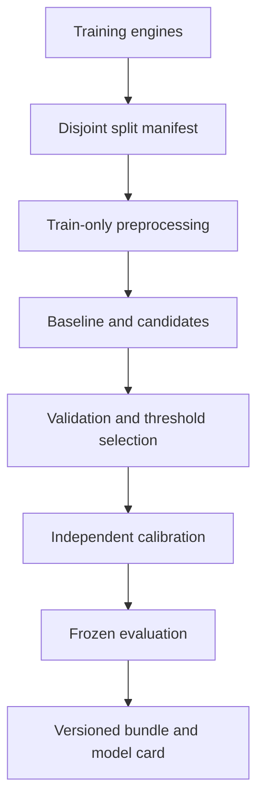

## Offline RUL comparison update — 2026-10-28

The 54-fit history-window experiment and engine-group uncertainty evaluation are complete; see [docs/RUL_EXPERIMENTS.md](docs/RUL_EXPERIMENTS.md). Intervals remain broad and the historical serving model is unchanged. Calibration/audit evidence from that study is now used, not untouched.

A controlled single-row Cap-125 FD001 candidate was subsequently tested on the same engines. On 88 common official-test engines, existing window-model MAE was 12.45 versus 13.58 cycles; near-failure MAE was 4.00 versus 11.03. The candidate failed the validation improvement gate and was not promoted. [Full comparison and limitations](reports/FD001_CAP125_COMPARISON_20261028.md). These are reused benchmarks, not fresh blind evaluations.

## Four-subset candidate training — 2026-10-27

Trained separate FD001, FD002, FD003 and FD004 candidates in new `runs/fd00X-20261027-candidate` directories. Validation selected XGBoost for FD001/FD003 and Ridge for FD002/FD004. Official-test MAE: 16.14 / 21.87 / 22.07 / 29.98 cycles, respectively; evaluated 100 / 253 / 100 / 237 engines. Seventeen short histories were excluded without padding. All four verified bundles reproduce the saved predictions across 690 eligible engines; 10 parser/feature tests passed.

These are offline experimental candidates, not automatic replacements for the running FD001 model. No deployment, model routing change or dataset modification was performed. Original model artifacts and release/configuration hashes were preserved. Details, caveats and provenance: [training report](reports/ALL_SUBSETS_TRAINING_20261027.md).

# Model Design and Selection

Version: 1.0 · Updated: 2026-10-22 · Status: proposed implementation specification

## Prediction tasks

RUL regression estimates remaining operating cycles. Horizon classification estimates `P(RUL <= H | observed history)` with proposed initial `H=30` cycles. These are separate outputs. Do not convert a rescaled RUL estimate into a claimed probability. Anomaly detection, if added, is a separate score and does not automatically imply imminent failure.

## Data and split design

Start FD001. Use engine IDs, operational settings and documented sensor columns; do not infer arbitrary sensor names/units. Training RUL at cycle t is final observed failure cycle minus t. The official test set stays untouched during tuning. Within training engines, create disjoint train/validation/calibration partitions using a recorded seed and manifest; cap per-engine contribution or report engine-balanced metrics.

Proposed window 30 cycles; insufficient history returns unavailable in MVP. Padding is an optional evaluated policy, not a silent default. Features: trailing mean, standard deviation, slope, last value and operating settings. Fit scaling, feature selection and condition transforms on training engines only. No future-centered rolling windows.

## Candidate progression

| Candidate | Purpose | Advancement rule |
|---|---|---|
| Age/constant baseline | Minimum comparison | Always report |
| Regularized linear regression | Interpretable baseline | Compare error and bias |
| Gradient-boosted regression/classification | Main tabular candidate | Better validation plus acceptable alert policy |
| GRU/LSTM/temporal CNN | Optional sequence experiment | Justified improvement and manageable serving cost |
| Isolation-style anomaly model | Separate novelty signal | Never labeled failure probability |

Models are not trained by this pack; metrics are unmeasured. Hyperparameter tuning has a bounded budget and uses validation engines only. Choose artifact format and loader security deliberately; hash-checking alone does not make an untrusted pickle safe.

## RUL target policy

Primary reporting uses uncapped RUL in cycles. A capped training target (for example plateaued early-life RUL) may be an experiment, but label cap value and report comparable uncapped official test errors separately. Do not compare clipped and unclipped benchmark results as equivalent. Nonnegative output constraints must be recorded and evaluated.

## Calibration and uncertainty

Use independent calibration engines or grouped out-of-fold predictions for classifier calibration. Inspect reliability and Brier score, especially near action thresholds. RUL intervals can be empirical or conformal candidates, calibrated with engine-aware held-out data. Nominal coverage is not guaranteed under drift; report observed coverage and width. Do not derive horizon probability from an interval without a justified predictive distribution.

## Component panel

FD001's dataset fault mode is background metadata, not learned classification. Sensor attributions support investigation but cannot establish root cause. Validated subsystem/component diagnosis requires suitable labeled fault examples, a separate model card and evaluation. Until then expose `diagnosis_basis: known_dataset_mode | expert_rule | technician_confirmed | unavailable`.

## Bundle contents

Model, preprocessing, feature order/schema, machine compatibility, window/horizon, calibration objects, interval method, training code commit, dataset/split hashes, metrics, dependency lock and artifact hash. Serving rejects mismatched feature/schema versions.

