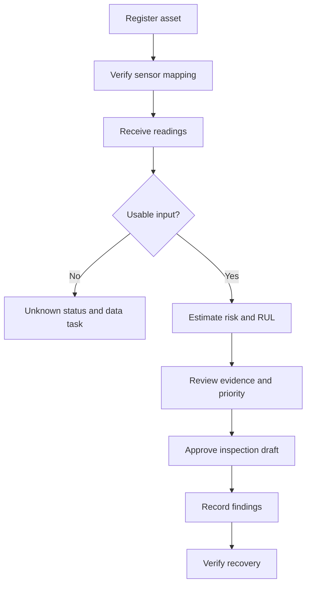

# Product Requirements Document

Version: 1.0 · Updated: 2026-10-22 · Status: proposed implementation specification

## Problem and outcome

Plant managers cannot inspect every asset at once. Sensor data can identify deterioration, but an unexplained score does not tell a technician which machine, what evidence, or what action. Meridian Sentinel connects validated telemetry, predictive estimates and accountable inspection workflows.

Success means a team can locate an asset, inspect a warning's evidence, prepare a reviewed work order and record a verified outcome. Reduced downtime is a later pilot outcome, not an assumed benefit already achieved.

## Personas and decisions

| Persona | Decision | Required information |
|---|---|---|
| Manager | Which inspection first? | Criticality, evidence, backup availability, unresolved issues |
| Technician | Where and what to inspect? | Asset photo/QR, sensor location, approved checklist, assigned task |
| ML engineer | Is the model dependable? | Data lineage, evaluation, drift, outcome labels, artifact versions |
| Administrator | Who may do what? | Memberships, scoped roles, integration credentials, audit events |

## Requirements

| ID | Priority | Requirement | Acceptance reference |
|---|---|---|---|
| FR-01 | P0 | Verified machine and sensor registry, installation history | AC-01 |
| FR-02 | P0 | Validated, deduplicated telemetry with provenance | AC-02 |
| FR-03 | P0 | Risk-ranked fleet and distinct unknown queue | AC-03 |
| FR-04 | P0 | Sensor trends, prediction history and evidence | AC-04 |
| FR-05 | P0 | RUL and horizon classification with held-out metrics | AC-05 |
| FR-06 | P0 | Draft, review, assign and verify work orders | AC-06 |
| FR-07 | P0 | Roles, tenant isolation and audit history | AC-07 |
| FR-08 | P0 | Repeatable replay and clearly labeled simulations | AC-08 |
| FR-09 | P1 | Model registry, controlled deployment and rollback | AC-09 |
| FR-10 | P1 | Evidence cards and incident timelines | AC-10 |
| FR-11 | P1 | Technician/parts-aware planning suggestions | AC-11 |
| FR-12 | P2 | Read-first MCP assistant with draft-only tools | AC-12 |

## Scope and explicit exclusions

P0 demonstrates the four requested deliverables: ranked assets, sensor trends, model metrics, draft maintenance work order. The component panel presents a known dataset mode or a clearly labeled suspected subsystem, never a validated component classifier unless a separate labeled dataset and test exist.

No support claim for arbitrary pumps/conveyors from engine training. No automatic repair, actuator commands, guaranteed failure times, real savings claims, or fully autonomous retraining/promotion.

## Product success measures

Record task completion time for locate → review → draft; percentage of incidents with an owner; unresolved alert age; post-repair verification completion; false-alert episodes per engine and warning lead time. Establish baseline before reporting improvement. Report model errors by engine and operating regime, not only pooled row accuracy.

## Proposed nonfunctional budgets

For a declared pilot load of 100 assets sending one 21-sensor frame per minute: fleet API p95 below 1 second, frame-to-prediction p95 below 5 seconds, no duplicate work order on replayed requests. These are engineering targets requiring measurement. Recovery objectives: RPO 24 hours / RTO 4 hours for an initial pilot, subject to plant approval. API availability target 99.5% excludes upstream telemetry availability; report them separately.

## User journey

## Open decisions

Confirm team size, deadline, deployment target, actual plant data access, fault-label availability and identity provider before committing production scope. The docs provide proposed defaults so prototype work can start without those decisions.
