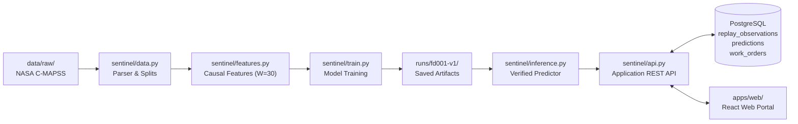

# Meridian Sentinel — Predictive Maintenance & RUL Platform

## Offline all-subset training — 2026-10-30

Completed strict data validation, training-engine EDA, causal feature engineering,
train-only feature selection and FD001–FD004 Random Forest classification plus
XGBoost RUL experiments. The combined classifier achieved 90.25% test-row accuracy
on 104,897 observations; lifetime-stage labels are not physical health diagnoses.
Candidates remain offline and the serving model is unchanged.
[Measured results](reports/all-subsets-20261030-v1/REPORT.md) and
[reproduction guide](docs/ALL_SUBSETS_TRAINING.md).

Meridian Sentinel is an enterprise-grade predictive maintenance platform that forecasts the **Remaining Useful Life (RUL)** of turbofan engines using the NASA C-MAPSS dataset. It combines a verified machine learning pipeline with a multi-tenant FastAPI backend, PostgreSQL persistence, human-in-the-loop maintenance approval workflows, an MLOps model registry with drift monitoring, and a React web frontend.

---

## Architecture Navigation & Quick Links

- 🧭 **Code Map**: [docs/CODE_MAP.md](docs/CODE_MAP.md) — Directory index and clickable guide to all source files and responsibilities.
- 📋 **Implementation Status**: [IMPLEMENTATION_STATUS.md](IMPLEMENTATION_STATUS.md) — Authoritative status matrix (Phases 1 through 9).
- 🚀 **Quickstart Guides**:
  - Backend: [BACKEND_QUICKSTART.md](BACKEND_QUICKSTART.md) (Local server, replay, and PostgreSQL)
  - Frontend: [FRONTEND_QUICKSTART.md](FRONTEND_QUICKSTART.md) (React portal launch & demo seeding)
- 🐳 **Container Deployment**: [DEPLOYMENT.md](DEPLOYMENT.md) (Hardened Docker Compose, Nginx TLS gateway)
- 📘 **Deep Blueprint Specs**: [docs/blueprint/readme.md](docs/blueprint/readme.md)
- 🔮 **Planned Future Roadmap**: [docs/planned/README.md](docs/planned/README.md)
- 🏛️ **Historical Archives**: [docs/history/README.md](docs/history/README.md)

---

## Implemented Flow: Data to Prediction

The diagram below reflects the **actual working implementation**:



1. **Raw Ingestion**: Official NASA text files reside in `data/raw/` (gitignored).
2. **Parsing & Validation**: `sentinel/data.py` validates column ranges, types, and creates disjoint engine splits.
3. **Causal Features**: `sentinel/features.py` extracts 96 trailing rolling features over a causal 30-cycle window without lookahead leakage.
4. **Training**: `sentinel/train.py` trains Ridge and XGBoost models, selecting the best model on held-out validation engines.
5. **Artifact Storage**: Verified bundles are saved in `runs/<version>/` (e.g. `runs/fd001-v1/`) with SHA-256 hashes.
6. **Inference**: `sentinel/inference.py` loads verified bundles and executes low-latency inference.
7. **Database Storage**: Application observations live in PostgreSQL (`replay_observations`), while `database/migrations/` manages the schema via Alembic.
8. **Operational Workflow**: Predictions feed deterministic maintenance priority bands (`urgent`, `high`, `medium`, `low`, `unknown`) and draft work orders that require explicit human approval before execution.

---

## Status Summary: Implemented vs. Pending

| Domain | Status | Implemented Reality |
|---|---|---|
| **Python Core** | **Implemented** | Working Python package lives under `sentinel/` (API, Auth, Ingestion, Registry, Predictions, Work Orders, MLOps). |
| **Frontend Portal** | **Implemented** | Full React 18 + TypeScript + Vite web portal in `apps/web/`. |
| **ML Models** | **Implemented & Verified** | Active model `fd001-v1` (MAE 16.79 cycles on official test engines). Four candidate models evaluated offline. |
| **Persistence** | **Implemented** | PostgreSQL 18 native cluster with 7 Alembic revisions (`database/migrations/`). |
| **MLOps Foundation**| **Implemented** | Hash verification, operator release/rollback CLI, latency tracking, baseline input drift monitoring, offline ground-truth evaluation. |
| **Exploratory Data Analysis** | **Not Implemented** | Comprehensive EDA notebook/pipeline is not yet part of the core package. |
| **Automated Feature Selection** | **Not Implemented** | Causal trailing features are domain-defined; automated selection algorithms are future work. |
| **Background Workers** | **Planned** | Async queue / outbox consumer is planned; current backend runs synchronously. |
| **CMMS & IoT Integrations** | **Planned** | Hardware adapters and external CMMS sync are planned specifications in `docs/planned/`. |
| **MCP Assistant Tools** | **Planned** | Assistant tools (read-only/drafting) are planned specifications in `docs/planned/mcp.md`. |

---

## Honest ML Capabilities & Boundaries

- **Discrete RUL Outputs**: The model outputs estimated remaining flight cycles ($\text{RUL} \in \mathbb{R}^+$). It does **NOT** output learned failure probabilities.
- **No Probability Rescaling**: Re-scaling an RUL number into $[0, 1]$ is strictly prohibited and must not be presented as a failure probability.
- **Offline Uncertainty Studies**: Engine-grouped uncertainty studies exist offline (`docs/RUL_EXPERIMENTS.md`), but intervals are **not available** in the live application API.
- **Cap-125 Candidate Rejected**: A single-row Cap-125 candidate was benchmarked on official test engines, failed the improvement gate (MAE 13.58 vs 12.45 baseline), and was **not promoted** (see `reports/FD001_CAP125_COMPARISON_20261028.md`).
- **Human Gate**: Predictions **never** auto-approve maintenance or shut down machinery. Plant managers must review and approve work orders.

---

## Local Prerequisites (Not Tracked in Git)

The following local prerequisites must be installed on the host and are excluded from Git:
1. **Python 3.12+** in `.venv` with dependencies from `requirements.txt` (or platform lock files).
2. **Node.js 18+ & npm 10+** for the web portal in `apps/web/`.
3. **Local PostgreSQL 18** on port `55432` (or configured port) with `btree_gist` extension enabled.
4. **NASA C-MAPSS Raw Data** in `data/raw/` (`train_FD001.txt`, `test_FD001.txt`, `RUL_FD001.txt`). Downloaded via `python -m sentinel.download`.
5. **Model Run Artifacts** in `runs/fd001-v1/` (`bundle.json`, `model.json`, `report.json`, `split.json`).
6. **Local Secrets & Env Files** (`.env`, `.runtime/postgres.env`). Use `.env.example` as a template.

---

## Running the Application Locally

### 1. Verification & Tests

```powershell
# Run backend test suite (from project root)
.\.venv\Scripts\python.exe -m pytest -q

# Run frontend tests (from apps/web/)
cd apps/web
npm test
npm run typecheck
cd ../..
```

### 2. Launching Backend & Verified Replay

```powershell
# Terminal 1: Launch backend API server
.\scripts\start-local.ps1

# Terminal 2: Verify model, hashes, and send a test replay observation
.\scripts\check-local.ps1
```

### 3. Launching Frontend Portal

```powershell
# Seed local demo organization, admin, technician, and asset telemetry
.\.venv\Scripts\python.exe -m scripts.prepare_demo_data

# Launch Vite dev server
cd apps/web
npm run dev
```

Open [http://localhost:5173](http://localhost:5173) in your browser.
- **Admin**: `admin@meridian.example.com` / `Password12345!`
- **Technician**: `tech@meridian.example.com` / `Password12345!`

### 4. MLOps CLI

```powershell
# Inspect active deployment status
.\.venv\Scripts\python.exe -m sentinel.mlops.cli status

# Inspect input feature drift against training baseline
.\.venv\Scripts\python.exe -m sentinel.mlops.cli drift --model-dir runs/fd001-v1

# Evaluate predictions against official ground-truth test labels
.\.venv\Scripts\python.exe -m sentinel.mlops.cli evaluate --test-rul data/raw/RUL_FD001.txt
```

---

## Key Directory Structure

```text
Meridian_Sentinel_Full_Architecture/
├── sentinel/              # Canonical Python implementation (API, ML, DB, Auth, MLOps)
├── apps/
│   └── web/               # React 18 / TypeScript frontend portal
├── backend/               # Operational Docker build context for backend (Dockerfile)
├── frontend/              # Operational Docker build context for frontend (Dockerfile, Nginx)
├── infra/                 # Deployment infrastructure & Nginx gateway configs
├── database/
│   └── migrations/        # Alembic schema migrations (0001 through 0007_mlops)
├── data/
│   ├── raw/               # Raw NASA C-MAPSS text datasets (gitignored)
│   └── source.json        # Official dataset source URLs and metadata
├── runs/
│   └── fd001-v1/          # Active trained model bundle & evaluation metrics (gitignored)
├── packages/
│   └── contracts/         # OpenAPI specifications (experimental and target)
├── scripts/               # Runnable automation, startup, and validation scripts
├── tests/                 # Automated pytest suite
├── reports/               # Historical phase validation reports and benchmarks
└── docs/                  # Current technical manuals and operations guides
    ├── CODE_MAP.md        # Comprehensive navigation guide
    ├── planned/           # Specifications for planned future modules
    └── history/           # Historical phase handoffs and superseded documentation
```
