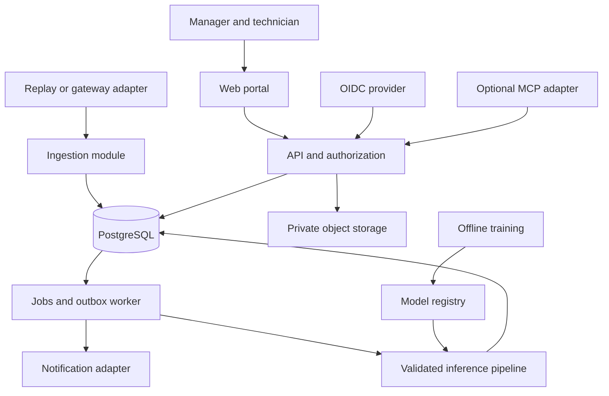

# System Architecture

Version: 1.0 · Updated: 2026-10-22 · Status: proposed implementation specification

## Chosen shape

Start with a modular monolith API plus a background worker, not independent microservices. Proposed stack: React/TypeScript frontend, Python/FastAPI API and worker, PostgreSQL relational store, S3-compatible private object storage, MLflow tracking/registry. A PostgreSQL jobs/outbox queue is enough for MVP; Redis and dedicated streaming infrastructure are optional measured extensions.

Exact compatible package versions must be selected and locked during bootstrap. These are architectural choices, not a runnable dependency manifest.

## Module ownership

Identity owns users/memberships/sessions. Registry owns machines/sensors/installations. Ingestion owns telemetry and quality events. Prediction owns model compatibility, feature computation and outputs. Maintenance owns incidents, work orders and inspections. Model operations owns releases and review gates. Integration adapters translate external contracts, never implement business authorization.

## Transaction and async boundaries

Ingest request validates size/auth/schema and atomically writes a unique frame, readings, quality result and an outbox event. Return 202 only after commit. Worker claims events with row locking, lease and retry count. At-least-once delivery is assumed. Unique prediction key and idempotent state transitions prevent duplicates; do not promise exactly-once transport.

Prediction stores input range, quality checks, model bundle hash and policy version in one transaction with any new incident/outbox event. Notification delivery failure must not roll back a committed incident. Failed jobs move to a dead-letter state after bounded retries with recorded reason.

## Availability behavior

If inference is unavailable, data continues to ingest within storage limits. Expose prediction status pending/unavailable; do not retain an old healthy badge as current. If registry is unavailable, a verified cached immutable artifact may continue serving with its version displayed. If DB is unavailable, return 503 and let adapters retry with the same event ID.

## Time and provenance

All stored timestamps UTC; UI displays user timezone. `event_time` is source time, `received_at` server time. NASA cycle index remains authoritative for model sequence. Synthetic replay timestamps are marked simulated and never treated as physical sampling cadence. Replay stream ID isolates runs, preventing duplicate identity collisions between demonstrations.

## Tenant boundary

Tenant determined from authenticated membership or gateway credential. Never trust tenant ID in a request body. All tenant-owned records carry tenant ID, scoped queries and composite tenant foreign keys. Cross-tenant object IDs return 404. Background jobs carry validated tenant context. Object prefixes are not sufficient authorization by themselves.

## Deployment boundaries

Browser holds a secure session cookie; API handles OIDC exchange. Inference is internal. Plant gateway initiates outbound traffic; prototype does not open inbound control access to machinery. Admin and MLflow interfaces are private. Secrets are injected at runtime. See deployment.md and authentication_security.md.
