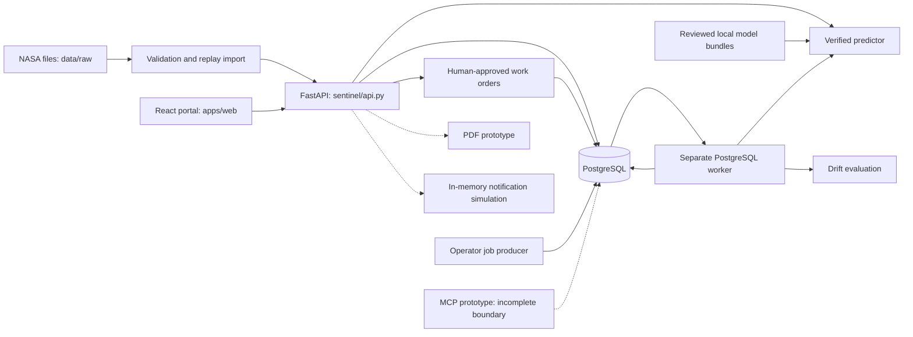

# Meridian Sentinel: complete project understanding guide

Snapshot date: 30 October 2026, user timezone Asia/Calcutta.
Scope: the local working tree of Meridian_Sentinel_Full_Architecture, including uncommitted additions.
Audience: a new AI assistant, developer, reviewer, reliability engineer or project stakeholder.

This is an engineering handoff, not a claim of production certification. The bundled source, route catalog, migration inventory, tests and original documents provide the detail behind this narrative. Read `03_CURRENT_GAPS_AND_CONTRADICTIONS.md` before acting on historical documentation. A file being present does not establish that its advertised capability works.

## 1. What the project is

Meridian Sentinel is an experimental predictive-maintenance application centered on simulated turbofan-engine degradation from NASA C-MAPSS. It joins validated sensor histories, remaining-useful-life regression, maintenance priority, traceable predictions, organization-scoped operational records, human-approved work orders, model monitoring and a React portal.

The practical user journey is: identify an asset, inspect its sensor history, obtain a model estimate, understand the estimate's provenance and limitations, create an inspection draft, obtain authorized human approval, assign a technician, record execution and retain the evidence. The prediction is decision support. It is not a diagnosis, certified maintenance instruction, autonomous actuator command or guarantee of failure time.

The broader product ambition is industrial asset reliability. The currently implemented data/model contract is much narrower: C-MAPSS simulated turbofan observations. Registering a physical machine does not make that machine compatible with the trained engine models. No measured real-plant downtime savings or physical fault-localization accuracy has been established by the work documented here.

### People and decisions

| Persona | Main questions | Relevant surfaces |
|---|---|---|
| Plant manager | Which assets need review? Who should inspect? Can a draft be approved? | Fleet priorities, evidence, work orders, assignments |
| Technician | Which approved task belongs to me? What evidence and history are available? | Machine detail, assigned work orders, transitions and notes |
| Organization administrator | Who belongs to this organization and with what permissions? | Membership management, registry, tenant access |
| ML operator | Which artifact is loaded? What was its evaluation? Has input distribution changed? | CLI, model registry, deployments, monitoring |
| Viewer | What is happening in assets I am allowed to inspect? | Read-only tenant-scoped views |
| Future assistant | What evidence can I retrieve and what draft can I propose? | Proposed secure MCP read/draft boundary; current prototype has gaps |

### Product requirements and acceptance mapping

FR-01/AC-01: verified asset and sensor registry. FR-02/AC-02: validated, deduplicated telemetry. FR-03/AC-03: risk-ranked fleet with unknowns separate. FR-04/AC-04: sensor history, evidence and provenance. FR-05/AC-05: RUL and horizon classification supported by held-out evaluation. FR-06/AC-06: draft/review/assign/execute workflow. FR-07/AC-07: roles, tenant isolation and audit history. FR-08/AC-08: repeatable, explicitly labeled replay. FR-09/AC-09: controlled model release and rollback. FR-10/AC-10: incident evidence and timelines. FR-11/AC-11: technician/parts-aware planning. FR-12/AC-12: read-first, draft-only assistant tools.

The PRD marks FR-01 through FR-08 P0, FR-09 through FR-11 P1, and FR-12 P2. A later gap table called some items P1 that are P0 in the PRD. Preserve this discrepancy rather than silently rewriting requirements. FR-10 does not by itself certify a signed compliance PDF; that is an extension to evidence/timeline functionality.

## 2. How to determine truth

Use this precedence when sources disagree:

1. Current executable source and schema, with meaningful tests for the exact behavior.
2. Fresh inspection and executed validation for this snapshot.
3. Dated test reports and artifact manifests, scoped to their recorded environment and revision.
4. Operational manuals and current feature contracts.
5. Root README and implementation summaries, which can lag development.
6. `docs/planned`, `docs/blueprint`, `docs/history`, reference SQL and production-target OpenAPI: intent or history, not automatically implemented behavior.

Neither a commit title, a module docstring, a screenshot nor a test name proves end-to-end functionality. A test passing against a dummy database establishes only what that test exercises. A SHA-256 printed in a PDF is not a digital signature. A local dictionary called a registry is not durable persistence. A file named `train.py` is not a working trainer when its contents are empty.

The repository has recently changed outside this conversation. This pack records the inspected working tree, including those changes, without overwriting them. Earlier conversational assessments saying “no MCP,” “no PDF,” “no job HTTP API,” or “classifier card not mounted” are no longer accurate descriptions of file presence. Conversely, those newer files do not justify declaring the features complete.

## 3. Architectural shape

The intended architecture is a modular monolith plus a separate worker. Business logic resides in Python modules under `sentinel/`; it is not spread across implemented independent services. FastAPI composes routers. PostgreSQL stores organizational and operational state. React/TypeScript provides the portal. Model artifacts are local files verified by hashes. The durable job queue uses PostgreSQL, not Celery or Redis.



The database is the persistence boundary. HTTP handlers normally open a transaction, resolve a session principal, verify tenant permissions, validate input, invoke a service and commit. Write paths in established modules also enforce CSRF and serialize relevant tenant/state changes. New prototype routers do not uniformly follow these rules; see the gap register.

Worker handlers use the worker-supplied SQLAlchemy session. Their domain writes and completion acknowledgement commit together. External side effects cannot inherit this database-only atomicity. A future webhook sender must use durable delivery records and receiver-side idempotency, not assume a local transaction makes HTTP delivery exactly once.

## 4. Repository navigation

| Location | Meaning |
|---|---|
| `sentinel/` | Runtime Python package: configuration, inference, API, auth, database, registry, ingestion, predictions, work orders, MLOps, jobs and newer prototypes |
| `apps/web/` | Canonical React/TypeScript/Vite application; pages, components, API client, auth context, tests |
| `database/migrations/` | Executable Alembic revision chain; current head is `0009_fleet_jobs` |
| `database/reference/schema.sql` | Broader future database design; must not be executed as the current schema |
| `packages/contracts/` | Experimental OpenAPI and separate production-target contract; distinguish exported schema from functioning behavior |
| `tests/` | Backend behavioral, security, PostgreSQL, ML, deployment and prototype tests |
| `scripts/` | Native PostgreSQL helper, launchers, replay/demo population, experiments, deployment and verification helpers |
| `backend/`, `frontend/`, `infra/` | Container definitions, entrypoints, reverse proxy and deployment scaffolding |
| `config/` | Configuration guidance and placeholders; real TLS material stays private |
| `docs/` | Current domain manuals plus blueprint/planned/history subtrees |
| `reports/` | Dated validation/evaluation evidence; historical claims must retain date and scope |
| `runs/` | Ignored model artifacts, manifests and experiment outputs; not bundled as model binaries |
| `data/raw/` | Ignored NASA datasets, not application PostgreSQL telemetry |
| `.runtime/` | Local cluster/state/caches/logs/private environment files; not portable source |
| `services/` | Architectural placeholder rather than proof of implemented microservices |
| `archives/`, `ml_package/`, `resources/` | Older exports, supporting media and packages; not canonical runtime |

The generated technical reference lists every included file, its symbols, tests, source hash, routes, CLI arguments and migration content. The sanitized source snapshot preserves repository-relative paths so another AI can inspect exact implementations.

## 5. Technology and dependency boundaries

Python source uses FastAPI, Uvicorn, Pydantic, SQLAlchemy, psycopg and Alembic. ML code uses NumPy, pandas, scikit-learn and XGBoost. Local authentication uses Argon2id and email-validator. Tests use pytest, HTTPX/TestClient and actual PostgreSQL for integration behavior. The frontend uses React 18, TypeScript, Vite, Vitest, Testing Library and Lucide icons.

Exact declared versions belong to `requirements.txt`, platform lock files and `apps/web/package.json`/lockfile; the pack includes them. Local historical validation used Python 3.12 and PostgreSQL 18. Docker Compose currently specifies PostgreSQL 17 Alpine. Do not confuse a locally installed package/version with a dependency declared for reproducible installation.

The PDF module imports matplotlib at application import time. Matplotlib is not listed in the inspected direct requirements file. It may be installed locally, but clean-environment startup needs dependency verification. The new master document does not silently modify requirements to conceal this mismatch.

## 6. Configuration and secrets

`sentinel/config.py` owns configuration validation. Explicit overrides beat process environment, which beats the chosen `.env`, then defaults. Blank overrides do not silently fall back. Model configuration binds a directory and expected manifest digest. `SENTINEL_RELEASE_POINTER` can instead bind both through a reviewed local release pointer; pointer resolution is relative to the selected environment file.

Core variable families:

| Family | Variables / meaning |
|---|---|
| Experimental inference | `SENTINEL_API_KEY`, `SENTINEL_MODEL_DIR`, `SENTINEL_BUNDLE_SHA256` |
| Classifier | `SENTINEL_CLASSIFIER_DIR` |
| Server | `SENTINEL_HOST`, `SENTINEL_PORT`, `SENTINEL_CONTAINER_MODE` |
| PostgreSQL | `DATABASE_URL`; psycopg PostgreSQL URL, not arbitrary SQLite substitution |
| Auth | `SENTINEL_AUTH_ENABLED`, `SENTINEL_AUTH_LOCALHOST`, `SENTINEL_AUTH_ORIGINS` |
| Session/limits | `SENTINEL_SESSION_SECONDS`, `SENTINEL_LOGIN_LIMIT`, `SENTINEL_LOGIN_WINDOW`, `SENTINEL_LOGIN_GLOBAL_LIMIT` |
| Releases | `SENTINEL_RELEASE_POINTER` |
| Tests | `SENTINEL_TEST_ADMIN_URL`, explicit disposable-database authority |
| Containers | `POSTGRES_PASSWORD`, `SENTINEL_RUNTIME_PASSWORD`, gateway bind/port, TLS configuration |
| Public demo | `MIGRATION_DATABASE_URL`, provider origin/port variables; owner URL consumed for migration then replaced with runtime URL |
| Frontend development | `VITE_BACKEND_URL` or `BACKEND_URL` for development proxy configuration |

An exhaustive identifier inventory appears in the technical reference. No actual environment values, passwords, cookies, CSRF tokens, webhook secrets, TLS private keys or database contents are part of the pack. File hashes and model digests are integrity identifiers, not credentials. Placeholder configuration is not a deployable secret store.

## 7. Dataset semantics

Canonical C-MAPSS observations have 26 numeric columns in exact order: `engine_id`, `cycle`, three operating settings and 21 sensor channels. Settings are `setting_1` to `setting_3`; sensors are `sensor_01` to `sensor_21`. Engine identities are not globally unique across subsets or train/test partitions.

FD001 and FD003 describe one operating condition; FD002 and FD004 include multiple operating conditions. Dataset-level degradation modes are not per-observation confirmed diagnoses. The model must not infer “Fan fault” merely because an asset belongs to a subset with multiple simulated failure modes.

Training trajectories run to the simulation's failure endpoint. Official test trajectories stop earlier, and the separate RUL file supplies remaining cycles at the final observation. For offline labels, total lifetime can be reconstructed as final observed cycle plus official final RUL. Future lifetime/labels are permitted in supervised target construction, never as input features for the same prediction.

RUL is expressed in operating cycles. Do not convert it to hours, calendar days or due dates without a separately justified operational model. Replay timestamps are ingestion/system timestamps or explicitly synthetic display times, not actual sensor acquisition timestamps. The canonical persisted replay observation accepts `observed_at=None`.

## 8. Data validation and import

`sentinel/data.py` validates exact column order, nonempty frames, finite numeric values, positive integral engine/cycle IDs, unique engine/cycle pairs and consecutive histories within each engine. File parsing uses whitespace-separated data. Rows may be sorted into canonical order; invalid readings are rejected, not silently dropped or replaced by zero.

The offline parser's complete-trajectory rules differ from incremental persisted ingestion. A stored replay can temporarily have missing cycles because batches may arrive separately; quality endpoints expose gaps and the prediction layer rejects incomplete windows. Do not mistake that for a permissive offline training parser.

Persisted ingestion uses strict Pydantic schemas: extra fields forbidden, exactly three settings and 21 sensor readings, finite numbers, positive integer cycle IDs and at most 500 observations per batch. One batch cannot contain a repeated cycle. Its source includes dataset, subset, partition, engine ID, source-file SHA-256 and schema version 1. Idempotency keys are bounded to 128 characters with the permitted alphanumeric/dot/underscore/colon/hyphen pattern.

`sentinel/ingestion/service.py` checks the registered machine's immutable source binding and source version. It scopes stream, observation and batch operations to the tenant/machine. Canonical payload hashing supports replay of identical requests and rejects conflicting reuse. The transaction commits the coherent batch state or rolls back. Source provenance is retained. Importing data does not implicitly perform inference, approve work or send real alerts.

History endpoints use bounded windows/pagination. Quality queries have a maximum requested range of 10,000 cycles. Unknown channel metadata stays unknown. The channel catalog exposes logical input positions; it does not invent physical sensor names, units, components or a hardware mapping.

## 9. Asset and sensor registry

The registry models tenants, machines, sensors and time-bounded sensor installations. A machine has a tenant-scoped asset code, identity, type, descriptive/location fields, lifecycle status, criticality, source binding and version. Lifecycle values are `active`, `inactive`, `archived`; they are not health predictions. Legacy operating status is a separate database concept.

Replay source binding identifies dataset/subset/partition/engine and, where required, source-file hash. Changing a trajectory/version must not mutate historical identity. Physical device registration is separate from having a working physical ingestion adapter. Sensors can be active or retired. Installations map a sensor/channel to a machine over an effective interval; overlapping conflicting mappings are guarded by database constraints and service validation.

`sentinel/registry/service.py` exposes a `Registry` service class. New modules incorrectly calling nonexistent module-level helpers must be treated as broken integrations rather than assumed aliases. Registry operations use tenant-scoped queries, permissions and audit records. Cross-tenant IDs are normally hidden behind 404 responses.

## 10. Serving feature contract and regression

The historical serving feature schema is `cmapss-trailing-v1`. For 24 input channels (three settings plus 21 sensors), it calculates last value, trailing mean, population standard deviation and linear slope. That is 24 × 4 = 96 features, ordered by statistic and channel. The standard baseline window is 30 cycles. The code does not compute min/max in this 96-feature representation even though some older prose describes them.

Features use only current and previous observations. `make_windows` excludes histories shorter than the requested window. Training contributions are bounded per engine; validation uses fixed truncations; final-test mode uses the last eligible window per engine. Engine partitions use deterministic seed 42 with roughly 70% train, 15% validation and 15% calibration-reserved. Splitting correlated rows randomly is not an equivalent evaluation.

`Predictor` verifies the expected `bundle.json` digest, exact feature schema/order, subset/window constraints and model/report hashes before loading. XGBoost uses native JSON; Ridge/constant artifacts use explicit numeric JSON. Untrusted pickle/joblib loading is not an accepted serving mechanism. Prediction rejects incompatible input and nonfinite output; nonnegative RUL is returned in cycles. Failure probability and intervals remain unavailable in this serving contract.

`MultiPredictor` routes by subset. The current API loader includes the configured primary bundle and attempts known, hash-pinned candidate directories for other subsets when available. This is a material difference from older statements that candidates never affect serving. The fleet worker deliberately loads only the configured primary `Predictor`, not candidate discovery. Thus API and worker subset coverage can differ. Always inspect loaded model identity rather than trusting a static “ACTIVE” table.

### Current training regression

At the documented snapshot, `sentinel/train.py` is zero bytes and modified relative to Git. Historical trainer descriptions describe earlier functionality, not runnable current contents. `all_subsets_training.py` imports `metrics` from it and `rul_experiments.py` imports `weights`; these imports currently fail. Do not run training or claim its tests pass until this is resolved with the owner of the change. This documentation task did not restore or overwrite the file.

## 11. Offline all-subset experiments

`sentinel/all_subsets_training.py` contains a separate experiment pipeline with validation, training-only EDA, feature alternatives, selection, classification and regression. Its code is present, but execution is currently blocked by the empty shared training module.

Raw25 features consist of cycle plus 24 input channels. Engineered97 adds trailing mean and population standard deviation over up to ten cycles plus five-cycle differences for all 24 channels. Early-history derived-statistic initialization is explicitly defined; it is not raw missing-sensor imputation. Feature extraction is grouped by engine. Combined identities retain subset prefixes.

Training-only feature selection removes constants, filters strongly correlated later columns above 0.995, ranks survivors using a 64-tree ExtraTrees classifier and retains at most 40 features. Raw and selected engineered representations are compared on validation data. Importance is not causal fault attribution.

Five Random Forest classification scopes exist in the recorded experiment: four subsets and COMBINED. Each compares two representations; the documented forest uses 300 trees, depth 15, max_samples 0.4, seed 42, two threads and engine-balanced fitting. Four separate XGBoost regression scopes compare feature alternatives with uncapped RUL targets. The bounded experiment budget is 10 forest fits, five selectors and eight XGBoost fits.

Classification labels are early lifetime at <=60% elapsed total lifetime, middle at >60% to <=80%, and late at >80%. They are not Healthy/Warning/Critical physical diagnosis labels, not P(failure within 30 cycles), and not calibrated probabilities. Raw25 won four recorded classifier scopes; engineered-selected won FD003. Official test data is used after frozen selection, and historical repeated benchmark inspection is acknowledged.

Forest exports use numeric NPZ arrays and JSON metadata with expected digests and `allow_pickle=False`. Reload parity is tested. Experiment artifacts are not automatically compatible with the 96-feature serving bundle. Model files and row-level prediction exports stay in ignored run directories.

## 12. Model results: retain evaluation context

The following are historical reported measurements, not reruns during this documentation task:

| Experiment | Recorded result | Essential caveat |
|---|---|---|
| Historical FD001 baseline | README reports official-test MAE 16.79 cycles | Use bundle report and its eligibility/protocol; not every later comparison uses the same engines |
| Four-subset candidates, 27 Oct | MAE 16.14 / 21.87 / 22.07 / 29.98 for FD001–FD004; 100 / 253 / 100 / 237 eligible engines | 17 short histories excluded; not directly comparable to all-cycle/startup experiments |
| Cap-125 comparison, 28 Oct | Candidate 13.58 versus baseline 12.45 MAE on 88 common engines | Candidate rejected; differing headline baseline is explained by matched evaluation population |
| Combined lifetime classifier, 30 Oct | 90.2457% row accuracy, macro F1 0.8132; 104,897 test observations | Correlated rows, lifetime stages, uncalibrated scores; not failure prediction accuracy |
| Combined classifier engine-balanced result | 92.72%, descriptive bootstrap interval 92.11%–93.33% | Different aggregation from row accuracy; not per-engine confidence |
| All-subset XGBoost regression, 30 Oct | MAE 18.21 / 20.04 / 23.60 / 28.76; RMSE 24.86 / 27.55 / 33.93 / 38.37 | Final-cycle evaluation across 100 / 259 / 100 / 248 engines; supports partial startup windows |

The supplied external notebook's 90.5069% uses a different recipe and is not proof that one implementation is better. Do not pool or compare metrics without matching target definitions, engine populations, feature windows, weighting, split and test reuse. Offline conformal/uncertainty studies do not mean a live calibrated interval is served. The pack retains the experiment reports for exact context.

## 13. Lifetime-stage API and UI

`sentinel/classification.py` implements a read-only organization/machine endpoint ending in `/lifetime-classification`. It uses a fixed trusted manifest and numeric forest representation, checks input dimensionality and finite values, and evaluates a stored observation at or before an optional cutoff. Session membership and replay-read permission are checked.

Responses identify the machine, stream, source cycle, requested cutoff, model version/hash, class ID, lifetime-stage label, replay mode and interpretation. Classification is not persisted as a maintenance mutation. The returned label policy explicitly distinguishes lifetime stage from physical health and failure probability. Missing observations and missing/incompatible model artifacts produce unavailable/error behavior rather than invented predictions.

The current `MachineDetailPage.tsx` imports and mounts `LifetimeStageCard`. Earlier notes that it was unmounted are superseded. The card has a service client and a component test. That does not validate horizon classification, calibrated risk or component localization; those remain absent.

## 14. Persistent predictions and priorities

`compute_and_persist` retrieves the tenant-scoped machine, verifies source/model compatibility, resolves replay stream and requested cutoff, extracts the trailing window, checks exact consecutive cycles, runs inference, applies priority policy and persists provenance. Missing history stays unavailable. It does not fill sensor gaps or allow future observations into the prediction window.

Stored prediction fields include machine/tenant/stream, actor/request IDs, requested/observed cutoff, input range/count/digest, model version/digest/bundle digest, inference and feature-schema versions, status/reason, RUL, priority policy/band and latency. The API adds display semantics such as cycles, experiment-only release status and unavailable probability/interval/diagnosis.

Prediction uniqueness is scoped by tenant, machine, stream, requested cutoff, input digest, model digest and inference version. Identical input reuses the prior result. A backfill changes the digest and can produce a new result at the same cutoff. This is why work-order stale-evidence checks cannot rely solely on a larger cycle number.

Priority policy `v1-experimental`: available RUL <=15 cycles is urgent, <=35 high, <=75 medium, otherwise low. Any unavailable result maps to unknown. These are experimental simulation thresholds, not manufacturer-approved limits. “Unknown” is not low risk. A completed job can contain unavailable predictions; queue success means processing succeeded, not that every machine is healthy.

The prediction service records completed/failed prediction audit events. Prediction failure in this context may mean insufficient or incompatible data, not a failed machine. UI copy and downstream reporting must preserve this distinction.

## 15. Authentication, sessions and permissions

Local email/password authentication is implemented. Password hashes use Argon2id; email normalization is explicit and does not invent provider-specific alias rules. Users are global identities; memberships bind users to tenants with roles. Organization administration does not imply platform/model-release authority.

Sessions are opaque random tokens in HttpOnly, host-only, SameSite=Lax cookies; only token digests are stored. Secure mode uses `__Host-meridian_session`; explicit localhost mode uses `meridian_session` and permits loopback HTTP. Sessions have absolute expiry. Logout, password change and user disable revoke sessions. Last-usable-admin protection prevents stranding an organization.

Login requires JSON, allowed Origin and `X-CSRF-Protection: 1`. Mutating established application routes require `X-CSRF-Token`, checked against a session-bound digest, plus origin checks. Browser tokens stay in memory, not URLs/localStorage. Credentialed CORS uses configured origins rather than `*`. New job/notification prototype write routes omit the established CSRF call and must be reviewed before use.

Permissions are defined in `sentinel/auth/permissions.py`. All four roles can read core tenant views. Viewers cannot create predictions or maintenance drafts. Technicians can request predictions and drafts, and execute/note eligible assigned work orders. Plant managers and admins can approve, assign, update and cancel. Only organization admins manage memberships. The exact permission sets are included in the source snapshot.

Login throttling is in-process and resets on restart; it is not distributed Redis rate limiting. OIDC/SAML SSO, database RLS and broader enterprise security controls remain work. Existing tenant checks and least-privilege deployment roles are valuable but not equivalent to full production hardening.

## 16. HTTP boundaries and errors

`http_support.py` caps request bodies at 1 MiB, generates request IDs, sets no-store and sanitizes response errors. Request-validation failures become bounded schema errors rather than echoing raw input. Logs emphasize request ID and status rather than payloads or secrets. The safe-code allowlist means arbitrary route exception text is normally mapped to a generic error. MCP runs outside this middleware and therefore does not inherit its safeguards.

Health endpoints distinguish process liveness, model readiness, database revision readiness and combined deployment readiness. A successful `/health` response does not prove tenant auth, worker operation, physical ingestion or a production release. Startup and health checks are not permission to retrain models.

The generated route catalog records methods, full paths, handler locations, source signatures and docstrings. `runtime.openapi.json` in this pack is generated from a non-serving, no-database, no-model app construction. It inventories routes and schemas; it is not an end-to-end test. Avoid confusing it with the aspirational production-target contract.

## 17. Work orders and human approval

Work orders may be manual or prediction-linked. Both begin as drafts. A prediction-linked draft captures immutable evidence: prediction ID, model/bundle hashes, stream/cutoff, RUL, policy/band and disclaimers. New observations do not rewrite that snapshot. Manual drafts do not manufacture prediction evidence.

States: draft, approved, in_progress, blocked, completed, cancelled. Actions: approve, start, block, resume, complete, cancel. Approval is manager/admin-only and checks evidence currency. Start requires an eligible active assignee. Technicians execute only their assigned work with current permissions. Block/cancel require reasons; completion requires a summary. Completed and cancelled are terminal in the current workflow. Status cannot be changed via an unrestricted generic PATCH.

Assignment requires an active user, active same-tenant membership and technician eligibility. Revocation takes effect at execution time; a stale assignee UUID is not continuing authority. Managers/admins can act for an assignee only within the enforced eligibility rules. Changes carry an expected integer version; stale versions return conflicts. Successful changes increment it.

Prediction-origin active orders are deduplicated per tenant/machine by a partial unique index. Scoped idempotency records replay identical creates and reject changed payloads under the same key. Transitions, assignments and notes retain actor/time/request context. Notes are bounded plain text, not arbitrary HTML. Completing a work order does not reset raw telemetry, prove repair effectiveness, establish health or grant an assistant approval rights.

AMM-looking descriptions/checklists in demos or PDF/MCP prototypes are not validated manufacturer procedures. Do not present them as a certified aircraft maintenance manual. Structured spare-parts availability, warehouse inventory, technician shifts and verified post-repair outcome learning are not yet complete capabilities.

## 18. PostgreSQL schema and migrations

The executable chain is linear: 0001_registry → 0002_auth → 0003_registry → 0004_replay → 0005_predictions → 0006_work_orders → 0007_mlops → 0008_outbox → 0009_fleet_jobs. Runtime readiness expects the last revision. Do not edit an applied revision to implement a new feature; add a forward migration and write rollback/restore notes.

| Revision | Main responsibility |
|---|---|
| 0001_registry | Initial tenants, users, memberships, machines, sensors, installations, extensions/constraints |
| 0002_auth | Local identity/session/audit fields and auth invariants |
| 0003_registry | Lifecycle/source bindings, richer registry metadata, installation constraints |
| 0004_replay | Immutable replay streams/observations/batches and source traceability |
| 0005_predictions | Persisted prediction identity/provenance and deduplication |
| 0006_work_orders | Work-order state, evidence, transitions, assignments, notes and idempotency |
| 0007_mlops | Model registry, deployments, monitoring runs and inference/pipeline latency |
| 0008_outbox | Tenant-scoped queue, attempts, leases, retry scheduling and dead-letter view |
| 0009_fleet_jobs | Fleet event type and persisted result object; guarded downgrade |

The technical reference embeds the complete executable migration sources, including constraints/indexes/triggers and downgrade code. This avoids pretending a prose table is an exhaustive schema definition. Reference/blueprint SQL contains additional future entities and is separately labeled.

`Database` uses a bounded pool, pre-ping, UTC session timezone and statement/lock/connect timeouts. Integration tests create and drop generated disposable databases using explicit test administration credentials. They do not silently use SQLite or reset a development database.

Audit history is append-oriented in application behavior and supported by relevant constraints/triggers, but organization-wide claims of cryptographic immutability or production append-only role enforcement require separate evidence. PostgreSQL composite tenant keys and service scoping should remain aligned.

## 19. Durable background processing

`sentinel/jobs/queue.py` provides internal enqueue, lease-based claim, dispatch and transactional execution. The producer uses its caller's transaction so domain writes and the outbox event commit atomically. Event identity is `(tenant_id, event_type, source_event_id)`. Conflicting reuse of the same event ID with different payload is rejected. Currently supported types are `drift.evaluate` and `fleet.score`.

Claims use `FOR UPDATE SKIP LOCKED`, a unique lease token and a five-minute lease. Attempts increment on claim, including crashes. A handler holds its queue-row lock while committing effects and acknowledgement, so another claimant skips an actively locked row even if time passes beyond lease expiry. Token verification prevents an obsolete claimant from executing after reassignment.

A savepoint rolls back failed handler writes before storing retry state. Default attempts are five. Failure delays begin at 2, 4, 8 and 16 seconds; the SQL backoff expression is capped. Exhaustion moves the event to dead_letter. `outbox_dead_letter` is a view over retained queue rows, not a separate delivery service. Error codes are sanitized; raw exception strings are not stored by the worker. Interrupted work is recoverable when its lease expires. The system promises at-least-once delivery with idempotent database effects, not exactly-once transport.

The worker is a separate CLI process, `python -m sentinel.jobs work`, with `--once` for one polling iteration. It is not automatically installed as a system service. No recurring scheduler or Compose worker service is established by the queue code itself. Database outages require supervision/restart; there is no evidence here of an always-running deployed daemon.

### Drift job

`enqueue-drift` accepts an explicit tenant and source event ID. Payload is empty and schema-validated. The handler calls existing verified FD001 drift evaluation and retains monitoring records. Insufficient data is a completed monitoring outcome; incompatible reference/failed evaluation enters retry handling. There is no automatic retraining or model promotion.

### Fleet job

`enqueue-fleet` requires a tenant, acting user ID and source event ID. The producer verifies active account/membership and `predictions.create`, snapshots all active machines in that tenant, and rejects more than 100 rather than truncating. Empty fleets complete with zero results. The snapshot binds requester, primary model hash, policy version, stream, cutoff and trailing-window digest per machine.

Repeated submission by the same requester returns the original snapshot despite later telemetry. Worker execution rechecks permissions, lifecycle/tenant membership, input identity and model/policy identity. Later cycles beyond the frozen cutoff do not affect results; backfilled input in the frozen window invalidates it. A changed primary model cannot silently execute an old job as a different prediction experiment.

All predictions, corresponding audit events and queue success commit in one bounded transaction. An unexpected error for one machine rolls back the batch. Existing prediction uniqueness prevents duplicate records. Results store counts and machine/prediction identifiers with available/unavailable reasons. Tenant writes may contend with the batch lock; this is not an established high-volume throughput SLA.

### Job API caveat

A new `sentinel/jobs/api.py` registers list/detail/fleet-submit routes. The inspected submission uses `actor['id']`, whereas the authenticated principal exposes `user_id`; this is a concrete integration defect. Its mutation also lacks the established CSRF check, creates a random source ID rather than accepting a retry key, and passes the API predictor into a producer designed around the primary predictor. HTTP code presence must not be reported as verified equivalent to the tested CLI path.

## 20. Model registry, monitoring and release

MLOps modules provide verified bundle inspection, model registration, release/rollback bookkeeping, a local release pointer, inference/pipeline latency, reference-based feature drift and offline evaluation against official labels. Models and deployments are separate from organization users' ordinary permissions.

Registration ties model metadata to verified artifact digests. Deployment operations require explicit operator identity/reason and reject prohibited review states. They record desired state and publish a recoverable pointer after commit. Running processes do not hot-swap automatically; restart and activation matching establish what actually loaded. Desired, active, failed and superseded states must not be collapsed into “deployed.”

Monitoring compares unique input windows to a training-partition reference with source/bundle/report identity. Drift is a statistical input shift, not proof of failure or inaccurate predictions. Ground-truth performance evaluation is an offline NASA benchmark, not a stream of confirmed industrial maintenance outcomes. Displayed latency distinguishes model execution from the surrounding pipeline.

MLflow/W&B remote tracking, Airflow/Prefect orchestration, continuous retraining, shadow/canary traffic, delayed real-world labels and automated production release gates remain extensions. Human approval for operational maintenance and production model release remains a policy boundary. Current local CLI release capability is not proof of enterprise production governance.

## 21. MCP prototype: what exists and what does not

`sentinel/mcp_server.py` contains a stdio JSON-RPC loop, initialize response, tools/list and tools/call dispatch. It advertises list_machines, get_sensor_trends, get_prediction_evidence and draft_work_order. Approval, shutdown and deployment tools are not advertised. The declared protocol version is 2024-11-05; interoperability beyond the local implementation has not been validated here.

The implementation directly accepts organization IDs and opens database transactions without binding a verified principal/membership. It invokes service helper names that do not exist in the current registry/ingestion/work-order modules, assumes prediction field names that differ from persistent prediction responses, and uses a hardcoded assistant actor UUID. Errors are returned/logged through a separate path. The three inspected tests exercise initialize, tool listing and an unknown tool; they do not prove usable scoped tool execution.

Therefore classify this as an incomplete prototype, not a safe usable assistant integration. The desired design remains a reviewed read/draft scope, verified organization identity, bounded input/output, citation of evidence, secret exclusion and hard prohibition on approval/execution/model release. Do not configure it as a trusted production data interface based on this handoff.

## 22. Notifications prototype

Notification code registers tenant webhook configurations in process memory, builds an envelope, signs bytes with HMAC-SHA256, suppresses repeated machine/priority events for 15 minutes and retains at most 50 recent delivery records per tenant. API routes expose registration, removal, test dispatch and history.

The inspected dispatcher does not perform an outbound HTTP request. It writes a delivery record with `status='dispatched'` and `http_code=200` locally. Registrations, secrets, deduplication and history disappear on restart and are not shared across workers. The cooldown is recorded before subscriber/delivery success is established. These are simulation semantics, regardless of a “durable” docstring or commit title.

Actual notification work requires persisted subscriptions/secret handling, durable outbox-to-delivery linkage, event generation on verified priority transitions, network timeouts, retries, per-destination deduplication, receiver acknowledgements and validated connector formats. Email/SMS and actual Slack/Teams delivery are not implemented merely because a generic URL is accepted. Before enabling network delivery, endpoint validation/egress policy and CSRF/authorization must be addressed.

## 23. PDF/audit prototype

`sentinel/audit/api.py` registers a machine audit-dossier GET route. `dossier.py` uses matplotlib PdfPages to draw two pages containing identity/provenance fields, prediction text, sensor plots, maintenance history/checklist-like material and signature lines. The frontend has a client and download UI wiring.

Several implementation mismatches remain: nonexistent registry/data-quality helper calls, assumed prediction keys such as predicted_rul/priority/model_bundle_sha256 instead of actual service fields, broad exception fallback that can hide missing evidence, and defaults that may show 0.0 RUL rather than unknown. The plotted observation query takes the first 300 cycles, which must not be described as necessarily aligned to the prediction cutoff. Sensor labels and FAA/AMM-style statements require independent validation.

The module does not implement a cryptographic digital signature or PDF tamper-evidence mechanism. Printed hashes and blank signature lines do not establish either. No fresh PDF rendering, content correctness, tenant-boundary integration or compliance validation was run in this documentation task. Treat it as a prototype needing repair and review, not a signed compliance packet.

## 24. Frontend behavior

### Newly present planning prototype

`sentinel/planning/` now contains inventory, shift-roster, readiness-service and API
modules. This appeared during the documentation work and is included in the final
source snapshot. It supersedes statements that there are no planning files, but it
does not establish durable parts-aware scheduling.

Inventory is seeded from a hardcoded catalog of five example part types, warehouse
bins, prices, stock counts and minimum quantities, then stored in a per-process
tenant dictionary. Rosters similarly clone three example technicians with fixed
identifiers, qualification strings, descriptive shift-hour text and manually toggled
on-duty booleans. These are demo inputs, not verified stock, vendor pricing, certified
personnel or an actual clock/calendar-based shift calculation. Updates do not persist
across process restart and are not backed by reservations, stock movements or database
membership/qualification records.

The readiness service calls `work_orders_service.get_work_order`, which is not the
current service interface. It falls back to static task codes if a work order has no
tasks. Its qualification aggregation takes a union of candidates across tasks rather
than proving complete task coverage. An assigned technician being off-duty adds a
blocker string but does not set the overall readiness flag false in that branch.
Thus a READY_FOR_EXECUTION label cannot be trusted as an operational clearance.
Planning PATCH routes also lack the established CSRF call. Repair the service
contract, durable data model, actual identity linkage and readiness invariants before
using it for real planning. The existing maintenance approval gate remains required.

### Portal structure

`apps/web/src/App.tsx` uses hash-based navigation and local page state rather than a separate routing library. Routes/views cover overview, machines, machine detail, work-order list/detail, registry, members and model monitoring. Login/session loading gate the application. Shell is keyed by active tenant; details are keyed by object IDs. Auth context controls session state, memberships, tenant selection and CSRF lifecycle.

The API client uses credentialed requests and shared error handling. Types encode prediction/work-order/registry contracts. Client-side role hiding improves usability but does not replace server permission checks. Tenant switches must discard stale data and in-flight responses from the previous tenant; dedicated regression tests address this boundary.

Overview ranks available maintenance priorities while making unknown conditions explicit. Machine detail displays asset identity, replay provenance, sensor trends, quality, prediction evidence, classification, maintenance links and newer PDF controls. Prediction UI must distinguish unavailable model/probability/diagnosis from numeric zero. Trend gaps should not be connected into a false continuous line.

Work-order components cover creation, actions, notes and history. Model monitoring combines registry/deployment information, observability, drift and evaluation. Some static candidate rows are labeled ACTIVE; these are not authoritative proof of the backend's loaded subset models. Compare with returned model info and deployed artifact identity.

Vite development server defaults to loopback port 5173 and proxies `/api` and `/health` to the backend (default loopback 8000). Runtime deployments use Nginx/static serving. UI tests use Vitest/jsdom and Testing Library; browser validation reports are historical evidence, not a current browser session certification.

## 25. Operational entrypoints

Use the repository root and its configured virtual environment. These commands describe available interfaces, not commands all executed for this documentation task:

```powershell
.venv/Scripts/python.exe -m sentinel.check
.venv/Scripts/python.exe -m sentinel.serve
.venv/Scripts/python.exe -m sentinel.db --help
.venv/Scripts/python.exe -m sentinel.auth --help
.venv/Scripts/python.exe -m sentinel.registry --help
.venv/Scripts/python.exe -m sentinel.ingestion --help
.venv/Scripts/python.exe -m sentinel.mlops.cli --help
.venv/Scripts/python.exe -m sentinel.jobs --help
.venv/Scripts/python.exe -m sentinel.jobs enqueue-drift --tenant <uuid> --source-event-id <stable-id>
.venv/Scripts/python.exe -m sentinel.jobs enqueue-fleet --tenant <uuid> --actor <user-uuid> --source-event-id <stable-id>
.venv/Scripts/python.exe -m sentinel.jobs work --once
.venv/Scripts/python.exe -m sentinel.jobs status --tenant <uuid> --job <uuid>
```

`sentinel.check` verifies local model/data prerequisites and prepares replay; do not make training an implicit readiness step. `sentinel.train` is currently empty and must not be advertised as a working command. All-subset and RUL experiment commands currently depend on the missing helper functions. Population/streaming scripts generate/replay demonstrations; inspect their write targets and labeling before use.

Frontend commands from `apps/web` are `npm ci`, `npm run dev`, `npm run typecheck`, `npm test` and `npm run build`. Do not assume globally installed Node/Python versions match the documented environment. The safe source bundle contains no installed environments or data/model files, so it is context, not a self-contained runnable distribution.

## 26. Deployment topology and rollback

Compose defines postgres, migrate, backend, frontend and an Nginx gateway. The migration service uses owner credentials and prepares a separate runtime role. Backend/database ports are private within the network; the gateway handles externally bound TLS with separately provisioned certificates. Dev override has explicit loopback behavior. Build, health checks and process startup are not evidence a production deployment actually occurred.

The public demo entrypoint consumes an owner migration URL, configures the runtime URL, removes owner-related environment values, constructs the app, mounts frontend assets and runs behind a trusted TLS proxy. Forwarded headers are trusted in current entrypoints under their stated topology. Older authentication prose saying proxy headers are always disabled is stale. Review ingress exposure and trust topology before deployment.

Native PostgreSQL helper scripts manage an isolated `.runtime` cluster and do not authorize deleting the machine's existing PostgreSQL service/data. The test database role needs privileges to create disposable databases; that is separate from application runtime access.

For migrations: back up, stop affected producers/workers, apply the forward migration using the proper owner role, grant needed runtime access, deploy matching app/worker code, check schema/model/auth paths and verify recovery. Downgrading 0009 refuses while fleet rows exist. Archive/review any explicit removal first. Earlier outbox downgrade destroys queue/history and does not reverse completed domain effects. Restore matching database/application snapshots; restoring only queue state over newer domain state can replay work.

No actual application database upgrade or daemon installation is asserted by the earlier queue/fleet reports. This documentation task did not deploy, migrate, train, send notifications or approve maintenance.

## 27. Testing and evidence interpretation

Backend suites cover parser/schema validity, feature causality, artifact integrity, configuration, authentication, tenant boundaries, registry integrity, immutable ingestion, prediction provenance, concurrency/deduplication, work-order authorization, MLOps, queue recovery and fleet scoring. Prototype tests cover only their limited tested surfaces. PostgreSQL fixtures require an explicit test admin URL and otherwise skip, so a green result with many skips is not database validation.

Historical counts include the 27-test initial queue validation and the later 35-test fleet/queue/prediction/deployment run. The latter repaired a stale single-model test assumption by explicitly injecting a single Predictor rather than changing production inference. Other dated reports record different suites and environments; counts must not be added together as one full-run total.

During this handoff task, a current `pytest --collect-only -q` attempt exited 2: 286 tests were collected and three modules failed collection because the empty `sentinel.train` lacked `metrics`/`weights`. This was collection, not execution; it does not establish 286 passing tests. A fresh complete green suite cannot currently be claimed. See `05_VALIDATION_AND_PROVENANCE.md` for exact task checks.

CI currently contains a GitHub Actions Python install/pytest workflow. No fresh remote CI run is claimed. The repository's docs can describe desired checks that have not been run. Browser, deployment, PDF rendering, external connector behavior and production restore each require their own evidence.

## 28. Known work remaining

Immediate correctness work: reconcile/restore the empty trainer with its owner, repair prototype service calls/field contracts, fix job submission principal key and CSRF, make notification simulation explicit, correct PDF unknown/provenance semantics, and synchronize documentation/OpenAPI with reviewed code.

Infrastructure/product work: deploy the durable worker safely, add asynchronous telemetry ingestion, add periodic scheduling, expose reviewed job UI, support fleets beyond the bounded batch, implement durable real notification delivery, integrate MQTT/OPC-UA and CMMS, replace the in-memory parts/shift prototype with verified durable planning, add enterprise auth/RLS/distributed limits, produce verified export packets and build secure MCP tools.

ML work: define horizon targets consistently (planned docs mention 15/30/45 while a later request mentions 30/50), obtain/evaluate appropriate labels, calibrate probabilities, test near-failure behavior, assess operating-regime normalization, validate delayed real outcomes, and retain explicit human release gates. Lifetime-stage classification is not a shortcut to this work.

Product differentiation: verified maintenance memory, described next, is proposed rather than implemented. It depends on genuine reviewed maintenance outcomes, not fabricated findings attached to NASA replay.

## 29. Proposed differentiator: verified maintenance memory

The feature answers: “What actually fixed a similar problem here, and what evidence supports that?” It links each warning to what a technician found, what action was taken, what happened afterward and which similarities/differences matter for a later decision. This can preserve plant-specific expertise as staff and assets change. It is a product hypothesis, not a claim that competitors have no such feature or that a single addition guarantees irreplaceability.

### Minimum useful workflow

1. Freeze an alert/prediction evidence snapshot and operating context.
2. Record structured inspection finding: confirmed finding, no fault found, unresolved or inconclusive.
3. Record human-reviewed action, parts actually consumed, measured downtime and actual recorded costs, leaving missing values unknown.
4. Perform an explicit follow-up observation using comparable operating conditions and defined observation windows.
5. Classify follow-up as improved, unchanged, worsened or inconclusive, retaining reviewer and rationale.
6. Retrieve previous verified cases for the same asset; only later add similarity retrieval across appropriate comparable assets.

### Proposed data design, not existing tables

An inspection outcome would link tenant, asset, work order, reviewer, finding taxonomy, evidence references and review status. A maintenance action record would capture the actual work and its provenance. A verification record would link pre/post windows, operating-context matching, measured change, recurrence horizon, limitations and sign-off. A case link would record why a prior case was retrieved, which features were compared, and whether a human accepted its relevance. Revisions should append evidence rather than rewrite earlier claims.

Photos/documents need private storage, tenant-scoped access, retention policy and consent where people are identifiable. Raw voice notes or technician narratives need controlled handling; they are not automatically training data. Identity, tenancy and export policies should apply to any embedding/vector index as well as PostgreSQL.

### Decision safeguards

Similarity is not diagnosis. A repair preceding improved readings does not establish causality. Sensor replacement, changed load, environmental conditions, regression to the mean, preventive intervention and censored failures can explain apparent improvement. Unknown outcomes must not be counted as successful fixes. Do not compute “avoided downtime” or financial savings without a defensible baseline/counterfactual and a clear distinction from actual recorded costs.

Use sufficient reviewed cases before ranking actions. Show the case count, verification status, relevant differences and unavailable evidence. Do not automatically recommend a manufacturer's procedure from generated text. Human approval remains mandatory; no autonomous model promotion or maintenance execution is introduced.

### Suggested phased implementation

Phase A: outcome capture and review for existing work orders. Phase B: post-maintenance verification tied to comparable sensor windows. Phase C: asset-local case timeline and search. Phase D: reviewed similarity retrieval with explanations and tenant isolation. Phase E: evaluate operational usefulness and only then consider offline learning pipelines using curated, consented outcomes.

Measure capture completeness, verification completion, proportion of inconclusive outcomes, reviewer agreement, recurrence over an explicitly defined horizon, time to find relevant evidence, and actual measured downtime/cost. Any claimed improvement needs a prospective evaluation. Do not claim NASA replay can validate the real-world repair-effectiveness loop.

## 30. Rules for the next AI

Read the gap register and source index first. Identify the user's actual request; do not implement every roadmap item merely because it is documented. Treat existing uncommitted changes as user/other-agent work. Inspect before editing, preserve contracts and make one reviewable vertical slice at a time.

Do not turn this document's descriptions into authority to deploy, message external services, approve work orders, load arbitrary pickles, train models or expose secrets. When modifying schema, add a migration and rollback/restore notes. When modifying API, keep runtime schemas, exported OpenAPI and frontend types consistent. Tests should prove meaningful behavior, particularly tenant access, revocation, deduplication, state transitions and leakage prevention.

Always report what changed, what actually ran, what failed/skipped, what remains unverified and whether rollout occurred. If source changes after this snapshot, regenerate or inspect the changed files; the pack is versioned context, not a live connection to the repository.
