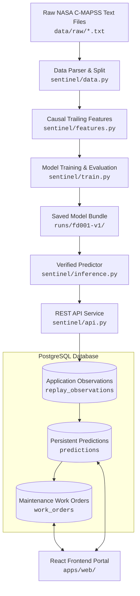

# Meridian Sentinel — Code Map & Architecture Navigation

This document is a beginner-friendly index of the Meridian Sentinel repository. It maps every major component to its working implementation files, data assets, and execution commands.

---

## 1. End-to-End Data & Model Flow

The diagram below represents the exact implemented path for ML training, inference, and operational workflows:

---

## 2. Quick Location Guide (Where Does It Live?)

| Task / Domain | Canonical Location | Key Files & Responsibilities |
|---|---|---|
| **Raw Datasets** | [`data/raw/`](file:///H:/HarixAI/Projects/Meridian_Sentinel/Meridian_Sentinel_Full_Architecture/data/raw/) | NASA C-MAPSS text files (`train_FD001.txt`, `test_FD001.txt`, `RUL_FD001.txt`). Gitignored. |
| **Data Download & Parsing** | [`sentinel/download.py`](file:///H:/HarixAI/Projects/Meridian_Sentinel/Meridian_Sentinel_Full_Architecture/sentinel/download.py) [`sentinel/data.py`](file:///H:/HarixAI/Projects/Meridian_Sentinel/Meridian_Sentinel_Full_Architecture/sentinel/data.py) | Downloads official NASA archives; validates schema, column types, engine IDs, and operational cycles. |
| **Feature Engineering** | [`sentinel/features.py`](file:///H:/HarixAI/Projects/Meridian_Sentinel/Meridian_Sentinel_Full_Architecture/sentinel/features.py) | Extracts causal trailing summary statistics ($W=30$ window, 96 features). Fits scaler on training engines only; zero data leakage. |
| **Model Training & Evaluation** | [`sentinel/train.py`](file:///H:/HarixAI/Projects/Meridian_Sentinel/Meridian_Sentinel_Full_Architecture/sentinel/train.py) | Trains baseline/Ridge/XGBoost models; validates on held-out engines; outputs `bundle.json`, `model.json`, and `report.json`. |
| **Saved Trained Artifacts** | [`runs/fd001-v1/`](file:///H:/HarixAI/Projects/Meridian_Sentinel/Meridian_Sentinel_Full_Architecture/runs/fd001-v1/) | Active model bundle: `bundle.json`, `model.json`, `report.json`, `split.json`. SHA-256 hash verified. |
| **Model Loading & Inference** | [`sentinel/inference.py`](file:///H:/HarixAI/Projects/Meridian_Sentinel/Meridian_Sentinel_Full_Architecture/sentinel/inference.py) | `Predictor` loads verified bundle, validates SHA-256 hashes, checks feature schemas, and runs single-window or batch inference. |
| **Application Observations** | PostgreSQL `replay_observations` | Multi-tenant observation store. Ingestion handled by [`sentinel/ingestion/`](file:///H:/HarixAI/Projects/Meridian_Sentinel/Meridian_Sentinel_Full_Architecture/sentinel/ingestion/). |
| **Persistent Predictions** | [`sentinel/predictions/`](file:///H:/HarixAI/Projects/Meridian_Sentinel/Meridian_Sentinel_Full_Architecture/sentinel/predictions/) | Stores predictions in DB, calculates maintenance priority bands (`urgent`, `high`, `medium`, `low`, `unknown`). |
| **Work Orders & Approvals** | [`sentinel/work_orders/`](file:///H:/HarixAI/Projects/Meridian_Sentinel/Meridian_Sentinel_Full_Architecture/sentinel/work_orders/) | Full maintenance lifecycle, OCC concurrency checks, technician assignment, manager human-approval gates. |
| **Authentication & RBAC** | [`sentinel/auth/`](file:///H:/HarixAI/Projects/Meridian_Sentinel/Meridian_Sentinel_Full_Architecture/sentinel/auth/) | Argon2id password hashing, opaque server-side session tokens, CSRF protection, tenant isolation. |
| **Asset Registry** | [`sentinel/registry/`](file:///H:/HarixAI/Projects/Meridian_Sentinel/Meridian_Sentinel_Full_Architecture/sentinel/registry/) | Organization-scoped machines, physical sensors, channel mappings, and installation histories. |
| **MLOps Foundation** | [`sentinel/mlops/`](file:///H:/HarixAI/Projects/Meridian_Sentinel/Meridian_Sentinel_Full_Architecture/sentinel/mlops/) | Operator CLI (`python -m sentinel.mlops.cli`), feature drift monitoring, latency tracking, offline evaluation against test labels. |
| **Database Migrations** | [`database/migrations/`](file:///H:/HarixAI/Projects/Meridian_Sentinel/Meridian_Sentinel_Full_Architecture/database/migrations/) | Alembic migration revisions (`0001_registry.py` through `0007_mlops.py`). Schema management code. |
| **Frontend Web Portal** | [`apps/web/`](file:///H:/HarixAI/Projects/Meridian_Sentinel/Meridian_Sentinel_Full_Architecture/apps/web/) | React 18 + TypeScript + Vite portal. Fleet overview, sensor telemetry charts, prediction viewer, work order approvals, MLOps dashboard. |
| **Deployment Config** | [`infra/`](file:///H:/HarixAI/Projects/Meridian_Sentinel/Meridian_Sentinel_Full_Architecture/infra/) [`backend/Dockerfile`](file:///H:/HarixAI/Projects/Meridian_Sentinel/Meridian_Sentinel_Full_Architecture/backend/Dockerfile) [`frontend/Dockerfile`](file:///H:/HarixAI/Projects/Meridian_Sentinel/Meridian_Sentinel_Full_Architecture/frontend/Dockerfile) [`docker-compose.yml`](file:///H:/HarixAI/Projects/Meridian_Sentinel/Meridian_Sentinel_Full_Architecture/docker-compose.yml) | Operational Dockerfiles, Nginx TLS gateway, Compose services for backend, frontend, PostgreSQL, and migrations. |
| **Automated Tests** | [`tests/`](file:///H:/HarixAI/Projects/Meridian_Sentinel/Meridian_Sentinel_Full_Architecture/tests/) | Pytest test suite covering unit, pipeline, auth, ingestion, predictions, work orders, MLOps, and deployment. |
| **Utilities & Scripts** | [`scripts/`](file:///H:/HarixAI/Projects/Meridian_Sentinel/Meridian_Sentinel_Full_Architecture/scripts/) | Local startup (`start-local.ps1`), verification (`check-local.ps1`), demo data preparation (`prepare_demo_data.py`), deployment (`deploy.ps1`). |
| **Validation Reports** | [`reports/`](file:///H:/HarixAI/Projects/Meridian_Sentinel/Meridian_Sentinel_Full_Architecture/reports/) | Historical test outputs, smoke test results, phase validation evidence, and comparison reports. |
| **Planned Modules** | [`docs/planned/`](file:///H:/HarixAI/Projects/Meridian_Sentinel/Meridian_Sentinel_Full_Architecture/docs/planned/) | Specifications for planned workers, CMMS/IoT integrations, MCP server, and ML extensions. |
| **Historical Archive** | [`docs/history/`](file:///H:/HarixAI/Projects/Meridian_Sentinel/Meridian_Sentinel_Full_Architecture/docs/history/) | Archived phase handoffs (Phases 5–9), early scaffolding files, and superseded documentation. |

---

## 3. Important Notes on Folder Roles

- **`sentinel/` vs `backend/`**:
  `sentinel/` contains all actual Python backend, data, ML, and API code. `backend/` is strictly an operational Docker build folder containing `backend/Dockerfile` and `backend/entrypoint.sh` for container packaging.
- **`apps/web/` vs `frontend/`**:
  `apps/web/` contains the actual React/TypeScript frontend application code. `frontend/` is an operational Docker build folder containing `frontend/Dockerfile` and `frontend/nginx.conf` to serve production builds.
- **`database/migrations/` vs PostgreSQL**:
  `database/migrations/` contains the Python/SQL Alembic migration scripts. Stored observations, registered assets, user credentials, predictions, and work orders reside in PostgreSQL tables at runtime.
- **`packages/contracts/`**:
  Contains API contracts. `experimental.openapi.json` is verified by test fixtures against the running API; `production-target.openapi.json` is the specification for future production extensions.

---

## 4. Current ML Status & Honest Capabilities

1. **Implemented & Verified**:
   - NASA C-MAPSS downloader and raw parser (`sentinel/download.py`, `sentinel/data.py`).
   - Causal 30-cycle trailing feature engineering (`sentinel/features.py`).
   - Disjoint engine-level train/validation split with zero leakage (`sentinel/data.py`).
   - Baseline, Ridge, and XGBoost training and RUL regression (`sentinel/train.py`).
   - Active FD001 model bundle (`runs/fd001-v1/`) with test MAE = 16.79 cycles, RMSE = 21.61 cycles.
   - SHA-256 hash validation and safe model loading without unvetted pickle execution (`sentinel/mlops/verification.py`).
2. **Offline Experiments**:
   - Four-subset candidate models (`FD001` through `FD004`) evaluated offline (MAE 16.14, 21.87, 22.07, 29.98).
   - Single-row Cap-125 candidate was tested on official test engines, failed the improvement threshold gate (MAE 13.58 vs 12.45 baseline), and was **not promoted** to production.
3. **Not Implemented / Limitations**:
   - **Comprehensive Exploratory Data Analysis (EDA)** is not yet integrated into the core package.
   - **Automated validated feature selection** is not yet implemented (features are domain-defined causal rolling statistics).
   - The active model outputs **discrete RUL in flight cycles**, NOT failure probabilities.
   - Uncertainty intervals from offline studies are **not available** in the active serving API.
   - Predictions **never** auto-approve maintenance or shut down machines.
