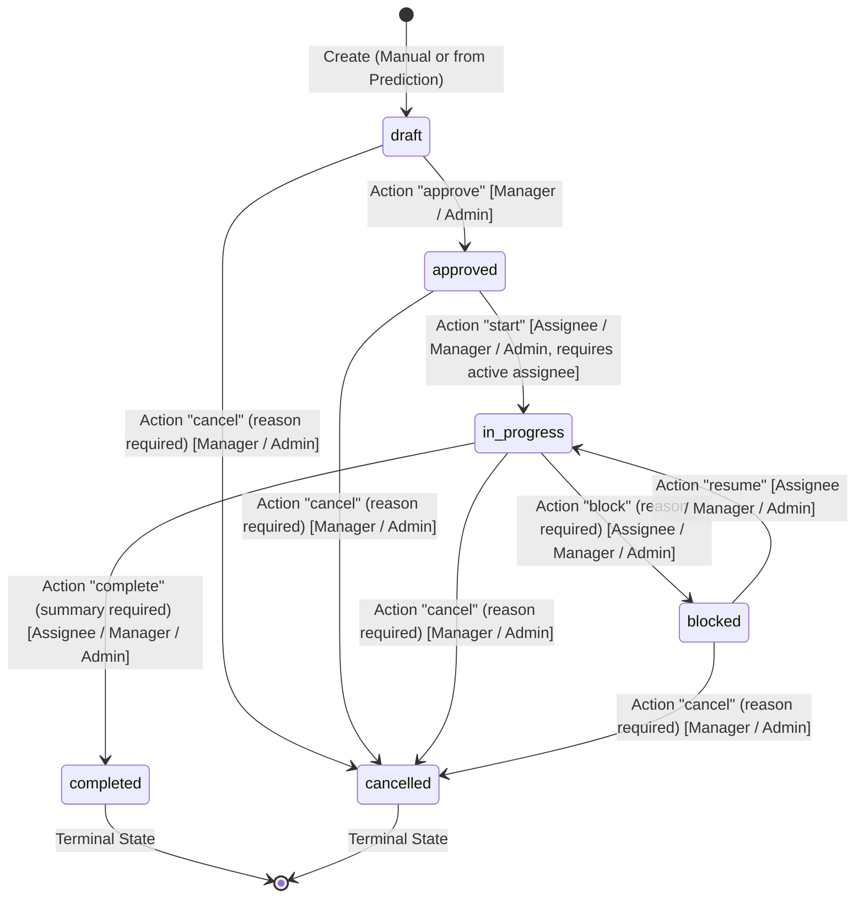

# Meridian Sentinel — Maintenance Workflow & Approval Specification

Version: 1.0 · Updated: 2026-10-26 · Status: Phase 7 Implemented Specification

---

## 1. Overview & Core Human-in-the-Loop Principles

Meridian Sentinel Phase 7 implements maintenance work order management and a human approval workflow. 
The system enforces strict human oversight over all maintenance operations:

1. **Human Decisions Only**: Model predictions **never** automatically approve maintenance, diagnose failed components, or trigger equipment shutdown.
2. **Immutable Prediction Snapshots**: When a work order draft is created from an ML prediction, the model's estimate ($RUL$, cutoff cycle, digest, and priority band) is captured immutably. Later predictions or observations never overwrite or mutate this snapshot.
3. **No Metric or Date Fabrication**: Remaining Useful Life ($RUL$) is strictly measured in **operating cycles**. The system never converts cycles into calendar due dates or fabricates failure probabilities, component defects, or repair instructions.
4. **Tenant Isolation**: Every work order, transition, assignment, and note is scoped to an authenticated organization (`tenant_id`). Cross-tenant access is rejected with HTTP 404.
5. **Post-Maintenance Semantics**: Recording a work order as `completed` records that a human technician finished an inspection or procedure. It does **not** prove the machine is healthy, reset its operating cycles, or alter historical sensor observations.

---

## 2. State Machine & Lifecycle

The work order entity follows a strict, finite state machine enforced by the `WorkOrderService.perform_transition` transaction.

### 2.1 State Diagram



### 2.2 Allowed Transitions & Guards

| From Status | To Status | Action | Required Role | Preconditions & Validation Rules |
| :--- | :--- | :--- | :--- | :--- |
| `draft` | `approved` | `approve` | `plant_manager`, `admin` | Work order must be in `draft` status with current evidence; stale evidence returns409. |
| `draft` | `cancelled` | `cancel` | `plant_manager`, `admin` | `reason` is mandatory. |
| `approved` | `in_progress` | `start` | `technician` (if assigned), `plant_manager`, `admin` | **Requires assigned technician** (`assigned_technician_id != null`) who is an active user and active member of the organization. |
| `approved` | `cancelled` | `cancel` | `plant_manager`, `admin` | `reason` is mandatory. |
| `in_progress` | `blocked` | `block` | `technician` (if assigned), `plant_manager`, `admin` | `reason` is mandatory. Sets `block_reason` and `blocked_at`. |
| `in_progress` | `completed` | `complete` | `technician` (if assigned), `plant_manager`, `admin` | `summary` is mandatory. Sets `completion_summary` and `completed_at`. Terminal. |
| `in_progress` | `cancelled` | `cancel` | `plant_manager`, `admin` | `reason` is mandatory. Sets `cancellation_reason` and `cancelled_at`. Terminal. |
| `blocked` | `in_progress` | `resume` | `technician` (if assigned), `plant_manager`, `admin` | Clears `block_reason`. |
| `blocked` | `cancelled` | `cancel` | `plant_manager`, `admin` | `reason` is mandatory. Sets `cancellation_reason` and `cancelled_at`. Terminal. |

*Notes:*
- **Terminal States**: `completed` and `cancelled` cannot be transitioned to any other state. Reopening is forbidden in Phase 7.
- **Generic PATCH Prohibition**: Status changes can **only** be performed via `POST /api/v1/work-orders/{id}/transitions`. Generic `PATCH /api/v1/work-orders/{id}` only allows editing `title`, `description`, `priority`, `planned_date`, and `due_date`.

---

## 3. Role-Based Access Control (RBAC) Matrix

Permissions are tenant-scoped and evaluated via `sentinel.auth.context` and `sentinel.auth.permissions`.

| Permission | Viewer | Technician | Plant Manager | Organization Admin | Rules & Scope Restrictions |
| :--- | :---: | :---: | :---: | :---: | :--- |
| `work_orders.read` | Yes | Yes | Yes | Yes | Can view list, details, and history of work orders in the tenant. |
| `work_orders.create` | No | Yes | Yes | Yes | Can create manual drafts or prediction-linked drafts. |
| `work_orders.approve` | No | No | Yes | Yes | Can approve draft work orders. Technicians cannot approve. |
| `work_orders.assign` | No | No | Yes | Yes | Can assign or reassign work orders to active organization technicians. |
| `work_orders.update` | No | No | Yes | Yes | Can update editable metadata (`title`, `description`, `priority`, `due_date`). |
| `work_orders.cancel` | No | No | Yes | Yes | Can cancel work orders in any non-terminal state with a documented reason. |
| `work_orders.notes` | No | Assigned only | Yes | Yes | Can append plain-text notes. Technicians can only add notes to work orders assigned to them. |
| `work_orders.execute` | No | Assigned only | Manager override | Admin override | Can start, block, resume, and complete work orders. Technicians can only execute work orders assigned to them. |

### Assignee Invariants
- Assignees must be active users in the PostgreSQL `users` table (`is_active = true`).
- Assignees must have active membership in the same tenant (`memberships.tenant_id = :tenant_id`).
- Assignees must hold the `technician` role in that tenant.
- If a technician is removed or deactivated, they immediately lose execution and note access. A plant manager or admin can reassign open work orders to another qualified technician.

---

## 4. Draft Generation & Deterministic Templates

Work order drafts can be created via two pathways:
1. **Prediction-Linked Drafts** (`POST /api/v1/predictions/{id}/work-order-draft`):
   - Re-verifies prediction eligibility under Phase 6 rules: prediction must be in `available` status and belong to the tenant.
   - Captures an immutable snapshot in `work_orders`:
     - `prediction_id`, `model_version`, `model_digest`, `bundle_digest`
     - `stream_id`, `cutoff_cycle`, `rul_cycles`
     - `prediction_status`, `release_status` (`experiment_only`)
     - `policy_version`, `snapshot_priority_band`
   - Generated title: `Maintenance review for {asset_code} (Cycle {cutoff_cycle})`.
   - Generated description uses deterministic wording (no LLM, no hallucinated failure modes):
     > *"Review the engine's sensor trends and maintenance records. The experimental model estimates remaining life in operating cycles. A qualified person must determine inspection and maintenance actions."*
2. **Manual Drafts** (`POST /api/v1/work-orders`):
   - Created for any registered machine in the tenant.
   - `origin = 'manual'`, evidence fields remain `null`.
   - Requires user-provided `title` and `description`.

### Outdated Evidence Tracking
When a prediction-linked work order is retrieved (`GET /api/v1/work-orders/{id}`), the API queries the current maximum observation cycle for the machine's stream. If $C_{\text{max\_obs}} > C_{\text{cutoff}}$, the API flags `is_evidence_outdated: true` while preserving the original prediction snapshot unmodified.

---

## 5. Deduplication & Idempotency

### 5.1 Machine-Level Active Work Order Deduplication
To prevent duplicate maintenance work orders against the same machine:
- Database partial unique index:
  ```sql
  CREATE UNIQUE INDEX uq_active_prediction_wo_per_machine 
  ON work_orders (tenant_id, machine_id) 
  WHERE origin = 'prediction' AND status NOT IN ('completed', 'cancelled');
  ```
- If an active prediction-generated work order already exists for the machine:
  - The API does not create a duplicate work order.
  - The API does not overwrite the existing record.
  - The API returns HTTP 200 with the existing active work order, flagging `"already_active": true`.

### 5.2 Scoped Idempotency Keys
The client may provide an `Idempotency-Key` header with draft creation:
- Stored in `work_order_idempotency` table: `(tenant_id, key, request_path, request_hash, work_order_id, created_at)`.
- If a request arrives with the same key and identical payload, the existing work order is returned with `"idempotency_replayed": true`.
- If a request arrives with the same key but a modified payload, the API raises `HTTP 409 Conflict (idempotency_conflict)`.

---

## 6. Concurrency & Audit Integrity

### 6.1 Optimistic Concurrency Control (OCC)
- Every work order has a `version: integer` column starting at `1`.
- Any mutation (`PATCH`, `/assignment`, `/transitions`, `/notes`) requires `version: integer` in the request body.
- If `version != current_version`, the API rejects the request with `HTTP 409 Conflict (version_conflict)`.
- Each successful mutation increments `version` by 1.

### 6.2 Append-Only Audit & History
- **Transitions Table** (`work_order_transitions`): Records `from_status`, `to_status`, `action`, `reason`, `actor_id`, and `created_at`.
- **Assignments Table** (`work_order_assignments`): Records `assigned_technician_id`, `actor_id`, and `created_at`.
- **Notes Table** (`work_order_notes`): Append-only plain text notes. Maximum 2,000 characters. HTML tags are rejected; no arbitrary script execution.
- **Audit Table** (`auth_audit_events`): Records actions (`work_order_created`, `work_order_approved`, `work_order_assigned`, `work_order_transitioned`, `work_order_updated`, `work_order_note_added`) with actor, tenant, target ID, and request ID.

---

## 7. API Reference

All routes require active session cookies (`meridian_session`) and CSRF tokens (`X-CSRF-Token`).

| Method | Endpoint | Description | Permitted Roles |
| :--- | :--- | :--- | :--- |
| `POST` | `/api/v1/work-orders` | Create manual work order draft | `plant_manager`, `technician`, `admin` |
| `POST` | `/api/v1/predictions/{id}/work-order-draft` | Create prediction-linked draft | `plant_manager`, `technician`, `admin` |
| `GET` | `/api/v1/work-orders` | List work orders with pagination/filters | `viewer`, `technician`, `plant_manager`, `admin` |
| `GET` | `/api/v1/work-orders/{id}` | Get work order detail with evidence | `viewer`, `technician`, `plant_manager`, `admin` |
| `PATCH` | `/api/v1/work-orders/{id}` | Update editable fields (title, dates, priority) | `plant_manager`, `admin` |
| `POST` | `/api/v1/work-orders/{id}/assignment` | Assign technician | `plant_manager`, `admin` |
| `POST` | `/api/v1/work-orders/{id}/transitions` | Perform lifecycle state transition | Role-specific per transition table |
| `POST` | `/api/v1/work-orders/{id}/notes` | Append plain-text work order note | `technician` (assigned), `manager`, `admin` |
| `GET` | `/api/v1/work-orders/{id}/history` | Get full timeline (transitions, notes, assign) | `viewer`, `technician`, `plant_manager`, `admin` |

## Corrected execution, approval, filter and note contracts

Execution (`start`, `block`, `resume`, `complete`) checks current membership on every
request. A technician must still hold `work_orders.execute` and be the assigned user.
A former technician who now has only viewer access receives403, even if their UUID
remains assigned. Disabled users receive401; removed/inactive memberships receive404.
Managers/admins may execute on behalf of the eligible assignee, but every execution
action requires the assigned technician to remain active and eligible. Otherwise409
`assignee_ineligible` requires explicit reassignment. Missing assignment returns400.
Assignment history remains intact; none of these operations grants platform access.

**Approval policy: require a refreshed draft, not implicit acknowledgement.** A draft
is outdated if observations exceed its snapshot cutoff or its prediction is no longer
the latest stored prediction for that machine (cutoff, created_at, id descending).
Approval checks this transactionally under the same tenant mutation lock used by
API ingestion and prediction requests. It returns409 `outdated_evidence` without
changing state, version, history or evidence. A manager cancels the old draft with a
reason, requests/selects a current available prediction, creates a new draft and reviews
it. New observations do not automatically cancel an already approved work order;
its original evidence and current outdated flag remain visible for human review.

Both work-order list route variants accept these optional inclusive filters:

- `created_from`, `created_to`: timezone-aware ISO8601 timestamps, e.g.
  `2026-10-26T00:00:00Z`. Naive timestamps are rejected.
- `due_from`, `due_to`: ISO dates, e.g. `2026-10-31`. Orders with no due date are
  excluded when a due-date bound is supplied.

Reversed ranges return422 `invalid_date_range`. Filters combine with machine/status/
priority/technician filters and apply to both total count and the bounded page.
Stable sorting remains created_at descending, then UUID descending.
Example: `GET /api/v1/work-orders?created_from=2026-10-26T00:00:00Z&due_to=2026-12-31&limit=25`.
Use an explicit authorized tenant_id query for multi-organization users, or the
`/api/v1/organizations/{tenant_id}/work-orders` route.

Notes now require the expected version:

```json
{"version":6,"note_text":"Replay exercise: human review recorded; no physical repair claimed."}
```

Success returns `note`, `work_order_version:7`, and request_id. Use that returned
version for the next mutation; stale versions return409 `version_conflict`, and a
missing version returns422. Note append, version increment and audit commit together;
a failed write leaves all three unchanged. Concurrent note/edit/completion requests
using the same version cannot both commit. Notes remain append-only; an authorized
note can be appended to a terminal order, incrementing version without reopening it
or changing its completion/cancellation evidence. This is an API contract change:
older callers must supply version and consume work_order_version.
