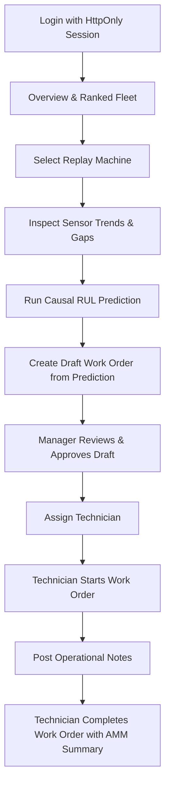

# Meridian Sentinel — Portal User Guide (Phase 8)

## 1. Safety and Replay Status

> [!WARNING]
> **NASA C-MAPSS Replay — Experimental Model**
>
> Meridian Sentinel is an experimental causal inference and predictive maintenance demonstration built on NASA C-MAPSS simulated turbofan degradation datasets. It is **not** an airworthiness certified aircraft system. Human review and explicit engineering sign-off are strictly required for all maintenance decisions. Predictions never auto-approve work orders, and completing a work order never certifies physical machine health.

---

## 2. Access and Role Matrix

| User Role | Registry Access | Causal Inference | Draft Work Orders | Approve Work Orders | Execute Work Orders | Member Management |
| :--- | :---: | :---: | :---: | :---: | :---: | :---: |
| **`admin`** | Create, Edit, Archive | Yes | Yes | Yes | Yes | Full Access |
| **`plant_manager`** | Create, Edit, Archive | Yes | Yes | Yes | Yes | View Only |
| **`technician`** | View Only | Yes | Yes | No | Start, Block, Resume, Complete | No |
| **`viewer`** | View Only | No | No | No | No | No |

---

## 3. End-to-End User Workflows

### 3.1 Overview and Ranked Fleet
- **Maintenance Priority**: Machines are sorted by priority bands (`urgent`, `high`, `medium`, `low`, `unknown`).
- **Estimated Remaining Life**: Displayed strictly with the unit **"cycles"** (discrete flight cycles).
- **Outdated Status**: When newer telemetry cycles have been ingested after a prediction cutoff, an **"Evidence Outdated"** badge is displayed.

### 3.2 Machine Details and Sensor Trends
- **Telemetry Gaps**: Sensor line charts preserve telemetry gaps. Broken lines indicate missing cycles; data points are never linearly connected across gap boundaries.
- **Unit Separation**: Unlike channels are normalized on the SVG display to avoid mixing unlike units on a single axis. Hovering points reveals exact unnormalized stored values.
- **Numeric Table**: Click **"View Numeric Table"** to inspect cycle-by-cycle tabular readings.

### 3.3 Running Causal Predictions
- Authorized users (`admin`, `plant_manager`, `technician`) click **"Run Causal Prediction"**.
- Inference requires a minimum of 30 contiguous cycles.
- Metrics not modeled in the FD001 causal bundle (such as failure probability or subsystem diagnosis) are displayed honestly as **"Unavailable"** and never as fabricated zeroes.

### 3.4 Work Order Workflow & Optimistic Concurrency Control (OCC)
- **Drafting**: Create manual draft work orders or create drafts directly linked to immutable prediction evidence snapshots.
- **Approval Gate**: Managers review the draft. If the prediction evidence has become outdated, approval is transactionally rejected with `409 outdated_evidence`. Outdated drafts must be cancelled and re-drafted from the latest prediction.
- **Assignment**: Managers assign qualified technicians to approved work orders.
- **Execution Transitions**: Assigned technicians transition orders:
  - `start`: Work order moves to `in_progress`.
  - `block`: Requires documenting a block reason (e.g., waiting for AMM tooling or replacement part).
  - `resume`: Re-activates a blocked order.
  - `complete`: Terminal transition requiring a mandatory completion summary detailing inspection findings per AMM 72-00.
- **Concurrency Conflicts**: Every action checks the record's version (`v1`, `v2`, ...). If another operator modified the order concurrently, the UI notifies the user and refreshes state without silent overwriting.
