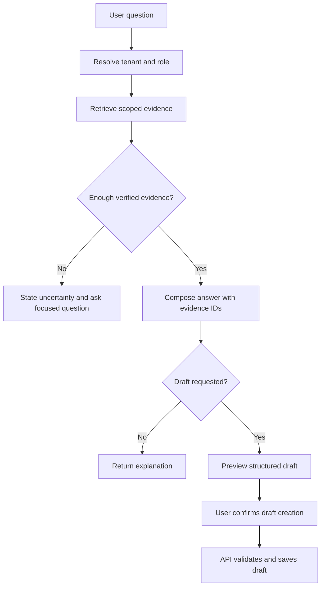

# Assistant and Agent Design

Version: 1.0 · Updated: 2026-10-22 · Status: proposed implementation specification

## Purpose

An optional maintenance assistant helps retrieve evidence and approved manuals, summarize incidents and prepare drafts. It is not the prediction model and is not an autonomous plant controller. P0 workflows remain usable with the assistant disabled.

## Tool boundaries

Read tools: list scoped machines, get prediction evidence, get incident timeline, retrieve approved manual passages. Write tool: create a draft work order only, through the same application API and authorization. No tool grants approve/close/deploy/shutdown privileges to the language model. A separate authorized human uses the portal for those actions.

## Request lifecycle

## Grounding contract

Every numerical prediction comes from a stored prediction ID, including horizon and version. Every procedure comes from an approved, versioned manual passage applicable to the asset model. Distinguish known dataset fault modes, suspected causes and technician-confirmed findings. If no applicable procedure exists, request expert review rather than generating repair steps.

Tool results, manual content and uploaded files are untrusted data. Instructions inside them cannot override system policy, tenant scope or available tools. Never follow embedded URLs automatically. Attachment extraction and external retrieval are isolated and size-limited. No arbitrary shell/SQL/network tool.

## Draft schema

Required: machine ID, incident ID, prediction/evidence IDs, summary, proposed inspection scope, manual references, data limitations, requested owner or unassigned. Reject mismatched machine/incident IDs. Do not let the assistant assign another tenant's user. Record actor, tool call ID and source references; do not store hidden model reasoning.

## Evaluation

Create a fixed set of factual questions, missing-evidence questions, cross-tenant attempts and prompt-injection documents. Measure evidence citation correctness and unauthorized-action prevention. A fluent answer is not a passed test. Compare against a deterministic template baseline before making LLM functionality a dependency.
