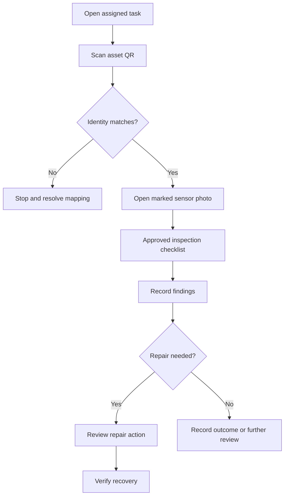

# UX and Interaction Design

Version: 1.0 · Updated: 2026-10-22 · Status: proposed implementation specification

## Information architecture

Primary navigation: Overview, Machines, Incidents, Work Orders, Model Operations, Administration. Planning is P1; assistant is P2. Role permissions hide irrelevant actions but all authorization is enforced server-side.

## Screen specification

| Screen | Content | Primary action | Essential alternate states |
|---|---|---|---|
| Fleet | Asset, risk horizon, RUL, freshness, criticality, incident owner | Open evidence | Empty, unknown, offline, filtered, forbidden |
| Asset | Location/QR, photo, model, sensors, status, installation history | Locate / inspect | Mapping unverified, moved, retired |
| Trend | Time/cycle axis, units, load context, quality gaps | Select window | Missing data, stale, invalid unit, insufficient history |
| Evidence | Prediction ID, version, inputs, range, changes and limitations | Draft inspection | Unsupported machine / unreliable result |
| Incident | Timeline, grouped alerts, acknowledged by, assignment | Acknowledge | Escalated, superseded, disputed |
| Work order | Checklist, findings, attachments, repair, verification | State-specific transition | Version conflict, no permission, awaiting parts |
| Model operations | Candidate vs active metrics, scope, artifact hash | Review promotion | Failed gate, missing metrics, rollback available |

## Visual language

Use calm industrial styling: dark navy or accessible light equivalent, clear typography, readable tables. Proposed accent teal, amber for review, red for urgent, gray for unknown. Every status has text and an icon; color alone is insufficient. Avoid fabricated machinery imagery as physical-location evidence. Real installations require verified photos; demo diagrams say illustrative.

Desktop: left navigation, main list and optional detail drawer. Tablet/mobile: stacked views; persistent task identity; large touch controls; no 20-chart grid. Default to 3 meaningful sensor trends, with the rest selectable. Show native sensor units and cycle axes for NASA replay. Plot discontinuities for missing data rather than connecting misleading lines.

## Risk card contract

Display `failure_probability × 100` only when calibrated probability is available. Attach horizon, observed cycle and model version. Unavailable result shows “Unable to assess” and reason. Never display 0% for missing data. Interval must include interval type and nominal coverage; unavailable interval is hidden with a short explanation.

## Technician interaction

## Copy and confirmations

Use “suspected subsystem”, “known dataset fault mode”, “estimated cycles remaining”, “data unavailable”. Approval dialogs show exact machine, action, current version and consequence. Closing an incident requires a reason; recording repair does not imply recovery. Unsaved inspection text survives accidental navigation locally, without caching sensitive manuals unnecessarily.

## Acceptance

Keyboard traversal, screen-reader labels, visible focus, touch targets around 44 px, no horizontal overflow at 390 px for primary tasks, reduced-motion preference and readable errors. Verify chart labels at actual mobile size. See accessibility.md and AC-04/06.
