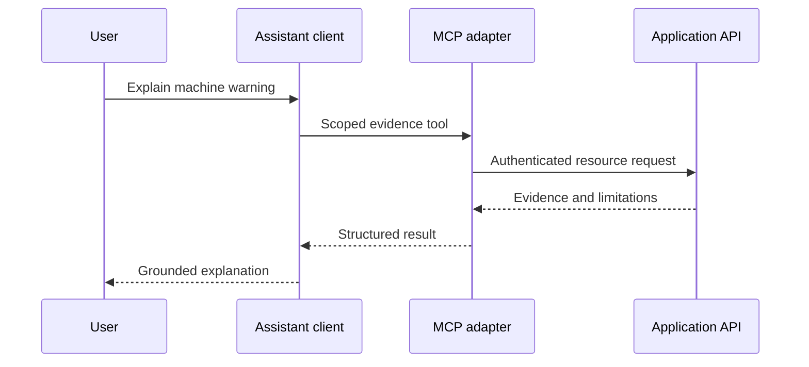

# MCP Connection Design

Version: 1.0 · Updated: 2026-10-22 · Status: proposed implementation specification

## Role in this project

MCP means Model Context Protocol. It exposes controlled application capabilities to an assistant. It is optional and does not carry raw industrial sensor streams or run the core inference pipeline. The application API remains the source of authorization and workflow truth.

Proposed interoperability baseline: review the MCP 2025-06-18 HTTP authorization specification linked in sources.md, then pin an SDK/protocol version supported by the selected client. Do not assume that baseline is the latest specification or that every client supports the same transport.

## Connection options

| Environment | Transport | Credential boundary |
|---|---|---|
| Local development | stdio child process | Credentials supplied through a protected environment; no token logging |
| Hosted assistant integration | Streamable HTTP | Protected resource authentication, scoped tokens, audience validation |

For HTTP, implement the selected specification's discovery and authorization flow, including resource/audience binding, approved redirects and PKCE as applicable. Never pass an upstream token through to an unrelated downstream API. Service-to-service credentials stay server-side; the user's scope must still be enforced per call.

## Proposed tools

| Name | Input | Output | Effect |
|---|---|---|---|
| list_machines | filters, cursor | Scoped asset summaries | Read |
| get_machine_evidence | machine_id, prediction_id | Versioned evidence | Read |
| get_incident_timeline | incident_id | Sanitized timeline | Read |
| search_approved_manuals | machine_id, query | Applicable passages and references | Read |
| create_work_order_draft | incident_id, structured draft, idempotency key | Draft ID | Draft-only mutation |

Tool schemas reject unknown fields, huge queries and cross-resource mismatches. Read-only annotations are hints to clients, not security enforcement. Do not expose deploy_model, execute_sql, approve_repair or shutdown_machine tools.

## Failure and testing

Timeouts return a tool error with retry guidance, not fabricated evidence. Expired auth requires reconnection. Revocation immediately prevents future scoped calls. Test invalid audience, expired tokens, malicious document instructions, oversized output, unauthorized asset IDs and duplicate draft creation. Inspect capability negotiation and tool schema compatibility before enabling a new client.

No live MCP server, credentials or connection are configured by this documentation pack.
