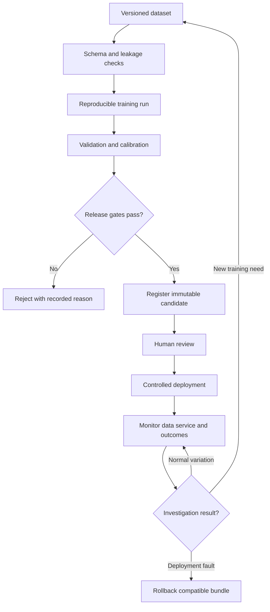

# MLOps Structure and Release Lifecycle

Version: 1.0 · Updated: 2026-10-22 · Status: proposed implementation specification

## Directory contract

`ml/data/manifests` records source/split hashes; `ml/features` contains shared causal transforms; `ml/training` trains candidates; `ml/evaluation` computes frozen metrics and replay alerts; `ml/cards` contains versioned model cards; `infra/pipelines` orchestrates jobs; `services/worker` loads only approved immutable releases. Dataset/model bytes live outside Git in private storage.

## Lifecycle

## Experiment tracking

Record seed, code commit, runtime lock, dataset hash, engine split, features, target policy, horizon, window, parameters and measured results. MLflow is the proposed tracker; actual self-hosted authorization must be configured separately. Registry aliases are convenient pointers, but each deployment resolves and records an immutable version/hash. Never serve an unreviewed moving “latest” alias.

## Proposed gates

Data/schema checks pass; engine leakage test passes; required metrics present and finite; baseline comparison recorded; calibration and interval coverage checked when exposed; false-alert/lead-time budgets approved by domain owner; compatible feature schema; artifact trusted and hash verified; service smoke test passes. Numeric quality budgets must be set on validation/pilot needs before release, not invented to pass a candidate. Missing measurements block release.

## Deployment and rollback

Use shadow mode first when real data is available: log candidate outputs without changing maintenance decisions. Compare against delayed outcomes. Controlled release changes the deployment pointer transactionally and audits approver/deployer. Retain previous complete bundle, not just estimator weights. Rollback if service errors or compatibility regressions exceed declared release limits; investigate before re-promoting.

## Monitoring distinctions

Input drift is a distribution change, not proof of accuracy loss. Data quality tracks missing/stale/invalid sensors. Service health tracks failures/latency. Model quality needs true outcomes and censoring-aware interpretation of preventive repairs. Compare drift within operating regimes. Alert on investigate-worthy changes; do not autonomously retrain on every drift flag or technician comment.

## Retraining triggers

Reviewed new labeled data, changed operating domain with sufficient evidence, confirmed model regression, or a scheduled evaluation review. The trigger creates a candidate pipeline run, never automatic production promotion. A data incident may require fixing sensors rather than training a model.

## Retained artifacts

Training/evaluation logs, input manifests, model card, release approval, prediction lineage and rollback record. Protect manuals and operational data; redact secrets from traces. Reproduction may fail if original data was intentionally deleted—document this honestly.
