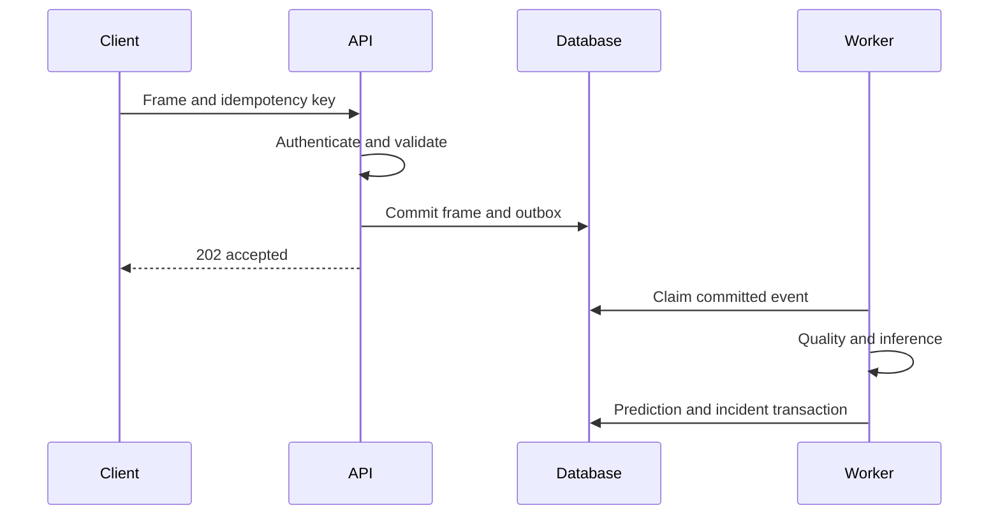

# API Contract and Error Semantics

Version: 1.0 · Updated: 2026-10-22 · Status: proposed implementation specification

## Transport and authentication

Base `/api/v1`; JSON UTF-8; UUID resource IDs; UTC ISO timestamps; maximum default page size 100. Browser session cookie is HttpOnly/Secure/SameSite=Lax; mutating browser requests require CSRF token. Device ingestion uses a scoped credential; it never accepts a browser user's cookie as a gateway identity. See [OpenAPI reference](contracts/openapi.json).

Responses use `request_id`. Collections return `{items,next_cursor}`; cursors are opaque and tenant-bound. Missing or cross-tenant resources return 404. Validation errors never echo secrets or entire uploaded files.

## Endpoints

| Method/path | Purpose | Permission |
|---|---|---|
| GET /machines | Risk/freshness-filtered fleet; unknown separate | viewer+ |
| POST /machines | Register asset | admin |
| GET /machines/{machine_id} | Identity and latest eligible prediction | viewer+ |
| GET /machines/{machine_id}/trends | Sensor window and quality gaps | viewer+ |
| POST /telemetry/frames | Idempotent ingestion | device:ingest |
| GET /machines/{machine_id}/predictions/latest | Current result or unavailable reason | viewer+ |
| GET /incidents | Scoped queue | viewer+ |
| POST /incidents/{incident_id}/acknowledge | Record acknowledgement | technician/manager |
| POST /work-orders | Draft from incident/evidence | technician/manager |
| GET /work-orders/{work_order_id} | Task details | scoped viewer+ |
| POST /work-orders/{work_order_id}/transitions | Controlled lifecycle transition | action-specific |
| POST /model-deployments | Approved immutable version release | ml_engineer + manager review |
| GET /jobs/{job_id} | Async job state | initiating user or authorized operator |

These are the baseline implemented-contract targets. Sensor registry/admin routes, attachment upload and P1 planning routes are to be specified before their feature slice; they are not claimed present in the OpenAPI snapshot.

## Ingestion behavior

Require `Idempotency-Key`, max 1 MiB and 100 readings per frame (initial bounds). Resolve external sensor IDs through verified installations. Validate schema, finite numbers, units, cycle monotonicity policy and provenance. Accept delayed historical data with historical status; do not replace latest live state with an older observation. Duplicate event with identical body returns original receipt; different body gives 409. Return 202 `{frame_id,status:"accepted",request_id}` after durable commit. This means accepted, not prediction completed.

## Prediction response

```json
{
  "prediction_id":"44444444-4444-4444-8444-444444444444",
  "machine_id":"11111111-1111-4111-8111-111111111111",
  "status":"unavailable",
  "reason":"insufficient_history",
  "failure_probability":null,
  "horizon_cycles":30,
  "rul_cycles":null,
  "interval":null,
  "model_version_id":null,
  "data_mode":"replay",
  "request_id":"req-example"
}
```

An available prediction includes its immutable version, observed cycle, input window and assessment timestamp. Return HTTP 200 for a valid resource whose assessment is unavailable; 503 when the service itself cannot answer. Never turn unavailable into numeric zero.

## State transition request

`POST /work-orders/{id}/transitions` body: `{action:"approve",expected_version:3,reason:"Inspection scope reviewed"}`. Use `Idempotency-Key` on mutations. In one transaction: authorize action, check version/current state, validate required fields, transition, append audit event and enqueue notification. A stale version or illegal transition gives 409 with current version; user refetches and reviews before retrying. Reusing an idempotency key with different content is also 409.

## Errors

| HTTP | Code examples | Client behavior |
|---|---|---|
| 400 | bad_cursor | Correct request |
| 401 | authentication_required | Reauthenticate |
| 403 | forbidden, csrf_failed | Show permission issue; no retry loop |
| 404 | not_found | No cross-tenant existence leak |
| 409 | version_conflict, idempotency_conflict, illegal_transition | Refetch/review |
| 413 | payload_too_large | Split upload |
| 422 | invalid_unit, unverified_mapping, invalid_schema | Correct source data |
| 429 | rate_limited | Honor Retry-After |
| 503 | dependency_unavailable | Bounded retry with jitter |

Error envelope: `{error:{code,message,details},request_id}`. `details` is a sanitized object, never a stack trace. Network retries must reuse the original idempotency key.




## Phase 5 implemented extension (2026-10-26)

Current migration is `0004_replay`. `sentinel/ingestion/` implements persistent NASA
replay observations, immutable partition/file-version streams, atomic batches and
bounded history/quality APIs with the existing sessions, CSRF and tenant permissions.
The authoritative new contract is `docs/REPLAY_INGESTION.md`; Phase 6 integration
details are in `docs/PHASE5_HANDOFF.md`. Older phase-specific text above is historical.
Machine source bindings now accept `split: train|test` and optional `file_sha256`
(required for new train registrations). Different trajectory/version requires a new
machine. No prediction persistence or physical-device ingestion was implemented.
