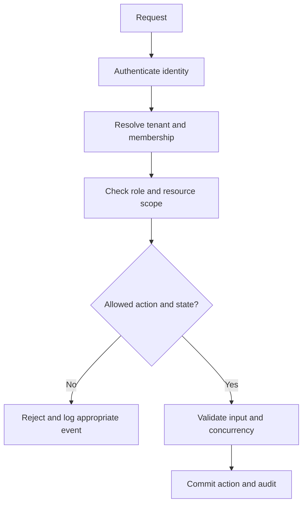

# Authentication and Security

Version: 1.0 · Updated: 2026-10-22 · Status: proposed implementation specification

## Identity design

Use an external OIDC provider and Authorization Code flow with PKCE for browser login, with backend token exchange/session handling. Validate issuer, audience, signature, expiry, state and nonce. Store minimal identity and roles in the application; authorization reads membership, not email domain guesses. Browser receives a secure HttpOnly session cookie and a separate CSRF token for mutations. Set idle/absolute session lifetime, rotate on login/privilege changes and invalidate on logout.

The demo may use a local OIDC provider, but must not ship an authentication bypass reachable in production. No access tokens in localStorage. Privileged actions require reauthentication/MFA through the identity provider where configured.

## Role matrix

| Operation | Viewer | Technician | Manager | ML engineer | Admin | Gateway |
|---|---|---|---|---|---|---|
| Read scoped assets | Yes | Yes | Yes | Yes | Yes | No |
| Register asset/mapping | No | No | No | No | Yes | No |
| Ingest telemetry | No | No | No | No | No | Scoped |
| Acknowledge / draft | No | Yes | Yes | No | No | No |
| Approve and assign | No | No | Yes | No | No | No |
| Record inspection | No | Assigned task | Yes | No | No | No |
| Verify recovery | No | Designated verifier | Yes | No | No | No |
| Submit model candidate | No | No | No | Yes | No | No |
| Approve model release | No | No | Yes | No | No | No |
| Deploy approved bundle | No | No | No | Yes | No | No |
| Manage memberships | No | No | No | No | Yes | No |

Roles are additive only through explicit memberships. Admin does not automatically become a maintenance approver. Production role changes are audited. Enforce assignment and asset scope in addition to the coarse role.

## Threats and controls

| Threat | Control | Negative test |
|---|---|---|
| Cross-tenant object access | Tenant predicates + composite FKs + server-derived scope | Other tenant ID returns 404 |
| Forged device telemetry | Per-device scoped credential, TLS, rotation, rate limit | Wrong gateway cannot submit asset |
| CSRF / session fixation | CSRF token, origin checks, session rotation | Cross-origin mutation rejected |
| Upload abuse | Size/type checks, private storage, malware/extraction isolation | Oversized or executable upload denied |
| Prompt injection | Read-only/draft tool boundary, untrusted-content handling | Manual text cannot approve a task |
| Model artifact execution | Trusted registry, hash verification, isolated loading | Unknown artifact rejected |
| SSRF via connector URL | Admin-reviewed allowlist and egress policy | Local metadata endpoint blocked |
| Secret leakage | Secret manager, redacted logs, no browser credentials | Log scan contains no tokens |

## Security operations

Encrypt transport; apply organization storage encryption and key policy. Avoid public database/tracking/admin ports. Use least-privilege runtime DB roles, separate migration credentials, dependency scanning and reproducible builds. Audit model releases, approvals, connector edits, downloads of sensitive manuals and role changes. Backups require independent access restrictions and restore testing.

Security references are listed in sources.md. This document is a project policy, not a claim of certification or complete production security review.

