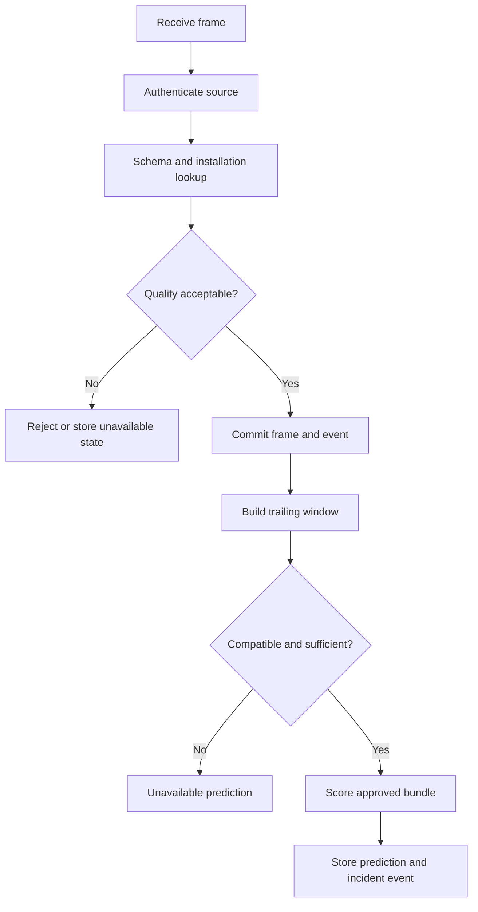

# Dataset and Telemetry Pipelines

Version: 1.0 · Updated: 2026-10-22 · Status: proposed implementation specification

## Offline training pipeline

Download approved source → verify hashes → parse whitespace files → assert expected columns/engine-cycle uniqueness → separate official train/test/RUL labels → create disjoint training engine partitions → compute labels within engine → fit training-only transforms → build trailing windows → train/evaluate → immutable bundle.

C-MAPSS standard rows have 26 fields: engine identifier, cycle, three operating settings and 21 sensor measurements. Confirm with the archive README; some web catalog wording has an inconsistent last-column sensor number. Do not copy that typo into the parser. Sort within each engine; reject duplicate cycles unless explicitly reviewed. Never mix engine trajectories when computing rolling features.

## Online/replay pipeline

## Late data and reprocessing

Backfill writes historical records and may create a new historical prediction version, but cannot send a current urgent alert by default. Reprocessing requires explicit job mode and audit metadata. Do not mutate old predictions in place; preserve the original decision evidence. Record which artifact and policy produced each result.

## Repair and censoring

NASA run-to-failure trajectories do not contain real post-repair interventions. Demonstrated repair recovery is a separate synthetic workflow scenario. In a plant, preventive replacement can prevent observation of the original failure time. Store censored/unknown outcomes; do not assign arbitrary RUL labels or automatically treat unobserved failure as a false positive.
