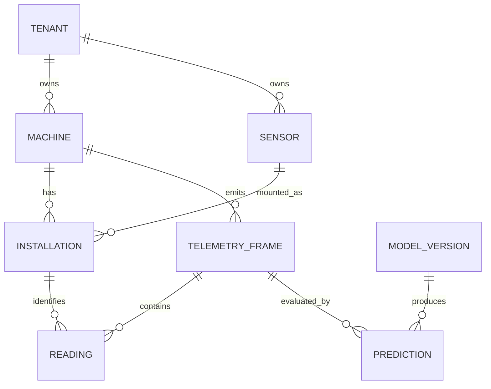
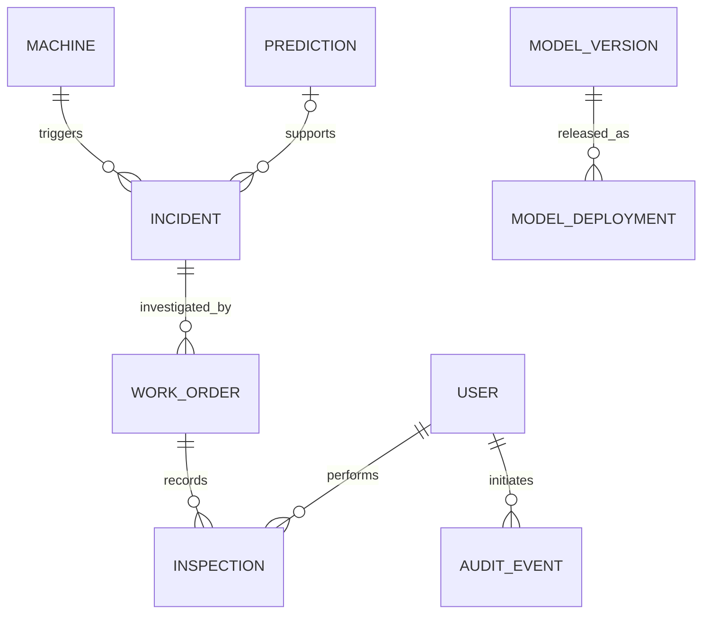

# Database Design and Persistence Contracts

Version: 1.0 · Updated: 2026-10-22 · Status: proposed implementation specification

## Conventions

PostgreSQL; UUID IDs; UTC timestamptz; `tenant_id` on tenant-owned rows; `version` integer on mutable workflow objects. See [reference DDL](database/schema.sql). It is a proposed baseline, not a production migration already executed. Alembic migrations, DB integration tests and reviewed retention policies are required before use.

| Entity | Meaning and important fields |
|---|---|
| tenants, users, memberships | Organizations, OIDC identities, scoped roles |
| sessions | Server-side session hash, user, tenant, expiry; no plaintext tokens |
| machines | Asset code, model type, location, criticality, operating status |
| sensors | Sensor code, kind, canonical unit, retired state |
| installations | Sensor-to-machine/channel mapping with valid time range and verification |
| telemetry_frames | Source event, stream, cycle, event/received time, provenance, quality |
| readings | Installation, raw/canonical values and quality flag |
| model_versions | Immutable artifact hash, schema version, compatible type, registry URI |
| predictions | Frame/window, model, probability/horizon, RUL, interval, unavailable reason |
| incidents | Machine, family, severity, state, owner, evidence prediction |
| work_orders | Incident, draft content, approval, assignment, workflow version |
| inspections | Findings, outcome label, evidence references, verification |
| audit_events | Actor/action/resource/change summary/correlation ID |
| outbox_events, jobs | Reliable async dispatch, attempts, lease and dead letter |
| idempotency_records | Request key, canonical request hash, status, response and expiry |
| model_release_reviews | Human release decisions with artifact/scope and evidence |
| model_deployments | Scope, active immutable model version, approval and deployment record |
| integration_deliveries | External delivery status, attempt and deduplication ID |

## Asset and telemetry relationships

## Workflow relationships

## Critical integrity rules

1. Asset codes unique per tenant. Source event IDs unique per tenant and replay/live stream.
2. A reading references an installation belonging to the same tenant and machine as its frame. Baseline DDL uses tenant FKs; application transaction must additionally validate the machine match and installation validity at event time. Add a tested trigger or stronger composite constraint before live ingestion.
3. Installation time ranges for a sensor must not overlap. Baseline DDL checks end > start; production migration adds a PostgreSQL exclusion constraint after selecting the required extension. An application-only check is insufficient under concurrency.
4. One prediction per frame and model version; one active incident per machine/family, enforced with partial unique index. Worker upserts evidence without reopening dismissed incidents blindly.
5. Workflow update uses `WHERE version = expected_version`; no match means conflict. Approval actor/time cannot be erased by subsequent draft edits; editing approved content requires a new review.
6. `failure_probability` and RUL are nullable for unavailable outputs. Probability range 0–1; lower interval ≤ upper interval. Horizon and status required.
7. Never hard-delete a machine with historical records; retire it. Audit is append-only to application roles. Database operators still require independent access logging.

## Indexing and retention

Use indexes on frames `(tenant_id,machine_id,event_time DESC)`, cycle queries `(tenant_id,machine_id,stream_id,cycle)`, incidents `(tenant_id,status,updated_at)` and work orders `(tenant_id,assigned_to,status)`. Add partitioning only after volume measurement; minute frames with 21 readings differ drastically from raw vibration waveforms.

Proposed defaults: raw telemetry 90 days hot, archived datasets under approved retention, audit one year, sessions until expiry plus short investigation window. Confirm plant policy and storage costs. Immutable training manifests retain hashes even when raw data expires; do not imply deleted data can still be reproduced.

## P1 schema extensions

`parts`, `stock_movements`, `technician_skills`, `shift_slots`, `planning_runs`, `manual_documents`, `document_chunks` become explicit tables when their features are implemented. Do not use unstructured JSON to bypass authorization or relational integrity for these entities.

## Phase 5 implemented extension (2026-10-26)

Current migration is `0004_replay`. `sentinel/ingestion/` implements persistent NASA
replay observations, immutable partition/file-version streams, atomic batches and
bounded history/quality APIs with the existing sessions, CSRF and tenant permissions.
The authoritative new contract is `docs/REPLAY_INGESTION.md`; Phase 6 integration
details are in `docs/PHASE5_HANDOFF.md`. Older phase-specific text above is historical.
Machine source bindings now accept `split: train|test` and optional `file_sha256`
(required for new train registrations). Different trajectory/version requires a new
machine. No prediction persistence or physical-device ingestion was implemented.
