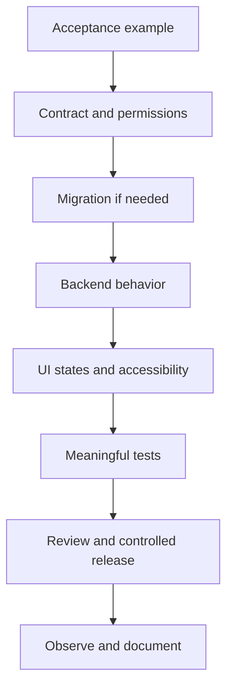

# Feature Development Workflow

Version: 1.0 · Updated: 2026-10-22 · Status: proposed implementation specification

## Required feature brief

Each feature has an FR/AC identifier, user story, input/output schema, permissions, unavailable states, audit requirement, failure behavior and an explicit non-goal. Describe what changes for a user, not only components to build.

## Example: evidence card (FR-10)

User story: a technician needs to inspect why an asset was flagged before preparing an inspection. Inputs: immutable prediction, input quality, model version, sensor trends, incident. Output: readable evidence card and draft CTA. Required states: available, stale, insufficient history, incompatible model, service unavailable. Permission: same tenant and asset visibility. Audit only writes/access to sensitive documents, not every graph hover.

## Development order

Feature branches should keep migrations, contract, implementation and tests together. Use a flag for incomplete P1/P2 features; hiding a button does not authorize its API. Generated API types are outputs, not hand-edited parallel truth. Breaking changes require version strategy and client compatibility review.

## Definition of done

ACs pass, errors are actionable, permission checks include negative tests, events include correlation IDs, user-facing data provenance is clear, monitoring is defined, docs updated. Performance testing is proportionate to changed behavior. No success toast before the durable mutation succeeds.

## Review prompts

Can a stale client overwrite a reviewed work order? Can a different tenant's ID be supplied? Does retry create duplicate work? Can a missing reading become zero? Does a chart mix units? Does an assistant bypass normal validation? Each yes is a defect to address before release.
