# Flowchart and State Diagram Atlas

Version: 1.0 · Updated: 2026-10-22 · Status: proposed implementation specification

Each diagram is also present in its owning document. Open in a Mermaid-capable Markdown viewer. Diagrams describe proposed behavior.

## PRD.md — diagram 1
[Context](PRD.md)

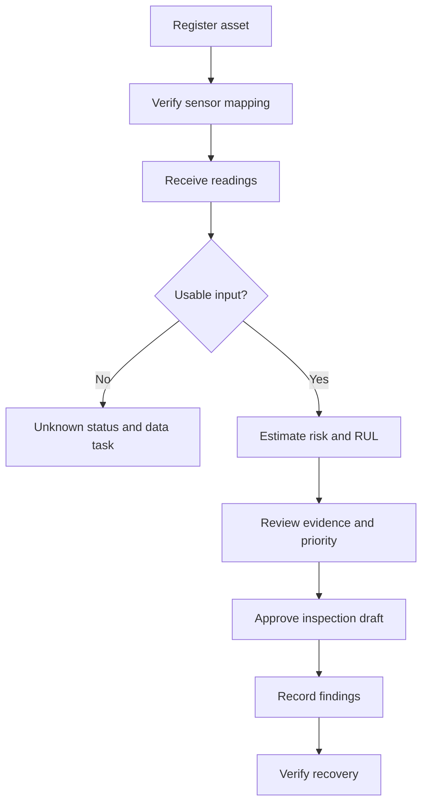

## Design.md — diagram 1
[Context](Design.md)

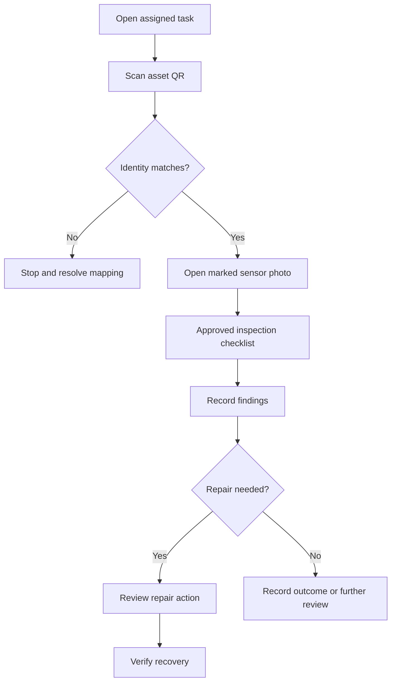

## architecture.md — diagram 1
[Context](architecture.md)

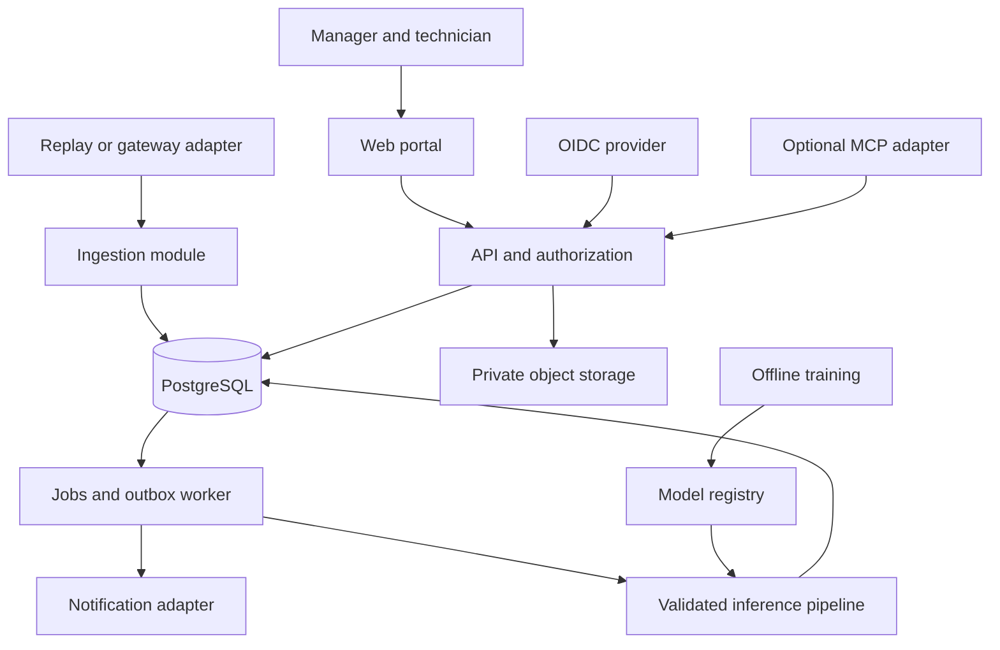

## database.md — diagram 1
[Context](database.md)

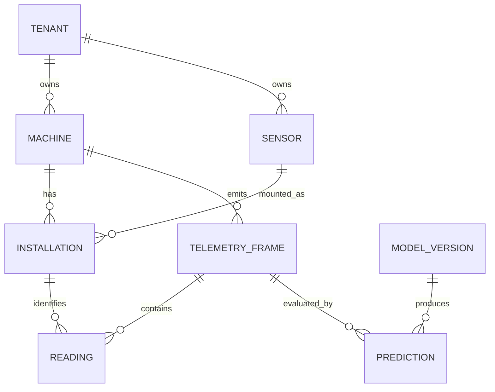

## database.md — diagram 2
[Context](database.md)

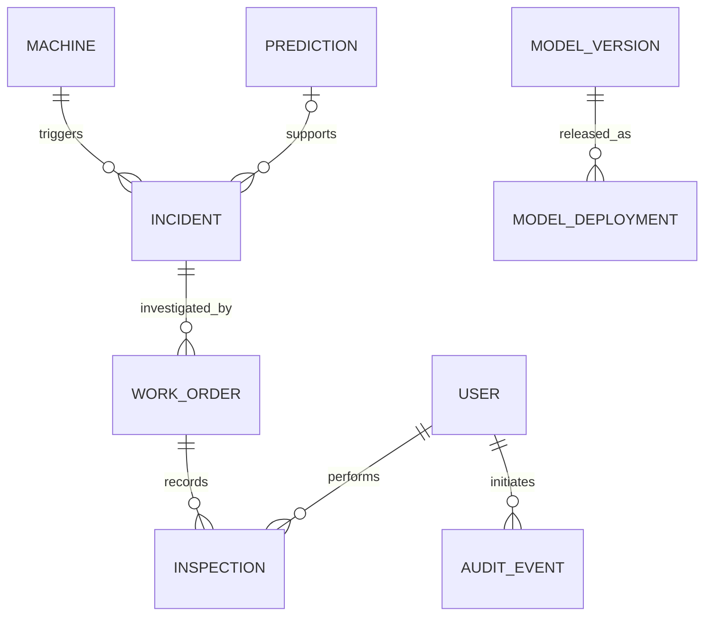

## api.md — diagram 1
[Context](api.md)

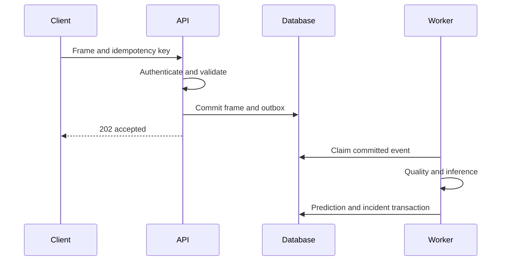

## Agent.md — diagram 1
[Context](Agent.md)

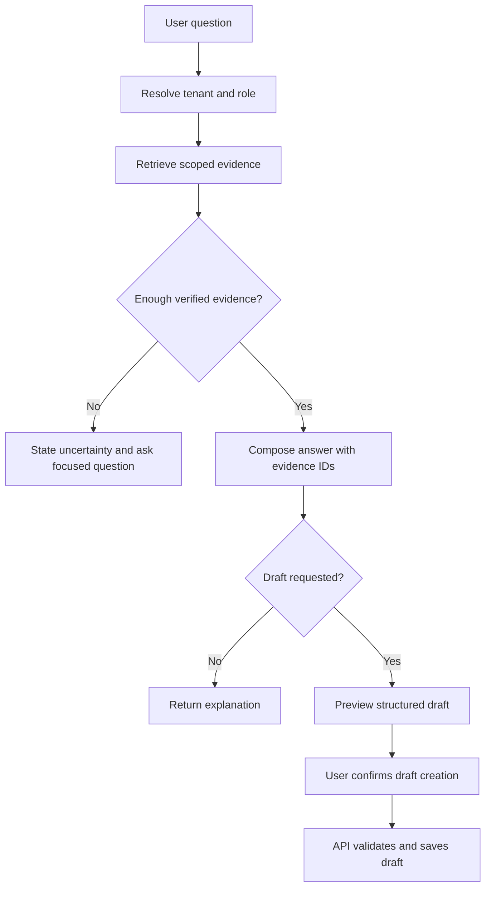

## project_implementation.md — diagram 1
[Context](project_implementation.md)

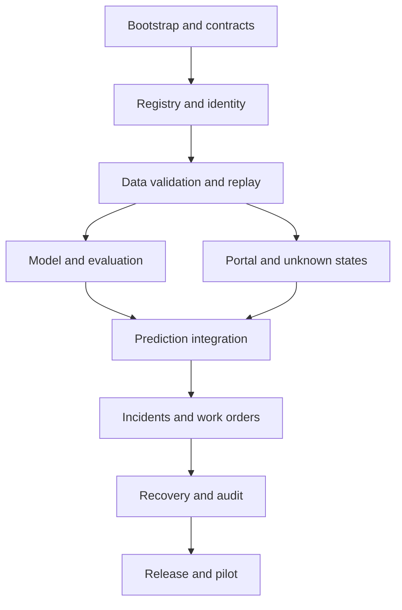

## feature_development.md — diagram 1
[Context](feature_development.md)

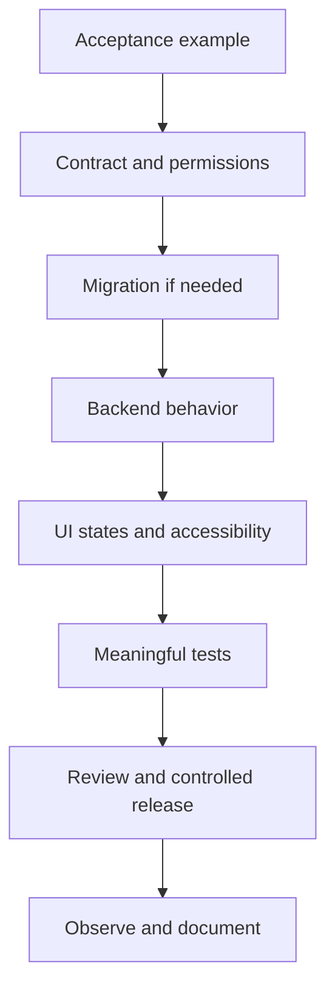

## authentication_security.md — diagram 1
[Context](authentication_security.md)

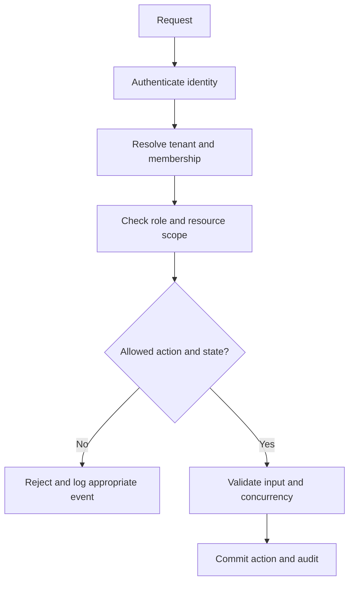

## MCP_connections.md — diagram 1
[Context](MCP_connections.md)

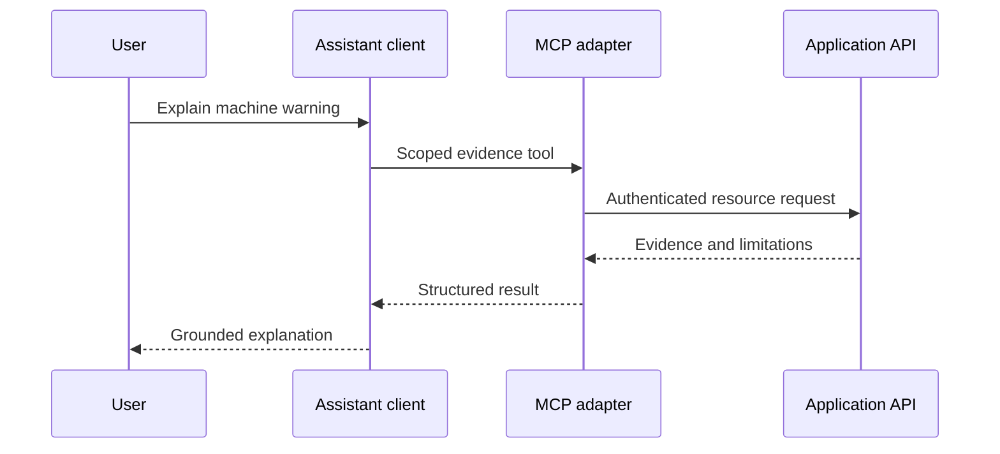

## Models.md — diagram 1
[Context](Models.md)

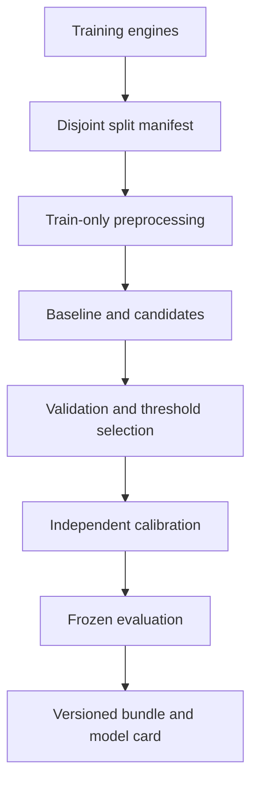

## MLOPS_structure.md — diagram 1
[Context](MLOPS_structure.md)

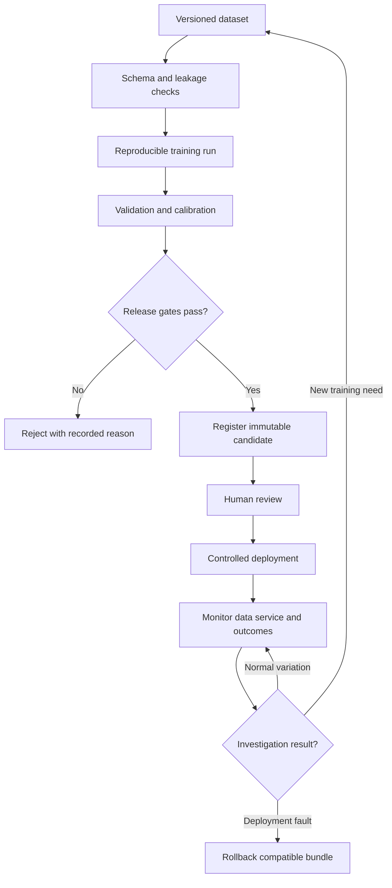

## data_pipeline.md — diagram 1
[Context](data_pipeline.md)

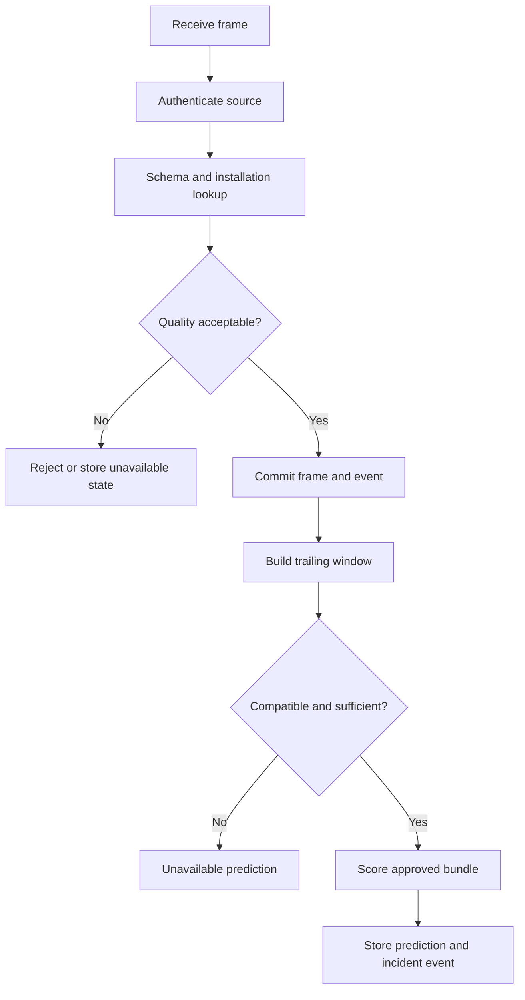

## state_machines.md — diagram 1
[Context](state_machines.md)

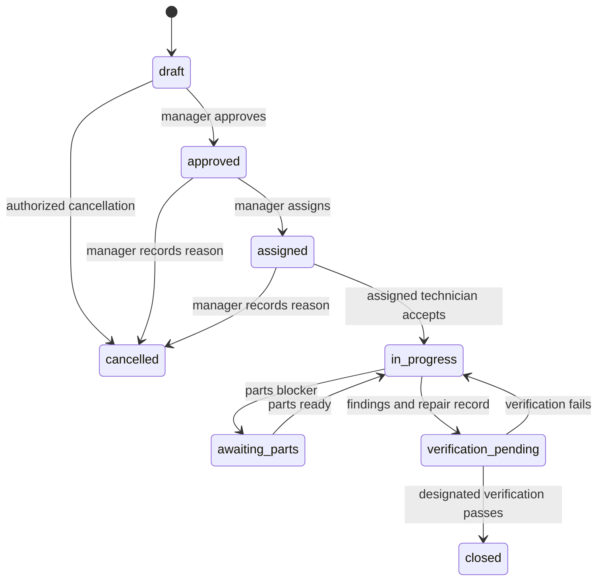
