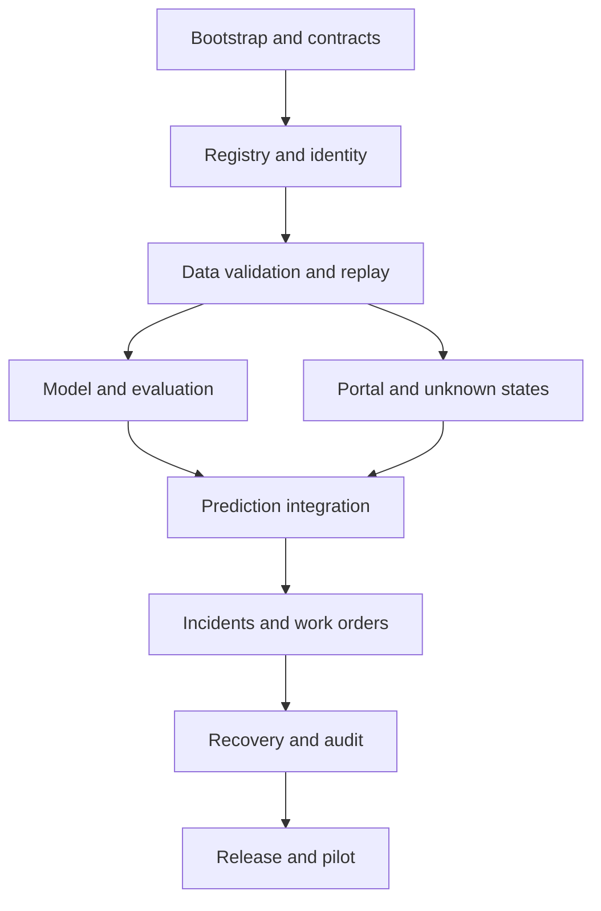

# Project Implementation Plan

Version: 1.0 · Updated: 2026-10-22 · Status: proposed implementation specification

## Repository target

Create `apps/web`, `services/api`, `services/worker`, `ml/training`, `ml/features`, `ml/evaluation`, `infra`, `tests`, and `docs`. These are intended directories, not source code delivered in this pack. Share typed contracts through generated OpenAPI clients; share feature transforms between training and serving as a versioned Python package.

## Dependency-ordered vertical slices

| Slice | Deliverable | Dependencies | Exit evidence |
|---|---|---|---|
| S0 | Repo, locked dependencies, CI, local identity/DB setup | None | Clean clone boots; no committed secrets |
| S1 | Tenant identity, machine and sensor registry | S0 | Cross-tenant isolation and mapping tests |
| S2 | Replay importer and validation gate | S1 | Duplicate/stale/wrong-unit fixtures pass |
| S3 | Baseline model and honest evaluation | S2 parser | Engine split manifest; real measured metrics |
| S4 | Prediction worker, fleet and trend pages | S2/S3 | Replayed engine produces traceable result |
| S5 | Incident and draft work-order journey | S4 | Approval and version-conflict tests |
| S6 | Findings, recovery and audit timeline | S5 | Repair does not bypass verification |
| S7 | Registry, model review/deploy/rollback | S3/S4 | Compatible bundle rollback exercise |
| S8 | Planner, MCP, optional hardware adapters | Stable S1–S7 | Separate feature-specific acceptance |

## Detailed first sprint

Task 1: bootstrap development environment and document exact versions. Task 2: implement identity and tenant middleware. Task 3: migrations and registry endpoints. Task 4: deterministic importer with schema checks. Task 5: ingestion/outbox transaction. Task 6: replay UI with unknown status before sufficient history. Avoid building an elaborate dashboard before the ingestion/identity path works.

## ML parallel work boundary

An ML engineer can work from a frozen parsed dataset contract while UI work uses explicitly labeled fixtures. Replace fixture endpoints with actual inference before claiming model integration. Final test engines are never fed into tuning. Train/test compatibility must include feature ordering, normalization and clipping policy.

## Delivery estimates

A 2–4 week prototype for a small experienced team is a planning hypothesis, not a commitment. Actual scope depends on team capacity and data access. Prioritize S0–S6 for the requested deliverables; S7 basic tracking can start earlier. Hardware integration and validated diagnosis are separate pilot workstreams.

