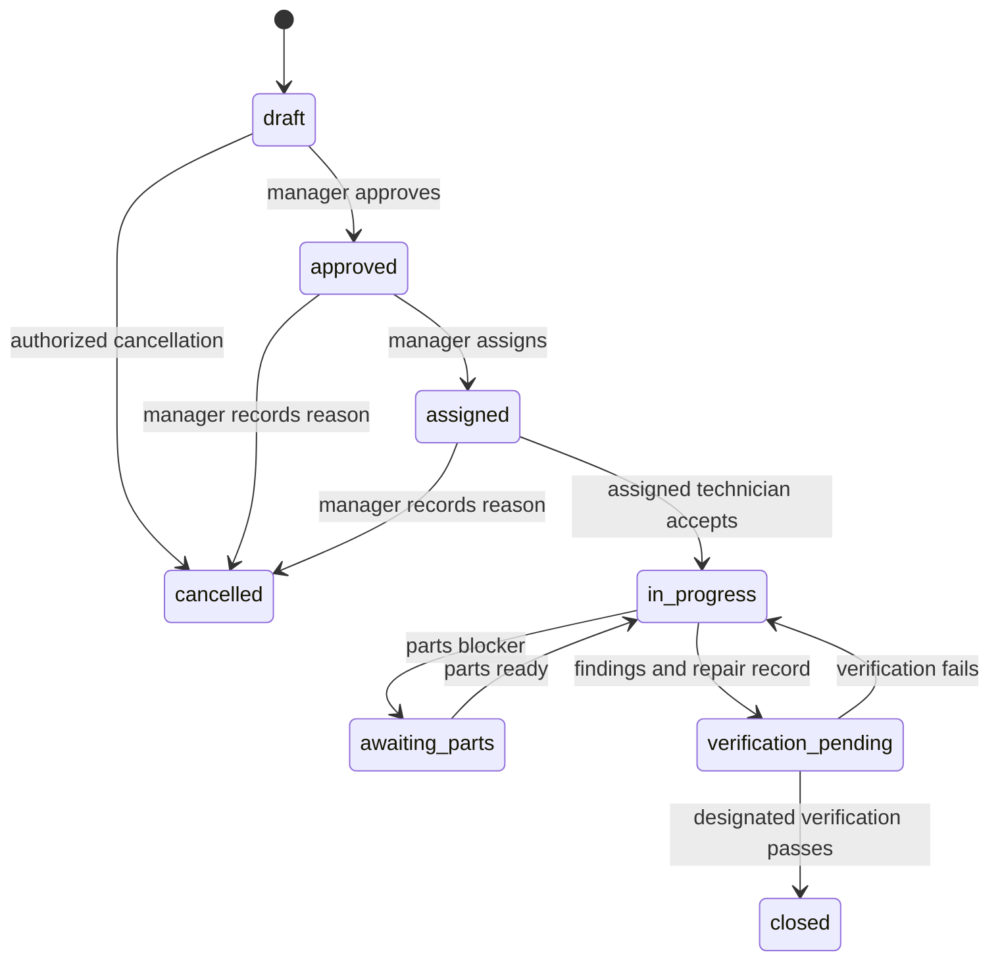

# Operational State Machines

Version: 1.0 · Updated: 2026-10-22 · Status: proposed implementation specification

## Independent states

Machine operating status: running, stopped, maintenance, offline, retired. Data quality: valid, degraded, unavailable. Prediction status: available, unavailable, pending. Never derive one blindly from another: offline telemetry does not prove the physical machine stopped.

## Work-order transitions

Every transition requires expected_version, actor authorization and reason where consequential. `approve` requires reviewed scope; `assign` requires active eligible membership; `complete_inspection` requires outcome and evidence; `verify` requires verifier/check result. Cancellation of in-progress work requires a separate reviewed policy and is not enabled in MVP. Closed tasks are immutable; new evidence creates a follow-up.

## Incident lifecycle

open → acknowledged → investigating → monitoring → resolved. A dismissed state requires an authorized reason and retained evidence. A sensor/data issue may resolve independently of machine repair. Repeated evidence attaches to an active incident of the same family; a new materially different issue can open another. Automatic threshold recovery may suggest monitoring, not silently erase a technician's task.

## Model lifecycle

candidate → evaluated → approved → deployed → retired. Rejection records the failed gate. Rollback changes active deployment to a previously approved compatible bundle; it does not delete the failed candidate or its evaluation history.
