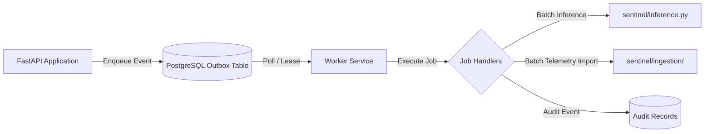

# Planned Services: Background Workers and Async Jobs

This specification describes planned asynchronous background processing services for the Meridian Sentinel architecture.

## Status

**Status: PARTIALLY IMPLEMENTED — durable queue, operator-enqueued drift and bounded fleet scoring**

The FastAPI endpoints remain synchronous. The PostgreSQL outbox and a separate
worker now support operator-enqueued drift evaluation and bounded fleet scoring in `sentinel/jobs/`.
See [operation and recovery](../BACKGROUND_JOBS.md). Asynchronous ingestion,
notifications and periodic scheduling remain planned. Dead letters are retained in
the queue and exposed through the `outbox_dead_letter` view.

---

## Planned Architecture

### 1. PostgreSQL Outbox Consumer
- **Pattern**: Transactional outbox table within PostgreSQL (`outbox_events`).
- **Processing**: Periodic polling with `FOR UPDATE SKIP LOCKED` row-level leasing to support multiple consumer instances without lock contention.
- **Resilience**: Explicit retry policies with exponential backoff and dead-letter queues (`outbox_dead_letter`) after a maximum number of failed attempts.
- **Idempotency**: Source event IDs and idempotency keys to ensure at-most-once state mutations.

### 2. Planned Job Handlers
- **Replay Ingestion**: Asynchronous batch ingestion of high-volume telemetry archives.
- **Batch Fleet Scoring**: Scheduled execution of RUL inference across all active fleet machines at shift boundaries.
- **Model Monitoring & Drift**: Periodic execution of feature drift checks and latency aggregation jobs.
- **Notification Delivery**: Authorized outbound dispatch of maintenance alerts to external channels with delivery deduplication.

### 3. Safety Constraints
- Workers must never bypass tenant isolation; worker context must always include explicit `tenant_id`.
- Workers must never automatically approve maintenance work orders or dispatch technicians autonomously.
