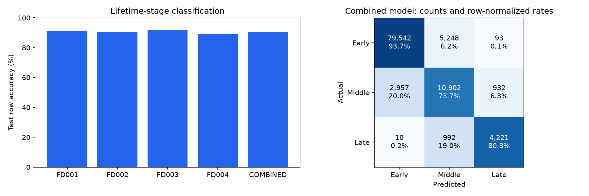

# All-subset training results — 30 October 2026

Completed cleaning/validation, training-engine EDA, causal feature engineering, training-only feature selection, model training, validation selection, and official-test evaluation for FD001–FD004. This is an offline experiment. No existing serving model or raw dataset was changed.

## Data and protocol

All 160,359 training-file observations and 104,897 official-test observations passed strict canonical parsing. No rows required removal or imputation. A 70/15/15 engine split per subset reserves validation and calibration engines. The four source training sets contain 709 engines; test files contain 707 different trajectories. Training features never contain engine identity, ground-truth lifetime or RUL labels. Combined identities retain subset prefixes. Previously inspected benchmarks are not fresh blind tests.

EDA: per-channel quantiles/correlations, constant channels, outlier counts, engine lifetime and class distribution plots. Retain extreme valid measurements. No scaler is required for the chosen tree models.

## Classification

Labels reproduce the supplied notebook: class 0 is <=60% elapsed lifetime, class 1 is >60% through80%, class 2 is >80%. These are early/middle/late lifetime stages, not independently verified health or fault diagnoses.

|Scope|Validation-selected feature set|Test row accuracy|Macro F1|Class1 recall|Class2 recall|
|---|---|---:|---:|---:|---:|
|FD001|raw25|91.41%|0.7936|70.54%|69.60%|
|FD002|raw25|90.20%|0.8087|74.47%|84.86%|
|FD003|engineered_selected|91.84%|0.8415|65.67%|83.68%|
|FD004|raw25|89.33%|0.7997|69.94%|78.90%|
|COMBINED|raw25|90.25%|0.8132|73.71%|80.82%|

Combined model engine-balanced accuracy: **92.72%**, descriptive 95% engine-bootstrap interval **92.11%–93.33%** (2,000 resamples). Row accuracy is **90.2457%**, not a guarantee for an individual engine. Scores are uncalibrated. About 26.29% of class1 observations and 19.18% of class2 observations were classified as another stage.

The user supplied 90.5069% from a different, unweighted full-training CSV recipe. This run uses held-out training engines and engine-balanced fitting. The two figures do not establish an algorithm improvement. Raw25 won four of five classification scopes. Engineered-selected top40 won FD003. Feature selection was performed, but validation rejected it where it did not help.

## RUL regression

XGBoost candidates are separate from the classifiers. Metrics below use final observed test cycles and uncapped true RUL. Each engine contributes once. No short histories were excluded because these candidates support partial startup windows.

|Subset|Selected features|MAE cycles|RMSE cycles|Test engines|
|---|---|---:|---:|---:|
|FD001|raw25|18.21|24.86|100|
|FD002|raw25|20.04|27.55|259|
|FD003|raw25|23.60|33.93|100|
|FD004|engineered_selected|28.76|38.37|248|

These results do not justify replacing the historical model. In particular, FD001 MAE18.21 is worse than the previously reported FD001 bundle MAE16.79, although training protocols differ. Earlier window/regime experiments also used different eligibility and feature rules. No controlled superiority claim is made.

## Tests and commands

Before changes: 18 existing pipeline/experiment tests passed. New pipeline suite: 15 passed. Full backend suite: 159 passed, 125 skipped, 2 warnings in46.57s. PostgreSQL test URL was not configured; database-dependent cases skipped. A pandas fixture warning was then corrected and all15 new tests passed again without warnings in5.80s. The pre-existing Starlette/httpx deprecation remains. No frontend or database code changed.

Tests cover canonical invalid-input rejection, duplicates/gaps, causal history, engine isolation, startup features, label boundaries, official cutoff labels, feature selection, engine-balanced metrics, safe numeric forest reload/tamper rejection, engine splits, missing files and output overwrite rejection. Actual run checked selected forest parity on256 validation observations per scope, XGBoost reload parity, all output hashes and preservation of source/serving-artifact hashes.

```powershell
.venv/Scripts/python.exe -m pytest -q tests/test_pipeline.py tests/test_rul_experiments.py
.venv/Scripts/python.exe -m pytest -q tests/test_all_subsets_training.py
.venv/Scripts/python.exe -m sentinel.all_subsets_training --data-dir data/raw --out runs/all-subsets-20261030-v1
.venv/Scripts/python.exe -m pytest -q
```

Use a new output directory to rerun. Existing directories are rejected. Model binaries and individual test predictions are in ignored `runs/all-subsets-20261030-v1/`. Aggregated results and EDA are in this report folder. RF model export uses numeric NPZ plus checksum-verified JSON, not pickle. App integration has not changed.

## Remaining limitations

- Fixed bounded search, one engine split and a previously inspected benchmark.
- Impurity feature importance can favor continuous features; correlated sensors complicate interpretation.
- RUL ablation reuses classification-selected features, not an independently optimized regression feature selector.
- Operating regime normalization was not fitted; FD002/FD004 remain difficult across multiple conditions.
- No calibrated failure probability, component diagnosis, physical deployment or automatic promotion.
- Near-failure RUL safety gating and a matched baseline comparison remain necessary before any release.

See `docs/ALL_SUBSETS_TRAINING.md` for labels, exact feature semantics and usage.

